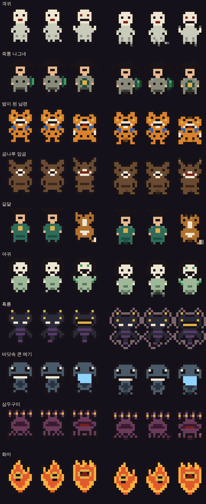
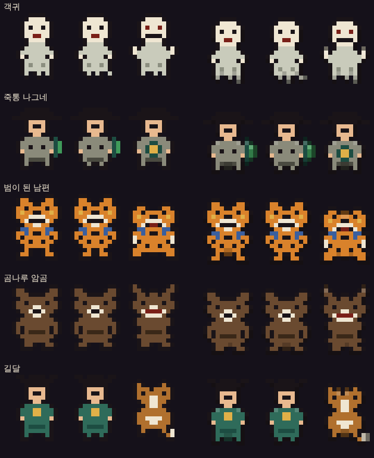

# 조선퇴마록 개발 로그

처음 요청부터 지금까지, 버전마다 **무엇을 요청받았고 · 무엇을 만들었고 · 어떤 문제를 어떻게 찾아 고쳤는지** 기록합니다.
게임은 대화형 AI(Claude)와 함께 만들었고, 사용자가 요청·피드백을 주면 Claude가 구현하고 실제 브라우저와 자동 시뮬레이션으로 확인하는 방식으로 진행했습니다.

- 기간: 2026년 10월 12일 ~ 10월 24일
- 초기 버전(v1~v6.1)의 디버깅 내용은 당시 대화 기록(명령 설명과 보고)을 바탕으로 정리했습니다. 당시 명령의 출력 자체는 남아 있지 않아, 원인을 확인하지 못한 항목은 그렇게 적었습니다.
- 결과물: `index.html` 한 파일 (HTML·CSS·자바스크립트, 외부 라이브러리 없음)
- 플레이: https://fullcharge13.github.io/Joseon-Exorcism-Game/
- 버전 번호는 README의 「개발 과정」과 같습니다. 괄호 안은 Claude 아티팩트 게시 판 번호입니다.

## 한눈에 보기

| 버전 | 날짜 | 주제 | 디버깅 요점 |
|---|---|---|---|
| v1 (판 1) | 10-12 | 첫 플레이 가능 버전, 4직업·4막 | 경험치 곡선이 너무 완만해 가파르게 조정 |
| v2 (판 2) | 10-12 | 3차 전직, 직업 전용 장비, 진화 20종, 보스 패턴·필살기 | 무적·만렙 스트레스 테스트로 모든 기술 발동 확인 |
| v3 | 10-12 | 유사 게임 조사와 보완점 제안 (코드 변경 없음) | — |
| v4 (판 3) | 10-12 | 요괴 58종·10막, 5차 전직, 주막·성황당·점괘·액운·과업 | 레벨 150~190 폭주 → 경험치·보스 체력 조정, 주막 축복 흐름 버그, 달성 불가 과업 |
| v5 (판 4) | 10-12 | 도움말, 난이도 3단계, 도사 전우치 | 패치 기준 문자열이 두 곳과 일치 → 더 구체적으로 |
| v6 (판 5) | 10-13 | 난이도 표시 오류, 펫, 기생 | 캐릭터 미선택으로 버튼이 꺼져 난이도 화면 진입 불가 |
| v6.1 (판 6) | 10-13 | 「시작 화면부터 오류 투성이」 → 디버깅 3회 | 파일을 직접 열면 숨김 규칙이 빠져 14개 화면이 한꺼번에 보임 + 버그 4건 |
| v7 (판 7) | 10-13 | drawImage 오류, 풍백·우사·운사, 성능 설정 | 화면 크기 0 → 그리기 실패 → 게임 루프 정지, 옹기 그림자 예외 |
| v8 (판 8) | 10-13 | 장판·경고 표식 도트화 | 복잡한 한자가 저해상도에서 뭉개짐, 렌더 비용 증가, 아이콘 빠진 장판 |
| v9 (판 9) | 10-16 | 오의 각성·한계 돌파·신내림·갈림길·쌍신 축복 | 패치 이스케이프 실수, 피해 측정 오류, 시뮬레이션 각성 누락, 모바일 줄넘침 |
| — | 10-16 | README 작성, 깃허브 푸시 | 푸시 권한 거부, 커밋 작성자 미인증 |
| v9.1 (판 10) | 10-16~17 | 레벨업 창 오입력 수정, README 아이콘, 플레이 링크 | 이동 키 S = 물리기 단축키 충돌 |
| v9.2 (판 11) | 10-17 | 전체 디버깅, 웹·모바일 최적화 재확인 | 떨어진 아이템 무제한 누적, 가로 화면에서 HUD 버튼이 창을 가림 |
| v9.3 (판 12) | 10-17 | 무기가 캐릭터·체력 막대를 가리는 문제 | 등패가 커지면서 캐릭터를 덮음, 무기 그림이 캐릭터보다 나중에 그려짐 |
| v10 (판 13) | 10-17 | 스팀 상위 10개 분석 → 합공·인장 각인·끝없는 밤·스치기 | 맞은 탄까지 스치기로 셈, 합공 무기 단독 생성 시 오류, 대기 중인 창이 테스트 순서를 흔듦 |
| v11 (판 14) | 10-17 | 2차 묶음: 퇴마 원정·액운 변종·괴이 조사 | README 생성 스크립트 따옴표 오류, 시뮬레이션 동시 실행 중 타이밍 |
| v12 (판 15) | 10-17 | 선비만 시작·과업 해금, 기록관, 담금질·도깨비 샛길·본부·정표·수련 도장·막 의뢰·연격 | 메아리 피해 출처 누락, 보스 처치 뒤 샛길 악용, 시뮬이 옛 코드 사본을 읽음, 연격 단계가 너무 쉬움 |
| v12.1 (판 16) | 10-17 | 깃허브 링크로 열면 모든 퇴마사가 해금된 상태 | 해금 초기화가 저장이 아예 없을 때만 돌아, 예전 판에서 저절로 열린 퇴마사가 남음 |
| v13 (판 17) | 10-17 | 캐릭터 상태창, 전 직업·전직·아이템·기술 전수 디버깅 | 천자문·훈민정음 글자가 떨어지기 전에 사라져 피해 0 (v9부터), 독·넋 피해 출처 누락 |
| v14 (판 18) | 10-18 | 오른쪽 아래 버튼 한글 통일, 새 퇴마사 상인 | 상인 「흥정」이 다른 기술 안에만 있는 함수를 불러 오류 → 수정, README 배너에서 여섯째 인물이 잘림 |
| v15 (판 19) | 10-18 | README 배너·재검수, 과업 40개와 도트 휘장, 과업 달성 알림 | 게임·README에 옛 「상점 엽전」 표현이 남아 있음, 과업 설명의 조사(「상인로」) 어색함 |
| v16 (판 20) | 10-18 | 기기 호환성·설계 검수 → 홈 화면 앱, 레벨링·난이도·보스·펫·무기 재조정, 공용 무기 4종 | 보스 체력을 화력 기준으로 바꾸자 보스전이 100~250초로 늘어남 → 계수·상한으로 조정, 새 무기 방패연이 지나치게 셈 |
| v16.1 | 10-18 | 인장 각인 점검 → 효과 없는 인장 거르기, 「오래」→「날카로움」, 표기·합공 칸 정리 | 합공할 때 인장이 하나 사라지던 오류, 카드 설명이 오른쪽 아래 번호와 겹치고 낱말 중간에서 줄이 바뀜 |
| v16.2 | 10-19 | 유사 게임 조사 → 「내 기술 효과 진하기」 설정, 「다음 목표」 안내 | 출정이 끝날 때 이번 출정 수치가 두 번 더해져 과업이 일찍 이뤄짐, 효과를 따로 그려 얹는 방식이 휴대폰에서 그리기 시간 +75% |
| v16.3 | 10-19 | 전직·펫 선택창이 안 뜨거나 눌러도 전직이 안 되는 오류 | 이동 손가락을 누른 채 탭하면 브라우저가 클릭을 만들지 않음, 2~5차 카드의 80%가 눌리지 않음, 전직 창이 쌓인 레벨업 뒤로 밀리고 오의 각성이 사라짐 |
| v17.0 | 10-19~20 | 설화 출정(이야기 모드) 3편, 본편 결말, 설화록 | 설화 막 요괴를 배경 막 세기로 두어 완주율 0% → 「세기 막」을 따로 둠, 보스 처치 직후 상자를 주우면 다음 창이 덮여 멈춤(본편도) |
| v17.1 | 10-20 | PC 화면 배율에 맞춘 캐릭터·요괴 크기(기본/2배, 2배 정밀 그리기) | 1.5배는 화면 배율이 홀수(흔한 PC)면 도트 칸이 7·8칸으로 섞임 → 단계에서 뺌 |
| v17.2 | 10-21~22 | 다른 AI 수정본(4128f65) 검토 → 입력 보호·이동 조이스틱 되돌림, 오디오 되살리기 오류 처리, 걷기 기울이기·보스 붉은 빛 제거 | 기존 시험은 입력 보호를 「열린 순간」만 봐 0.18초로 줄어도 통과 → 0.3초·0.6초 시험 추가 |
| v17.3 | 10-23 | 휴대폰 멈춤 신고 조사(재현 안 됨) → 멈춤 기록 장치, 도움말 「처음이라면」 그림 | 자동 플레이·터치·화면 돌리기·느린 기기 등 9가지로도 v17.2에서 멈춤 재현 0. v16.3의 「보스 처치 직후 상자」 오류가 유력 |
| v17.4 | 10-24 | 레벨업 카드 진화 짝 강조, 조합 시험장(`?combo`), 모든 조합 시험 | 32종 전부 검사 중 상인 「됫박」의 짝 「명태」가 무당 전용이라 「만석 곳간」을 아무도 만들 수 없음을 발견 → 명태를 무당·상인 함께 |
| v17.5 | 10-24 | 성황당·괴이·샛길 안내인(할머니·포졸·패랭이 도깨비)과 상징물, 말풍선, 가장자리 표지 | 뿔 달린 도깨비는 일제강점기 교과서의 오니 삽화에서 퍼졌다는 연구 → 패랭이 쓴 키 큰 사내로. 휴대폰에서 아래쪽 표지가 오른쪽 아래 단추에 가려짐 → 위로 비킴 |
| v18.0 | 10-24 | 다국어 공사 1단계: `src/` 나누기 + `build.py`, 코드 속 한국어 676곳을 번역 함수로 감쌈, 언어 장치(간체는 숨김). 플레이어에게 바뀌는 것 없음 | 번역 함수 이름을 `t`로 했다가 코드 곳곳의 지역 변수 `t`에 가려져 화면 117곳이 깨짐 → `_t`로. 원래 있던 시험 흔들림(`guide_same`) 수정 |
| v18.1 | 10-24 | **간체 중국어 공개**: 원문 2,370개 전부 간체로, 시작 화면·설정에 「한국어｜中文」, 간체 글꼴, 기록관을 아이디로 저장 | 원문 속 줄바꿈 없는 띄어쓰기(NBSP) 때문에 번역이 안 맞던 1곳, 시험 장면 2곳이 원래부터 오류(전직 갈래 없음)였던 것 |
| v18.2 | 11-01 | **분위기 층 1단계**: 막이 갈수록 깊어지는 밤·막별 어둠 색·빛나는 물건·요괴 탄과 경고의 빛·잔해, 설정 「분위기 효과」 | 시안 58ms → 미리 굽기로 +3ms 안팎. 화면 가장자리 경고가 어둠에 묻혀(71~81%) 경고를 어둠 위로, 퇴마사 빛이 도트 색을 번지게 해 뺌, 잔해가 게임 난수를 써서 전용 난수로 |
| v18.2.1 | 11-02 | 버그: 엽전·복주머니·떡이 나무·돌 뒤에 떨어지면 줍기 어려움 → 장애물 밖으로 밀어 떨어뜨리고, 장애물 위에 그림 | 장애물 한가운데 떨어진 것은 밀어낼 방향이 없어 그대로 남던 것(시험을 「멀리서 걸어 들어가기」로 바꿔서 찾음) |
| v18.3 | 11-02 | **분위기 층 2단계**: 바람에 흔들리고 밟으면 눕는 풀, 막마다 하나의 날씨(저녁놀·댓잎·흙바람·물안개·재·누런 먼지·눈발·물보라·넋 안개) | 「약하게」에서 날씨가 개수·진하기 둘 다 절반이 되어 4분의 1로 옅어지던 것(검토 지적) → 개수만 절반 |
| v18.4 | 11-02 | **분위기 층 3단계**: 막별 바닥 무늬(흙길·낙엽 오솔길·자갈길·물웅덩이·금 간 돌·마른 땅·눈더미·모래·갈라진 땅·박석 길). 바닥을 128px 조각으로 미리 구워 덮어 무늬를 더하고도 무게는 v18.3과 비슷 | 검토(심각): 넓고 낮은 창에서 보이는 조각까지 버려 그 프레임 그리기가 멈춤 → 보이는 조각은 버리지 않음. 새 조각 6장 넘으면 무늬 전체가 한 프레임 깜빡 → 그 자리만 예전 그리기 |
| v18.5 | 11-02 | **장수의 방패 단계**: 등패가 레벨마다 죽패 → 생우피방패 → 장방패 → 원방패 → 등패(진화 철갑 등패)로 이름·그림이 바뀜. 규칙·수치 그대로 | 도감 비교 시험이 새 「단계」 줄을 회귀로 잡음 → 그 화면·그 글만 허용 |
| v18.6 | 11-02 | **그림 다듬기**: 움직이는 그림 둘레에 맞닿은 색을 어둡게 한 테두리 · 위 밝게·아래 어둡게, 설정 켬/끔 | 검은 갓 둘레가 두꺼워져 뭉개짐 → 짙은 색에 닿은 칸은 테두리 없음 · 판 시작 난수로 비교 시험이 흔들림 → 씨앗 고정 |
| v18.6.1 | 11-02 | 검은 요괴(몸의 60% 넘게 짙은 그림)에 붉은 기 도는 밝은 회색 테두리 | 테두리 있는 그림 58 → 64장(전부) |
| v18.6.2 | 11-02 | 버그 셋: 직업 기술 카드 「?」 아이콘 · 깃발 표지가 퇴마사를 가림 · 보스 피해 숫자 소수점 | 카드 아이콘은 v18.5 방패 아이콘 작업이 직업 기술에도 무기 아이콘을 찾게 만든 것이 원인 |
| v18.6.3 | 11-02 | 버그: 손을 떼도 이동이 눌린 채 남음 | 손 뗀 알림을 한 번 놓치면 이동이 끝없이 남고, 「이동 중이면 새 터치 무시」 규칙 때문에 되찾을 길이 없었음 |
| v19.0 | 11-02 | **6차 전직 1부**: Lv 60에 실존 인물로 전직(선비·의원·장수 6명, 고유 기술·보너스·차림·발밑 고리·과업 6) | 검토 지적 7건 고침(탕약 회복이 흉년에도 꺼짐 · 의병 카드 헛됨 · 회오리 끄는 힘 고정 · 과업 휘장 · 도움말 HTML 등) |
| v19.1 | 11-02 | **6차 전직 2부**: 무당·기생·상인 6명 → 12갈래 모두 6차 | 기술 이름표가 기존 무기 「등짐 지게」(jige)·보패 「인삼」(insam)과 겹쳐 합공 설명이 깨짐 → 이름표 바꾸고 겹침 시험 · 황진이 기술 비중 39% → 낮춤 |
| v19.2 | 11-02 | **밸런스 검수(12갈래·6차 포함)**: 약한 6차 기술 셋 ×1.8 · 주판·합공 약방울 낮춤 · 남강 피해 숫자 하나 · 시작 무기 보너스 5차까지 | 주판 57~60% → 31% · 약방울은 한 판 54%로 남음 · 인삼 교역이 30% 근처로 올라옴 · 표본 4판이라 흔들림 큼 |
| v19.5 | 11-03 | **막별 새 엘리트 2부**: 6~10막(여귀·흑룡·큰 메기·삼두구미·화마), 도감 68·과업 「요괴 사냥꾼」, 12갈래 × 8판 균형 | 삼두구미가 기존 엘리트보다 2.19배 오래 걸림 → 체력·다시 일어날 때 체력을 두 번 낮춰 1.50배 · 검토: 얼어 있는 동안 다시 일어난 삼두구미가 계속 무적, 화마 둘이면 드므가 사라짐 |
| v19.4 | 11-03 | **막별 새 엘리트 1부**: 중간 보스 뒤 1~5막 새 엘리트(객귀·죽통 나그네·범이 된 남편·곰나루 암곰·길달), 장면 바꾸기 그림, 도감 63 | 검토자가 찾은 심각 1: 객귀가 웅크리는 동안 몸에 닿아 생긴 무적 때문에 실제 판에서는 한 번도 안 들러붙음(시험이 무적을 지워 가려짐) → 웅크림 중 닿기 피해 없앰, 무적을 지우지 않는 시험 |
| v19.3 | 11-02 | **점괘 패 세 장**: 출정 전 0~3장, 효과 모두 함께 | 화면 없는 시험 도구는 단추를 만들지 않아 단추가 부르는 함수를 따로 시험하고, 실제 누르기는 브라우저 시험으로 |
| (밸런스 시도) | 11-02 | 30% 넘은 다섯(인삼 교역·진오귀굿·천독지·합공 약방울·용연 태극) 약 0.8배 → **되돌림**(게임 변화 없음) | 30% 넘은 판 37 → 39(다른 기술이 그 자리를 채움), 끝까지 버틴 판 72 → 56(제10막) · 세 번째로 같은 일이 되풀이돼 기준을 다시 정하기로 |

---

## v1 · 첫 플레이 가능 버전 (판 1)

**요청**
> 지금 바로 플레이 가능한 로그라이크 도트형 웹게임. 레퍼런스: 뱀파이어 서바이버즈 / 배경: 조선시대 / 캐릭터: 선비·의원·무당·장수 / 배경과 캐릭터 특성을 살린 전직·스킬, 스테이지·레벨업 시스템.

**구현**
- 캔버스 한 장에 낮은 해상도로 도트를 그리고 정수 배율로 확대하는 구조. 이미지 파일 없이 모든 그림을 코드 속 픽셀 문자열로 그림.
- 직업 4종(선비·의원·무당·장수), 레벨 10에 두 갈래 중 하나로 전직.
- 무기 8종·보패 8종, 각 6칸, 레벨업마다 3~4장 중 선택. 최대 레벨 무기 + 짝 보패 + 보물상자 = 진화.
- 4막(저잣거리 → 대숲 → 산사 → 근정전), 막마다 2분 30초 후 보스(대장 도깨비·구미호·이무기·저승사자).
- 황금 불가사리(보물상자), 요괴 떼 습격, 엽전 상점(영구 강화), 브라우저 저장.

**디버깅·검증**
- 자바스크립트 문법 검사(`node --check`).
- Node.js로 게임 코드를 불러와 네 직업을 4막 끝까지 자동 진행하는 시뮬레이션을 만들어 오류가 없는지 확인.
- 시뮬레이션 결과를 보고 **경험치 곡선을 조금 가파르게** 조정.

**남긴 과제:** 난이도·밸런스는 사람이 해 봐야 알 수 있음.

---

## v2 · 3차 전직과 보스 패턴 (판 2)

**요청**
> 각 직업당 10레벨마다 3차 전직(10→20→30)과 추가 스킬 / 직업별 무기 3종·보패 3종 / 진화 추가 / 보스 공격 패턴 무작위, 보스별 스킬과 필살기.

**구현**
- 8갈래 × 3단계 전직, 단계마다 고유 기술. 2·3차는 보너스 셋 중 하나 선택.
- 직업 전용 무기 3종·보패 3종(직업으로 할 때만 등장). 진화 8종 → 20종, 레벨업 카드에 「진화 짝」 표시.
- 보스마다 기술 4종을 무작위로 쓰되 같은 기술 연속 금지, 체력 60%·25%에서 필살기. 공격 전 붉은 예고 장판.

**디버깅·검증**
- 플레이어를 무적으로 두고 8갈래를 끝까지 자동 진행 → 3차 전직 도달, 보스 기술과 필살기 20종 전부 발동 확인.
- **스트레스 테스트:** 직업별로 무기 전부 진화, 보패 전부 최대로 두고 90초씩 진행 → 오류 없음.
- 무적이 아닌 일반 진행도 한 번 돌려 확인.

---

## v3 · 시장 조사와 제안 (코드 변경 없음)

**요청**
> 시장에 나온 유사 뱀파이어 서바이버·로그라이크를 찾아보고 보완·추가할 점 제시.

**진행**
- 뱀파이어 서바이버즈(아르카나), Megabonk, Brotato, Halls of Torment, Soulstone Survivors, Death Must Die, HoloCure 등을 조사.
- 같은 한국 설화 소재의 「Dokaebi Gate」(2026년 10월 스팀 얼리 액세스)를 찾아 차별화 방향 제시: 조선의 실제 직업·제도를 앞세우기.
- 제안 13가지(레벨업 조작, 회피, 피해 통계, 설정, 과업·해금, 액운, 점괘 패, 주막, 맵 목표·지형, 신령 축복, 사당 봉안, 적 다양화, 무한 모드).

**사용자 결정:** 회피·피해 통계·사당 봉안은 미반영, 나머지는 「조선퇴마록에 알맞게」 반영. 적은 고성배 『한국 요괴 도감』 참고, 10막, 5차 전직과 전직별 외형.

---

## v4 · 대규모 확장 (판 3)

**구현**
- 『한국 요괴 도감』 목차에서 58종을 골라 막마다 일반 2~3종·엘리트·중간 보스(1분)·막 보스(2분). 10막.
- 일반 요괴 행동 다양화: 돌진, 원거리 사격, 떼, 도약, 죽으면 분열, 죽으면 폭발.
- 5차 전직(Lv 10·20·30·40·50), 전직 기술 40종, 단계마다 쓰개·의복·손에 든 물건이 바뀌는 외형(5차는 후광).
- 레벨업 조작(산통 흔들기·물리기·봉인), 주막, 성황당과 신령 축복 12위, 막별 장애물과 옹기, 점괘 패 11장, 액운 0~10, 퇴마록(과업 36개 + 요괴 도감), 설정 메뉴.

**디버깅·검증**

| 문제 | 원인 | 수정 |
|---|---|---|
| 첫 시뮬레이션에서 레벨이 150~190까지 올라 레벨업 창이 너무 잦음 | 막이 10개로 늘었는데 경험치 곡선이 그대로 | 곡선 지수를 높이고 막별 경험치 배율 조정 → 1차 전직 제2막, 5차 전직 제6막 무렵, 최종 Lv 75~90 |
| 첫 보스 처치에 1~4분 | 보스 체력이 높음 | 막 보스 체력 표를 낮추고 첫 보스는 700으로 |
| 주막에서 정화수를 사면 축복 창이 뜬 뒤 주막으로 돌아오지 않음 | 축복 창이 닫힐 때 게임 화면으로 돌아가며 한 프레임이 진행됨 | 축복 창에 「끝나면 돌아갈 곳」(`afterBless`)을 넘기는 방식으로 고침 |
| 시뮬레이션에서 한 번도 나오지 않은 요괴 2종 | 등장 조건 확인 필요 | 어떤 요괴인지 찾아 등장 여부를 점검하고 무적이 아닌 일반 진행으로 다시 확인 |
| 과업 「도감 60종」이 달성 불가능 | 요괴가 58종뿐 | 58종으로 수정 |
| 점괘 패 × 액운 테스트가 오류로 멈춤 | **게임이 아니라 테스트 스크립트**의 줄바꿈 이스케이프 실수 | 테스트 스크립트 수정 후 재실행 → 오류 없음 |

- 8갈래 무적 10막 진행: 5차 전직 도달, 보스·중간 보스 기술 39종 모두 발동.
- 모든 점괘 패를 액운 5·10에서 진행: 오류 없음.

---

## v5 · 도움말, 난이도, 도사 전우치 (판 4)

**요청**
> 시작 화면에 도움말·팁 / 난이도(쉬움·보통·어려움)는 체력만이 아니라 보스 패턴도 바뀌고, 엘리트·중간 보스 동시 등장 가능하나 막 보스는 중간 보스 토벌 후 / 체력 50%·20%에서 도사 전우치 지원.

**구현**
- 도움말 6탭(나중에 펫 탭 추가로 7탭). 설명은 게임 데이터에서 자동 생성되므로 데이터가 바뀌면 도움말도 따라 바뀜.
- 난이도: 쉬움은 보스 기술 고정 순서, 보통은 무작위, 어려움은 다른 보스의 기술 2개를 빌려 섞고 엘리트가 중간 보스와 함께 나옴. 모든 난이도에서 막 보스는 중간 보스 토벌 후 등장(아니면 안내 문구).
- 전우치: 50% 이하에서 5초 토벌 지원, 20% 이하에서 체력 40% 회복 + 10초 방어 +5·받는 피해 −30% + 5초 토벌. 난이도별 재사용 대기.

**디버깅·검증**
- 코드 수정은 「찾을 문자열이 정확히 한 번 나오는지」 확인한 뒤 바꾸는 패치 스크립트로 진행. 하나라도 어긋나면 파일을 쓰지 않음.
  - **1차 시도 실패:** 기준 문자열 하나가 두 곳과 일치 → 파일은 그대로 → 기준을 더 구체적으로 바꿔 재적용.
- 8갈래 × 3난이도 시뮬레이션. 전우치가 실제로 나오도록 플레이어 체력을 10%에서 붙잡아 둠.
  - 막 보스가 중간 보스보다 먼저 나온 경우 0회.
  - 전우치 50% 지원 147회, 20% 지원 79회 발동.
  - 어려움에서 빌려 온 보스 기술 18종 관찰, 엘리트·중간 보스 동시 등장 확인.
- 전체 시뮬레이션이 10분 제한을 넘겨 어려움 난이도는 직업 둘·짧은 시간으로 나눠 확인.

---

## v6 · 난이도 표시 오류, 펫, 기생 (판 5)

**요청**
> 스크린샷처럼 난이도가 출정 준비 화면에서 안 보임 / 펫(호랑이·곰·매): 1차 전직 후 선택, 일반 3초·홀딩 10초·궁극 20초, 펫 레벨에 따라 기술 자동 습득, 죽지 않음 / 신규 캐릭터 「기생」.

**디버깅**

| 문제 | 원인 | 수정 |
|---|---|---|
| 난이도가 안 보임 | 처음에 캐릭터가 선택돼 있지 않아 「출정 준비」 버튼이 꺼져 있었고, 난이도가 있는 화면에 들어갈 수 없었음 | 첫 화면에서 해금된 첫 캐릭터를 자동 선택. 첫 화면 캐릭터 카드 아래에도 난이도 선택 추가 |
| 기생 패치 적용 실패(파일은 그대로) | 기생 데이터를 넣을 기준 문자열이 맞지 않음 | 기준을 `TIER_BONUS` 정의 앞으로 바꿔 재적용 |
| 시뮬레이션 10회가 한 프로세스에서 10분 초과 | 실행 시간 제한 | 직업별 프로세스 5개로 나눠 병렬 실행 |

**구현**
- 펫 3종(범·반달곰·해동청). 펫 레벨 = 1 + ⌊(레벨−10)/4⌋, 최대 10. 레벨 2에 홀딩, 4에 궁극기, 5·6·8에 강화판.
- 기생: 전용 무기 4종(가야금·검무·부채춤·장구)·보패 3종(노리개·비녀·화관), 풍류의 길·검무의 길 × 5차, 가채 → 화관 → 족두리 외형. 과업 3개 추가.

**검증:** 5직업 × 2갈래 끝까지 오류 없음, 세 펫 모두 레벨 10 도달, 펫 기술 18가지 전부 발동, 도움말 7탭 정상.

---

## v6.1 · 「시작 화면부터 오류 투성이」, 디버깅 3회 (판 6)

**요청**
> (모든 화면이 가로로 늘어선 스크린샷) 시작 화면부터 모든 게 오류 투성이니 디버깅 3회 후 결과물 제출.

**핵심 원인**
게임 파일은 Claude 아티팩트로 게시되는 것을 전제로 작성되어 있었습니다. 게시될 때는 서비스가 `[hidden]` 숨김 규칙, 문자 인코딩, 기본 여백을 덧붙여 주지만, **내려받은 파일을 컴퓨터에서 바로 열면 이 설정이 빠져** 숨겨야 할 화면 14개가 한꺼번에 보였습니다. v6의 「난이도가 안 보인다」 문제도 같은 뿌리였을 가능성이 높습니다. v6 수정은 이 원인을 짚지 못했습니다.

**1차: 재현과 근본 수정**
- 헤드리스 크로미움으로 사용자처럼 파일을 직접 열어 재현 → 화면 14개 동시 표시 확인.
- 파일 안에 직접 `<meta charset>`, `viewport`, `[hidden]{display:none!important}`, `box-sizing`, `html,body{margin:0}` 추가 → 첫 화면 하나만 보이고 캐릭터 자동 선택·난이도 표시 확인.

**2차: 화면 29개 클릭 순회** (출정 준비 → 게임 → 레벨업 → 전직 → 펫 → 신령 → 보물상자 → 막 보스 → 주막 → 4차 전직 → 일시정지 → 도움말 7탭 → 설정 → 결과 → 퇴마록 → 상점)
- 스크립트 오류·가로 넘침 0건. 눈으로 찾은 버그 2건 수정:

| 문제 | 원인 | 수정 |
|---|---|---|
| 펫 카드의 기술 제목 글씨가 비정상적으로 큼 | 전직 카드용 `.adv b{font:32px}` 스타일을 펫 카드의 `<b>`가 물려받음 | `.adv p b{font:inherit}` |
| 반달곰의 발과 눈이 금색 | 팔레트 지정 실수 | 갈색·검정으로 수정 |

**3차: 10막·보스·휴대폰 화면(412×900)**
- 10막 전부, 막 보스 5종, 휴대폰 화면을 그려서 확인. 버그 2건 수정:

| 문제 | 원인 | 수정 |
|---|---|---|
| 얼어붙은 요괴 위에 회색 네모 | 얼음 효과를 반투명 사각형으로 덮어 그림 | 발밑 얼음 고리와 반짝이 점 세 개로 변경 |
| 쓰러진 뒤 결과 화면 뒤로 흰 실루엣이 남음 | 피격 무적 깜빡임 상태로 게임이 멈춤 | 게임 종료 시 무적 시간을 0으로 |

- 수정 후 PC·휴대폰 크기 모두 29개 화면 재순회 → 오류 0건.

**교훈:** 이후 모든 버전은 「파일을 직접 여는 실제 브라우저」 기준으로 검증하고, 수정마다 29개 화면 순회를 다시 돌림.

---

## v7 · drawImage 오류, 풍백·우사·운사, 최적화 (판 7)

**요청**
> 콘솔 오류 `Failed to execute 'drawImage' … canvas element with a width or height of 0` / 스테이지 중 풍백·운사·우사가 랜덤으로 30초 버프 / PC·모바일 최적화 가능 여부 확인 후 최적화 설정.

**디버깅: drawImage 오류**
- **재현:** 크기 0×0인 iframe 안에서 게임을 열어 같은 오류를 재현. 그 뒤 창을 키워도 게임이 멈춘 채였음.
- **원인:** 탭을 숨기거나 창을 접어 화면 크기가 0이 되면 내부 화면 버퍼도 0×0 → `drawImage`가 예외를 던짐 → `requestAnimationFrame` 다음 프레임 예약이 그 예외에 막혀 **게임 루프가 영영 멈춤**.
- **수정 3가지:** ① 버퍼·캔버스 크기를 최소 1로 보장 ② 크기가 0이면 그리기 건너뜀 ③ 프레임을 `try/catch/finally`로 감싸 한 프레임에서 오류가 나도 다음 프레임은 반드시 예약. 덤으로 탭을 떠나면 자동 일시정지.
- **검증:** 같은 0×0 재현 환경에서 오류 0건, 창을 키우면 루프가 다시 돎.

**구현**
- 풍백(바람)·우사(비)·운사(구름)가 막마다 한 번 구름을 타고 내려와 가호 9종 중 하나를 30초간. 오른쪽 위에 남은 시간.
- 성능 모드(자동/고화질/절약)와 FPS 표시. 자동은 3초 넘게 평균 24ms를 넘으면 절약으로 전환.
- 코드 최적화: 화면 밖 요괴 그리기 생략, 그림자를 한 번에 몰아 그리기, 절약 모드에서 해상도 배율 1·파티클 140·피해 숫자 60·요괴 200 상한.

**디버깅: 그 밖**

| 문제 | 원인 | 수정 |
|---|---|---|
| 테스트 화면에서 단지(옹기)가 있을 때 렌더 예외 | 그림자 일괄 처리 코드가 옹기에도 요괴 정보(`EN`)를 찾음 | 옹기는 건너뛰도록 순서 조정 |
| 신령 강림 안내가 성황당 안내(25초)에 덮임 | 둘 다 화면 가운데 같은 알림 칸을 씀 | 강림 시각을 30초 이후로 미룸 |
| 도움말에 「왼쪽 위」에 시간이 나온다고 적음 | 정보창은 오른쪽 위 | 문구 수정 |
| 시뮬레이션이 `document.addEventListener` 없다고 멈춤 | 테스트용 가짜 문서 객체에 함수가 없음(게임 문제 아님) | 테스트 스텁에 추가 |

**측정 (요괴 280마리·무기 전부 만렙 장면, 휴대폰 크기)**
- 고화질 약 5.2ms → 절약 약 4.1ms(약 22% 빠름), 그리는 화면 픽셀 수 1/4.
- 헤드리스 환경은 그래픽 가속이 없어 측정값이 흔들림. 3회 반복 측정으로 경향만 확인.

---

## v8 · 장판·경고 표식 도트화 (판 8)

**요청**
> 장판 스킬은 색만 다르고 무슨 스킬인지 알 수 없다. 캐릭터 장판과 보스 공격 범위를 도트적 시각효과로.

**구현**
- 내 장판: 점무늬(디더링) 채움 + 돌아가는 점선 테두리 + 룬 점 + 위쪽 테두리에 **만든 기술의 아이콘**(왼쪽 위 슬롯과 같은 그림).
- 보스 경고: 붉은 점선 원, 안쪽 점무늬가 차오르고 직전에 깜빡임, 조여 드는 꺾쇠, 가운데 ! 표식. 돌진·광선은 점선 띠 위로 흐르는 화살표.
- 각 장판·경고에 「누가 만들었는지」 출처를 자동으로 붙이는 장치 추가.

**디버깅**

| 문제 | 원인 | 수정 |
|---|---|---|
| 毒·蠱 같은 복잡한 한자 아이콘이 점 무더기로 뭉개짐 | 게임 버퍼가 낮은 해상도(약 12픽셀)라 획을 표현 못 함 | 아이콘만 **화면 해상도로 따로** 그려 슬롯과 같은 선명도 |
| 테스트 스크린샷이 레벨업 창에 가려짐 | 테스트 중 경험치가 쌓여 레벨업 발생 | 테스트에서 레벨업 큐 비우기 |
| 점선 테두리 추가로 렌더링이 약 1.6ms 느려짐 | 점 하나마다 그리기 호출 | 한 테두리의 점을 경로 하나로 모아 한 번에 칠함 → 약 1ms 증가로 줄임 |
| 묵향 결계 장판에 아이콘이 안 붙음 | 그 기술만 장판을 직접 만들어 출처 장치를 거치지 않음 | 출처를 직접 지정. 모든 직업·갈래·펫 조합을 돌려 출처 없는 장판 0개 확인 |

---

## v9 · 하데스식 1차 묶음 (판 9)

**요청**
> 5차 전직 이후 성장할 방법이 없다 / 하데스·하데스 2를 참고한 기믹·시스템 제안 → 추천 묶음 1차 반영.

**구현**
- **오의 각성**(Lv 54·58·62·66·70): 연환(0.4초 뒤 재시전)·극의(피해 +50%·범위 +25%)·신속(재사용 −35%).
- **궁극 오의**(Lv 74, 각성 4번 이상): 직업마다 하나, 24초마다 자동.
- **한계 돌파**: 만렙 무기 카드가 피해 +10%씩 끝없이 쌓이는 돌파 카드로.
- **신내림 게이지**: 처치로 차고 Space/버튼으로 축복 1위 신령의 필살기(13종).
- **갈림길**: 주막 뒤 길 셋, 보상 미리보기, 험로는 보상 2배.
- **쌍신 축복** 8종, 과업 4개, 도움말.

**사전 조사:** 「연환」이 의미 있으려면 기술이 「시전」해야 하므로, 직업 기술 50종을 20초씩 돌려 시전 횟수를 측정. 시전이 0회인 늘 켜진 기술 13종(결계·소환·궤도형)은 극의만 고르게 하고, 「회생」은 각성 대상에서 제외.

**디버깅**

| 문제 | 원인 | 수정 |
|---|---|---|
| 패치 적용 실패 | 패치 스크립트 안 따옴표 이스케이프가 한 겹 많음 | 이스케이프 정리 후 재적용(실패 시 파일 미변경) |
| 각성 피해 측정이 비정상(1천만대) | 테스트에서 매 프레임 요괴 체력을 되채운 값이 피해로 집계됨 | 피해 함수 호출을 직접 세는 방식으로 재측정 → 연환 +60~85%, 극의 +50~100%, 신속 +50~60% |
| 의원 독왕 갈래 시뮬레이션에서 각성이 4번만 | 시뮬레이션이 선택 창이 열린 동안에도 게임을 진행시켜 막 평정 화면이 각성 창을 덮음 (실제 게임은 창이 열리면 멈춤) | 테스트 문제로 판정. 각성 과정을 기록해 다시 돌렸을 때 5번 정상 |
| 모바일에서 갈림길 정보가 두 줄로 넘침 | 길 이름이 김 | 짧은 이름(상자·엽전·축복·약수·수련) 사용 |

**검증:** 기능별 브라우저 테스트(각성 실제 큐, 한계 돌파 카드, 궁극 오의 주기, 신령 13종 신내림, 쌍신 카드·효과, 갈림길 5종 × 평탄/험로 보상), Space 키와 버튼, PC·모바일 화면 순회, 5직업 × 2갈래 완주 10회 오류 0건.

**한계:** 시뮬레이션은 체력을 매 프레임 채우므로 난이도 판단 근거가 아님.

---

## README와 깃허브 배포 (10-16)

| 문제 | 원인 | 처리 |
|---|---|---|
| 첫 푸시가 403으로 거부 | Claude GitHub 앱이 저장소에 연결돼 있지 않음 | 커밋은 준비해 두고 사용자에게 앱 설치 안내 → 허용 후 푸시 성공 |
| 커밋이 깃허브에서 「Unverified」로 표시될 상황 | 커밋 작성자 이메일이 서명 정책과 다름 | 작성자를 Claude(noreply@anthropic.com)로 다시 만들어 푸시 |
| README 내용 오류 2건 | 세계관 문장에 게임에 없는 요괴(물귀신)와 틀린 마지막 무대(저승) | 실제 데이터(인면조, 근정전 앞뜰)로 수정 |
| README 표가 게임과 어긋날 위험 | 손으로 쓰면 숫자·이름이 틀리기 쉬움 | 게임 데이터를 브라우저에서 뽑아 표를 자동 생성 |

---

## v9.1 · 레벨업 창 오입력, README 아이콘, 플레이 링크 (판 10)

**요청**
> WASD로 이동하는 도중 레벨업 창이 뜨면 실수로 아이템이 선택되어 진행됨 / README에 도트 아이콘 / 링크 하나로 바로 플레이 / 푸시.

**디버깅: 레벨업 창 오입력**
- **원인:** 아래로 이동하는 `S` 키가 레벨업 창의 「물리기」 단축키와 같았음. 걷는 중 창이 뜨면 S 입력이 곧바로 그 레벨업을 넘김. 누르고 있는 키의 자동 반복 입력이 창이 뜨는 순간 들어가 문제를 키움.
- **수정:** ① 물리기 단축키 `S` → `X` ② 선택 창(레벨업·전직·축복·펫·각성·갈림길·보물상자)은 뜬 뒤 **0.5초 동안 키·터치 무시**(카드가 살짝 흐리게 보임) ③ 반복 입력 무시 ④ 창이 뜰 때 버튼 포커스 해제.
- **검증:** 실제 브라우저에서 S·D를 누른 채 레벨업 → 창 유지·물리기 횟수 그대로, 0.5초 안의 숫자 키·클릭 무시, 이후 숫자 키·`X`·휴대폰 터치 정상.
- **테스트 쪽 조정:** 29개 화면 순회 스크립트가 0.2초 만에 누르던 단계가 막혀, 순회 스크립트에서만 이 보호 장치를 끄고 다른 화면을 검사(보호 장치 자체는 별도 테스트로 확인).

**README 아이콘**
- 게임 코드에서 스프라이트를 뽑아 `docs/img`에 PNG 276장(배너, 전직별 모습, 기술 인장, 무기·보패, 신령, 요괴 58종, 펫, QR).
- 문제: 그림을 원래 크기와 다른 크기로 줄이면 도트가 흐려짐 → 모든 도트 그림을 원래 배율 그대로 표시.
- 문제: 배너에서 오른쪽 구미호가 기생과 겹침 → 캐릭터 간격 조정.

**플레이 링크**
- 깃허브 Pages API는 작업 환경의 프록시가 막아 직접 켤 수 없었음 → `gh-pages` 브랜치를 푸시해 Pages 자동 활성화 → 링크가 게임 페이지로 열리는 것 확인.
- 단축 주소 서비스(is.gd·v.gd·TinyURL)는 작업 환경에서 접속이 막혀 생성 실패 → Pages 주소와 휴대폰용 QR 코드를 README에 넣음.

---

## v9.2 · 전체 디버깅과 웹·모바일 최적화 재확인 (판 11)

**요청**
> 전체 디버깅 실행 / 웹·모바일 최적화 재확인 / 진행 후 LOG 기록을 위해 푸시.

**1. 지금까지 만든 검사 전부 다시 실행** (수정 전 버전 기준)

| 검사 | 결과 |
|---|---|
| 문법 검사 | 통과 |
| 화면 30개 순회: PC 1600×900, 휴대폰 412×900 | 오류 0, 가로 넘침 0 |
| 0×0 화면 재현 | 오류 0, 크기를 키우면 루프 재개 |
| 입력 보호: S 누른 채 레벨업, 0.5초 안 숫자·클릭, 휴대폰 터치 | 오입력 0, 0.5초 뒤 정상 선택 |
| Space·神 버튼 신내림 | 정상 |
| v9 기능(각성·돌파·궁극·신내림 13종·쌍신·갈림길 10가지) | 정상 |
| 풍백·우사·운사 가호 9종, 자동 절약 전환 | 정상 |
| 모든 장판·경고의 출처 아이콘 | 출처 없는 것 0 |

**2. 새로 더한 검사**

| 검사 | 결과 |
|---|---|
| 화면 크기 4종 추가: 태블릿 768×1024, 휴대폰 가로 844×390, 작은 휴대폰 360×640, 큰 모니터 2560×1440 | 오류 0, 가로 넘침 0 (태블릿 1회 실패는 시뮬레이션과 동시에 돌려 생긴 테스트 타이밍 문제였고, 재실행에서 통과) |
| 어려움 + 액운 10 + 점괘 패(흉년·홍수·천살·천을귀인·역마살) × 5직업 완주 | 5회 모두 제10막 평정, 오류 0, 각성 5회·궁극 오의·한계 돌파 발동 |
| 장시간 실행: 화면을 그리며 게임 시간 15분(제7막까지) | 자바스크립트 메모리 2~3MB로 일정, 화면 요소 수·캐시 증가 없음 |
| 휴대폰 회전(세로→가로→세로), 터치 끌기 이동, 탭 숨김 | 크기 재계산 정상, 터치로 이동, 탭을 숨기면 자동 일시정지 |

**찾은 문제와 수정**

| 문제 | 원인 | 수정 |
|---|---|---|
| 한 막 안에서 떨어진 엽전·떡이 500개 넘게 쌓임(장시간 테스트에서 507개) | 줍지 않은 아이템에 상한이 없음. 막 보스를 오래 못 잡으면 계속 늘어 매 프레임 그리기 부담 | 아이템 상한 300. 넘치면 가장 오래된 엽전·떡부터 지움(보물 상자는 지우지 않음) |
| 가로 화면에서 오른쪽 아래 神·SND·II 버튼이 레벨업 창 안내 글을 가림 | 게임 버튼이 선택 창 위에 그대로 떠 있음(창이 열린 동안은 눌러도 동작하지 않음) | 창이 열려 있는 동안 게임 버튼을 숨김 |
| 화면 밖 경험치 구슬·아이템까지 매 프레임 그림 | 그리기 범위 확인 없음 | 화면 밖은 건너뜀 |

**3. 웹·모바일 성능** (요괴 280마리·무기 만렙 장면, 한 프레임 처리 시간)

| 기기 크기 | 고화질 | 절약 |
|---|---|---|
| PC 1920×1080 | 9.0ms | 7.7ms |
| 휴대폰 412×900 (화면 배율 2) | 7.9ms | 6.7ms |
| 휴대폰 390×844 (배율 3) | 10.2ms | 8.7ms |
| 태블릿 768×1024 (배율 2) | 9.4ms | 8.0ms |
| 휴대폰 가로 844×390 (배율 3) | 11.8ms | 8.3ms |

- 모두 초당 60프레임 기준(16.6ms) 안. 이번 측정 환경은 v7·v8 때보다 느린 기계여서 숫자를 그때와 직접 비교하지 않음.
- 같은 기계에서 이전 판과 번갈아 3회씩 잰 결과, 화면 밖 생략으로 프레임당 약 9.7ms → 8.5ms(약 12% 빠름).
- 그래픽 가속이 없는 헤드리스 환경이라 실제 휴대폰 수치는 다를 수 있음. 느린 기기에서는 자동 모드가 3초 안에 절약 모드로 바꿈.

---

## v9.3 · 무기가 캐릭터를 가리는 문제 (판 12)

**요청**
> (스크린샷) 「등패」가 레벨이 오를수록 커져 캐릭터를 가린다. 체력 막대가 안 보이면 HP를 가늠할 수 없다. 크기를 줄이거나 거리를 두는 것 중 최적의 방법으로 고치고, 다른 직업도 모든 아이템을 최상위까지 착용하는 시뮬레이션으로 확인할 것.

**원인 조사**
- 등패의 방패는 캐릭터에서 늘 14픽셀 떨어진 자리에 서지만, 크기는 범위(`P.area`)에 비례해 커짐. 후반 범위 ×2.5에서 방패 반지름이 거리보다 커져 캐릭터를 덮음. 진화(철갑 등패)는 앞뒤 두 개라 캐릭터가 완전히 사라짐.
- 게다가 그리기 순서가 「캐릭터 → 무기 그림 → 투사체 → 효과」라서, 캐릭터에 붙은 무기 그림이 모두 캐릭터 위에 그려지고 있었음.

**측정 방법 (새 검사)**
- 그리기가 끝난 화면에서 캐릭터와 체력 막대 영역을 떠 두고, 그 위에 캐릭터를 다시 그렸을 때 달라지는 픽셀 비율을 「가려진 비율」로 계산.
- 직업마다 쓸 수 있는 모든 무기(최대 레벨·진화) + 두 갈래 직업 기술 10종 전부 + 범위 보패·성황신 축복 최대(범위 ×2.5) + 펫으로 8초씩 움직이며 측정. 이어서 74개 무기·기술을 하나씩 따로 측정해 범인을 가려냄.

**수정 전 결과**

| 직업 (전부 착용) | 평균 가려짐 | 절반 이상 가려진 프레임 |
|---|---|---|
| 선비 | 55% | 56% |
| 의원 | 11% | 4% |
| 무당 | 66% | 97% |
| 장수 | 93% | 100% |
| 기생 | 47% | 30% |

| 하나씩 측정한 주범 | 평균 가려짐 | 이유 |
|---|---|---|
| 등패 | 93% | 고정 거리에서 크기만 커짐 |
| 길닦음 | 58% | 무명천이 캐릭터 한가운데서 뻗어 나감 |
| 판소리 완창 | 43% | 소리 물결이 한가운데서 시작 |
| 벼루 | 36% | 커다란 벼루가 캐릭터를 지나 되돌아옴 |
| 명두 | 34% | 빛줄기가 한가운데서 시작 |
| 먹탄(진화) | 17% | 투사체가 캐릭터 위치에서 생겨남 |

**수정 (크기를 줄이면 무기 성능이 바뀌므로, 순서와 거리로 해결)**
1. **그리기 순서 변경:** 캐릭터에 붙은 무기 그림과 내 투사체를 먼저 그리고 그 위에 캐릭터를 그림. **체력 막대는 모든 효과가 끝난 뒤 맨 마지막**에 그려 어떤 것에도 가려지지 않음. 요괴 탄은 피할 수 있게 캐릭터 위에 그대로 그림.
2. **등패 거리:** 방패와 캐릭터 사이 거리를 `max(14, 방패 반지름×0.55 + 9)`로 바꿔 방패가 커질수록 바깥으로 물러남. 막는 범위와 피해는 그대로.
3. **빛줄기·천의 시작점:** 길닦음·판소리 완창·명두 등의 줄기가 캐릭터 중심이 아니라 10픽셀 바깥에서 시작.

**수정 후 결과**

| 직업 (전부 착용) | 평균 가려짐 | 절반 이상 가려진 프레임 |
|---|---|---|
| 선비 | 6% | 5% |
| 의원 | 2% | 0% |
| 무당 | 2% | 0% |
| 장수 | 5% | 6% |
| 기생 | 4% | 0% |

- 하나씩 측정에서 가장 높은 것도 등패 7%이고, 나머지는 5% 이하(지나가는 피해 숫자·파동 같은 순간 효과 수준).
- 체력 막대는 맨 마지막에 그려 가려진 비율 0%.
- 회귀 확인: 화면 순회 PC·휴대폰 오류 0, 입력 보호·기능·0 크기 검사 통과, 장수 두 갈래 완주 오류 0, 프레임 시간 변화 없음(휴대폰 8.0ms).

---

## v10 · 스팀 로그라이크 상위 10개 분석과 1차 묶음 (판 13)

**요청**
> 스팀 「Action Roguelike」 별점순 상위 10개를 분석해 추가·향상 방안 제시 → 추천 묶음 1차 진행 후 README·LOG 업데이트.

**분석:** 스팀 페이지는 목록을 자바스크립트로 불러와, 같은 태그를 사용자 평가순으로 정렬한 스팀 검색 결과로 상위 10개를 확인(The Void Rains Upon Her Heart, Vampire Survivors, HoloCure, Picayune Dreams, CAPTURED 2, Deep Rock Galactic, Hades, Dead Cells, Crab Champions, Post Void). 제안 13가지 중 1차 묶음 4가지를 반영.

**구현**

| 기능 | 내용 | 참고 게임 |
|---|---|---|
| 합공 | 짝이 맞는 두 진화 무기를 가진 채 상자를 열면 하나로 합쳐짐. 무기 칸 하나가 비고, 두 무기 공격은 피해 +20%로 계속, 합공 고유 기술 추가. 직업별 2종 + 공용 2종 = 12종 | HoloCure 콜라보, VS 결합 |
| 인장 각인 | 상자(40%)나 주막 「인장 장인」에서 인장을 얻어 무기에 새김. 힘·넓힘·재촉·이음·오래·빠름 6종, 칸은 무기 1·진화 2·합공 3 | HoloCure 스탬프, Crab Champions 개조 |
| 끝없는 밤 | 제10막 평정 뒤 마치거나 이어 가기. 바퀴마다 요괴 체력 ×1.9·받는 피해 ×1.3·엽전 +25%, 평정 기록은 이어 가는 순간 인정 | VS·Crab Champions 무한 진행 |
| 스치기 | 요괴 탄이 맞지 않고 가까이 지나가면 신내림 게이지 +1.2, 2초 동안 재사용 대기 −15% | Picayune Dreams |

- 합공 무기는 두 원래 무기를 안에 품고 그대로 돌리는 방식이라, 원래 무기의 동작·그림·인장·한계 돌파가 모두 이어짐.
- 과업 4개(첫 합공, 인장 10개, 스치기 100번, 끝없는 밤) 추가. 도움말에 합공·인장·끝없는 밤·스치기 설명 추가.

**디버깅**

| 문제 | 원인 | 수정 |
|---|---|---|
| 몸에 정통으로 맞은 탄도 「스침」으로 셈 | 탄이 몸에 닿기 직전 스치기 범위를 먼저 지나가면서 판정됨 | 스치기 범위에 들어온 탄이 **맞지 않고 다시 빠져나갈 때** 셈. 맞은 탄은 제외 |
| 가림 측정 중 「w.kids is not iterable」 오류 | 테스트가 합공 무기를 원래 무기 없이 직접 장착 (실제 게임에서는 합체로만 생기지만 안전장치가 없었음) | 원래 무기 목록이 없어도 오류 없이 돌도록 보완. 측정은 실제 합체 과정으로 장착 |
| 화면 순회 중 주막 단계에서 간헐적 실패 | 앞 단계 상자에서 인장(40%)이 대기열에 들어가 보스 단계 전에 인장 창이 열림 → 테스트 순서가 어긋남 (게임 동작은 정상) | 테스트에서 보스 단계 전 대기 창을 비움. 이후 PC 4회·휴대폰 2회 모두 통과 |
| 휴대폰 순회·입력 보호 검사 실패 | 시뮬레이션 5개를 동시에 돌려 기계가 느려진 상태의 타이밍 문제 | 시뮬레이션 종료 후 재실행해 통과 |

**검증**
- 합공 12종 전부: 두 무기 → 합공 1개로 칸 감소, 10초 동안 오류 없이 피해 발생, 합쳐진 원래 무기가 새 무기 후보로 다시 나오지 않음.
- 인장: 힘 1개 +21%, 힘 2개 +50%, 이음·재촉 각 +17% (신칼 기준 피해 합계). 칸이 가득 차면 엽전 20닢, 주막에서 산 뒤 주막으로 복귀, 상자 인장 확률 45%(목표 40%).
- 끝없는 밤: 선택 화면 → 이어 가기 시 2바퀴·요괴 체력 ×1.9, 평정 기록 1회만 집계, 쓰러지면 「끝없는 밤 N바퀴」 결과, 마치기 선택 시 승리 처리, 과업 달성.
- 5직업 × 2갈래 완주 10회 오류 0. 합공(오방부적검+일월바라 등)·인장 6~12개·스치기 56~893회 발생, 일부 판은 끝없는 밤 2바퀴까지 진행.
- 가림 측정(합공 포함 전부 착용): 2~6% 유지. 화면 순회 PC·휴대폰, 입력 보호, 0 크기 검사 통과. 휴대폰 프레임 7.6ms.

---

## v11 · 2차 묶음: 퇴마 원정, 액운 변종, 괴이 조사 (판 14)

**요청**
> 2차 묶음(⑤ 퇴마 원정, ⑪ 액운 변종, ⑩ 괴이 조사) 반영, 게임·README·LOG 업데이트 후 푸시.

**구현**

| 기능 | 내용 | 참고 게임 |
|---|---|---|
| 퇴마 원정 | 출정 준비의 새 「출정 방식」. 보스만 10번 연달아 상대. 막마다 보스 셋(그 막의 막 보스·중간 보스 + 앞뒤 막 보스 하나)이 하·중·상 등급으로 제시됨. 하급 체력 ×0.8, 중급 ×1.25·빌린 기술 1, 상급 ×1.8·빌린 기술 2·필살기 +1. 처치하면 넋의 선물 7종 중 셋에서 고름(상급은 두 번). 시작 레벨업 3회, 요괴는 평소 40% | The Void Rains Upon Her Heart |
| 액운 변종 | 일반 요괴가 확률로 변종이 됨: 분열·독·질주·철갑·저주 5종. 확률 = 액운 × 3% (+어려움 5%, +끝없는 밤 바퀴당 5%, 최대 45%). 발밑에 변종 색의 점선 고리 | Dead Cells 보스 세포 |
| 괴이 조사 | 막마다 한 번(20~90초 사이) 무대 물건이 이상하게 구는 괴이 12종 중 하나가 나타남. 보라색 화살표, 곁에 2.5초 머물면 조사 → 엽전·신내림·깨달음·인장 중 하나. 퇴마록에 「괴이록」 탭 추가, 2·5·8·12종마다 퇴마사별 이야기 조각(5명 × 4) | CAPTURED 2 |

- 괴이는 그 막의 장애물 그림을 뒤집기·회전·투명·크기 변화·쌍둥이·피눈물·붉은 눈 같은 방식으로 비틀어 그려, 무대마다 모습이 달라짐.
- 과업 5개(원정 보스 3, 원정 완주, 변종 100, 괴이 6종, 괴이 12종), 도움말 3장 추가. 결과 화면·통계에 원정 진행(n/10) 표시.

**디버깅**

| 문제 | 원인 | 수정 |
|---|---|---|
| README 생성 스크립트 수정이 문법 오류로 적용 안 됨 | 따옴표가 세 겹으로 겹치는 문자열을 한 번에 치환하려 함 | 추가할 내용을 별도 파일로 빼서 삽입. 생성 후 그림 373개 모두 정상 표시 확인 |
| 시뮬레이션과 동시에 돌린 검사 중 타이밍에 민감한 것 | 기계가 바빠짐 | 타이밍 무관한 검사만 함께 돌리고, 화면 순회·입력 보호는 시뮬레이션 뒤 실행 |

**검증**
- 퇴마 원정: 상급만 골라 10라운드 완주 → 라운드마다 빌린 기술 2개(기술 수 4→6 또는 2→4)·필살기 3회·선물 2회, 마지막에 「열 번의 원정을 모두 마쳤다」, 과업 달성. 선비·무당·기생 원정 완주 시뮬레이션 오류 0 (최종 Lv 44~51).
- 액운 변종: 액운 10에서 요괴 500마리 중 변종 163마리(33%, 목표 30%), 5종 고르게 등장. 분열은 작은 둘(변종 아님)로 갈라짐, 독은 웅덩이, 저주는 닿으면 1.5초 느려짐 확인. 액운 0에서는 0%.
- 괴이 조사: 생성 위치 약 200픽셀 거리, 2.5초 조사 후 기록·보상, 12종 모두 그리기 오류 0, 8종 조사 시 이야기 조각 15개(5명 × 3) 열림.
- 회귀: 화면 순회(PC 1600×900·모바일 412×900) 오류 0, 키보드·터치 입력 보호 통과(0.5초 전 입력 무시), 가림 측정 5직업 모두 과반 가림 비율 0.06 이하, 모바일 고품질 프레임 8.4ms(적 280). 장기 시뮬: 원정 모드 선비·무당·기생 10라운드 완주(Lv 44~51), 저주 10 일반 모드 의원·장수 2회차 4판까지(Lv 105~106, 변종 1.7만~1.8만 마리) 오류 0.

---

## v12 · 퇴마사 해금, 기록관, 3차 묶음 (판 15)

**요청**
> 1. 처음 진행할 때는 선비만 플레이할 수 있게 설정
> 2. 퇴마록 과업을 이룰 때마다 플레이 가능한 캐릭터 해금
> 3. 시작 화면에 기록관 추가. 출정 후 죽거나 출정을 마치면 플레이한 캐릭터의 정보 기록(가장 빠른 클리어, 가장 많은 킬 수, 직업별 가장 효율적인 아이템·스킬 조합 등). 세계관에 맞게 날짜·시간 포함
> 4. 3차: 나머지 + 지난번 하데스 2·3차 묶음(담금질, 도깨비 샛길, 본부, 정표 등) 추가
> 5. 게임·README·LOG 업데이트 후 푸시

**해석:** 스팀 분석의 「나머지」 제안 원문은 대화가 정리되면서 남아 있지 않았다. 그래서 상위 10개 가운데 아직 반영하지 않은 두 게임에서 다시 골랐다. Deep Rock Galactic에서는 **막 의뢰**(부가 임무)를, Post Void에서는 **연격**(멈추면 지는 속도감)을 가져왔다. 하데스 쪽은 2차 묶음(D 담금질, E 도깨비 샛길)과 3차 묶음(G 본부, H 정표, I 수련 도장 개편)을 모두 넣었다.

**구현**

| 기능 | 내용 | 참고 게임 |
|---|---|---|
| 퇴마사 해금 | 새로 시작하면 선비만 열림. 의원(요괴 1,000), 장수(중간 보스 3), 기생(성황당 기도 3), 무당(제3막 도달) 과업으로 하나씩 해금. 잠긴 카드에 여는 과업을 표시. 이미 기록이 있는 저장은 그대로 유지 | 뱀파이어 서바이버즈 캐릭터 해금 |
| 기록관 | 시작 화면·본부에서 들어감. 출정이 끝날 때마다 퇴마사·직업·결과·시간·처치·레벨·연격·무기와 보패·담금질·정표·피해 출처를 저장. 날짜는 간지 해 + 달 + 날 + 열두 시각(예: 병오년 시월 열이레 신시)에 실제 날짜를 괄호로 덧붙임. 명예록 9종, 퇴마사별(최고 조합, 분당 피해 상위 셋), 출정 일지(최근 50번) | 하데스 기록 |
| 피해 출처 기록 | 무기·기술이 만든 투사체·장판·효과·돌진체에 출처를 붙이고, 피해가 들어갈 때 출처별로 합산. 독·소환수·신내림·궁극 오의·펫까지 구분 | — |
| 명장의 담금질 | 갈림길에 「대장간」 길 추가. 평정 후 무기 하나를 골라 9종 가운데 하나로 움직임을 바꿈: 세 갈래·튕김·터짐·쫓음(투사체), 잔불·소용돌이(장판), 뇌전·서리·메아리(모든 무기). 무기마다 1번, 합공 시 이어짐, 슬롯에 글자 표시 | 하데스 다이달로스의 망치 |
| 도깨비 샛길 | 막마다 50%로 청록 도깨비불 문(청록 화살표). 들어가면 체력 15%와 그 막 동안 짐 하나(이동 −15%, 받는 피해 +25%, 재사용 +15%, 줍는 범위 −50%, 회복 −50%). 평정하면 도깨비 보물 7종 가운데 셋에서 고름 | 하데스 혼돈의 문 |
| 퇴마사 본부 | 출정이 끝나면 「본부로」. 식구 6명(주모 순덕, 도사 전우치, 대장장이 무쇠, 무녀 할멈, 성황신, 외뿔 도깨비)이 출정 횟수·평정·정·괴이 수 등에 따라 대사 36개를 차례로 들려줌. 주모와 전우치는 지난 출정 결과에 반응 | 하데스 저택 |
| 정표 | 막걸리를 건네면 정이 한 칸(최대 5) 깊어지고, 처음 건넬 때 정표를 줌. 정표 6종(떡 회복 +50%, 전우치 더 자주, 대장간 보장·시작 담금질, 산통 +2·물리기 +1, 기도 −40%·신내림 30 시작, 샛길 매 막·대가 절반). 출정 준비에서 고르고 주막에서 바꿈 | 하데스 넥타르·기념품 |
| 막 의뢰 | 막마다 의뢰 하나(옹기, 엘리트, 요괴 수, 기도, 떡, 연격, 스치기, 변종, 괴이). 끝내면 엽전 + 막걸리 한 병. 제5·10막 보스도 막걸리 한 병 | Deep Rock Galactic 부가 임무 |
| 연격 | 2.2초 안에 이어 잡으면 쌓임. 100·300·700·1500에서 이동 +5~20%, 경험치 +10~40%. 정보창에 10부터 표시 | Post Void |
| 수련 도장 | 엽전 상점을 「수련 도장」으로 바꾸고, 수련 6개마다 갑·을 두 길(예: 단단한 몸 ↔ 맑은 기혈, 혼백 부적 ↔ 금강 부적). 쌓은 단계는 그대로, 길은 언제든 무료로 전환 | 하데스 밤의 거울 |

- 과업 8개 추가(장수 해금, 기생 해금, 담금질 1·10, 도깨비와 거래, 의뢰 10, 연격 300, 정표 3). 결과 화면에 최대 연격·의뢰·막걸리·주력 무기·기록 날짜 표시. 도움말에 새 장치 7장 추가.

**디버깅**

| 문제 | 원인 | 수정 |
|---|---|---|
| 메아리 담금질의 울림이 피해 출처에 잡히지 않음 | 출처를 붙인 뒤에 울림 효과를 만들어서, 새 효과가 출처 없이 남음 | 무기 처리 끝에서 출처를 붙이도록 순서를 바꿈 |
| 막 보스를 쓰러뜨린 뒤에도 샛길에 들어갈 수 있음 | 문이 막 평정 대기 중에도 남아 있어, 짐을 지지 않고 보물만 받을 수 있었음 | 보스를 쓰러뜨리면 문을 닫고 더 열지 않음 |
| 화면 순회가 「처음으로」 버튼 뒤 시작 화면을 기대함 | 결과 화면 버튼이 본부로 가도록 바뀜 (게임은 정상) | 순회에 본부·기록관 3탭·정표 고르기·수련 도장 을 길을 추가(38개 화면) |
| 갈림길 시험에서 대장간 길이 끝나지 않음 | 시험이 새 선택 창(담금질)을 누르지 않음 (게임은 정상) | 시험에 공용 선택 창 처리 추가. 험로 두 번째 담금질은 담글 무기가 없어 엽전으로 바뀌는 것 확인 |
| 장기 시뮬이 기록관 자리에서 「runs」 오류로 멈춤 | 시뮬레이션이 v11 때 떼어 둔 게임 코드 사본을 읽고 있었음 (게임은 정상) | 매번 현재 파일에서 스크립트를 다시 떼어 쓰도록 바꾸고 재실행 |
| 기록관에 「의원 · 의원」처럼 이름이 겹침 | 전직 전에는 직업 이름이 퇴마사 이름과 같음 | 둘이 같으면 직업 이름을 생략 |
| 본부로 돌아와도 지난 판의 막 이름 알림이 뒤에 남음 | 알림 칸을 비우지 않음 | 본부로 갈 때 알림을 비움 |

**검증**
- 퇴마사 해금: 저장을 지운 새 시작에서 선비만 열리고 나머지 넷의 카드에 여는 과업이 표시됨. 중간 보스 3 → 장수, 기도 3 → 기생, 처치 1,000·제3막 → 의원·무당 해금 확인.
- 담금질: 세 갈래(본 탄 12발에 곁가지 24발), 튕김·쫓음·터짐 표시, 뇌전 4초에 벼락 5번, 메아리 4초마다 울림, 잔불(장판 수명·늦춤)·소용돌이(약탕 장판), 슬롯 글자 표시. 작은 망치 정표를 차면 갈림길 20번 모두 대장간 포함.
- 도깨비 샛길: 문이 약 200픽셀 거리에 생기고, 들어가면 체력 대가·짐(재사용 ×1.15 등)·정보창 표시. 평정 때 도깨비 보물이 갈림길 보상보다 먼저 나오고(도깨비불 → 치명타 +8%), 짐이 풀림. 「지나친다」는 아무 효과 없음.
- 막 의뢰·연격: 의뢰 완료 시 엽전 30·막걸리 1, 제1막에서는 조건에 맞는 7종이 고루 등장(스치기는 제4막부터, 변종은 액운이 있을 때), 원정 모드에는 의뢰 없음. 연격 160 → 단계 상승, 연격 의뢰 완료.
- 본부·정표: 식구 5명(도깨비는 샛길에 든 뒤 6명째), 첫 대사·지난 출정 반응 대사, 막걸리 → 정 1·정표 획득·자동 착용, 막걸리 0이면 버튼 꺼짐. 방울 한 쌍 → 산통 3, 놋 국자 → 떡 회복 ×1.5, 주막에서 정표 바꾸기 후 주막으로 복귀(한 번뿐인 효과는 다시 안 받음).
- 수련 도장: 을 길로 바꾸면 체력 120 → 90·초당 회복 +0.3, 산통 2 → 1·물리기 +1, 부활 1 → 0·받는 피해 ×0.9, 치명타 +6%.
- 기록관: 2026-10-17 15:42 → 「병오년 시월 열이레 신시」, 2025-01-01 23:30 → 「을사년 정월 초하루 자시」. 출정 3번 뒤 명예록 7종 채워짐(나머지 2종은 「아직 기록이 없다」), 퇴마사별 카드 5장(분당 피해 표시), 일지 3줄, 결과 화면 → 본부 → 기록관 → 돌아가기(본부) 흐름.
- 화면: PC 1280×800·휴대폰 412×900에서 본부·기록관 3탭·수련 도장·출정 준비(정표)·도깨비 창·담금질 창·게임 화면(문, 의뢰·연격·짐 표시)을 캡처해 확인, 가로 넘침 없음.
- 장기 시뮬(오류 0): 5직업 보통 완주 시뮬에서 선비·무당·기생 제10막 평정, 의원·장수는 끝없는 밤 2바퀴, 의뢰 4~10번·막걸리 6~14병, 기록관 1건·명예록 6~7종. 작은 망치·도깨비 감투 정표로 담금질과 샛길을 일부러 많이 겪게 한 시뮬에서 담금질 1~6번(9종 중 7종 등장), 샛길 2~6번, 괴이 조사 최대 8번. 퇴마 원정 기생 완주.
- 연격 조정: 시뮬에서 연격이 6,000~36,000까지 끊기지 않아 단계가 너무 쉽게 찼다. 단계를 50·150·300·600에서 100·300·700·1500으로, 연격 의뢰를 80+막×25로 올림.
- 회귀: 화면 순회 38개(PC 1600×900·휴대폰 412×900) 오류 0, 입력 보호(키보드·터치) 통과, 이전 기능 시험(v9·v10·v11) 통과, 0 크기 재현 오류 0, 가림 측정 5직업 평균 0.02~0.06, 휴대폰 고화질 프레임 8.7ms(요괴 280).

---

## v12.1 · 예전 저장에서 모든 퇴마사가 열려 있던 문제 (판 16)

**요청**
> 깃허브의 바로 플레이 링크로 들어가면 모든 캐릭터가 해금된 상태. 새 웹·모바일 세션은 선비만 해금된 상태로 시작하게. 더 좋은 방법이 있으면 반영. 수정 후 푸시.

**조사**

| 단계 | 내용 |
|---|---|
| 배포 확인 | `gh-pages` 브랜치의 `index.html`이 v12 커밋(4c4503a)과 같음을 확인. 배포 누락은 아님 |
| 재현 | 저장을 비운 상태에서는 선비만 열림. 예전 판 형식의 저장(최고 기록 있음, 장수·기생 기본 해금)을 넣고 열면 다섯 명이 모두 열림 → 사용자 화면과 같음 |
| 원인 | v12의 「선비만」 초기화는 저장에 해금 목록이 **아예 없을 때만** 돌았다. 예전 판은 장수·기생을 처음부터 열어 주었고, 최고 기록이 있으면 의원·무당도 열어 주었다. 그래서 그 휴대폰 브라우저에 남은 저장이 모든 퇴마사를 연 채로 남아 있었다. |

**수정**
- 저장에 판 번호(`saveVer`)를 두고, 12보다 낮은 저장을 처음 열 때 한 번만 해금 목록을 옮겨 적는다. 선비를 뺀 퇴마사 해금을 지운 뒤, **이미 이룬 과업**에 걸린 퇴마사만 다시 연다. 이어서 쌓아 둔 기록(처치 수, 도달한 막 등)으로 지금 조건을 채운 과업은 그 자리에서 달성 처리된다. 엽전·점괘 패·과업·도감은 건드리지 않는다.
- 시작 화면 맨 위에 한 번 안내문을 띄운다(첫 출정을 하면 사라짐).
- 설정에 **「처음부터 다시 (저장 지우기)」** 버튼. 확인 창을 거쳐 저장을 지우고 선비만 열린 상태로 다시 연다.
- 시작 화면 아래에 **버전 표시(v12.1)**. 휴대폰 브라우저가 예전 파일을 붙들고 있는지 바로 알 수 있다.
- 사용자 요청보다 나은 점: 「새로 열면 무조건 선비만」으로 하면 그동안 쌓은 진행을 잃는다. 대신 정당하게 이룬 과업은 살리고, 저절로 열린 것만 잠그고, 완전히 새로 하고 싶을 때만 지우도록 나눴다.

**검증** (`mig.py`, 고치기 전 실패 → 고친 뒤 통과)
- 고치기 전: 예전 형식 저장 → 다섯 명 모두 열림(재현).
- 고친 뒤: 빈 저장 → 선비만. 예전 저장(처치 900, 제4막 도달) → 선비 + 무당(「길이 열리다」 조건을 이미 채움), 장수·기생·의원 잠김. 처치 1,000 과업을 이미 이룬 저장 → 선비·의원·무당. 다시 열어도 같음(한 번만 옮겨 적음). 「처음부터 다시」 → 엽전 0, 과업 0, 기록관 0, 선비만.
- 휴대폰 화면 캡처로 안내문·잠긴 카드·설정 버튼 확인.
- 회귀: 화면 순회 38개(PC·휴대폰) 오류 0, v12 기능 시험 통과, 키보드·터치 입력 보호 통과, 문법 검사 통과.

---

## v13 · 캐릭터 상태창과 전수 디버깅 (판 17)

**요청**
> 1. 게임 화면에서 지금 착용·사용 중인 아이템과 스킬을 확인하는 캐릭터 상태창 추가, 웹·모바일 호환·최적화 확인
> 2. 모든 캐릭터, 모든 전직 루트, 아이템과 스킬 사용 디버깅
> 3. 반영 후 깃허브 푸시

**구현: 캐릭터 상태창**
- 여는 법: `C`(또는 `Tab`) 키, 휴대폰은 오른쪽 아래 **狀** 버튼, 일시정지 화면의 「상태창」. 열어 둔 동안 게임이 멈추고, 같은 키·`ESC`·「계속」으로 닫는다(일시정지에서 열었으면 일시정지로 돌아감).
- 머리: 지금 직업의 도트 모습, 퇴마사·갈래·전직 단계·레벨, 지나온 전직 경로, 체력·경험치 막대.
- 「무기·기술」 탭: 무기와 직업 기술마다 레벨, 진화·합공·각성·담금질·한계 돌파·인장 표시, 지금 효과 설명, 다음 레벨 효과, 진화 조건 충족 여부, **이번 출정에서 준 피해·비중·분당 피해**. 궁극 오의(다음 펼침까지 남은 초), 신내림(지금 나갈 신령 기술과 게이지), 펫(익힌 기술).
- 「보패·축복」 탭: 보패 레벨과 진화 짝, 신령 축복 단계, 쌍신 축복, 정표, 점괘 패, 도깨비의 짐, 하늘 신령 가호, 막 의뢰 진행, 연격 단계.
- 「능력치」 탭: 최대 체력·공격력·치명타·범위·재사용 대기 등 20가지와 이번 출정 기록.

**전수 디버깅 방법** (`sweep.py`)
5직업 × 2갈래 = 10가지를 각각 5차 전직까지 올린 뒤, 그 직업이 쓸 수 있는 모든 무기를 최대 레벨로 차고 모든 보패를 최대로 갖춘 상태에서 차례로 시험했다. 화면도 함께 그려 그리기 오류까지 잡았다.
1. 기본 상태 12초 → 무기·기술마다 피해가 들어가는지
2. 모든 무기 진화 10초 → 진화 무기마다 피해
3. 직업 기술 × 고를 수 있는 각성 방식마다 9초
4. 궁극 오의, 신내림 13종(축복 신령마다 하나씩)
5. 무기마다 맞는 담금질 9종을 하나씩 4초 (직업당 38~50조합)
6. 한계 돌파 5 + 인장 가득 채운 상태
7. 보패를 하나씩 넣고 빼며 능력치가 실제로 바뀌는지
8. 피해 출처가 잡히지 않는 피해량

**찾은 문제와 수정**

| 문제 | 원인 | 수정 |
|---|---|---|
| 선비 「천자문」(1차)과 「훈민정음」(3차)이 피해를 전혀 주지 못함. 각성해도 0 | 하늘에서 떨어지는 글자 효과에 수명 값이 없어, 효과 목록을 정리할 때 첫 프레임에 바로 지워짐. 깃허브 첫 커밋(v9)부터 있던 문제로, 그동안의 시험은 「기술이 발동했는가」만 셌고 「피해가 들어갔는가」는 보지 않아 놓침 | 글자에 수명을 주고 땅에 닿을 때 터지게. 이제 천자문 분당 피해가 정상으로 잡히고 각성 3종 모두 피해 확인 |
| 의원 「만독불침」, 기생 「사랑가」, 무당 「진오귀굿」의 피해가 어느 기술 것인지 기록되지 않음 (기록관·상태창에서 0으로 보임) | 독(지속 피해)과 진오귀굿의 넋이 주는 피해에 출처가 붙지 않음. 피해 자체는 들어가고 있었음 | 독을 거는 8곳 모두 출처를 함께 기록, 넋·소환수에도 출처를 붙임. 출처 없는 피해 비율이 10~80% → 0~2% |
| 시험 중 궁극 오의·신내림이 0으로 나옴 | 시험이 길어지며 막 보스가 나오고 쓰러져 막 평정 상태가 됨 (게임은 정상) | 시험을 막 안에 묶어 두고 재시험 → 10가지 모두 궁극 오의 피해 확인 |

**피해가 0이어도 정상인 것**: 의원 「회생」(쓰러질 때 되살리는 기술), 신내림 「삼신 점지」(회복·경험치), 「현무 철갑」(무적), 「조왕 잔칫상」(떡·회복).

**검증**
- 전수 디버깅 최종: 10가지 모두 페이지 오류 0, 모든 무기·기술·진화 무기 피해 확인, 각성 7~15조합 모두 피해, 담금질 38~50조합 모두 피해, 한계 돌파·인장 상태 정상, 보패 전부 능력치 변화 확인.
- 상태창: PC 1280×800·휴대폰 390×844(터치)에서 세 탭 모두 가로 넘침 없음, 열린 동안 게임 시간 멈춤, `C` 열고 닫기, 일시정지 → 상태창 → 돌아가기. 합공·담금질·인장·각성·궁극·펫·정표·점괘·짐·의뢰·연격이 모두 표시되는 후반 상태를 캡처해 확인.
- 회귀: 화면 순회 41개(PC·휴대폰, 상태창 3탭 포함) 오류 0, 입력 보호 통과, v12 기능 시험·예전 저장 정리 시험·0 크기 재현 통과.
- 성능: 휴대폰 고화질 요괴 280마리 프레임 9.0ms → 9.9ms. 늘어난 0.9ms는 그동안 그려지지 않던 천자문 글자가 이제 실제로 떨어지기 때문이다. 60fps 기준(16.7ms) 안쪽.

---

## v14 · 버튼 한글 통일과 새 퇴마사 「상인」 (판 18)

**요청**
> 수정: 화면 오른쪽 아래 신내림·사운드·상태창·정지 버튼이 한자·영어·기호로 뒤섞여 있으니 한글로 통일.
> 제안: 상인 캐릭터 추가(상인 > 행수 > 대행수 > 도방 > 대방). 스킬과 아이템은 조선 상인 계급의 일과 관련되게, 세계관과 다른 퇴마사의 구조에 맞게. 깃허브 푸시 전에 허락을 받을 것.

**버튼 한글화**
- 退(신내림, 신령마다 글자가 바뀌던 것) / SND / 狀 / II → **신내림 · 소리(끄면 「소리 끔」) · 상태 · 정지**. 한글이 들어가도록 버튼 폭을 넓히고 본문 글꼴로 바꿈. 신내림 게이지 채움과 준비 완료 반짝임은 그대로.
- 도움말에서 「II 버튼」「神 버튼」「狀 버튼」으로 적었던 곳도 모두 새 이름으로 바꿈.

**상인 설계**
다른 퇴마사처럼 「시작 무기 하나 + 전용 무기 넷(하나는 1차 전직 해금) + 전용 보패 셋 + 두 갈래 × 5단계 전직 기술 + 합공 둘 + 궁극 오의 + 괴이 이야기 넷」으로 맞췄다. 「시전의 길」 직함은 처음에 행수 → 대행수 → 도방 → 대방에 5차 「거상」을 더해 만들었으나, 사용자 결정에 따라 **상인 → 행수 → 대행수 → 도방 → 대방** 다섯 이름으로 1~5차를 채웠다. 둘째 갈래는 조선의 행상 조직인 보부상의 직임(보상 → 접장 → 공원 → 반수 → 도반수)으로 만들었다.

| 구분 | 내용 |
|---|---|
| 특성 | 엽전 +30% · 줍는 범위 +20% |
| 해금 | 과업 「셈이 빠른 퇴마사」: 주막에서 엽전 200닢 쓰기 |
| 전용 무기 | **주판**(시작, 주판알 부채꼴 → 진화 천금 주판), **엽전 꾸러미**(요괴 사이를 튕기는 엽전 → 상평통보 비), **됫박**(쌀알 장판으로 늦추고 깎음 → 만석 곳간, 진화 짝은 공용 보패 명태), **등짐 지게**(1차 전직 해금, 내리찍어 밀어냄 → 천근 지게) |
| 전용 보패 | 치부책(경험치·치명타), 전대(줍는 범위·엽전), 저울(치명 피해·공격력) |
| 시전의 길 | 상인 「흥정」 값 매긴 요괴에 표식(받는 피해 +50%) → 행수 「금난전권」 난전 단속, 둘레 요괴를 멀리 몰아냄 → 대행수 「객주 짐꾼」 짐꾼 소환 → 도방 「어음」 쫓아가 터지는 어음 → 대방 「만금 거래」 금덩이 비 |
| 보부상의 길 | 보상 「봇짐 던지기」 되돌아오는 봇짐 → 접장 「물미장」 보부상 지팡이로 후려치기 → 공원 「통문」 보부상 동무 소환 → 반수 「장돌림」 장돌뱅이 수레 돌진 → 도반수 「팔도 행상」 여덟 방위 폭발과 주판알 |
| 합공 | 천냥 셈판(주판 + 엽전), 한 짐 장사(됫박 + 지게) |
| 궁극 오의 | 천하 거상: 24초마다 금덩이 비, 엽전이 흩어짐 |
| 그림 | 패랭이(보부상 모자), 주판·전대·지게·물미장 손 소품, 주판알·엽전·봇짐·어음 투사체, 짐꾼·보부상 소환수, 장돌림 수레를 새로 그림 |

- 과업 3개 추가(상인 해금, 1차 전직 → 등짐 지게 해금, 5차 전직). 시작 화면 카드는 6장이 한 줄(PC) / 3장(태블릿) / 2장(휴대폰)으로 놓임. 도움말·퇴마록·기록관·상태창·README는 퇴마사 목록을 그대로 읽어 자동으로 상인이 들어감.

**디버깅**

| 문제 | 원인 | 수정 |
|---|---|---|
| 「흥정」을 쓰는 순간 오류로 시험이 멈춤 | 화면 안 요괴를 고르는 함수를 다른 기술(신내림) 안에서만 쓰던 것을 그대로 불러옴 | 화면 안 요괴를 직접 골라 쓰도록 바꿈 |
| README 배너에서 여섯째 퇴마사가 오른쪽 끝에 잘리고 구미호와 겹침 | 다섯 명 기준 간격 | 여섯 명 간격으로 다시 배치 |

**검증**
- 전수 디버깅(상인 두 갈래): 5차 전직까지 올리고 무기 4·기술 10·진화·각성 13조합·담금질 44조합·한계 돌파·인장·신내림·궁극 오의를 모두 돌려 피해 확인, 보패 3종 능력치 변화 확인, 오류 0, 출처 없는 피해 0.
- 힘 균형: 같은 조건 12초 총 피해가 상인 29만~33만, 다른 퇴마사 24만~52만으로 범위 안.
- 장기 시뮬(오류 0): 시전의 길 제10막 평정(Lv 86, 5차 전직), 보부상의 길 끝없는 밤 2바퀴(Lv 102, 도반수), 퇴마 원정 10라운드 완주.
- 가림 측정: 상인 전부 착용 평균 0.018로 여섯 중 가장 낮음.
- 회귀: 화면 순회 41개(PC·휴대폰) 오류 0, 입력 보호, v12 기능, 예전 저장 정리, 상태창, 0 크기 재현 모두 통과. 시작 화면·게임 화면(두 갈래)·상태창·도움말을 PC와 휴대폰에서 캡처해 확인.

---

## v15 · README 배너·재검수, 과업 휘장 (판 19)

**요청**
> 수정: README 배너를 여섯 퇴마사(선비·의원·무당·장수·기생·상인)의 기본 모습으로 교체, README가 최신 내용을 반영하는지 재검수.
> 제안: 퇴마사마다 직업 과업 5개, 공통 과업 10개 추가. 과업마다 어울리는 도트 로고(Steam 도전 과제처럼). 과업을 이루면 게임 화면 오른쪽 위에 로고와 함께 달성 알림, 5초 뒤 사라짐. 커밋 뒤 푸시 전 허락 받기.

**README**
- 배너: 5차 전직 모습 다섯 → **기본 모습 여섯**(선비·의원·무당·장수·기생·상인)으로 바꿈.
- 재검수에서 고친 것: 「상점 엽전」(수련 도장으로 바뀌기 전 이름)이 흐름 표·액운 설명·난이도 표에 남아 있었음 → 게임 안 문장(난이도·액운·주막·도움말)과 함께 모두 고침. 프레임 시간을 최근 측정값(7~10ms)으로 고침. 검증 방식에 전수 디버깅 추가. 퇴마록에 괴이록 항목 추가.
- **과업 목록과 휘장** 절을 새로 만들어 과업 103개를 휘장 그림과 함께 공통 / 퇴마사별 표로 정리.

**과업 40개 추가 (모두 103개)**

| 구분 | 내용 |
|---|---|
| 퇴마사마다 5개 (30개) | 그 퇴마사로 요괴 3,000마리, 두 갈래 각각 5차 전직, 시작 무기 진화, 그 퇴마사로 제10막 평정. 이름은 직업에 맞게(예: 선비 「문방사우의 힘」 「성현의 반열」 「도체찰사의 마패」 「먹이 마르기 전에」 「선비의 새벽」, 상인 「셈이 맞는 장사」 「대방의 장부」 「도반수의 통문」 「천금의 셈」 「상인의 새벽」) |
| 공통 10개 | 요괴 5만, 여섯 퇴마사 해금, 출정 30번, 연격 1,000, 끝없는 밤 3바퀴, 막 의뢰 30번, 스치기 1,000, 무기 12종 진화, 도깨비 샛길 10번, 한 출정 레벨 100 |

- 새로 세는 기록: 퇴마사별 처치 수, 갈래별 최고 전직, 퇴마사별 평정 횟수, 무기별 진화 여부, 괴이 조사 횟수. 지금까지 쌓인 기록(처치 수 등)은 다음 출정부터 퇴마사별로 따로 셈.

**휘장과 알림**
- 휘장: 양피지 틀 안에 과업과 어울리는 그림. 퇴마사 과업은 그 퇴마사·전직 모습, 보스 과업은 그 보스, 무기 해금·진화는 무기 그림, 그 밖은 뜻을 담은 한자 도장(曉 새벽, 鍛 담금질, 鬼 도깨비, 連 연격 등). 103개 모두 자동으로 그려지고, 퇴마록에서는 이루지 못한 과업의 휘장이 어둡게 보인다.
- 알림: 화면 오른쪽 위에 휘장 + 「과업 달성」 + 이름·조건·보상. 오른쪽에서 밀려 들어와 5초 뒤 사라지고, 한꺼번에 여럿 이루면 최대 4개까지 아래로 쌓인다. 짧은 효과음.

**디버깅**

| 문제 | 원인 | 수정 |
|---|---|---|
| 「상인로 요괴 3,000마리 퇴치」「주판을(를) 천금 주판(으)로」 | 이름 뒤 조사를 고정해 붙임 | 받침을 보고 로/으로, 을/를을 고르는 함수 추가 |
| 퇴마사 과업을 만들 때 무기 정보가 아직 없음 | 과업 표가 무기 표보다 앞에 있음 | 퇴마사 과업 생성을 무기 표 뒤로 옮김 |
| 장기 시뮬이 과업 알림에서 멈춤 | 시뮬레이션의 가짜 화면 요소에는 자식 목록이 없음 (실제 브라우저는 정상) | 알림 개수를 셀 때 목록이 없어도 넘어가도록 보완 |
| 「주막을 나서면 … 남은 엽전은 출정이 끝난 뒤 상점 엽전이 된다」 | 수련 도장으로 이름을 바꿀 때 놓침 | 「수련 도장에서 쓰는 엽전」으로 |

**검증**
- 과업 103개(중복 0) 휘장 모두 그려짐. 장수로 5차 전직(궁술의 길)·처치 3,000·환도 진화 상태에서 과업 4개가 동시에 달성되어 알림 4개가 오른쪽 위에 쌓이고, 5초 뒤 모두 사라짐. 제10막 평정 뒤 「장수의 새벽」 달성, 지휘의 길 과업은 그대로 미달성.
- PC 1280×800·휴대폰 390×844에서 알림 위치(오른쪽 위), 퇴마록 휘장 목록, 가로 넘침 없음 확인.
- 회귀: 화면 순회 41개(PC·휴대폰) 오류 0, v12 기능·예전 저장 정리 시험 통과. 장기 시뮬(오류 0): 의원 독술의 길 제10막 평정, 상인 시전의 길 끝없는 밤 2바퀴(Lv 99).

---

## v16 · 기기 호환성·설계 검수와 재조정 (판 20)

**요청 1 (조사)**
> PC·태블릿·휴대폰, 최근 5년간 나온 기기 호환성 검수와 최적화 확인. 지금까지의 레벨링·아이템·스킬 설계 검수와 보완 제시.

**조사 결과 요약**
- 기기 28종(스마트폰 13, 태블릿 8, PC 화면 7. 폴더블·가로 화면 포함)을 기기별 화면 크기·화질·터치·브라우저 정보로 흉내 내어 크롬 엔진으로 시험. 오류 0, 화면 넘침·잘림·위쪽 표시 겹침 없음, 터치·키보드 이동과 레벨업·상태창·정지 정상. 사파리·파이어폭스 엔진은 이 환경에 없어 코드 검사로 대신했고, 쓰는 기능은 2021년 이후 브라우저에서 모두 지원됨.
- 지적 사항: 휴대폰마다 보이는 범위와 캐릭터 크기가 크게 다름, 보급형 휴대폰(CPU 4배 느리게) 약 30~35프레임, iPhone에서 앱 전환 후 소리가 다시 켜지지 않을 수 있음, 가로 화면 노치 여백, 오른쪽 아래 버튼 높이 38px, 홈 화면 앱 미지원.
- 설계: 전직이 앞쪽에 몰림(5차 전직 제4~5막), 중반이 너무 쉽고 제9막이 갑자기 어려움, 제5막 이후 보스가 2~30초 만에 쓰러짐, 펫·신내림 비중이 큼, 공용 무기 4종뿐이라 선택지가 좁음, 한계 돌파 +10%가 끝없이 쌓임.

**요청 2 (반영)**
> 1 홈 화면 앱(오프라인, 주소창 없는 전체 화면) / 2 중반 이후 경험치 곡선 가파르게 / 3 중반 요괴 체력 가파르게, 제9막 완화 / 4 보스 체력을 플레이어 힘에 맞추고 순간 피해 상한 / 5 펫 피해의 막별 성장 단계적 감소 / 6 공용 무기 4종 추가, 레벨업의 직업 기술 비중 낮춤, 시작 무기 후반 보정 / 7 한계 돌파 +5%. 커밋과 전체 시뮬레이션까지 하고 푸시는 허락을 받을 것.

**구현**

| 항목 | 내용 |
|---|---|
| 홈 화면 앱 | `manifest.webmanifest`(전체 화면, 이름·아이콘·색), `sw.js`(오프라인 저장: 게임 파일은 네트워크를 먼저 보고 새 판을 받되 끊기면 저장본, 글꼴은 저장본 먼저), 아이콘 4종(`docs/app/`), 아이폰용 홈 화면 설정. GitHub Pages(https)에서만 오프라인 저장을 켜서, 파일을 직접 열었을 때는 영향 없음 |
| 경험치 곡선 | Lv 20까지는 그대로, 그 뒤로 필요 경험치에 1 + 0.055 × (레벨−20)^0.8 을 곱함(Lv 30 약 1.35배, Lv 50 약 1.8배, Lv 74 약 2.3배) |
| 요괴 체력 | 막 배율 1+막 → 1+막+0.15×(막−2)² (제5막 7.35배 ← 6배, 제9막 17.4배 ← 10배). 제9막: 혼쥐 피해 9→6·속도 60→54, 귀곡성 피해 10→8·속도 44→40·터질 때 탄 6→4발·탄 피해 50%, 지박령 피해 14→11 |
| 보스 체력 | 최근 20초 동안 요괴에게 준 초당 피해 × 40초(중간 보스 18초) × 0.06을 체력으로(기본 체력보다 낮아지지 않고, 기본의 4배를 넘지 않음). 보스는 1초에 최대 체력의 6%(중간 보스 10%)까지만 피해를 받음 |
| 펫 | 막별 배율 1+0.55×막 → 1+0.18×막−0.008×막² (제5막 1.7배 ← 3.75배, 제9막 2.0배 ← 5.95배) |
| 레벨업 카드 | 직업 기술 강화 가중치 3 → 1.5 |
| 시작 무기 | 전직 단계마다 시작 무기 피해 +12% (5차 전직 +60%) |
| 한계 돌파 | 돌파마다 피해 +10% → +5% (5번마다 범위 +10%는 그대로) |
| 공용 무기 4종 | 조선 민속놀이. **투호**(화살이 요괴 위에서 터짐 → 백발백중 투호, 짝 넓은 갓), **윷**(도·개·걸·윷·모 끗수만큼 윷가락, 모면 둘레 폭발 → 윷판 모, 짝 서책), **방패연**(연이 요괴에게 내리꽂힘 → 가오리연 떼, 짝 짚신), **제기**(요괴 머리 위를 튀어 옮겨 다님 → 천 번 제기차기, 짝 두석린갑). 그림·투사체·소환 모습을 새로 그림 |

**조정 과정 (전체 시뮬레이션 6회)**
처음 값으로 돌리자 보스전이 100~250초, 막 하나가 4~6분으로 늘었다. 보스 계수를 0.3 → 0.1 → 0.07 → 0.06으로 낮추고 기본의 4배 상한을 두었다. 경험치 계수는 0.05 → 0.055. 펫 막별 배율은 0.55 → 0.5 → 0.4 → 0.35 → 0.25 → 0.18로 단계적으로 내렸다. 방패연은 첫 시험에서 같은 레벨 다른 무기보다 6배 강해 피해를 낮췄다.

**결과 (여섯 퇴마사 × 두 갈래 = 12판 자동 플레이, 고친 뒤 / 고치기 전)**

| 지표 | 고친 뒤 | 고치기 전 |
|---|---|---|
| 5차 전직 시점 | 제5~6막 | 제4~5막 |
| 끝날 때 레벨(중앙값) | 78 | 약 88 |
| 막 보스 처치 시간 | 중앙값 약 42초 (21~170초) | 제5막 이후 2~30초 |
| 제9막 받는 피해 ÷ 제8막 | 중앙값 약 1.3배 | 3~10배 |
| 중반(제5~8막) 받는 피해 | 초당 1~20 | 0에 가까운 판이 많음 |
| 펫 피해 비중(중앙값) | 약 15% | 약 13% |

- 펫은 절대 피해가 제9막 기준 약 1/3로 줄었지만, 레벨이 느려지고 한계 돌파도 약해져 다른 무기 피해도 함께 줄어 **비중은 거의 그대로**다. 비중까지 낮추려면 펫 레벨 성장(레벨마다 +30%)도 손봐야 한다.
- 의원 「내의원의 길」(회복 위주)은 보스전이 길어 최대 170초.
- 어려움 + 액운 10에서는 보스전이 77~190초로 길어 40분 시험 시간 안에 제10막을 끝내지 못했다(제10막 도달).

**검증**
- 홈 화면 앱: 로컬 서버에서 오프라인 저장 등록, 크롬 설치 조건 오류 0, 인터넷을 끊고 새로고침해도 게임이 열림.
- 전수 디버깅: 6퇴마사 × 2갈래 모두 새 공용 무기 4종 포함 전 무기·기술·진화·각성·담금질(58~70조합)·궁극 오의 피해 확인, 오류 0.
- 퇴마 원정 완주, 화면 순회 41개(PC·휴대폰) 오류 0, 이전 기능 시험(v9~v15)·입력 보호·0 크기·상태창·과업 알림 통과. 가림 평균 0.013~0.065. 휴대폰 고화질 프레임 6.5ms, 보급형(4배 느리게) 약 30~32프레임(자동 절약), PC 60프레임.
- 이번에 고치지 않은 조사 항목: 휴대폰별 보이는 범위·캐릭터 크기 차이, iPhone 소리 재개, 가로 화면 노치 여백, 버튼 높이.

---

## v16.1 · 인장 각인 정리

**질문**
> 인장 새기기에 「칸 2/2」로 이미 채워진 상태라면 더 새길 의미가 있는지, 인장 설계가 옳은지 오류인지 확인하고 방안을 제시해 달라.

**점검 결과**
- 「칸 2/2」는 새긴 **뒤**의 칸 수였다(그때 회춘침은 1/2). 칸이 다 찬 무기는 원래 고르기에 나오지 않는다. 다만 표기가 헷갈렸다.
- 무기 64가지(일반·진화)마다 실제로 쓰는 능력치를 자동으로 재 보니, 인장 6종 가운데 평균 2.2종이 효과가 없었다. 「오래(지속시간)」는 92가지 중 81가지, 「빠름(투사체 속도)」은 54가지, 「이음(투사체 +1)」은 48가지에서 효과 없음. 명두·등패는 6종 중 4종이 효과 없음.
- **오류**: 진화 무기 둘을 합공하면 인장을 모으되 3개까지만 남겨, 2개씩 새겼다면 하나가 알림 없이 사라졌다.

**결정**
> 추천안(표기 정리, 효과 있는 인장만, 「오래」를 「날카로움」으로 교체, 카드마다 다른 무기, 합공 칸 4개) 진행. 커밋·푸시는 하지 않음.

**구현**

| 항목 | 내용 |
|---|---|
| 효과 있는 인장만 | 무기(일반·진화·합공)마다 효과 없는 인장 표 `SEAL_OFF`를 두고 고르기에서 뺌. 표는 무기를 실제로 돌려 어떤 능력치를 읽는지 재서 만듦 |
| 날카로움(銳) | 「오래(久) · 지속시간 +25%」 대신 「날카로움 · 이 무기 피해 +12%, 범위 +8%」. 모든 무기에 효과가 있음 |
| 표기 | 「(칸 2/2)」 → 「(인장 1/2 → 2/2)」. 지금 상태와 새긴 뒤를 함께 보여 주고 한 줄로 묶음 |
| 카드마다 다른 무기 | 빈 칸 있는 무기가 둘 이상이면 카드가 서로 다른 무기를 가리키고, 되도록 서로 다른 인장을 보여 줌 |
| 합공 칸 | 3 → 4개. 합칠 때 두 진화 무기의 인장(최대 2+2)을 모두 옮김 |
| 카드 글자 | 모든 고르기 카드에서 설명이 오른쪽 아래 번호와 겹치지 않게 여백을 두고, 낱말 중간에서 줄이 바뀌지 않게 함 |

**검증**
- 먼저 실패하는 시험(`sealtest.js`)을 만들어 고치기 전 실패(인장 이름·무효 인장 200건·표기·합공 인장 3개)를 확인한 뒤 고쳐 통과. 무기 92가지 × 40번 고르기에서 효과 없는 인장 0건.
- 실제 브라우저(PC·휴대폰)에서 인장 고르기 화면을 띄워 보고 하나를 눌러 새겨짐 확인. 화면 순회 41개(PC 1280, 휴대폰 390·360) 오류 0, 과업·상태창·이전 기능 시험·0 크기·가림 통과.
- 전수 디버깅 12갈래 오류 0, 한계 돌파·인장 확인 통과. 담금질 0 피해가 한 번씩 등패에서만 매번 다른 담금질로 나옴(등패는 맞닿아야 피해를 주는 무기라 시험 중 요괴 위치에 따라 생기는 흔들림. 이번 수정과 무관).
- 12갈래 자동 플레이: 오류 없이 전부 제10막 도달. 기생 「검무」·의원 「내의원」 갈래의 보스전이 긴 편이라 v16과 같은 조건으로 3판씩 비교함. 의원은 중앙값 84초 → 86초로 같고, 기생은 61초 → 72초(최대 111 → 153초)지만 판마다 차이가 커서(같은 v16에서도 최대 90~190초) 인장 변경 때문이라고 보기 어려움.

---

## v16.2 · 내 효과 진하기와 다음 목표

**요청**
> 링크의 조선퇴마록과 유사한 게임들 웹에서 검색하여 보완점 혹은 플레이어가 지속적으로 플레이 할 수 있는 기능 추천

**조사 결과**
- 이미 들어간 장치(축복·액운·끝없는 밤·보스 연전·과업·본부)를 빼고, 출정 이어하기·오늘의 출정·숙련·설화 출정·내 효과 흐리게·다음 목표 안내 여섯을 추천.
- 근거: 이 장르의 흔한 불만이 「내 효과에 화면이 덮임」과 「무엇을 할지 안내가 불분명함」(Halls of Torment, Relic Abyss 등 리뷰 요약). 해금 조건을 공개해 목표를 주는 방식이 오래 붙잡는다는 분석(뱀파이어 서바이버즈).

**결정**
> 내 효과 흐리게 설정 & 「다음 목표」 안내 두 가지 설계 먼저 / A: 진하게, B: 함께 한다, C: 한 칸 고정

**구현**

| 항목 | 내용 |
|---|---|
| 내 기술 효과 진하기 | 설정에 「진하게 / 보통 70% / 흐리게 40%」. 처음 값은 진하게(지금과 같음). 내 장판·방울 울림·투사체·몸 둘레 무기·베기·고리·벼락·글자와 **장판 위 기술 아이콘**이 흐려진다. 퇴마사·요괴·요괴 탄·보스 경고·요괴 장판·보스 장판 표식·아이템·피해 숫자는 그대로 |
| 요괴 탄을 맨 위로 | 요괴 탄을 내 순간 효과와 피해 숫자보다 나중에 그린다. 진하게에서도 내 효과가 탄을 덮지 않는다 |
| 다음 목표 · 결과 화면 | 「이번 출정으로 가까워진 과업」 셋: 이번 출정에서 수치가 움직인 과업을 진행률 순으로, 「1/3 → 2/3」 「950 → 990 / 1,000」처럼 전후와 보상을 함께. 이번에 이룬 과업은 따로 한 줄. 움직인 과업이 없으면 「가까운 과업」 |
| 다음 목표 · 본부 | 식구 목록 위에 「가까운 과업」 한 줄(셋)과 퇴마록 바로가기 |
| 고르는 규칙 | 못 이룬 과업만, 진행률 높은 순, 잠긴 퇴마사의 전용 과업은 뺌, 셋 중 한 칸은 퇴마사·무기 해금 과업. 모두 이루면 「모든 과업을 이루었다」 |
| 퇴마록 돌아가기 | 결과 화면·본부에서 연 퇴마록은 「돌아가기」로 그 화면에 돌아감(전에는 늘 첫 화면) |
| 시험 도구 | 저장소 `tests/`에 화면 없는 실행 틀(`harness.js`)과 단위 시험, 한 번에 돌리는 `tests/run_unit.sh` |

**발견한 오류**
- **과업 이중 계산**: 출정이 끝나면 이번 출정 기록을 저장(`mergeRun`)한 **뒤**에 과업을 검사하는데, 과업 계산(`V`)이 저장된 값에 이번 출정 값을 한 번 더 더했다. 요괴 600마리만 잡아도 「손에 익은 퇴마」(1,000마리, 의원 해금)가 이뤄졌다. 처치·중간 보스·떡·옹기·성황당·주막·의뢰 같은 누적 과업 모두 해당. 저장한 뒤에는 이번 출정 값을 더하지 않게 고침. 이미 이뤄진 과업은 그대로 둔다(되돌리지 않음).

**조정 과정**
- 처음에는 내 효과를 별도 캔버스에 그린 뒤 진하기로 한 번에 얹었다. PC는 차이가 없었지만, 휴대폰(CPU 4배 감속) 그리기 시간 중앙값이 34ms → 60ms로 늘었다(프레임마다 캔버스 세 장을 얹으며 그리기가 멈춤).
- 내 효과를 그리는 동안에만 붓의 투명도에 진하기를 곱하는 방식으로 바꿨다. 겹친 효과는 각자 투명해져 겹친 곳이 조금 더 진하게 보이지만, 그리기 시간은 v16.1과 같아졌다.
- 첫 캡처에서 장판 위 기술 아이콘(따로 그리는 층)이 흐려지지 않아 화면을 가렸다 → 내 장판 아이콘도 같은 진하기, 보스 장판 표식만 그대로.
- 휴대폰 결과 화면에서 「950 → 990 / 1,000」이 줄 중간에서 끊겨 진행 숫자를 한 덩어리로 묶음.

**결과 (같은 후반 장면 · 무당 무기 6개 만렙·진화, 장판 14개)**

| 지표 | 진하게 | 보통 | 흐리게 | v16.1 |
|---|---|---|---|---|
| 내 효과가 화면 색을 바꾼 정도(픽셀 평균 차) | 46.7 | 31.1 | 18.5 | 같은 수준 |
| 내 효과에 눈에 띄게 덮인 픽셀 | 27.1% | 18.6% | 16.3% | 같은 수준 |
| 그리기 시간 중앙값 · PC | 3.7ms | 3.7ms | 3.8~3.9ms | 3.4~3.9ms |
| 그리기 시간 중앙값 · 휴대폰 CPU 4배 감속 | 33.6~37.2ms | 36.0ms | 35.1~35.9ms | 32.1~36.0ms |

- 장면 하나의 측정이라 흔들림이 있다(같은 판을 여러 번 재면 ±3ms). 이 장면에서는 v16.1에서도 요괴 탄이 덮이지 않았다. 탄을 맨 위로 올린 것은 베기·벼락이 탄 위를 지날 때를 위한 보장이다.

**검증**
- 단위 시험 6개(`bash tests/run_unit.sh`) 모두 통과. 같은 시험을 v16.1에 돌리면 진하기·다음 목표·이중 계산 시험이 실패함을 확인.
- 실제 브라우저(PC 1280×800, 휴대폰 390×844): 설정 고르기·저장, 결과 화면 목표 셋과 전후 숫자, 「퇴마록에서 모두 보기」 → 돌아가기로 결과 화면 복귀, 본부 한 줄과 퇴마록 왕복. 가로 넘침 없음, 콘솔 오류 없음.
- 화면 없이 게임 시간 8분씩 세 판(흐리게·진하게·보통, 무당·장수·상인)을 그리며 진행 → 출정 종료 → 결과 글: 오류 없음.
- 하지 못한 것: 실제 휴대폰 기기, 28종 기기 호환(`compat.py`), 12판 자동 플레이 밸런스 시뮬레이션은 이 저장소에 도구가 없어 돌리지 않음. 이번 변경은 수치 밸런스를 건드리지 않음(과업 이중 계산 수정으로 해금은 원래 의도대로 느려짐).

**남은 문제**
- 화면 순회·기기 호환·자동 플레이 도구를 저장소 `tests/`로 옮기는 일.
- 과업 이중 계산으로 이미 일찍 이뤄진 과업은 저장에 그대로 남아 있다.

---

## v16.3 · 전직·펫 선택창 오류

**요청**
> 일부 사용자들이 모바일 혹은 PC 환경에서 전직시 선택창이 나타나지 않거나, 선택창이 나타나도 클릭하여 전직이 이루어지지 않는 오류 발생, 펫 선택도 유사한 이슈 발생 / 오류 내용 분석 후 수정 요청

**조사**
- 모든 퇴마사 × 2갈래 × 1~5차 전직 창 60개와 펫 창을 열고 고르는 과정: 오류 0. 창 자체의 계산 오류는 아니었다.
- 실제 브라우저에서 레벨을 빠르게 올리며 창이 뜨면 사람처럼 누르는 봇을 PC·휴대폰 × 4퇴마사로 돌리고, 카드의 어느 부분이 눌리는지 격자로 측정, 멀티터치를 흉내 내어 원인 셋을 찾았다.

**원인과 수정**

| 원인 | 증상 | 수정 |
|---|---|---|
| ① 휴대폰에서 한 손가락으로 이동을 누른 채 다른 손가락으로 카드를 탭하면 브라우저가 「클릭」을 만들지 않는다. 게임의 고르기 카드는 클릭에만 반응했다 | 「창이 떠도 눌러도 안 됨」(전직·펫·레벨업 모두). 이동 손가락을 떼면 되므로 일부 사용자만 겪음 | 고르기 창에서는 같은 버튼 위에서 손가락을 떼면 바로 누른 것으로 처리. 뒤따르는 클릭은 0.7초 안에 한 번 걸러 두 번 처리되지 않게 함 |
| ② 2~5차 전직 창의 큰 카드는 버튼이 아니라, 아래 작은 「수련」 버튼 셋만 반응했다(카드 면적의 16~19%) | 「창이 떠도 눌러도 안 됨」(PC·휴대폰) | 위는 점선 안내판(새 직업·기술), 아래는 레벨업 카드처럼 칸 전체가 눌리는 수련 카드 셋. 안내판을 누르면 수련 카드로 화면을 옮기고 깜빡임 |
| ③ 보상 창은 들어온 순서대로 열려, 쌓인 레벨업 카드가 먼저 나오고 그 사이 게임이 한 프레임씩 진행되며 구슬을 더 먹었다 | 「10레벨인데 전직 창이 안 뜸」(봇 기록: 4차 전직이 레벨 46에, 5차가 레벨 54~58에 열림). 5차 전직이 레벨 54를 넘기면 그 사이 들어온 **오의 각성 창이 일반 레벨업으로 바뀌어 사라짐** | 대기 중인 전직이 있으면 그것부터 연다 |

**조정 과정**
- 첫 멀티터치 재현은 CDP 터치 신호를 잘못 써서 이동 손가락이 떨어지는 것으로 처리됐다(두 번째 손가락이 계속 붙어 있어 클릭이 없던 것). 올바르게 두 번째 손가락만 떼도록 고쳐 v16.2에서 다시 재현: 누름·뗌은 카드에 도착하지만 클릭이 없어 전직 안 됨. 같은 조작이 v16.3에서는 1차 전직 → 펫 창.

**결과 (고친 뒤 / 고치기 전)**

| 지표 | 고친 뒤 | 고치기 전 |
|---|---|---|
| 이동 손가락을 누른 채 전직 카드 탭 | 1차 전직 → 펫 창 | 반응 없음 |
| 이동 손가락을 누른 채 펫 카드 탭 | 펫 골라짐 | 반응 없음 |
| 2차 전직 창에서 눌리는 면적 | 수련 카드 셋 각각 100% | 카드의 16%(PC)·19%(휴대폰) |
| 대기열 [레벨업, 레벨업, 전직]에서 처음 뜨는 창 | 전직 | 레벨업 |
| 4차 뒤 레벨 54 대기열 [레벨업, 각성, 5차 전직] | 5차 전직 → 각성 | 각성이 레벨업으로 바뀌어 사라짐 |

**검증**
- 단위 시험 `queue_order`(새로 추가)와 기존 시험 모두 통과(`bash tests/run_unit.sh`). 고치기 전 코드에서는 `queue_order` 실패 확인.
- 브라우저 시험 `tests/browser/pick_touch.py`(새로 추가): 이동 중 전직·펫 탭, 한 번 누르면 한 번만(휴대폰 탭·PC 클릭, 레벨업 카드·전직→펫 창 연속), 2차 수련 카드 전체 면적, 안내판 누르기. 고치기 전 코드에서는 실패, 지금 통과.
- 퇴마사 6 × 2갈래 × 1~5차 전직 창 60개와 펫 창: 오류 0.
- 재현 봇(PC·휴대폰 × 4퇴마사, 게임 시간 300초, 경험치 14배로 빠르게): 8판 모두 5차 전직·펫 획득, 멈춤 0, 오류 0. 전직 창이 높은 레벨에서 뜬 경우(예: 2차가 레벨 39)는 막 평정 때 구슬을 한꺼번에 먹어 한 프레임에 여러 레벨이 오른 경우로, 그 뒤 남은 전직 창이 바로 이어서 열렸다.
- 하지 못한 것: 실제 휴대폰 기기(iOS Safari·안드로이드 크롬)에서의 확인. 크로미움의 휴대폰 흉내로만 재현·확인했다.

**남은 문제**
- 실제 기기에서 「이동 중 탭」이 같은 방식으로 막히는지는 사용자 기기로 확인이 필요하다(크로미움 흉내와 iOS Safari의 동작은 다를 수 있다).

## v17.0 · 설화 출정(이야기 모드)과 본편 결말

**요청**
> 설화 출정 (이야기 모드) : 「전우치전」, 「구미호 설화」처럼 장마다 퇴마사와 규칙이 정해진 짧은 이야기 출정입니다. 끝내면 외형(옷 빛깔)을 줍니다. 지금은 제10막 뒤의 결말 이야기도 없어서, 그것을 함께 넣을 자리가 됩니다. … 게임에 구현된 내용을 바탕으로 설화 수집 후 설화 출정 (이야기 모드) 로 구현할 방법에 대해서 계획해줘
>
> A + C: 본편에서 설화 조각을 모아야 열리는 방식까지 넣습니다.

구상 단계에서 정한 것(질문 하나씩): 조각은 관련 막의 「설화 흔적」 조사 · 설화마다 조각 3개 · 3막에 정해진 힘으로 시작 · 보상은 옷 빛깔 하나와 결말 글, 다시 하면 기록 도전 · 본편 결말은 공통 장면 + 퇴마사별 맺음말 · 설화 출정 엽전은 본편과 같은 셈 · 열림 알림은 장면 창 끝과 과업 알림 자리. 설계 문서 `docs/specs/2026-10-19-설화출정.md`, 작업 계획 `docs/plans/2026-10-19-설화출정.md`.

**구현**

| 항목 | 내용 |
|---|---|
| 설화 흔적 | 본편에서 조각이 3개 미만인 설화의 막(제1·7·9막)에 25~85초 사이 한 번, 괴이와 15초 이상 떨어져 나타남. 금색 화살표, 곁에 2.5초 → 조각 + 장면 창 |
| 설화 출정 | 출정 방식 「설화 출정」 → 설화 목록(잠김 n/3 · 열림 · 완주와 가장 빠른 기록). 정해진 퇴마사·갈래·전직·레벨·무기, 보통 난이도 고정, 패·액운·정표 없음. 막 90초 뒤 보스(중간 보스·주막·갈림길·도깨비 보물 없음), 막 사이 장면과 체력 50% 회복 |
| 막 규칙 9종 | 전우치와 함께 · 곡식 나누기(20섬) · 도술 그림자 · 어두운 굴 · 힘내는 물(+60%까지) · 돌아갈 길 없음(회복 아이템 없음) · 역병(초당 0.4%) · 약수 긷기(우물 3곳 6초씩) · 살리는 꽃(세 송이). 표(`TALE_RULES`)에 시작·매 프레임·보스 조건·그리기만 두고 엔진은 규칙 이름을 모름 |
| 보상 | 첫 완주에 옷 빛깔(쪽빛 도포·청록 철릭·흰 무명옷), 출정 준비 「차림」에서 고름. 기본과 1~5차 모든 차림의 옷 색만 바뀜 |
| 본편 결말 | 제10막 첫 평정 때 끝없는 밤 창 앞에 공통 네 쪽, 퇴마사별 첫 평정 때 맺음말 한 쪽 |
| 설화록 | 퇴마록 새 탭: 본편 결말 → 설화 세 편(조각·결말·출처). 못 본 쪽은 「???」와 여는 조건 |
| 과업 | 이야기의 실마리(엽전 30) · 옛이야기 한 편(100) · 새벽의 이야기(100). 모두 106개 |
| 기록 | 출정 일지에 「설화 · 『전우치전』」, 결과 화면 「막」 칸은 「『전우치전』 3막」. 설화 출정은 최고 막·평정·액운 기록과 「제n막 도달」 과업에 들어가지 않음 |
| 저장 | 판 12 → 13. 옛 저장은 빈 설화 기록으로 옮기고, 없는 빛깔 값은 기본으로, 3 넘는 조각 수는 3으로 바로잡음 |
| 새 그림 | 흔적 3종(족자·굴 입구·꽃), 곡식 섬, 우물, 꽃, 휘장 3개(話·說·曉). 「전우치의 분신」 보스는 기존 전우치 도트 |

**조정 과정 (자동 플레이 봇, 보통 수준: 요괴·탄·장판을 피하고 규칙 목표·아이템 쪽으로 가며, 창은 첫 선택지를 고름)**
1. 첫 측정: 세 편 모두 **완주율 0%**. 설화 막의 요괴를 배경 막(예: 『지하국대적』 1막 = 제7막 요괴)의 세기 그대로 냈기 때문. Lv 12~14로 시작하는 정해진 힘에는 제7·9막 요괴가 너무 셌다.
2. 막마다 「모습 막」(배경·요괴 종류)과 「세기 막」(체력·피해·수·보스 체력이 따르는 본편 막 번호)을 따로 둠. 화면에 보이는 막 이름이 세기 막으로 바뀌지 않게, 배경·요괴를 고르는 곳 16군데를 한 함수(`curStg`)로 모음. 처음 고른 세기 막(1~4)도 높아 다시 0~3으로 낮춤.
3. 주막이 없어 막을 넘을수록 체력이 모자람 → 막 사이 회복을 30%에서 50%로, 막마다 받는 피해 배율(0.65~0.85)을 둠.
4. 『바리공주』 2막: 우물을 지키는 동안 요괴에 둘러싸여 완주율 0% → 세기 막을 2에서 1로. 3막 피해 0.7.
5. 보스 체력을 1.4배로 올려 본 판(보스 시간은 늘지만 완주율이 떨어지고 한 판 시간은 거의 그대로)은 되돌림.
6. 400판쯤에 한 번, 1막 보스를 쓰러뜨린 뒤 다음 막이 오지 않고 요괴도 나오지 않는 **멈춤**이 나옴. 같은 씨앗으로는 다시 나오지 않아 멈춤 감지(보스 처치 뒤 창 없이 5초)를 봇에 넣고, 보스 처치 직후 흐름을 거꾸로 따라가 원인을 찾음(아래 「찾은 오류」).

**결과 (자동 플레이, 설화마다 72판 = 씨앗 3개 × 24판, 검토 지적까지 고친 뒤)**

| 지표 | 목표 | 『전우치전』 | 『지하국대적』 | 『바리공주』 |
|---|---|---|---|---|
| 완주율 | 60~80% | **86%** (79~92%) | **58%** (50~63%) | 71% (63~79%) |
| 한 판 시간(완주, 중앙값) | 6~8분 | 6분 32초 (391~396초) | 6분 55초 (404~423초) | **5분 50초** (348~352초) |
| 1막 보스 | 20~60초 | 41~49초 | 51~52초 | 24~25초 |
| 2막 보스 | 20~60초 | 33~38초 | 40~43초 | 21~22초 |
| 3막 보스 | 20~60초 | 36~37초 | 41~46초 | 25~31초 |
| 멈춤 · 오류 | 0 | 0 · 0 | 0 · 0 | 0 · 0 |
| 처음 측정(조정 전) | — | 완주 0% | 완주 0% | 완주 0% |

괄호는 씨앗 3개(24판씩)의 범위. 24판 묶음끼리도 완주율이 13%p까지 흔들려, 12판만으로는 판단하기 어렵다. 실패는 대부분 3막에서 나온다.
검토 지적을 고치기 전 같은 씨앗의 완주율은 『전우치전』 74% · 『지하국대적』 64% · 『바리공주』 74%였다. 『지하국대적』이 내려간 것은 3막에서 신내림 「조왕」이 떡을 떨어뜨리던 길을 막았기 때문으로 보인다. 『전우치전』이 오른 까닭은 찾지 못했다(같은 씨앗이라도 고친 코드에서는 난수 순서가 달라진다). 두 편이 목표 범위를 조금 벗어나 있다.

**찾은 오류 (본편에도 있던 것)**

| 원인 | 증상 | 수정 |
|---|---|---|
| 보스를 쓰러뜨리고 1.8초 뒤 다음 창(설화: 막 사이 장면, 본편: 도깨비 보물·갈림길·보상 상자·주막)을 여는데, 같은 걸음에 땅의 보물 상자를 주우면 상자 창이 그 창을 덮어써 다음 흐름이 사라졌다 | 보스를 잡았는데 주막(설화: 다음 막)이 오지 않고 요괴도 나오지 않아 게임이 멈춘 것처럼 됨. 정확히 그 한 걸음(약 1/60초)에만 일어나 드묾 | 막을 끝맺는 창이 열리면 그 걸음의 나머지 처리를 멈춤 |
| 설화 출정 결과·상태 창의 「막」 칸이 배경 막 이름(「제5막」)을 보임 | 『전우치전』 3막에서 쓰러져도 「제5막」으로 표시 | 「『전우치전』 3막」으로 표시 |

**전체 검토(새 검토자, 설계 일치 → 코드 품질)에서 나온 지적과 처리**

| 지적 | 처리 |
|---|---|
| (중요) 저장의 설화 기록이 문자열·숫자·배열처럼 모양이 틀어져 있으면 불러올 때 게임이 아예 열리지 않거나, 3막 끝에서 멈춤 | 모양이 틀린 값은 빈 기록으로 바로잡고, 숫자 best·n이 없는 완주 기록은 버림. 틀어진 저장 3종 시험 추가(고치기 전 셋 다 실패) |
| 「돌아갈 길 없음」·「곡식 나누기」 막에서도 신내림 「조왕」과 쌍신 「복록」으로 떡이 떨어짐 | 떡이 없는 막이면 어느 길로도 떡을 떨어뜨리지 않음. 점괘 패 「흉년」(떡이 나오지 않는다)에 있던 같은 구멍도 함께 막힘 |
| 흔적 조사를 마치는 걸음에 상자를 주우면 조각 장면이 상자 창에 덮임(조각은 들어오지만 글이 사라짐). 괴이 조사도 같은 자리 | 괴이·흔적·샛길 창이 열리면 그 걸음을 거기서 멈춤 |
| 결과 제목 「『바리공주』을 끝맺었다」 | 받침에 따라 을/를 |
| 설화 보스 처치가 본편 보스 과업(구미호·대장 도깨비·저승사자 퇴치)에 들어가지 않음 | 사용자 결정: **센다**. 시험 `tale_boss_tasks` 추가 |
| 수련 도장 영구 강화가 설화 출정에도 적용되어 「정해진 힘」과 기록이 계정 성장에 따라 달라짐 | 사용자 결정: **지금처럼 적용**(균형 수치도 강화가 있는 상태로 맞춤). README에 적음 |
| 제9막 요괴 폭발을 약하게 한 조정이 설화 막에서는 적용되지 않음(막 번호를 세기 막으로 셈) | 그대로 둠. 봇 수치에 이미 들어 있고 영향이 작음 |
| 설화록의 공통 결말 잠금 문구가 퇴마사용 문구, 설화 결말 장면 초상화가 새 옷 빛깔이 아닌 기본 옷 | 다음에 다듬음 |

**검증**
- 단위 시험 27회(시험 파일 23개, 저장 시험은 저장 자료를 바꿔 여러 번) 모두 통과(`bash tests/run_unit.sh`). 새 시험 파일 17개(검토 뒤 `tale_save_types` · `tale_noheal_leak` · `trace_overlap` · `tale_title_josa` · `tale_boss_tasks` 추가): `tale_save`(옛 저장 두 종) · `tale_data` · `scene` · `tale_trace` · `tale_prep` · `tale_run` · `tale_stats` · `tale_rules` · `ending` · `tale_codex` · `tale_over_label` · `clear_overlap`. `clear_overlap`의 본편 부분은 v16.3 코드에서도 실패(같은 오류가 이미 있었음)를 확인했고, `tale_over_label`도 고치기 전 실패를 확인했다.
- 브라우저 시험 `tests/browser/tale_flow.py`(새로 추가, 휴대폰 390×844 터치 · PC 1280×720): 흔적 조사 → 장면 창(조각 3/3, 장면 끝과 과업 알림 자리의 「열렸다」) → 설화 목록 세 모양 → 『전우치전』 한 판(막 사이 장면 순서, 결과·기록·빛깔) → 본편 결말 다섯 쪽이 「다음」 한 번에 한 쪽씩(탭·클릭·엔터, 휴대폰은 이동 손가락을 누른 채 두 번째 손가락 탭) → 설화록. 가로 넘침·페이지 오류 0. 캡처를 직접 보고 「막」 칸 표시 오류를 찾았다.
- 회귀: `tests/browser/pick_touch.py` 통과, 전직·펫 재현 봇 8판(PC·휴대폰 × 4퇴마사): 모두 5차 전직·펫 획득, 멈춤 0, 오류 0.
- 자동 플레이 `bash tests/sim/run_tales.sh [판 수] [씨앗]`(새로 추가).
- 하지 못한 것: 사람이 직접 한 판씩 해 보며 느끼는 난이도, 실제 휴대폰 기기 확인. 장면 글(설화 조각·막 사이·결말)은 설계 문서의 초안을 거의 그대로 썼다.

**남은 문제**
- 『바리공주』 한 판이 목표(6분)보다 약간 짧다(5분 48초). 막마다 90초에 보스가 빨리 쓰러지기 때문(20~30초). 사람이 해 보고 짧게 느껴지면 보스 체력을 조금 올린다.
- 봇은 사람과 다르게 움직인다. 완주율 60~80%는 「보통 수준 봇」 기준이다.
- 다음 묶음 후보: 구미호·불가사리·금돼지 설화.

---

## v17.1 · 캐릭터·요괴 크기

**요청**
> PC로 플레이 하는 사용자들이 화면 배율에 맞게 캐릭터와 요괴 사이즈 조정이 가능한지 검토

**조사 (코드는 고치지 않고 먼저 검토)**
- 이미 「도트 크기」(크게·보통·작게)가 있었다. 하지만 정수 배율이라 작은 노트북은 한 단계가 1.5~2배씩 바뀌었고(1280×720: ×4·×3·×2), 같은 1920 모니터라도 전체 화면(×5)과 브라우저 창(×4)이 달랐다. 그림을 키우면 보이는 넓이가 줄고, 요괴가 화면 가장자리에서 나오므로 생기는 거리도 줄어 난이도에 영향을 줬다.
- 선택지: A 배율 직접 고르기 · B 소수 배율 · **C 보이는 넓이는 그대로, 캐릭터·요괴 그림만 크게**. 사용자는 C를 골랐다.

**구상에서 정한 것 (질문 하나씩)**: 판정은 그대로(그림만 크게) · 그리는 방식은 2배 정밀 그리기 · 모든 기기에서 고를 수 있지만 느려지면 저절로 꺼짐 · 단계는 기본·1.5배·2배, 보스는 1.5배까지(→ 구현 중 바뀜, 아래). 설계 `docs/specs/2026-10-20-캐릭터크기.md`, 계획 `docs/plans/2026-10-20-캐릭터크기.md`.

**구현**

| 항목 | 내용 |
|---|---|
| 설정 | 「도트 크기」 아래 「캐릭터·요괴 크기: 기본 / 2배」와 설명 한 줄. 저장 `meta.set.ent`(1·2, 다른 값은 1) |
| 2배 정밀 그리기 | 크기가 2배이고 절약 모드가 아니고 느려짐으로 끄지 않았을 때만, 그리기 판을 가로·세로 2배로 만들고 모든 그림을 2배 좌표로 그린다. 기본이면 지금과 똑같이 그린다 |
| 그림 배율 한 곳(`entK`) | 플레이어·펫·도사 전우치·요괴 2배, 보스 1.5배, 이무기·어둑시니·그슨대 1배. 발밑 그림자, 머리 위 표식(얼음·독·표적), 플레이어 둘레의 기운·보호막 고리도 같은 배율 |
| 그대로 | 맞는 범위(`P.r`, `e.r`), 무기·투사체·장판, 아이템·구슬, 장애물, 피해 숫자, HUD, 보이는 넓이 |
| 느려짐 감지 | 2배 정밀이 켜져 있으면 먼저 그것만 끄고 알림(「화면이 느려져 캐릭터·요괴 크기를 기본으로 돌렸다」), 감지를 다시 시작. 그래도 느리면 예전처럼 절약 모드. 저장된 선택은 그대로(다음 실행에서 다시 시도), 설정을 다시 고르면 다시 켜짐 |

**조정 과정**
1. 측정용 시험 코드(버림)로 그리기 판을 2배로 만들어 지금 화면과 같게 그려지는지, 무게가 얼마인지 먼저 쟀다(약 1.8배).
2. 구현 뒤 브라우저 시험에서 플레이어 그림의 「도트 한 칸이 화면에서 몇 픽셀인지」를 셌다. 2배는 모든 화면에서 고르게 2S였지만, **1.5배는 화면 배율 S가 홀수면 7·8칸(S=5), 4·5칸(S=3)으로 섞였다.** 2배 정밀 판의 한 칸이 화면에서 S/2픽셀이라, S가 홀수면 1.5배 크기(1.5S)가 정수가 되지 않기 때문이다. 흔한 PC 화면(1920×1080 전체 화면 S=5, 1366×768 S=3, 2560×1440 S=7)이 모두 홀수였다. 설계 때 「1.5배도 깔끔하다」고 설명한 것이 틀렸다.
3. 화면 해상도 그대로 그려 화면마다 가장 가까운 깔끔한 크기로 맞추는 방법도 재 봤지만 1920 전체 화면에서 11.4ms(가끔 20.7ms)로 무거웠다.
4. 사용자 결정: **1.5배를 빼고 기본·2배만.**

**결과**

| 지표 | 기본 | 2배 |
|---|---|---|
| 화면이 v17.0과 다른 픽셀 (같은 씨앗·장면, 1280×720) | **0** | — |
| 플레이어 도트 한 칸(화면 픽셀) PC 1920 / 1366 / 휴대폰 | 5 / 3 / 1 | 10 / 6 / 2 (고름) |
| 그리기 시간 PC 1920×1080 (중앙값 · 95%) | 1.6 · 2.3ms | 3.0 · 3.5ms |
| PC 1366×768 | 1.9 · 2.8ms | 3.9 · 18.8ms |
| 휴대폰 고화질 | 4.1 · 7.2ms | 8.7 · 17.5ms |
| 보급형 휴대폰(CPU 4배 느림) | 27.2 · 43.6ms | 52.5 · 99.7ms → 느려짐 감지로 저절로 꺼짐 |

그래픽 카드 없이 돌린 브라우저(요괴 약 115~135마리, 무기 6개 최대 레벨)에서 잰 값이라 절대 시간은 실제 기기와 다를 수 있다.

**검증**
- 단위 시험 `ent_size`(설정 값 바로잡기, 그리기 판 크기, 2배 변환, 플레이어·요괴 2배, 보스 1.5배, 이무기 그대로, 아이템 그대로, 판정 값 그대로·판정 거리 밖이면 안 맞음, 표적 표식 위치)·`ent_perf`(느려지면 먼저 크기만 끄고 다음에 절약 모드). 구현 전 실패를 확인했다.
- 브라우저 시험 `tests/browser/ent_size.py`: 기본 = v17.0 픽셀 동일, PC 1920·1366·휴대폰 × 기본·2배 캡처(전투·보스·펫, 어둠 막, 제목) 직접 확인, 2배 도트 칸 고름, 설정 선택지 둘, 페이지 오류 0.
- 회귀: 단위 시험 전부, `tale_flow.py`, `pick_touch.py`.
- 하지 못한 것: 실제 4K 모니터·실제 휴대폰에서 보기.

**마무리 확인 중 찾은 것**
- 단위 시험 `tale_rules`가 가끔(약 1/10) 실패했다. v17.0 코드에서도 같았다. 원인을 하나씩 따라가 보니 셋이었다. 둘은 시험의 문제이고, 하나는 게임 문제였다.
  - 시험: 역병 확인 5초 동안 같은 걸음에 떨어진 떡을 주워 체력이 30 오름 → 그동안 떡을 막음. 보스를 잡은 뒤 레벨업 창이 먼저 뜨면 다음 막으로 넘어가지 못함 → 창을 골라 넘기며 다음 막까지 기다림. 회복 확인 1초 동안 레벨업 고르기가 능력치를 다시 계산해 회복이 0이 됨 → 그동안 레벨업을 막음.
  - **게임**: 『바리공주』 2막 우물 셋이 무작위 자리에 놓여 **서로 6픽셀까지 붙을 수 있었다.** 붙으면 다음 우물에 서도 앞 우물이 차오르고 순서가 보이지 않는다. 이제는 서로 70 이상 떨어뜨려 놓는다(시험 `tale_wells_apart`, 200번 놓아 보아 가장 가까운 거리, 고치기 전 6.4 → 실패 확인).
  - 고친 뒤 `tale_rules` 25번 연속 통과.

**전체 검토(새 검토자, 설계 일치 → 코드 품질)에서 나온 지적과 처리**

| 지적 | 처리 |
|---|---|
| (중요) 보스 기술 「천년 환영」의 분신은 보스가 아니라 일반 요괴로 나와 2배가 되어, 2배에서 보스와 거의 같은 크기(기본 2/3 → 0.89)가 됨 | 분신도 보스처럼 1.5배까지. 시험: 분신/보스 크기 비율이 기본·2배에서 같음(고치기 전 실패 확인) |
| 느려짐으로 꺼진 뒤 설정을 열면 「2배」로 보여, 같은 값을 다시 골라도 켜지지 않음 | 꺼진 상태면 「기본」으로 보이고 까닭을 적음. 2배를 고르면 다시 켜짐(시험 추가) |
| 성능 모드 「고화질」이면 느려져도 저절로 꺼지지 않음 | 그대로 둠(고화질은 직접 고른 설정). 설명에 「성능 모드가 자동이면」을 적음 |
| 얼음·변종 고리, 보스 기술 준비 표시, 하늘 신령 고리가 커진 그림과 따로 놂 | 같은 배율로 키움 |
| 정예 요괴(1.6배 → 3.2배)와 중간 보스(2.2배 → 3.3배)가 2배에서 거의 같은 크기 | 사용자 결정: **그대로**(정예는 발밑 체력 막대·테두리로 구분) |
| 시험 `goAct`가 막을 못 넘어가도 조용히 넘어감 | 막에 들어갔는지 확인 줄 추가 |

**남은 문제**
- 원래 1.4·1.6배로 그리는 큰 요괴·보스는 지금도 도트 칸이 조금 섞여 있다(이번 변경과 무관, 2배일 때 보스 1.5배 제한도 같다).
- 「도트 크기」의 정수 배율 간격 문제(작은 노트북에서 단계가 거침)는 이번에 손대지 않았다.

## v17.2 · 다른 AI 수정본 검토와 보완

**요청**
> index.html 파일을 다른 AI를 사용하여 수정하였습니다. 다음 깃허브 (https://github.com/morluto/rea) 에서 제공하는 스킬을 활용하여 기술적 결함을 찾고 보완 방법을 제시한 후 전체 레포 커밋과 푸시전 승인을 요청하십시오.

검토 대상은 main의 `4128f65` 「feat: complete mobile bugfixes, audio resume, and pixel graphics enhancement」(index.html 19줄 추가·9줄 삭제, gh-pages에는 올라가지 않음)이다.

**검토 방법 (morluto/rea 스킬)**
- `reverse-engineer-anything` 스킬은 「완전한 소스 저장소는 REA 대신 일반 도구로 분석하라」고 적고 있다. 그래서 정적 분석 CLI `rea-agents analyze-javascript-application`(6.7.0)은 한 번만 돌리고, 나머지는 스킬의 진행 방식으로 확인했다: 질문 목록 → 정적 증거 → 실제 브라우저 관찰 → 관찰·추론·모름 구분.
- `rea-ci-tests-audit` 스킬의 「통과한 시험이 정말 잡아내는지」 관점으로 기존 시험도 봤다.
- REA 정적 분석: 기본 시간 제한(300초)에서 시간 초과 → 시간 제한을 늘려 game.js만 다시 분석. 바깥과 닿는 곳은 오프라인 캐시 등록 1곳, 브라우저 저장소(읽기·쓰기·지우기) 3곳. 의미 그래프는 파일당 20,000개 상한에서 잘렸다(부분 분석). 이것이 다른 위험이 없다는 증명은 아니다.

**찾은 것과 처리**

| # | 수정본(4128f65)이 바꾼 것 | 관찰 | 처리 |
|---|---|---|---|
| 1 | 고르기 창 입력 보호 0.5초 → 0.18초 | 레벨업 창 두 개가 이어 뜰 때, 고르고 0.25초 만에 같은 자리를 또 누르면 **둘째 카드가 보지도 않고 골라짐**(PC·휴대폰). v17.1은 무시. 기존 시험은 「열린 순간」만 봐서 통과했다 | 0.5초로 되돌림. 시험 `input_guard`(0.3초 무시·0.6초 받음, 4128f65에서 실패 확인)·브라우저 `guard_joy` |
| 2 | 창이 뜨면 이동 조이스틱을 강제로 놓음 | 휴대폰에서 이동을 누른 채 카드를 고르면 창이 닫힌 뒤 **멈춤**(0.5초 이동 0, v17.1은 33). 손가락을 다시 눌러야 움직임 | 그 줄을 뺌. 수정본이 넣은 「이동 중 다른 손가락은 무시」는 살림. 붙잡기를 잃었을 때도 이동 손가락을 놓도록 한 줄 추가 |
| 3 | 오디오 되살리기 | `resume()`이 돌려주는 약속의 거절을 받지 않아, 거절되면 처리되지 않은 오류가 남음(단위 시험에서 재현) | 거절을 받는 함수 `resumeAudio` 하나로 모음. 시험 `audio_resume` |
| 4 | 기록 누락 | 버전·앱 캐시 이름·LOG·README 그대로 | v17.2, `joseon-v17.2`, 이 기록 |
| 5 | 걸을 때 캐릭터를 돌려 그림 | 도트가 비스듬히 그려져 갓 챙과 팔의 도트가 깨짐 | 사용자 결정: 뺌. 시험 `hero_draw` |
| 6 | 보스 둘레에 붉은 빛을 늘 그림 | 원래 있던 「보스 기술 준비(붉은 원 깜빡임)」 경고와 헷갈림 | 사용자 결정: 뺌. 시험 `hero_draw` |
| — | 플레이어 둘레의 따뜻한 빛 | 경고와 겹치지 않음. 매 장면 그라디언트를 새로 만들었음 | 그대로 두되 크기마다 한 번 그려 두고 다시 씀 |
| — | 맨 앞에 `<!DOCTYPE html>` 추가(표준 방식으로 화면 그리기) | 화면 8개 × PC·휴대폰을 v17.1과 비교: 배치·넘침 변화 없음(차이 0~0.08%) | 그대로 |
| — | 오프라인 캐시 등록을 github.io에서 https 전체로 넓힘 | 지금 배포에 영향 없음 | 그대로 |

**조정 과정**
- 처음 보고에서 「보스 붉은 빛으로 PC 그리기 시간 1.6 → 2.9ms」라고 했는데, 다시 세 번 재 보니 수정본은 1.7~1.9ms였다. 2.9ms는 한 번 튄 값이었다. 성능 영향은 작았다.
- 「기본 크기 = 앞 판과 픽셀 동일」 시험은 플레이어 빛 때문에 그대로 쓸 수 없어, 플레이어 둘레만 빼고 비교하도록 바꿨다. 바꾼 시험이 여전히 결함을 잡는지 확인하려고 수정본(보스 붉은 빛 있음)에 돌려 보니 10,566픽셀 차이로 실패했다. 도트 고름 검사도 캐릭터 색만 세도록 바꿨다(빛이 비치는 빈칸이 섞이지 않게).

**결과**

| 지표 | v17.1 | 4128f65 | v17.2 |
|---|---|---|---|
| 0.25초 만의 두 번째 누름이 고르는 카드 수 (PC·휴대폰) | 0 | **1** | 0 |
| 카드 고른 뒤 누른 채 0.5초 이동 | 33 | **0** | 움직임(시험 통과) |
| 걸을 때 회전 | 없음 | 있음 | 없음 |
| PC 1920×1080 그리기 시간 중앙값(보스 3·요괴 120, 세 번) | 1.6ms | 1.7~1.9ms | 1.6~1.7ms |

**검증**
- 단위 시험 전부 통과(새 시험 `input_guard`·`audio_resume`·`hero_draw`). 새 시험은 4128f65에서 실패하는 것을 확인했다.
- 브라우저 시험 `guard_joy`(새로)·`pick_touch`·`tale_flow`·`ent_size` 통과.
- 화면 캡처로 걷는 선비(똑바로 서 있음, 옅은 빛)와 보스(평소 붉은 빛 없음, 경고 원은 그대로)를 직접 확인했다.
- 하지 못한 것: 실제 휴대폰 기기에서의 터치·오디오 확인. 수정본이 「모바일 버그 수정」으로 무엇을 고치려 했는지는 커밋에 적혀 있지 않아 알 수 없다.

**남은 문제**
- 오프라인 캐시 등록 범위가 넓어진 것은 다른 https 주소에 올릴 때 다시 볼 것.

## v19.5 · 막별 새 엘리트 2부 (6~10막 · 도감 · 균형)

**요청**
> 커밋 후 푸시 · v19.5 계획 진행 → 진행

- 계획: `docs/plans/2026-11-03-막별-엘리트-v19.5.md` · 설계: `docs/specs/2026-11-03-막별-엘리트.md`

**구현**

| 막 | 새 엘리트 | 행동 | 출처(2026-11-03 원문 대조) |
|---|---|---|---|
| 6 역병 도는 마을 | 여귀 | 1초마다 독 안개 장판(5초, 동시 최대 8) | 「귀신」: 여귀는 「비명횡사한 기탁할 데 없는 고혼」, 여제는 「나라에 역질이 돌 때에 여귀에게 지내던 제사」 |
| 7 백두산 골짜기 | 흑룡 | 10초마다 0.8초 경고 뒤 4초 동안 화면 가장자리 어둠(가운데 반지름 90은 보임, 경고·피해 숫자·요괴 탄은 어둠 위) | 「백두산 설화」: 「물줄기를 불칼로 지져 말리는 흑룡」(천지), 「태양을 훔치려는 흑룡」(세 쌍둥이 별). 「해를 삼킴」이 아니라 「훔치려 함」이라 설명을 고침 |
| 8 동해 바닷가 | 바닷속 큰 메기 | 끌어당김 3초 ↔ 밀쳐 냄 3초(세기 18, 한 프레임 ≤ 3, 보스가 끌어당기는 동안 쉼, 바뀌기 0.6초 전 경고) | 「밀물썰물 설화」: 메기가 굴에서 나오면 썰물, 들어가면 밀물 |
| 9 저승길 | 삼두구미 | 쓰러지면 머리 하나를 잃고 한 번 다시 일어남(0.8초 무적), 상자·퇴치는 한 번 | 유정월 『한국고전연구』 56집 초록: 형상이 「기이하고 비대칭」, 「퇴치된 후에도 여전히 강력한 힘」. 머리 셋·꼬리 아홉 그림은 이름(三頭九尾)에서 지은 각색 |
| 10 근정전 앞뜰 | 화마 | 2초마다 불 장판 셋(4초, 동시 최대 6). 나오면 물독 드므 둘(표시물). 드므 곁이면 불이 꺼지고 받는 피해 ×1.5 | 「경복궁 근정전」: 「드므에 물을 담아두어 이 물에 화기의 얼굴이 비치면 놀라 숨거나 움츠리어 화기가 진압된다」. 백과 표현은 「화기」라 설명에 밝힘 |

- 도감 63 → 68 · 「도감 완성」 목표 58 → 68(이미 이룬 저장 그대로) · 새 과업 「요괴 사냥꾼」(새 엘리트 10종 모두 퇴치, 엽전 300) · 간체(중국어 글에 한글 없음)
- 계획의 결정: 드므는 길을 막지 않는 표시물(지형 장애물은 좌표로 저절로 생겨 화마가 나올 때만 놓기 어렵고, 막으면 길찾기가 바뀜)
- 균형 재기용: 엘리트마다 나온 때·쓰러진 때, 엘리트(와 그 보조물)에게 받은 피해를 따로 셈(`G.rs.eliteLog`·`eTake`, 자동 플레이 출력)

**균형** (12갈래 × 8판, 씨앗 21 · 기준: 끝까지 버틴 판이 크게 줄지 않음 · 새 엘리트 잡는 시간 = 같은 막 기존 엘리트의 0.7~1.5배 · 새 엘리트에게 받은 피해 ≤ 그 막 받은 피해의 25%)

| 조정 | 바뀐 값 | 끝까지 버틴 판(v19.4 55) | 벗어난 것 |
|---|---|---|---|
| 처음 | — | 57 | 삼두구미 2.19배 |
| 1차 | 삼두구미 체력 90 → 72, 다시 일어날 때 50% → 30% | 61 | 삼두구미 1.56배, 객귀 0.68배 |
| 2차 | 삼두구미 30% → 20%, 객귀 체력 90 → 115 | 54 | 객귀 0.69배(경계) |

- 2차 뒤 잡는 시간 배율(중앙값): 객귀 0.69 · 죽통 1.23 · 범 1.26 · 암곰 1.19 · 길달 1.33 · 여귀 1.22 · 흑룡 1.11 · 메기 1.30 · 삼두구미 1.50 · 화마 1.13
- 새 엘리트에게 받은 피해 / 그 막 받은 피해(판마다 중앙값): 2.0~11.5% — 모두 25% 아래
- 객귀는 체력을 28% 올려도 배율이 0.68 → 0.69로 그대로. 같은 판 안에서 기존 걸귀 쪽 시간도 3.4 → 3.9초로 흔들려(바꾸지 않았는데) 8판 흔들림 범위로 보고 멈춤. 객귀는 붙으면 퇴마사 무기 사거리 안이라 빨리 잡히는 것이 본래 성질
- 이 표는 검토 지적을 고치기 전 빌드로 잼(고친 것은 경고·무적 시간·피해 세기 방식이라 세기는 그대로로 봄). 보조물 피해를 엘리트 몫으로 세게 고친 뒤라 2·4막 비중은 조금 오를 수 있음
- 막별 받은 피해는 v19.4와 비슷(제8~10막 776·882·877 / v19.4 664·864·971), 막 보스 시간도 비슷

**조정 과정**
- 새 검토자(중요 3 · 사소 7), 시험 먼저(`elite2_fix2`, 고치기 전 실패 확인):
  - 중요: 다시 일어난 삼두구미가 얼어 있는 동안 무적이 안 풀림 → 무적 시간을 얼림과 상관없이 셈 / 화마 둘이 겹치면 둘째가 첫째의 드므를 지우고, 둘째가 쓰러지면 드므가 모두 사라짐 → 화마마다 드므 둘, 쓰러진 화마의 것만 거둠 / 시험이 실제 판을 가림(메기를 무적·제자리에 묶음, 늘 참인 검사 셋) → 실제처럼 움직이는 메기에 밀려도 장애물 안에 안 들어가는 시험, 늘 참이던 검사를 고침
  - 사소 고침: 얼어 있는 화마가 드므를 떠나도 ×1.5가 남음 · 흑룡 둘이면 하나가 쓰러질 때 다른 흑룡의 어둠도 꺼짐 · 준비 중 쓰러지면 경고가 남음 · 메기가 끌기↔밀기를 바꿀 때 경고 없음 · 보조물(대통 여인·새끼 곰)에게 받은 피해가 엘리트 몫으로 안 셈 · 드므 그림 오른쪽 테두리 빠짐 · README 삼두구미 「체력 절반」
  - 남김: 막 보스가 쓰러질 때(남은 요괴를 한꺼번에 지움) 드므가 다음 막까지 그려져 있음(보기만) · 흑룡 어둠은 매 프레임 그라데이션을 새로 만듦(4초 동안만) · 드므가 화면 밖에 놓일 수 있음(가리키는 표시 없음)

**검증**
- 단위: `elite2_c`(여귀·흑룡, 그리기 순서) · `elite2_d`(메기·삼두구미) · `elite2_e`(화마·드므) · `elite2_codex`(도감 68·과업·옛 저장) · `elite2_fix2` — 모두 고치기 전 실패 확인
- 브라우저 `elite2_ui`(10종 출현·행동, 흑룡 어둠 캡처, 도감 68)
- 단위 전부 · 브라우저 전부 · 본편 자동 플레이 12판 오류 0 · `vfx_perf` 옛 판과 번갈아: 고화질 켬 v19.4 17.9·18.5ms → v19.5 17.4·17.6ms, 절약 켬 13.0·11.9 → 12.2·12.4ms(기준 안)
- 시험 고침(의도한 변화만 허용): `i18n_ko_same` 과업 화면에 「요괴 사냥꾼」 줄·도감 목표 68·캔버스 글 앞 80개 안에 새 휘장 「精」이 끼어 뒤가 밀림 / `i18n_scen` 넉넉한 저장의 「이룬 과업」 고르기에서 새 과업을 빼 같은 과업이 이룸이 되게 / `refine_same` 가장자리가 이미 짙은 테두리로 그려진 새 엘리트 3장은 규칙대로 테두리를 더하지 않으므로 셈에서 뺌

---

## v19.4 · 막별 새 엘리트 1부 (1~5막)

**요청**
> 각 막 마다 엘리트 요괴 추가 계획 → A(막마다 하나 더) · A(전부 새 도트) · A(보물 상자 + 도감 + 과업) · 추천 10종 · 설계 1·2·3부 진행 · 직접 진행

- 설계: `docs/specs/2026-11-03-막별-엘리트.md` · 계획: `docs/plans/2026-11-03-막별-엘리트-v19.4.md`

**구현**

| 막 | 새 엘리트 | 행동(시작값) | 출처 |
|---|---|---|---|
| 1 한양 저잣거리 | 객귀 | 다가와 0.6초 웅크린 뒤 들러붙음 → 3초 동안 이동 −35%, 2초 물러남, 6초 뒤 다시 | 한국민족문화대백과사전 「객귀」 |
| 2 대숲 오솔길 | 죽통 나그네 | 8초마다 대통을 열어(0.8초) 대통 여인 둘, 동시 최대 4, 여인 체력 = 그 막 일반 평균 ×2 | 「죽통미녀 설화」 |
| 3 범 나오는 고개 | 범이 된 남편 | 7초마다 1초 웅크려(떨어질 자리 표시) 0.3초 만에 덮침, 반지름 40 안 피해 = 닿기 ×1.5 | 「호랑이로 변한 남편」 |
| 4 안개 낀 나루 | 곰나루 암곰 | 새끼 곰 둘과 나옴, 새끼 하나 쓰러질 때마다 이동·피해 ×1.25 | 「곰나루」 |
| 5 폐허가 된 산사 | 길달 | 6초마다 0.6초 여우로 변해 사라졌다가 80~120 떨어진 곳(장애물 밖·화면 안)에 나타나며 탄 8 | 「길달」(『삼국유사』) |

- 나오는 때: 중간 보스를 쓰러뜨리기 전 = 기존 엘리트, 뒤 = 새 엘리트(6~10막은 아직 기존). 간격·체력 ×10·보물 상자 그대로. 퇴마 원정 없음. 어려움에서 중간 보스와 함께 나오는 엘리트는 기존.
- 그림: 12×16 세 장(걷기 둘 0.25초마다 + 행동 하나), 다듬기 적용. 보조물(대통 여인·새끼 곰)은 도감·만남·엘리트 상자·변종에서 빠지고 퇴치 수는 셈.
- 도감 58 → 63(「도감 완성」 목표 58은 v19.5에서 68로). 도감·도움말 막 표에 새 엘리트, 안내 글에 출처. 간체 번역.
- 고증 원문 대조(2026-11-03, 한국민족문화대백과사전): 객귀 「집밖이나 객지에서 죽은 사람의 혼령」 · 죽통미녀(김유신이 만난 나그네가 죽통에서 미녀 둘을 꺼냄) · 호랑이로 변한 남편(부적을 아내가 없애 돌아오지 못함) · 곰나루(어부를 잡아간 암곰이 자식과 금강에 빠짐) · 길달(사람으로 나타나 집사 벼슬, 여우로 변해 달아남. 백과는 「도깨비」라 적어 설명을 「귀신」에서 「도깨비」로 고침). 행동은 모두 「게임 속 각색」으로 적음.

**조정 과정**
- 화면 없는 시험 도구에서 `frame()`은 앞 시각보다 커야 시간이 흘러, 브라우저 시험에서 둘째 판부터 엘리트가 멈춘 것처럼 보임 → 판마다 시각을 이어 씀.
- 새 검토자(심각 1 · 중요 6 · 사소 6), 모두 시험 먼저(`elite2_fix`, 고치기 전 실패 확인):
  - 심각: 객귀가 웅크리는 동안 몸에 닿아 무적이 생기고, 그 무적 때문에 들러붙기가 취소돼 실제 판에서는 한 번도 안 붙음(시험이 무적을 매 프레임 지워 가려짐) → 웅크림 중 닿기 피해 없음, 붙은 뒤 다른 요괴에 맞아도 떨어지지 않음
  - 중요: 붙은 객귀가 쓰러져도 느려짐이 남음·다음 막까지 남음 → 쓰러지면·막이 바뀌면 풂 / 얼린 엘리트가 계속 행동함 → 얼면 행동 멈춤(붙어 있으면 떨어짐) / 웅크리던 범이 쓰러져도 덮치는 피해 → 피해를 내려앉는 순간에 / 도감에 보조물 카드 2장(65 ≠ 63) → 도감 목록으로만 / 설화 출정이 막 시작부터 새 엘리트를 냄(설화는 중간 보스 없음) → **결정: 설화 출정은 기존 엘리트 그대로** (틀리면: 설화에서 새 엘리트를 못 봄)
  - 사소 고침: 보조물이 변종(분열 등)이 됨 → 막음 · 도움말 막 표에 새 엘리트
  - 남김: 표시만 하는 경고도 사라질 때 작은 고리를 그림 · 붙었다 떨어지는 순간 바로 닿기 피해 가능 · 암곰 피해가 다른 피해 변화를 덮어씀

**검증**
- 단위: `elite2_frame`(나오는 때·장면·보조물) · `elite2_a`(객귀·죽통) · `elite2_b`(범·암곰·길달, 길달은 씨앗 30개) · `elite2_codex` · `elite2_fix` — 모두 v19.3 빌드에서 실패 확인
- 브라우저 `elite2_ui`(도감 63 · 1~5막 출현과 행동, 객귀는 실제로 붙음 · PC·휴대폰 · 넘침 0 · 오류 0)
- 단위 전부 · 브라우저 전부(`i18n_ko_same`은 도감 카드·도움말 막 표에 새 엘리트가 붙는 것만 허용) · 본편 자동 플레이 12판(12갈래) 오류 0
- `vfx_perf` 옛 판과 번갈아 두 번씩: 고화질 켬 v19.3 20.2·20.5ms → v19.4 18.9·19.2ms, 절약 켬 13.3·14.0 → 13.9·13.8ms(기준 안, 차이는 흔들림 범위)
- 균형(잡는 시간·받은 피해)은 v19.5에서 12갈래 × 8판으로 잼

---

## v19.3 · 점괘 패 세 장

**요청**
> 출정 전 점괘 패를 세 가지까지 뽑을 수 있도록 허용 → A (처음부터 세 장까지 자유롭게)

**구현** (지금 → 바뀐 뒤)

| 대상 | 바뀐 것 |
|---|---|
| 출정 준비 「점괘 패」 | 한 장 → 0~3장. 누르면 켜지고 다시 누르면 꺼짐. 세 장이면 나머지 패는 흐려짐. 제목에 「점괘 패 2/3」 |
| 「패 없음」 | 고른 패를 모두 풂 |
| 「아무 패나 뽑기」 | 한 장으로 바꿈 → 안 고른 패 한 장을 더함(세 장이면 꺼짐) |
| 효과 | 고른 패 모두 함께 적용(예: 길일 + 역마살 + 홍수) |
| 상태창 · 결과 화면 · 출정 기록 · 다시 하기 | 고른 패 전부. 패 한 장이 글자로 적힌 옛 기록도 그대로 보임 |
| 도움말·안내 글 | 「한 장을 고른다」 → 「세 장까지 고른다」(간체도) |

- 없는 패·같은 패·넷째 패는 판을 만들 때 걸러짐. 잠긴 패는 준비 화면을 열 때 빠짐.
- 패 보상(엽전 등)은 바꾸지 않음 — 패마다 손해가 붙어 있어 많이 고를수록 판도 어려워짐(사용자 결정 A).

**검증**
- 단위 `cards_three`(세 효과 모두 · 거르기 · 켜고 끄기 · 3/3 · 뽑기 · 패 없음 · 출정·다시 하기 · 기록 · 옛 기록, v19.2 빌드에서 실패 확인) · 무작위 세 장 조합 20개 × 90초 진행 오류 0
- 브라우저 `cards_three`(PC·휴대폰에서 실제로 눌러 봄, 넘침 0, 화면 오류 0) 외 브라우저 시험 전부
- 본편 자동 플레이 12판(12갈래) 오류 0
- 새 검토자: 심각 0 · 중요 1(옛 기록 시험이 패가 보이는 유일한 화면 「가장 좋았던 조합」을 안 봄 → 시험 보탬, 옛 글자 처리를 지우면 실패함을 확인) · 남김: 결과 화면 패 이름이 좁은 휴대폰에서 낱말 중간에 줄바뀜(「장원급/제」), 출정 기록 목록에는 패가 안 보임(전부터)
- 단위 시험 `tale_rules`가 한 번 흔들림(전체 묶음 중 1번) → 따로 20번씩 옛 판·새 판 모두 0번 실패, 이번 변경과 무관하게 봄

---

## (v19.3 이전 시도) · 30% 넘은 다섯 낮춤 → 되돌림

**요청**
> A (30%를 넘은 기술들을 한 번에 조금씩 낮추고, 갈래마다 8판으로 다시 잼) → 결과를 보고 > A (되돌리고 기준을 다시 정하기)

**해 본 것** (지금 → 해 본 값): 인삼 교역 폭발 120~195 → 96~156 · 진오귀굿 넋 18~30 → 15~25 · 천독지 12~21 → 10~17 · 합공 약방울·용연 태극 두 무기 피해 −15%
- 용연 태극은 재 보니 피해 거의 전부가 두 무기에서 나와(회오리를 빼도 피해가 그대로) 회오리 배율 대신 두 무기 피해를 낮춤

**결과** (12갈래 × 8판, 씨앗 21, 끝까지 · 해 본 뒤 / 그 전)

| 항목 | 해 본 뒤 | 그 전 |
|---|---|---|
| 한 출처가 30% 넘은 판(96판 중) | 39 | 37 |
| 끝까지 버틴 판 | 56 | 72 |
| 진오귀굿·천독지 최고 비중 | 31 · 33% | 37 · 39% |
| 합공 약방울·용연 태극 비중 | 46~49 · 45~46% | 29~46 · 39~50% |
| 제10막 받은 피해 중앙값 | 940 | 792 |

- 낮춘 것 대신 다른 기술(신기화·투호·회춘 청심침 등)이 30%를 넘고, 퇴마사가 약해져 제10막에서 많이 쓰러짐(기생 2갈래 7 → 3판, 무당 2갈래 4 → 1판)
- 4판일 때보다 8판일 때 문제가 넓게 보임: 그 전에도 96판 중 37판이 30%를 넘음. 판마다 가장 센 출처 비중의 **중앙값은 25%**, 60% 넘는 판은 5판

**결정**: 수치는 모두 되돌림(v19.2와 같음). 황진이(v19.1)·v19.2·이번까지 하나를 낮추면 다른 것이 오르는 일이 세 번 되풀이돼, 수치를 더 깎기보다 「30% 이하」 기준을 다시 정하기로.
- **새 기준**(사용자 결정 A, `docs/specs/2026-11-02-피해-비중-기준.md`): 판마다 가장 센 출처 비중의 중앙값 ≤ 30% · 한 판 60% 넘으면 그 출처만 살핌(여러 판에서 넘을 때 고침) · 무기 3개 이하로 일찍 쓰러진 판은 셈에서 뺌. v19.2는 중앙값 25%로 기준 안, 60% 넘은 판은 합공 일월바라 한 판(68%)
- 남긴 것: 합공 설명의 「두 무기 피해 +20%」 문구를 피해 보정 값에서 바로 만들도록(지금 14개 합공 설명은 글자 하나 다르지 않음 — 옛 판과 비교 확인)
- 단위 시험 전부 통과

---

## v19.2 · 밸런스 검수 (12갈래, 6차 포함)

**요청**
> A (약한 6차 기술 셋 피해 약 1.8배 · 「주판」·합공 「약방」 낮춤 · 남강의 물결 피해 숫자 두 번 고침 · 시작 무기 보너스 5차까지)

- 계획: `docs/plans/2026-11-02-밸런스-v19.2.md` · 기준: 한 출처 피해 비중 ≤ 30%, 막 보스 20~60초
- 보스 시간·제8막은 이번 판에서 손대지 않음(사용자 결정)

**구현** (지금 → 바뀐 뒤)

| 대상 | 바뀐 값 |
|---|---|
| 어사 박문수 「봉고파직」 | 피해 80·90·100·125·160 → 144·162·180·225·288 |
| 구암 허준 「백 첩 탕약」 | 피해 10·12·12·16·20 → 18·22·22·29·36 |
| 의기 논개 「남강의 물결」 | 피해 40·52·52·60·78 → 72·94·94·108·140 · 엘리트·보스 추가 피해를 두 번째 타격이 아니라 한 번의 배율로(피해 숫자 하나) |
| 진화 「천금 주판」 | 구슬 피해 16 → 12 (× 공격력) |
| 합공 「약방울」 | 두 무기 피해 +20% → 없음(설명에서도 뺌). 다른 합공은 그대로 +20% |
| 시작 무기 보너스 | 전직 단계마다 커지던 것을 5차까지만(6차에서 더 안 커짐) |

**결과** (자동 플레이, 12갈래 × 4판, 같은 씨앗 21, 끝까지 · 고친 뒤 / 고치기 전)

| 항목 | 고친 뒤 | 고치기 전 |
|---|---|---|
| 한 출처가 30% 넘은 판(48판 중) | 18 | 15 |
| 끝까지 버틴 판 | 29 | 31 |
| 주판 비중(상위 셋에 든 판) | 31% (1판) | 16·57·60·17% |
| 약방울 비중 | 54% (1판) | 58·55% |
| 탕약(허준) 6차 비중 | 3·9·3·6% | 1·3·1·3% |
| 남강(논개) 6차 비중 | 3·3·2·2% | 2·2·1·1% |
| 봉고파직(박문수) 6차 비중 | 0% (6차 1판뿐) | 1·1·1% |
| 인삼 교역(임상옥) 6차 비중 | 6·31·30% | 21·21% |
| 막 보스 6~10막 중앙값(초) | 30.6 · 37.7 · 67.7 · 47.3 · 72.2 | 29.4 · 41.5 · 61.1 · 41.6 · 63.7 |
| 받은 피해 6~10막 중앙값 | 440 · 311 · 628 · 1028 · 1021 | 493 · 322 · 796 · 796 · 916 |

- 30%를 새로 넘은 것: 진오귀굿·합공 「용연 태극」·천독지 각 2판, 합공 「검무 화관」·천지진동·제기 각 1판(주판·약방울이 빠진 자리를 다른 출처가 채움 — 비중은 전체 대비라 하나를 줄이면 다른 것이 오른다)
- 6차에 닿은 판이 줄어든 갈래(장수 의병 4→2, 선비 2갈래 3→1, 상인 2갈래 4→2)는 한 판 쓰러짐에 따라 흔들리는 범위로 봄. 갈래마다 4판이라 흔들림이 크다.

**검증**
- 단위 전부(`balance_192`: 세 기술 Lv5 20초 피해가 v19.1의 1.7~2.1배(실제 1.80·1.80·1.83배) · 주판 구슬 12 · 약방울만 배율 1 · 남강 엘리트 한 번에 94×공격력×1.6 · 6차 시작 무기 배율 = 5차 · 도움말 약방울 예외, v19.1 빌드에서 실패 확인 · 10번 돌려 10번 통과)
- 브라우저 시험 전부 통과 · 본편 자동 플레이 오류 0
- `vfx_perf`(특수 효과 무게)는 이 기기에서 v19.1과 v19.2 모두 번갈아 통과·실패(예: 고화질 켬−끔 v19.1 7.6~9.2ms, v19.2 8.7~9.5ms, 기준 8ms) — 이번 판은 그리기를 고치지 않아 기기 흔들림으로 봄. 휴대폰 실제 확인 권함

**조정 과정**
- 새 검토자 지적(중요 2): ① 6차 기술 시험이 같은 씨앗인데도 판마다 피해가 달라 3/11번 실패 — 맞는 소리가 실제 시간 45ms마다 난수를 써서 기기 빠르기가 씨앗 순서를 흔든 것. 시험 도우미(`skillRun`)가 도는 동안 시계를 고정(먼저 「빠른 기기 = 느린 기기」 시험 실패 확인 → `skillrun_det`) 하고 v19.1 값을 다시 잼(4367·12340·8198 → 4078·12370·8161). ② 성능 숫자 흔들림 → 위처럼 옛 판과 번갈아 잼.
- 사소: 도움말 「두 무기의 공격은 피해 +20%」에 「약방울은 +20% 없음」 더함(간체도) · 시험 주석 고침 · 남강 시험이 피해 크기도 봄. 남김: 옛 약방울 간체 문장(쓰지 않음, 해 없음)

**남은 문제**
- 약방울 한 판 54% · 인삼 교역 30~31% 두 판 · 새로 30%를 넘은 출처들
- 막 보스 8·10막 60초 넘음, 9막 받은 피해가 8막의 1.6배

---

## v19.1 · 6차 전직 2부 (무당·기생·상인)

**요청**
> 진행 (v19.1)

- 계획: `docs/plans/2026-11-02-6차-전직-v19.1.md` · 설계: `docs/specs/2026-11-02-6차-전직.md`

**구현**

| 인물 | 기술(이름표) | 동작 | 보너스 |
|---|---|---|---|
| 토정 이지함 | 토정비결(`tojeong`) | 괘를 뽑아 길(금빛 장판 피해)·흉(화면 요괴 느려짐·조금 다침)·대길(둘 다). 대길 확률 20→40% | 치명타 +8% · 재사용 −8% |
| 격암 남사고 | 천기누설(`cheongi`) | 보스 경고 장판·요괴 탄 자리(움직이는 탄은 떨어질 때 있을 자리)에 먼저 별빛, 탄을 지우고 침 | 범위 +15% · 재사용 −8% |
| 명월 황진이 | 청산리 벽계수(`byeokgye`) | 물결 고리가 퍼지며 밀어내고 침(보스는 안 밀림) | 공격력 +20% · 범위 +15% |
| 의기 논개 | 남강의 물결(`namgang`) | 앞으로 휩쓰는 물결, 엘리트·보스에 추가 피해 | 공격력 +25% · 치명타 피해 +20% |
| 거상 임상옥 | 인삼 교역(`insamgyo`) | 엽전을 얻을수록(없어도 조금씩) 쌓였다가 금빛 폭발 | 공격력 +20% · 구슬 끌어오기 +30% |
| 도반수 백달원 | 지게 행렬(`jigehaeng`) | 보부상 동료 + 체력이 낮을 때 요괴가 붙으면 업고 피함(15초마다, 보스가 끌어당기는 동안은 안 함) | 최대 체력 +60 · 이동 +10% |

- 차림: 윤도·거문고·가락지 빛·인삼 꾸러미·지게 소품. 인삼 교역·지게 행렬은 늘 켜진 기술이라 오의 각성은 극의만.
- 12갈래 모두 6차가 생겨 도움말의 「곧」과 「60의 6차는 선비·의원·장수부터」 글을 뺌.

**조정 과정**
- 처음 정한 이름표 `jige`가 상인 무기 「등짐 지게」를, `insam`이 보패 「인삼」을 덮어 합공 「만석 곳간」 설명에 「undefined」가 나옴(번역 원문 뽑기에서 발견) → `jigehaeng`·`insamgyo`로 바꾸고, 6차 기술 이름표가 무기·보패·축복·요괴와 겹치지 않는지·합공 재료가 그대로인지 보는 시험을 더함(먼저 실패 확인).
- 간체 용어: v19.0에서 「보스」를 「首领」으로 옮긴 것을 용어집대로 「头目」로, 「6차」는 「五转」에 맞춰 「六转」.
- 토정비결은 괘가 무작위라 각성 효과 시험이 흔들림 → 그 기술만 씨앗 12개 평균.
- 새 검토자 지적(중요 1 · 사소 여럿): 천기누설이 움직이는 탄을 놓침 → 앞날 자리 노림 · 지게 피하기가 요괴 없이도·보스가 끌어당기는 중에도 발동 → 막음 · 설명 글 두 곳 실제와 맞춤 · 지게 레벨 시험의 빠진 칸 → 고침(시험 먼저). 남긴 것: 남강의 물결이 엘리트·보스에 피해를 두 번 넣어 피해 숫자가 둘 · 아군 경고 장판마다 화면 흔들림·소리(천기누설 Lv5 일곱 번).
- 자동 플레이에서 황진이 「청산리 벽계수」 피해 비중 39%(기준 30%) → 피해 20~40·범위 60~78로 낮춤 → 다시 4판 3~10%.

**결과** (자동 플레이, 무당·기생·상인 × 갈래 2 × 2판, 끝까지)

| 항목 | 값 |
|---|---|
| 6차에 닿은 판 | 12판 중 9판(무당 굿의 길 2판은 1차 전직 전, 신내림의 길 1판은 3차 뒤에 쓰러짐) |
| Lv 60에 닿은 막 | 제5~7막 |
| 6차 기술 피해 비중 | 1~17%(황진이 조정 뒤 3~10%) |
| 막 보스 시간 7·8·9·10막(중앙값) | 52 · 74 · 47 · 69초 |

- 기준(30%)을 넘는 것은 6차 기술이 아니라 기존 기술(부채춤 34%·합공 화관무 38~41%) — v19.2에서.

**검증**
- 단위 전부(`tier6_skill`에 여섯 인물·특별 규칙·겹침 시험, `tier6_combo` 12개 기술, `tier6`은 「칸 없는 갈래」를 시험 안에서 만들어 계속 검사)
- 브라우저 18종(`tier6_ui`에 12갈래·「곧」 없음) · 본편 자동 플레이 12판 오류 0 · `vfx_perf` 고화질 14.2 → 21.5ms · 절약 13.3 → 14.9ms(기준 안)

---

## v19.0 · 6차 전직 1부 (선비·의원·장수)

**요청**
> 다음 업데이트 - 6차 전직 / 각 퇴마사별 5차 전직에 이어서 6차전직을 계획 / 6차 전직은 레벨 60에 진행 / 퇴마사별 전직이 두 갈래길임으로 6차전직은 조선 시대 실제 했던 영웅 혹은 역사적 인물 제시

- 설계: `docs/specs/2026-11-02-6차-전직.md` · 계획: `docs/plans/2026-11-02-6차-전직-v19.0.md`
- 사용자 결정: 주는 것 A(고유 기술 + 능력치 + 외형) · 기술 방식 A(카드로 Lv1~5) · 인물 12명(정약용·박문수·허준·백광현·이지함·남사고·이순신·곽재우·황진이·논개·임상옥·백달원) · 무당은 신비로운 실존 인물(이지함·남사고)로 · 이지함은 일반 갓(쇠솥 갓은 출처 확인 못 함) · 임상옥 기술은 「인삼 교역」(계영배는 소설 『상도』로 알려진 이야기라) · 판 나누기 v19.0(선비·의원·장수)·v19.1(무당·기생·상인)·v19.2(밸런스)
- 고증: 한국민족문화대백과사전(설계서 7장, 2026-11-02 확인)

**구현**

| 항목 | 내용 |
|---|---|
| 뼈대 | 새 파일 `src/js/03b_tier6.js`. 5차를 마치고 Lv 60 이상이면 전직 대기열에 한 번(5차를 Lv 60 넘어 마치면 바로). 갈래 칸 수(`tierMax`)를 보고, 6차 칸이 없는 갈래는 5차에서 멈춤. `TIER_NAME[6]`. 과업 「○○의 길에서 6차 전직」 엽전 300 × 6 |
| 인물·기술 | 다산 정약용 「거중기」(몰린 곳에 큰 돌, 잠깐 굳음) · 어사 박문수 「봉고파직」(가장 센 요괴 셋을 묶고 침, 보스는 받는 피해 표식) · 구암 허준 「백 첩 탕약」(둘레 느려짐·피해·회복, 설화 「돌아갈 길 없음」에서는 회복 없음) · 신의 백광현 「대침 발근」(가장 센 요괴에 3초 독 뽑기 → 둘레 터짐) · 충무공 이순신 「울돌목 회오리」(끌어당기는 소용돌이, 보스는 안 끌림) · 홍의장군 곽재우 「홍의 의병」(붉은 옷 의병 + 말 돌진) |
| 보너스 | 정약용 공격력 +25%·재사용 −10% · 박문수 이동 +15%·체력 +40 · 허준 체력 +50·회복 +20% · 백광현 공격력 +20%·범위 +10% · 이순신 공격력 +20%·범위 +15% · 곽재우 투사체 +1·이동 +10% |
| 차림 | 측량 자·큰 침 소품, 붉은 옷 의병 그림. 6차 퇴마사 발밑 금빛 고리 |
| 화면 | 전직 창에 인물 소개 한 줄 · 갈래 줄기 끝에 6차 이름 · 도움말 「직업과 전직」에 6차 줄(소개·출처 링크), 6차가 아직 없는 갈래는 「곧」 · 「처음이라면」 전직 레벨에 60 · 간체 번역 |
| 엔진 | 친선 경고에 맞은 뒤 부르는 `on`(거중기 굳음) · 장판 끄는 힘 배율 `vtxK` · 설화 「돌아갈 길 없음」이 `G.mods.noHeal`도 켬 |

**조정 과정**
- 이순신·곽재우 차림이 둘 다 붉어 비슷 → 이순신을 짙은 붉은 갑옷에 금빛 띠로.
- 시험 도우미가 요괴를 쓰러뜨려 「준 피해」가 요괴 체력에서 막힘(탕약 Lv1과 Lv5가 같게 나옴) → 시험 요괴를 쓰러지지 않게.
- 회오리 보스 시험이 보스의 제 움직임(씨앗 밖 흔들림)으로 흔들림 → 보스 움직임을 빼고 끌림만 비교, 변이 시험(보스도 끌리게 바꾼 판)에서 실패하는 것 확인.
- 한국어 화면 비교 시험: 6차 글이 든 줄·과업 수·「처음이라면」 전직 줄은 새로 생긴 것이 맞아 거르고, 넉넉한 저장의 「이룬 과업」은 6차 과업을 빼고 고름.
- 새 검토자 지적(중요 3 · 사소 8): 시험이 무작위 수련 보너스로 흔들림 · 탕약 회복이 흉년 저주와 곡식 규칙에서도 꺼짐 · 홍의 의병 「의병 +1」 카드가 투사체 보너스가 있으면 헛됨(상한 4→8) → 고침. 사소 가운데 회오리 끄는 힘 고정(설계는 「끄는 힘 +」) · 6차 과업 휘장이 5차 차림 · 도움말의 잘못된 HTML · 「처음이라면」 글 · 거중기 무리 찾기를 시전당 한 번 → 고침(모두 시험을 먼저 만들어 실패 확인).
- 남긴 것(v19.2): 시작 무기 보너스가 6차에서 ×1.72로 한 번 더 커짐 · 막이 바뀌는 순간 사라진 요괴에게 봉고·대침의 늦은 타격이 닿을 수 있음(기존 칠성 등도 같음).

**결과** (자동 플레이, 선비·의원·장수 × 갈래 2 × 2판, 끝까지)

| 항목 | v18.6.3 | v19.0 |
|---|---|---|
| 6차에 닿은 판 | – | 12판 중 11판(1판은 제1막에서 쓰러짐) |
| Lv 60에 닿은 막(중앙값) | 제7막 | 제6막 |
| 6차 기술 피해 비중 | – | 2~10%(기준 30% 이하) |
| 막 보스 시간 7·8·9·10막(중앙값) | 48 · 69 · 56 · 74초 | 58 · 61 · 43 · 71초 |
| 받은 피해 7·8·9·10막(중앙값) | 204 · 581 · 631 · 763 | 446 · 1222 · 1033 · 961 |

- 6차 기술은 기준 안이지만 약한 편. 받은 피해는 v19.0이 더 많게 나왔으나 판마다 흔들림이 크고 표본이 작아(막마다 8~11판) 원인으로 단정하지 않음. 제8·10막 보스 시간은 v18.6.3에서도 이미 목표(20~60초)를 넘음 → v19.2에서 12갈래를 모아 조정.

**검증**
- 단위 전부(새로 `tier6` · `tier6_skill` · `tier6_combo`, 도우미 `tests/lib/tier6_helpers.js`)
- 브라우저 18종(새로 `tier6_ui`, 캡처 `tier6_looks`) · 본편 자동 플레이 12판 오류 0
- 성능: `vfx_perf` 고화질 끔 13.9 → 켬 19.5ms · 절약 12.3 → 13.6ms · `refine_perf` 19.6 → 20.4ms (CPU 4배 느림, 기준 안)
- 오의 각성(연환·극의·신속)과 한계 돌파 +5가 6차 기술 여섯 모두에서 피해를 바꿈(`tier6_combo`). 인장·담금질은 무기 전용이라 해당 없음.

---

## v18.6.3 · 이동이 「눌린 채」 남는 버그

**요청** (휴대폰 화면 녹화 14초)
> 오류 발생
> - 화면 터치가 눌러진 채로 자동으로 움직임
> - 움직이는 도중 다른 메뉴 클릭 가능
>
> 최신버전 업데이트 후 발생한 문제로 보여짐

**녹화에서 본 것**: 처음부터 끝까지 화면 왼쪽 아래 같은 자리에 이동 원이 떠 있고 퇴마사가 계속 움직인다. 그 사이 「상태」를 눌러 상태창을 열고 「계속」으로 닫아도 그대로. 메뉴 단추는 눌린다(= 실제로는 손가락이 이동을 누르고 있지 않음).

**원인 조사**
- 이동 손가락 처리(`src/js/08_ui.js`)는 v17.2 뒤로 바뀌지 않았다(v18.0에서 파일만 옮김). 이번 v18.5~v18.6.2 변경에는 터치 처리가 없다.
- 약점: 이동은 「그 손가락을 뗐다」는 알림이 와야만 풀리고, 이동이 남아 있는 동안에는 **새로 누르는 터치를 모두 무시**한다(이동 중 다른 손가락이 이동을 빼앗지 않게 한 v17.2 규칙). 그래서 손을 뗀 알림을 **한 번이라도 놓치면** 이동이 끝없이 남고 되찾을 방법이 없다.
- 시험 `tests/browser/joy_stuck.py`(새로)로 재현: 놓친 이동을 만들면 저절로 움직이고(0.4초에 31칸), 새로 눌러도 이동을 되찾지 못하고, 창이 초점을 잃어도 풀리지 않음 → 실패 확인. 상태창이 열린 동안 손을 떼는 경우(A)는 이 작업 환경의 브라우저(Chromium)에서는 알림이 제대로 와 재현되지 않았다.
- 알림을 놓치는 정확한 계기(아이폰 사파리의 어떤 동작인지)는 실제 기기 없이 확인하지 못했다. 이 환경에는 아이폰과 같은 엔진(WebKit) 브라우저도 없다. 「최신판 뒤에 생겼다」는 관찰도 코드 쪽에서는 확인하지 못했다.

**고침** (계기와 상관없이 「놓쳐도 되찾게」)
1. 새로 화면을 누를 때, 남아 있는 이동의 손가락이 이미 화면에 없으면(붙잡기가 풀렸거나 눌린 손가락 목록에 없음) 그 이동을 버리고 새 손가락이 맡는다. 이동 손가락이 정말 눌려 있으면 예전처럼 빼앗지 않는다.
2. 화면에 손가락이 하나도 없다는 터치 알림이 오면 이동을 푼다.
3. 창이 초점을 잃거나(앱 전환·제어 센터) 화면이 가려지면 이동을 푼다.
4. 이동 손가락을 어느 요소 위에서 떼든(상태창 위 등) 같은 손가락이면 푼다.

**검증**
- 브라우저 `joy_stuck`(새로, 휴대폰 터치): A 상태창 중 손 뗌 → 멈춤 · B 놓친 이동 → 새 손가락이 맡고 떼면 멈춤 · C 초점 잃음·가려짐 → 풀림 · D 이동 중 다른 손가락은 이동을 빼앗지 않음
- `guard_joy`(v17.2 약속: 이동을 누른 채 카드 고르기, 다른 손가락이 빼앗지 않음) 그대로 통과. 단위 전부, `pick_touch`·`tale_flow`·`diag_ui`·`guide_ui`·`evo_cards`·`i18n_switch`·`fix_1862`
- 단위 묶음 한 번에서 `tale_rules`(무작위 상황) 한 항목이 한 번 실패했으나, 같은 시험을 고친 판 5번·고치기 전 판 3번 따로 돌려 모두 통과, 묶음도 두 번 더 통과 → 이번 변경과 무관한 흔들림으로 봄
- 본편 자동 플레이 12판 오류 0
- 남은 것: 실제 아이폰에서 확인 필요

---

## v18.6.2 · 버그 셋 (직업 기술 카드 아이콘 · 깃발 표지 · 보스 피해 숫자)

**요청** (휴대폰 캡처 3장)
> 오류 수정
> - 무당 기술 박스 안 물음표로 뜨고 있음
> - 무당 기술 중 깃발 표시가 퇴마사를 가림
> - 보스들이 퇴마사에게 데미지를 받을때 소수점 아래 데미지 표시 뜨는것 일반 정수만 표기될 수 있도록 수정

**원인 조사 → 고침** (먼저 `tests/unit/fix_1862.test.js`로 셋 모두 재현해 실패 확인)

| 문제 | 원인 | 고침 |
|---|---|---|
| 직업 기술(벼락·오방신장기·소리 한 자락 등) 레벨업 카드 아이콘이 「?」 | **v18.5에서 생김.** 방패 단계 아이콘을 넣으면서 카드가 모든 무기·기술에 무기 아이콘 그림(`ICON`)을 찾게 됐는데, 직업 기술은 그림이 아니라 도장(글자 칸)이라 그림이 없어 빈 그림(`src="undefined"`)이 됨. 휴대폰은 빈 그림을 「?」로 보여 줌 | 단계 그림이 있는 무기(방패)만 단계 그림, 나머지는 예전 아이콘 함수(`iconHTML`, 직업 기술은 도장)로 |
| 오방신장기 깃발 표지(旗)가 퇴마사를 가림 | 기술 표지는 글이 잘 보이게 화면 맨 위 층에 그리는데, 깃발은 땅에 꽂혀 있어 퇴마사가 그 밑을 지나가면 위에 덮임 | 표지 칸이 퇴마사 그림과 겹치는 동안만 진하기를 25%로. 다른 표지는 그대로 |
| 보스 피해 숫자에 소수점(예 86.7402) | 보스 초당 피해 상한(최대 체력의 6%·10%)이 소수라, 상한에 걸린 마지막 한 방이 「상한 − 이번 초에 받은 피해」의 소수가 됨 | 남은 상한을 내림해 정수로. 1초에 1 미만 덜 받는 정도라 보스전 길이는 사실상 같음 |

**검증**
- 단위 `fix_1862`(새로): 직업 기술 6종 카드 아이콘이 도장 · 퇴마사가 깃발 표지 밑(6자리)에 있을 때 겹친 표지만 옅게(0.25), 겹치지 않은 표지는 진하게 · 보스에 60번 때려도 숫자가 모두 정수. 단위 전부
- 브라우저 `fix_1862`(새로, 휴대폰·PC): 카드 안 빈 그림 0·도장 표시 · 깃발 캡처 · 보스 숫자 정수 · 화면 오류 0. `evo_cards`·`pick_touch`·`guide_ui`·`vfx_read`·`diag_ui`
- 본편 자동 플레이 12판 오류 0

---

## v18.6.1 · 검은 요괴 테두리

**요청**
> 검은요괴 - A 진행

**구현**
- 몸의 60% 넘게 짙은 색(밝기 60 미만)인 그림은, 짙은 칸에 닿은 바깥 칸에 붉은 기 도는 밝은 회색 테두리(`REFINE_RIM` 122·100·108)를 칠한다. 다른 그림의 짙은 가장자리(퇴마사의 검은 갓 등)는 v18.6대로 비워 둔다.
- 대상: 꺼먹살이·흑호·사두충·천구·염매·어둑시니·저승사자·그슨대 등 9장.

**검증**
- 단위 `refine_rule`에 검은 요괴 시험(먼저 실패 확인): 왼쪽·위 테두리가 밝은 테두리색, 모서리는 비움, 테두리색이 밝고 붉은 기. 기존 시험 그림(대부분 초록 + 검은 칸)은 그대로 비움.
- 브라우저 `refine_same`: 「끔」은 v18.5와 같음 · 실제 점으로 그림 64장 모두에 테두리(v18.6은 58장) · 오류 0. `help_imgs`·`ent_size`·`i18n_ko_same`·`diag_ui`, 단위 전부, 자동 플레이 12판 오류 0
- 캡처: 제9막 검은 요괴 줄 끔/켬(`docs/img/refine_dark.png`)

---

## v18.6 · 그림 다듬기

**요청**
> B-1 (추천): 자동 다듬기

- 사용자 결정: 테두리 B(맞닿은 색을 어둡게) · 범위 A(움직이는 것 전부) · 설정 A(따로 「그림 다듬기」 켬/끔, 기본 켬)
- 설계: `docs/specs/2026-11-02-그림-다듬기.md` · 계획: `docs/plans/2026-11-02-그림-다듬기-v18.6.md`
- 시험판(버림): 검은 테두리 한 가지로 먼저 해 봄 → 가장자리에 빈칸이 없는 그림은 테두리가 잘리고, 검은 갓이 회색이 되며 틈이 메워짐. 이 두 문제를 설계에 반영

**구현**

| 항목 | 내용 |
|---|---|
| 다듬기 규칙 | 둘레 1칸 여백 · 바깥에서 이어지는 빈칸 가운데 그림에 맞닿은 칸만 테두리(맞닿은 색 평균 × 0.45) · 그림 안에 갇힌 빈칸과 1칸 골목은 비움 · 짙은 색(밝기 60 미만)에만 닿은 칸은 테두리 없음 · 바깥에 닿은 맨 위 칸은 흰색 쪽으로 18%(짙은 색 제외) · 맨 아래·오른쪽 칸은 × 0.8 |
| 범위 | 그림을 만드는 한 곳(`variants`)을 거치는 것 전부: 퇴마사·전직 외형·요괴·보스·펫·포졸·동료. 도감·장면·펫 칸 그림도 따라감. 아이콘·방패·물건·장판은 그대로 |
| 그리기 | 원래 그림과 다듬은 그림을 미리 둘 다 만들어 두고 설정에 따라 고름. 다듬은 그림은 1칸×배율만큼 옮겨 그려 발 자리(아래 가운데)가 같음. 크기 숫자(`w`·`hgt`)·맞는 범위 그대로 |
| 설정 | 「그림 다듬기」 켬/끔(`meta.set.refine`), 기본·옛 저장·엉뚱한 값 → 켬. 판 도중 바꿔도 바로. 간체 「像素描边」 |

**조정 과정**
- 캡처에서 검은 갓 둘레에 짙은 테두리가 덧붙어 갓이 한 칸 두꺼워지고 뭉개 보임 → 짙은 색에만 닿은 칸은 테두리를 칠하지 않게(시험을 먼저 바꿔 실패 확인).
- `ent_size` 시험은 그리는 폭을 재므로 테두리 1칸만큼 넓어진 폭을 기대값에 반영(몸 크기 `w`는 그대로 확인).
- 새 비교 시험 `refine_same`이 「끔」에서도 옛 판과 다르다고 나옴 → 원인은 이번 변경이 아니라 판 시작의 의뢰 고르기 난수와 과업 알림 애니메이션 시각. 페이지 처음부터 난수 씨앗을 고정하고 알림을 숨겨 해결.
- `i18n_ko_same`은 설정 화면의 새 「그림 다듬기」 줄만 허용.
- 검토자 지적(중요, 고침): 다듬기 중 오류를 모두 삼키고 다듬지 않은 그림으로 넘어가, 실제 브라우저에서 다듬기가 실패해도 어떤 시험도 몰랐음 → 점 읽기가 없는 가짜 화면에서만 건너뛰고, 실제 오류는 `REFINE_ERR`에 모음. `refine_same`이 실제 점을 읽어 테두리 칸이 있는지·오류 0인지 확인.
- 검토자 지적(중요, 고침): 설정을 바꿔도 과업 휘장 그림 저장이 남아 예전 그림이 보임 → 함께 비움.
- 검토자 지적(사소, 고침): 왼쪽을 볼 때(뒤집힌 그림) 어두운 쪽이 왼쪽으로 바뀜 → 뒤집은 뒤 따로 다듬어 늘 아래·오른쪽이 어둡게 · 엘리트·보스처럼 배율이 정수가 아닐 때 그리는 자리를 정수 칸으로 · 다듬은 그림은 처음 쓸 때 만듦(끔이면 만들지 않음).
- 남긴 것: 몸 대부분이 검은 요괴(어둑시니·그슨대·흑호 등 9장)는 「맞닿은 색을 어둡게」 규칙상 테두리가 검정 위 검정이라 보이지 않아 칠하지 않음. 이 요괴들은 다듬기 전후가 거의 같다.

**검증**
- 단위 `refine_rule`(새로: 바깥만 테두리 · 갇힌 틈·골목 비움 · 짙은 색 · 위 밝게 · 아래 어둡게 · 여백) · `refine_set`(새로: 설정 · 켬/끔 그림 · 발 자리) · 단위 전부
- 브라우저 `refine_same`(새로): 「끔」 10막 × PC·휴대폰이 v18.5와 한 점도 다르지 않음 · 「켬」 발 자리 같고 둘레 정확히 1칸 · 실제 점으로 그림 64장 중 58장에 테두리(나머지는 거의 검은 그림 등) · 뒤집힌 그림은 뒤집은 뒤 다듬은 것과 같음 · 다듬기 오류 0 · 화면 오류 0
- 브라우저 14종, 본편 자동 플레이 12판 오류 0

**결과** (휴대폰 390×844·DPR3·CPU 4배 느림·요괴 280마리·제9막, 네 번 잰 가장 작은 값)

| 항목 | 값 |
|---|---|
| 다듬기 끔 → 켬 (`refine_perf`, 새로) | 검토 전 21.1 → 22.4ms · 검토 뒤 20.8 → 20.6ms (차이는 흔들림 ±5ms 안) |
| 시작할 때 다듬기 | 그림 70장 약 90ms(같은 4배 느림, 한 번만. 뒤집힌 그림을 따로 다듬어 검토 전 약 50ms에서 늘어남). 전직 외형은 처음 보일 때 한 장씩 |
| `vfx_perf` | 고화질 끔 14.1 → 켬 21.2ms · 절약 12.4 → 14.0ms (기준 안). 측정 다섯 번 가운데 두 번은 +8.1ms로 기준(8ms)을 0.1ms 넘었고 나머지는 통과. 기준에 거의 닿아 있어 다음 그래픽 작업은 무게를 더하지 않는 쪽이어야 함 |

---

## v18.5 · 장수의 방패 다섯 단계

**요청**
> 방패 이미지 첨부 파일 바탕으로 교체 가능한지 검토, 가능하다면 죽패>생우피방패>장방패>원방패>등패 순으로 업그레이드 할 수 있도록 아이템 레벨링 설정

> 방패 진행

- 고증: 한국민족문화대백과사전 「방패」(https://encykorea.aks.ac.kr/Article/E0069041, 2026-11-01 확인) — 죽패는 대를 두세 겹 엮음, 생우피방패는 네 발 달린 나무틀에 날소가죽(선조 때 김응남의 건의), 장방패는 나무에 가죽·흰 베, 원방패는 둥근 판에 쇠테, 등패는 등나무. 귀면 색은 중군 빨강·좌군 파랑.
- 첨부 그림의 일본식 오니 얼굴은 따르지 않고, 기와의 도깨비 얼굴(귀면와) 꼴(뿔·부릅뜬 눈·드러낸 엄니)로 그렸다.

**구현**

| 항목 | 내용 |
|---|---|
| 이름 | `WD.deungpae.lvName` 다섯 이름. 가진 무기의 보이는 이름은 한 함수 `wName(w)`로(진화면 진화 이름, 단계 이름이 있으면 그 레벨 이름, 아니면 원래 이름). 다른 무기는 예전과 같음 |
| 쓰는 곳 | 레벨업 카드(새로 얻으면 「죽패」, 올리면 「죽패 → 생우피방패」), 무기 칸, 상태 창, 한계 돌파·인장·담금질 카드, 투구 카드의 진화 짝 줄, 판이 끝난 뒤·기록관의 피해 비중 줄과 지난 출정 아이콘(그 판의 단계), 도감 무기 줄(「단계: …」 한 줄). 여러 판을 합친 직업별 피해 합계는 무기 이름 「등패」 그대로 |
| 아이콘 | 카드·무기 칸·상태 창·진화 짝 줄의 아이콘도 지금 단계 그림 |
| 그림 | 코드 도트 여섯 장(죽패 9×12 · 생우피방패 9×12 · 장방패 11×15 · 원방패 13×13 · 등패 17×17 · 철갑 등패 17×17, 쇠테·징). 미리 한 번 만들어 두고 매 프레임 고르기만. 기울이지 않고 똑바로 세워 그림. 방패가 커지면(범위 보패) 그림도 같은 비율로 커짐 |
| 간체 | 竹牌 · 生牛皮盾 · 长盾 · 圆盾 · 藤牌(그대로) · 阶段： |
| 규칙 | 무기 이름표(`deungpae`)·크기·피해·밀침·탄 막기 그대로. 저장 형식 그대로 |

**조정 과정**
- 첫 귀면이 고양이 얼굴처럼 보임 → 뿔을 바깥으로 벌리고 엄니를 더함. 생우피방패에 가죽 얼룩, 철갑 등패의 징을 밝게.
- 한국어 화면 비교 시험(`i18n_ko_same`)이 도감 무기 화면의 새 「단계:」 줄을 회귀로 잡음 → 그 화면의 그 글만 허용(다른 화면의 회귀는 그대로 잡음).
- 검토자 지적(중요, 고침): 투구 카드의 진화 짝 줄, 지난 출정 아이콘 이름, 피해 비중 줄이 Lv1~4에도 「등패」로 나옴 → 시험을 먼저 만들어 실패 확인 뒤 지금 단계 이름으로. 옛 기록(레벨 없음)은 죽패.
- 검토자 지적(사소, 고침): 아이콘이 단계와 상관없이 예전 둥근 등패 그림 → 단계 그림 아이콘 · 엉뚱한 레벨 값에도 그림이 깨지지 않게 · 「여섯 그림이 다름」 시험을 점 배치 비교로 · 캡처 시험의 쓰지 않는 코드 정리.
- 남긴 것(사소): 범위 보패로 방패가 1.15배처럼 정수배가 아니게 커지면 도트가 고르지 않게 늘어남(예전 타원도 같은 배율, 맞는 범위와 그림 크기를 맞추려고 그대로 둠).

**검증**
- 단위 `shield_tier`(새로, 먼저 실패 확인): 레벨별 이름 · 진화 이름 · 범위 밖 레벨 · 카드 「지금 → 다음」 · 무기 칸 · 그림 여섯 장이 서로 다르고 다시 만들지 않음 · 방패 크기 8,8,10,10,12 · 진화 둘·13 그대로
- 단위 전부, 브라우저 13종(`i18n_zh_flow` 간체 172화면 한글 0 포함), `shield_shots`(새로: 6단계 × 효과 켬·끔 × PC·휴대폰, 화면 오류 0), 본편 자동 플레이 12판 오류 0
- `vfx_perf`: 고화질 끔 14.0 → 켬 21.6ms · 절약 12.6 → 13.4~14.0ms (기준 안). 자동 플레이와 동시에 돌린 첫 측정은 기준을 넘었고(+12.3ms), 따로 돌린 다음 측정도 절약 +2.3ms로 기준(2ms)을 조금 넘음. 이 장면에는 방패가 없어 이번 변경과 무관한 흔들림으로 보고, 세 번째·네 번째 측정은 통과
- 검토 뒤 다시: 단위 전부, 브라우저 14종, 자동 플레이 12판 오류 0, 실제 레벨업 화면 캡처(PC·휴대폰)

---

## v18.4 · 분위기 층 3단계 (막별 바닥 무늬)

**요청**
> 문제 없음 / v18.4 진행

**구현**

| 항목 | 내용 |
|---|---|
| 바닥 조각 | 효과를 켜면 바닥을 128px 조각으로 미리 굽는다(원래 바닥 칸 + 막별 무늬). 매 프레임 칸 수백~천여 개를 칠하던 것을 조각 열몇 장 덮기로 바꿈. 끔·절약 모드는 예전 그리기 그대로 |
| 막별 무늬 | 1 흙길(디딤돌) · 2 낙엽 오솔길 · 3 자갈길 · 4 물웅덩이 · 5 금 간 돌바닥 · 6 마른 땅(갈라짐) · 7 눈더미 · 8 모래·조개 · 9 갈라진 땅(보랏빛) · 10 박석 길 |
| 이어짐 | 무늬는 세상 좌표의 함수라 조각 경계에서도 이어진다. 길은 가로 420px·세로 520px마다 굽이친다 |
| 규칙 | 보기만 한다. 길·웅덩이가 움직임을 막거나 바꾸지 않는다 |
| 조각 관리 | 새 조각은 한 프레임에 2장까지 굽고 남은 몫으로 화면 바로 바깥을 미리 굽는다. 아직 없는 조각 자리는 그 자리만 예전 칸 그리기. 보이는 조각은 버리지 않고, 오래 안 쓴 것부터 64장(화면이 넓으면 더) 넘게 쌓이지 않게 |

**조정 과정**
- 캡처에서 4막 물웅덩이가 바닥 색과 비슷해 안 보이고, 9막 갈라짐이 너무 옅음 → 더 짙게.
- 검토자 지적(심각): 화면 배율이 1이 될 만큼 넓고 낮은 창(예 1600×450 「작게」)에서는 보이는 조각이 64장을 넘어, 저장소가 보이는 조각까지 버리고 빈 그림을 그리려다 그 프레임 그리기가 멈춤(재현 시험: 빈 그림 99번) → 보이는 조각은 버리지 않게, 상한을 화면 크기에 맞춰 늘림.
- 검토자 지적(중요): 새 조각이 6장 넘게 필요한 프레임은 바닥 전체를 예전 방식으로 그려 무늬가 한 프레임 사라짐(휴대폰에서 약 1초에 한 번) · 조각 6장을 한 번에 구우면 순간 끊김 → 한 프레임 2장까지만 굽고, 없는 조각 자리만 예전 칸 그리기, 화면 바로 바깥을 미리 굽기 · 흙길의 거리 계산을 두 번에서 한 번으로.
- 검토자 지적(사소, 고침): 10막 박석 무늬가 음수 좌표에서 바둑판이 어긋남 · 1막 디딤돌이 조각 경계에서 반쪽으로 잘림(경계를 넘는 돌은 놓지 않음) · 이음매 시험이 세로 경계만 봄 → 카메라를 옮겨 겹친 바닥을 한 점씩 비교.
- 남긴 것(사소): 2배 정밀 설정에서 무늬 테두리는 1배로 구운 뒤 늘려 계단이 2배 크기. 설계의 갈대(4막)·풀숲(3막)은 넣지 않음(풀은 v18.3의 흔들리는 풀이 맡음).

**검증**
- 단위 시험 전부(`vfx_table`에 바닥 무늬, `vfx_cap`에 조각 상한·막 바뀜·넓은 화면·깜빡임·박석 — 검토 지적은 시험을 먼저 만들어 실패 확인)
- 브라우저 `ground_same`(새로): 끔·절약 모드 바닥이 v18.3과 한 점도 다르지 않음(10막 × 2자리), 켬에서 카메라를 옮겨도 겹친 바닥이 같음(휴대폰·PC)
- 그 밖의 브라우저 시험 13종·본편 자동 플레이 12판 오류 0

**결과** (휴대폰 390×844·DPR3·CPU 4배 느림·요괴 280마리·제9막, 한 프레임 중앙값, 네 번 잰 가장 작은 값)

| 항목 | 효과 켬 | 효과 끔 | 차이(기준) | v18.3 차이 |
|---|---|---|---|---|
| 고화질 | 21.2ms | 13.6ms | +7.6ms (8ms 이하) | +7.8ms |
| 절약 모드 | 14.1ms | 12.7ms | +1.4ms (2ms 이하) | +1.9ms |

- 바닥 무늬를 더했는데도 무게는 v18.3과 비슷하다(바닥 칸을 하나씩 칠하던 몫이 줄어든 만큼 상쇄). 다른 측정에서는 +5.9ms도 나왔지만 흔들림(±5ms) 안이라 「가벼워졌다」고 말하지 않는다. 고화질 차이는 여전히 기준(8ms)에 가깝다.

---

## v18.3 · 분위기 층 2단계 (흔들리는 풀 · 막별 날씨)

**요청**
> 확인 완료 / v18.3 진행

- 설계: `docs/specs/2026-11-01-분위기-층.md` 3장 · 계획: `docs/plans/2026-11-02-분위기-층-v18.3.md` · 사용자 결정: 날씨는 보기만(A)

**구현**

| 항목 | 내용 |
|---|---|
| 막별 표 | `STAGE_VFX`에 `weather`·`grass`. 날씨 종류 표 `VFX_WX`(입자 수·색·흐름·흔들림, 안개 덩어리, 위쪽 빛) |
| 흔들리는 풀 | 16px 칸의 20%에 풀 한 포기. 바람 흔들림 5단계를 미리 그려 고름. 퇴마사 둘레 14px는 밀려 눕는다. 돌바닥·눈 막(5·7·10)은 풀 없음 |
| 날씨 | 1 저녁놀(위쪽 따뜻한 빛) · 2 날리는 댓잎 · 3 흙바람 · 4 물안개 · 5 떨어지는 재 · 6 누런 먼지 · 7 눈발 · 8 물보라 · 9 넋 안개 · 10 없음 |
| 그리는 자리 | 풀은 바닥 바로 다음(장애물·물건·요괴 아래), 날씨는 어둠 다음·빛 번짐 전(요괴 탄·경고·숫자 아래) |
| 상한 | 날씨 입자 120(넓은 휴대폰 화면은 넓이만큼 늘리되 120까지), 약하게 60, 절약 모드·끔 0. 입자는 번호와 시각으로 자리를 계산해 저장·할당이 없음. 게임 난수를 쓰지 않음 |

**조정 과정**
- 캡처에서 대숲 댓잎이 짙은 바닥과 비슷해 거의 안 보임 → 색을 밝게.
- 검토자 지적(중요): 「약하게」에서 날씨 입자를 개수도 절반, 진하기도 절반으로 줄여 설계(날씨 절반)보다 옅어짐 → 시험을 먼저 만들어 실패 확인(진하기 0.85 → 0.42) → 개수만 줄이게 고침.
- 검토자 지적(사소, 고침): 휴대폰 세로 화면에서 같은 수의 입자가 4배 넓은 곳에 퍼짐 → 넓이에 맞춰 늘리되 120까지 · 풀 그림 이름표를 매 프레임 글자로 만들던 것 → 숫자 번호표 · 10막마다 풀·날씨·빛을 한 번씩 그려 보는 시험 추가 · v18.2.1 고침 주석의 판 번호.
- 남긴 것(사소): 안개 그림을 크게 늘릴 때 부드럽게 펴지 않음(불투명도 0.13이라 계단이 거의 안 보임), 1막 저녁놀 그림을 막이 끝나도 버리지 않음(어둠·새벽빛 그림과 같은 방식).

**검증**
- 단위 시험 전부(`vfx_table`·`vfx_cap`에 날씨·풀 항목 추가, 구현 전 실패 확인), 브라우저 13종 통과(`i18n_ko_same` 86곳 v17.5와 같음, `vfx_read` 128곳 99% 이상), 본편 자동 플레이 12판 오류 0

**결과** (휴대폰 390×844·DPR3·CPU 4배 느림·요괴 280마리·제9막, 한 프레임 중앙값, 네 번 잰 가장 작은 값)

| 항목 | 효과 켬 | 효과 끔 | 차이(기준) |
|---|---|---|---|
| 고화질 | 20.9ms (v18.2 16.0) | 13.1ms | +7.8ms (8ms 이하) |
| 절약 모드 | 14.3ms | 12.4ms | +1.9ms (2ms 이하) |

- 두 기준 모두 안이지만 거의 끝에 닿았다. 풀·날씨가 더해진 만큼(+5ms 안팎) 늘었다. 다음 판(v18.4 바닥 무늬)은 미리 굽기로 더하지 않는 쪽으로 해야 한다. 측정 흔들림 ±5ms.
- 캡처: 10막 × 켬·약하게·끔 × 휴대폰·PC

**남은 문제**
- 바닥 무늬는 v18.4.
- 실제 휴대폰 속도는 아직 재지 못함(이 작업 환경은 그래픽 카드 없이 그림).

---

## v18.2.1 · 장애물 뒤에 떨어진 물건 줍기

**요청**
> 첨부 이미지 처럼 가끔 엽전, 복주머니, 떡 등이 배경의 나무나 돌 뒤에 드랍시 습득이 어려움

**원인(두 가지)**
- **가려짐**: 떨어진 물건·경험치 구슬을 장애물보다 **먼저** 그려, 키 큰 대나무·바위·장승이 그 위를 덮었다.
- **닿지 못함**: 물건이 장애물의 부딪힘 원 안에 떨어질 수 있다. 퇴마사는 원 밖(장애물 반지름 + 퇴마사 반지름)으로 밀려나는데 줍는 거리는 8이라, 떡·복주머니처럼 끌려오지 않는 물건은 원 가운데에 있으면 주울 수 없었다(재현 시험 140건).
- 덧붙여 장애물 **한가운데**(거리 0)에 놓인 것은 밀어낼 방향이 없어 밀어내기 코드가 아무 일도 하지 않았다.

**고침**

| 항목 | 내용 |
|---|---|
| 떨어뜨릴 때 | `dropItem`이 물건을 장애물 밖으로 밀어 놓는다(퇴마사가 다가갈 수 있는 거리) |
| 한가운데 | `pushOut`이 거리 0이면 앞쪽(아래, 화면에서 보이는 쪽)으로 민다 |
| 그리는 순서 | 경험치 구슬·떨어진 물건을 장애물 **다음에**, 요괴·퇴마사보다는 먼저 그린다 |

**조정 과정**
- 재현 시험 `drop_reach`(새로)를 먼저 만들어 실패 확인: 닿지 못함 140건, 그리는 순서 어긋남.
- 밀어내기를 넣자 통과했지만 전/후 캡처에서 한가운데 엽전이 그대로였다. 시험이 퇴마사를 물건 자리에서 출발시켜, 한가운데에서는 퇴마사도 같이 안 밀려 「닿음」으로 셌던 것 → 시험을 **여덟 방향에서 걸어 들어가기**로 바꿔 48건 실패 확인 → 거리 0 처리 넣어 통과.

**검증**
- 단위 시험 전부(새로 `drop_reach`), 브라우저 12종, 본편 자동 플레이 12판 오류 0
- 전/후 캡처(제2막 대숲, 대나무 한가운데에 떡·복주머니·엽전): 고친 뒤 세 가지 모두 대나무 둘레에 보이고 닿는 자리에 놓임

**남은 문제**
- 이미 땅에 있던 물건을 옮기지는 않는다(새로 떨어지는 것부터). 저장되는 것이 아니라 판이 바뀌면 사라지므로 문제없다.
- 끌려오는 엽전이 퇴마사에게 날아오다 장애물을 통과하는 것은 예전과 같다(보기만 그렇고 줍기는 됨).

---

## v18.2 · 분위기 층 1단계 (밤·불빛·잔해)

**요청**
> 게임의 전반적인 그래픽을 스팀상점의 "Romestead" 정도까지 끌어올릴수 있나요?
>
> A로 진행합시다 (분위기부터, 캐릭터·요괴 그림은 그대로)

- 조사(코드 변경 없음): Romestead(Beartwigs)는 손그림 도트 + 자체 엔진의 2.5D 빛. 그림·연출은 베끼지 않고 「빛·날씨·살아 있는 환경」 기법만 참고. 출처: Design Week 「Beartwigs on building a bespoke engine for debut game Romestead」, Netto's Game Room 리뷰(2026-05)
- 사용자 결정: 밤의 흐름 A(막이 갈수록 깊어짐, 제10막 끝 새벽) · 날씨 A(보기만, v18.3) · 바닥 A(이어지는 무늬, v18.4) · 만드는 방식 A(지금 2D 위에 분위기 층)
- 설계: `docs/specs/2026-11-01-분위기-층.md` · 계획: `docs/plans/2026-11-01-분위기-층-v18.2.md`

**구현**

| 항목 | 내용 |
|---|---|
| 새 파일 | `src/js/08c_vfx.js`: 막별 표 `STAGE_VFX`(어둠 세기·어둠 색·빛나는 물건), 빛나는 물건 표 `VFX_LAMP`, 그리기 `vfxGround`·`vfxLight`, 잔해 `vfxDebris` |
| 밤의 흐름 | 어둠 세기 1막 0.20(해 질 녘) → 9막 0.60(가장 깊음), 10막 0.56. 본편 제10막 막 보스를 쓰러뜨리면 3초에 걸쳐 걷히고 새벽빛 |
| 빛나는 물건 | 청사초롱(1)·반딧불이(2)·횃불(3)·등불(4)·석등(5)·촛불(6)·눈빛(7)·고깃배 불(8)·넋불(9)·궁궐 등롱(10) |
| 잘 보이게 | 요괴 탄·피해 숫자·체력 막대·가장자리 화살표는 어둠 **위**. 효과를 켜면 보스 경고 장판도 어둠·요괴 위에. 퇴마사 둘레 반지름 40은 늘 맑음 |
| 잔해 | 요괴·옹기를 쓰러뜨리면 조각이 튀었다가 5~9초 남고 밟으면 밀림. 260개(절약 60) 상한, 새 판·다음 막에서 비움 |
| 설정 | 「분위기 효과」 켬 / 약하게 / 끔(기본 켬, 옛 저장도 켬). 간체 「氛围效果」 |
| 성능 | 어둠은 화면 크기·막·설정이 바뀔 때만 한 장 굽고 덮음, 빛 번짐은 색마다 한 장. 절약 모드는 어둠 한 장만 |

**조정 과정**
- 시안 첫 판은 휴대폰(보급형 가정)에서 한 프레임 15 → 58ms. 이 작업 환경의 휴대폰 화면은 내부 그리기 판이 390×844로 커서, 빛마다 그라디언트를 새로 만드는 것·풀을 점마다 칠하는 것·화면 전체 색 곱하기가 무거웠다 → 어둠을 한 장으로 미리 굽고(카메라가 퇴마사를 따라가니 모양이 같음), 빛 번짐은 미리 그린 그림을 쓰고, 색 곱하기는 어둠 색에 녹여 없앰.
- `vfx_read`(새로) 첫 실행: 요괴 탄·숫자는 통과, 화면 가장자리 보스 경고가 끈 때의 71~81%로 어두워짐 → 빛 세기·크기를 두 번 키워도 81%(1곳). 같은 문제를 세 번째로 수치만 만지는 대신 **그리는 순서를 바꿈**: 효과를 켜면 경고 장판을 어둠 위에 그림 → 128곳 모두 99% 이상.
- `vfx_perf`(새로)는 같은 장면도 ±5ms 흔들려 켬이 끔보다 빠르게 나오기도 함 → 끔·켬을 번갈아 네 번씩 재서 가장 작은 값으로 비교. 절약 모드 +2.2ms(기준 2ms) → 절약 모드에서는 빛 번짐·빛나는 물건 몸체를 그리지 않음(요괴 탄·경고는 어둠 위라 그대로 잘 보임).
- 검토자 지적(중요): 잔해가 게임 난수(`Math.random`)를 써서, 효과를 켜면 같은 씨앗의 게임 진행이 달라짐 → 시험(켬·끔 난수 순서 같음)을 먼저 만들어 실패 확인 → 효과 전용 난수로 바꿔 통과. 같은 검토에서 새 판에 앞 판 잔해가 남는 것, 10막 새벽 3초 동안 어둠을 22번 다시 굽는 것도 시험 먼저 → 고침.
- 마지막 전체 시험에서 `ent_size`(도트 칸 고르기) 실패: 퇴마사 둘레 따뜻한 빛을 그림 **위에 더해** 도트 색이 모두 바뀜(맞는 색 0칸) → 퇴마사 빛 번짐만 뺌(둘레는 어둠 그림이 이미 밝게 비워 둠) → 통과.
- 캡처를 보니 제10막 궁궐 등롱이 너무 잦아 붉은 번짐만 보임 → 나오는 확률 0.2 → 0.1.

**결과** (휴대폰 390×844·DPR3·CPU 4배 느림·요괴 280마리·제9막, 한 프레임 중앙값)

| 항목 | v18.2 효과 켬 | 효과 끔(= v18.1과 같은 그림) |
|---|---|---|
| 고화질 | 16.0ms | 13.8ms |
| 절약 모드 | 15.3ms | 14.2ms |
| 요괴 탄·경고·숫자 밝기(128곳) | 끈 때의 99% 이상 | 100% |

- 이 작업 환경의 브라우저는 그래픽 카드 없이 그리므로 실제 휴대폰은 더 가벼울 가능성이 크다. 실제 기기에서는 아직 재 보지 못했다. 측정 흔들림 ±5ms.

**검증**
- 단위 시험 전부(새로 `vfx_table`·`vfx_cap`, 구현 전 실패 확인)
- 브라우저 15종: 기존 11 + 새 `vfx_read`·`vfx_perf`, `i18n_ko_same` 86곳 v17.5와 같음(설정 「분위기 효과」 줄만 시작·설정 화면에서 거름), `i18n_zh_flow`·`i18n_switch`
- 간체 자동 플레이 `zh_soak` 글 11만 9천 개 한글 0 · 본편 자동 플레이 6명 × 2판 = 12판 오류 0
- 캡처: 10막 × 켬·약하게·끔 × 휴대폰·PC(`tests/browser/vfx_shots.py` → `tests/browser/out/vfx/`)

**남은 문제**
- 흔들리는 풀·날씨는 v18.3, 바닥 무늬는 v18.4.
- 효과를 켜면 보스 경고 장판이 요괴 위에 그려진다(가림 비율 시험은 이 저장소에 없어 재지 못함).
- 빛 상한 45개를 탄·경고가 먼저 채워, 탄이 아주 많으면 초롱 빛이 깜빡일 수 있다.

---

## v18.1 · 간체 중국어(简体中文) 공개

**요청**
> 진행 (v18.1: 용어집 나머지와 말투 안내 → 번역)

- v18.0 때 정한 것 그대로: 한국어 + 간체 두 언어 / 민속 낱말은 뜻과 한자 중심 / 처음 언어는 기기 언어 / 원어민 검수 없이 Claude 번역 + LinguaGacha 번역 지침의 **방법만** 참고(용어집 적용, 글 보호, 인물 목소리, 원문 글자 남김 검사, 반복 교정)
- 계획: `docs/plans/2026-10-24-다국어-v18.1.md` · 용어집·말투: `docs/i18n/용어집.md`

**구현**

| 항목 | 내용 |
|---|---|
| 번역 | 원문 2,370개(데이터 표 1,694 · 코드 문구 610 · 화면 틀 108, 한글 약 2만 5천 자) 전부. 영역별 파일 `src/i18n/zh/10_…65_*.json` 14개 |
| 원문 목록 | `tools/i18n_keys.py`가 표·코드·화면 틀에서 원문을 모아 `docs/i18n/원문.json`으로. `tools/i18n_todo.py`로 영역별 남은 것 보기 |
| 언어 단추 | 시작 화면 맨 위 「한국어｜中文」, 설정 맨 위 「语言 · Language」. 바꾸면 지금 화면을 다시 그리고 저장(다음 실행에도 그 언어). 언어 이름은 늘 제 말로 |
| 글꼴 | 간체일 때만 Noto Serif SC(제목)·Noto Sans SC(본문)를 불러오고, 캔버스 제목 글꼴도 간체 글꼴 먼저. 한국어는 글꼴 그대로. 브라우저 탭 제목도 「朝鲜退魔录」 |
| 기록관 | 출정 기록에 직업 갈래·설화 막 같은 **아이디도 저장**(`v:2`)하고, 보여 줄 때 지금 언어로 다시 만든다. 옛 기록(완성된 한국어 글)은 사전·모양 맞추기(「N번째 원정」·「『설화』 N막」)로 간체로 옮겨 보임. 본부 식구의 「지난밤」 반응도 같음 |
| 화면 틀 번역 | 코드가 나중에 바꾼 글을 옛 원문으로 되돌리던 문제(v18.0 검토 지적) → 마지막으로 넣은 글을 기억해 비교 |

**조정 과정**
- 마지막 1개가 계속 「번역 없음」: 원문의 띄어쓰기가 줄바꿈 없는 띄어쓰기(NBSP, 「인장 1/2」가 줄에서 갈라지지 않게 쓴 것)여서 사전 열쇠와 글자가 달랐다 → 열쇠를 원문과 같은 글자로.
- 용어 검사가 「{p} 전직」(一转·二转이 자리에 들어감)을 「转」 빠짐으로 잡음 → 용어가 끼워 넣을 자리 바로 뒤에 붙은 곳은 검사에서 뺌(시험 설명에 적음). 「인장 새기기 → 刻印」은 「刻印印章」으로, 「저잣거리」는 용어집대로 「集市」로 고침.
- 간체 화면 순회를 처음 돌렸을 때 실패 20건: 언어 단추 「한국어」(의도된 것), 시험 장면이 한국어 제목을 직접 넘긴 것, 각성·궁극 장면이 전직 갈래 없이 5차로 만들어 **v17.5 때부터** 오류가 나던 것 → 시험 장면을 고침(게임 코드는 그대로, 한국어 비교 시험도 같은 장면을 씀).
- 간체 자동 플레이 시험(`tests/sim/zh_soak.js`)을 새로 만들며 시험 자체를 먼저 시험: 글 모으기 장치가 한글을 잡는지 확인하는 줄을 넣음. 처음엔 원정 모드를 잘못 불러(난이도 칸에 모드를 넣음) 결과 화면에서 오류 → 시험 쪽 실수로 확인하고 고침.

**검토(새 검토자 1명, 설계 일치 → 코드 품질 → 번역 표본 60개)**
- 심각 0. 중요 3건을 실제 브라우저에서 재현해 고침: **판 도중 언어를 바꾸면**(일시정지 → 설정) 일시정지 화면·상단 숫자판·상단 막 이름이 옛 언어로 남음 → 시험 `i18n_switch`를 먼저 만들어 실패 8건 확인 → 바꿀 때 그 셋을 다시 그리게 고친 뒤 통과. 그동안의 시험은 모두 처음부터 간체로 시작해 이 경우를 못 봤다.
- 사소한 것 가운데 고친 것: 「없음」이 어디서나 「未拥有(안 가짐)」 → 정표 고르기는 「不佩戴」, 상태창 빈 칸은 「无」로 문맥을 나눔 · 캔버스 간체 글꼴에 기기 글꼴(Noto Serif CJK SC 등)도 넣음(인터넷이 끊겨도 섞이지 않게) · 용어 검사 예외를 문장 통째가 아니라 용어 횟수로 · 간체 자동 플레이에 상태창·설화 출정 더함 · LOG 숫자.
- 사용자 결정으로 고친 것: 윷 끗수 刀·开·杰·尤·模(소리만 옮김) → **猪·狗·羊·牛·马**(무기 설명엔 猪1…马5), 「물리기」 推辞 → **跳过**.
- 남긴 것: 말풍선 너비 기억에 글꼴이 안 들어감(간체 웹 글꼴이 늦게 오면 테두리가 조금 어긋날 수 있음) · 한국어 전우치 대사 「{막 이름}이라」 조사(받침 없을 때 「라」, v18.0 전부터 있던 것).

**반복 교정 (3바퀴)**

| 바퀴 | 표본 | 찾은 것 | 전체 훑기 |
|---|---|---|---|
| 1 | 무기 b · 식구 대사 · 과업 (36개) | 큰 실수 없음 | 반각 문장부호(, ! ?)가 중국어 옆에 붙은 곳 → 0(1곳은 `&nbsp;` 오탐) · 주요 낱말 26개 일관성 → 2곳은 문맥상 맞음 |
| 2 | 작은 표 b · 코드 b · 퇴마사·요괴 (42개) | 요괴 「대인」→「大人」은 중국어로 「어른·나리」로 읽힘 | 「대인」→「山巨人」(그슨대 「黑影巨人」과 겹치지 않게) |
| 3 | 무기 c · 코드 c · 작은 표 a (36개) | 설정의 「절약」이 「节能」·「省电」 두 가지로 | 「节能」으로 통일 · 짧은 낱말이 긴 문장에서 다르게 옮겨진 곳 자동 검사 → 남은 것(레벨→级, 이야기→故事 등)은 문맥상 맞음 |

**결과**

| 항목 | v18.1 | v18.0 |
|---|---|---|
| 간체 번역 | 2,370 / 2,370 | 0 |
| 간체 화면 한글 남김(화면 43곳 × 휴대폰·PC × 저장 2종 = 172곳) | 0 | — |
| 간체 자동 플레이(퇴마사 6명 + 원정 2판 + 설화 3편, 게임 시간 10분씩) 화면 글 가운데 한글 | 0 | — |
| 판 도중 한국어↔간체 바꾸기(본편·설화 × 휴대폰·PC) 뒤 남은 다른 언어 글 | 0 | — |
| 한국어 화면(86곳)이 v17.5와 다른 줄 | 0 (새 언어 단추 줄 빼고) | 0 |

**검증**
- 단위 시험 전부(새로 `i18n_cover`: 원문 전부에 간체·한글 0·번체/가나 0·끼워 넣을 자리·태그·숫자 보존·용어집 / `i18n_arch`: 구현 전 실패 확인 후 통과)
- 브라우저 `i18n_zh_flow`(새로): 172곳 한글 0 · 넘침 0 · 페이지 오류 0, 캡처 `tests/browser/out/zh/`
- 브라우저 `i18n_switch`(새로, 검토 지적): 판 도중 한국어 → 간체 → 한국어
- 브라우저 `i18n_ko_same`: 86곳 v17.5와 같음 · 기존 브라우저 시험 8종
- 실제 브라우저: 기기 언어 zh-CN → 간체로 시작, 「한국어」 단추 → 한국어로, 설정에서 中文 → 다시 간체, 새로 고침 뒤에도 간체 유지
- 이 작업 환경에서는 Google 글꼴을 받을 수 없어(403) 기기 글꼴(Noto CJK)로 확인했다.
- 2026-11-01 사용자가 실제 사이트(PC 크롬)에서 확인: 화면 버전 v18.1, 시작 화면 「한국어｜中文」 단추, 中文을 누르면 간체 웹 글꼴이 자연스럽게 적용되고 탭 제목이 「朝鲜退魔录」으로 바뀜.

**남은 문제**
- 원어민 검수는 하지 않았다(사용자 결정). 플레이어 의견이 오면 사전 파일만 고치면 된다.
- 인장·퇴마사 도장의 한자(將·醫·話 등)는 그림 속 장식이라 번체 그대로 둠.
- 덧셈으로 잇는 문구 조각은 조각마다 옮겼다. 어색한 곳이 보이면 한 문장으로 묶는다.

---

## v18.0 · 다국어 공사 1단계 (한국어 화면은 그대로)

**요청**
> 게임 전체에 영어, 중국어 지원을 넣을 수 있을까요? 번역이 매끄럽게 나올수 있을지 걱정입니다.
>
> 간체(简体中文) 만 진행하도록 합니다. 최종 한국어 & 간체 언어만 지원하도록 합니다.
>
> C 검수 없이 당신의 번역만 & 아래 첨부한 깃허브 참조하여 번역에 도움을 받을 수 있도록 합니다. https://github.com/neavo/LinguaGacha/tree/main

- 사용자 결정: 언어 한국어 + 간체 / 민속 낱말은 뜻과 한자 중심(도깨비 = 鬼怪) / 처음 언어는 기기 언어 따르기 / 원어민 검수 없음 / 기생 乐伎 · 백두산 처음에만 「白头山（长白山）」 · 동해 朝鲜东海
- 참고: LinguaGacha는 **번역 지침의 방법만** 참고했다(용어집 적용 조건, 글 보호, 인물 목소리 재현, 번역 투 피하기, 원문 글자 남김 검사, 반복 교정). README에 상업 프로젝트는 사용 전 제작자 허가가 필요하다고 적혀 있어 프로그램은 쓰지 않았다.
- 설계: `docs/specs/2026-10-24-다국어.md` · 계획: `docs/plans/2026-10-24-다국어-v18.0.md` · 용어집: `docs/i18n/용어집.md`

**구현**

| 항목 | 내용 |
|---|---|
| 파일 나누기 | 464KB 한 장 → `src/shell.html`(HTML·CSS) + `src/js/00_boot.js` … `09_render.js`(스크립트를 큰 머리말 경계로 10개) + `08b_lang.js`(언어). `python3 build.py`가 다시 한 장으로 합침. 나눈 직후 합친 결과가 v17.5와 **바이트까지 같음**(sha256 `ca08c4bf689c`) |
| 번역 함수 | `_t('한국어 원문', {변수})`: 한국어면 원문, 간체면 사전 `I18N.zh[원문]`. 조사는 `{이름:을}`·`{이름:으로}` 등(지금 `eul`·`euro`와 같은 규칙). 사전에 없으면 한국어로 보이고 오류 기록에 실행마다 한 번 |
| 설계 변경(구현 전) | 문구마다 이름 열쇠를 붙이는 안 → **한국어 원문 자체를 열쇠로**. 데이터 표 안의 한국어 1,652개는 그대로 두고 언어를 바꿀 때 사전으로 덧씌움(원문은 따로 기억해 되돌림). 한국어 화면이 달라질 위험을 없앰 |
| 감싸기 | 코드 구조를 읽는 도구(`tools/i18n_wrap.js`, Babel 파서)로 코드 속 한국어 676곳(끼워 넣는 틀 272곳)을 `_t()`로. 객체 열쇠·비교·오류 기록 글·데이터 표는 건너뜀. 날짜의 간지·달·날 이름은 표로 바꿔 사전 대상에 넣음 |
| 언어 장치 | `detectLang`(저장값 → 기기 언어 zh면 간체 → 한국어), `setLang`·`applyLang`(데이터 표 44개와 화면 틀 글 덧씌우기). v18.0에서는 간체 사전이 비어 있어 **늘 한국어로 시작**(`LANG_ZH_PUBLIC=false`) |

**조정 과정**
- 번역 함수 이름을 처음에 `t`로 했더니, 코드 곳곳의 `for(const t of TASKS)`·`const t=G.time` 같은 지역 변수에 가려 「t is not a function」으로 화면 117곳(86곳 × 두 저장 가운데)이 달라짐 → 코드 어디에도 없는 이름 `_t`로 바꾸고 다시 감쌈.
- 「한국어 화면이 옛 판과 같은지」 시험을 처음 만들었을 때 같은 파일끼리도 달랐다: 앞 화면의 상태가 다음 화면으로 샘, 저절로 도는 장면 때문에 시계가 달라짐, 실제 시각으로 장면을 돌려 피해 숫자가 달라짐 → 화면마다 새로 열기, 장면 돌기 멈춤, 시각·씨앗 고정. 같은 파일끼리 세 번 연속 같음을 확인하고, 낱말 하나를 바꾼 파일은 잡아내는 것을 확인한 뒤 씀.
- 단위 시험 `guide_same`(v17.5)이 가끔 실패했다. v17.5에서도 같은 비율로 실패해, 이번 공사 탓이 아니라 시험이 퇴마사를 장애물 위에 세우는 탓이었다 → 장애물 없는 자리를 골라 거리를 지키게 고침(20번 연속 통과).
- 씨앗을 고정한 장시간 자동 플레이로 옛 판·새 판 결과를 비교하려 했으나, 같은 파일끼리도 결과가 달라(실제 시각에 기대는 부분) 비교 근거로 쓰지 않았다. 대신 오류 0을 확인.

**검증**
- `build.py --check`(단위 시험 처음에 자동), 단위 시험 48건 전부(새로 `i18n_josa`·`i18n_keys`·`i18n_lang`, 구현 전 실패 확인)
- 브라우저 `i18n_ko_same`(새로): 화면 43곳 × 처음 저장·넉넉한 저장 = 86곳의 화면 글과 캔버스 글이 **v17.5와 같음**
- 자동 플레이: 퇴마사 6명 × 게임 시간 10분, 쓰러짐·완주·그만두기·끝없는 밤 63판 — 오류 0
- 기존 브라우저 시험 8종(아래 마무리에서 다시)

**검토(새 검토자 1명, 설계 일치 → 코드 품질)**
- 심각 0. 한국어 출력은 v17.5와 같음(검토자가 `_t` 677곳의 끼워 넣기·조사·비교 사용을 다시 훑고, 표 2,106개 문자열을 가짜 사전으로 ko→zh→zh→ko 돌려 원문으로 돌아오는 것을 확인).
- 바로 고친 것: 조사를 고르는 코드 속 「을·를·이·가·로·으로」까지 번역 함수로 감싸져 있었음(간체 사전에 「을」→「乙」을 넣으면 간체 문장에 乙이 붙을 뻔함) → 감싸지 않음 · 간체 문구엔 한국어 조사를 붙이지 않음 · 간지(신=辛·申 겹침)는 언어별 한자 표 · `build.py` 안전 검사 3가지 · 감싸기 도구가 원문 속 `{ }`에서 멈춤. 시험 `i18n_keys`에 간체 조사·간체 날짜 확인 추가.
- v18.1로 넘긴 것: 기록관이 완성된 글을 저장하는 문제, 언어를 바꾼 뒤 화면 다시 그리기·설정 칸, 큰 HTML 틀 열쇠 정리(자세히는 계획 문서 끝).

**남은 문제**
- v18.1: 간체 사전(데이터 표 1,652개 + 코드 문구 676곳 + 화면 틀), 글꼴, 언어 단추, 간체 화면 순회·한글 남김 0 검사, 반복 교정.
- 덧셈으로 잇는 문구 조각 45곳(예: `_t('엽전 ')+n+_t('닢')`)은 번역할 때 한 문장으로 묶어야 자연스럽다(v18.1).

---

## v17.5 · 성황당·괴이·샛길 안내인과 상징물

**요청**
> 성황당, 괴이, 샛길로 안내의 이펙트가 부족한 것 같습니다. 각 이벤트 장소에서 NPC를 한 명씩 배치하여 짧은 문구 몇가지를 랜덤으로 표시하며 퇴마사를 이끄는 방법을 도입해 볼까요? 성황당, 괴이, 샛길의 이미지도 확실히 구분될 수 있도록 상징적인 물건이 있으면 좋을것 같습니다
>
> (포졸 차림) 첨부한 이미지 바탕으로 구성가능할까요?

- 조사: 세 장소가 퇴마사와 비슷한 크기라 요괴 사이에 묻히고, 괴이는 평범한 옹기와 거의 같아 보이며, 화면 밖 안내는 작은 삼각형 하나였다(캡처로 확인).
- 사용자 결정: 안내인 **A**(당 지기 할머니·포도청 포졸·길잡이 도깨비), 말 횟수 **A**(중요한 순간만), 도트 시안 승인, 포졸은 사용자 사진(전립·상모·쾌자·허리띠) 바탕으로 다시 그림.
- 설계·계획: `docs/specs/2026-10-24-장소안내인.md`, `docs/plans/2026-10-24-장소안내인.md`

**고증 (2026-10-24 확인)**
- 서낭당: 돌무더기·신목·오색 천·장승, 지나가며 돌 세 개를 얹음 — [한국민족문화대백과사전 「서낭당」](https://encykorea.aks.ac.kr/Article/E0027672)
- 금줄: 부정을 막는 왼새끼, 고추·숯·백지를 끼움 — [같은 사전 「금줄」](https://encykorea.aks.ac.kr/Article/E0008002)
- 도깨비: 씨름·장난을 좋아하나 사악하지 않음, 방망이 — [정책브리핑 「새로 태어나는 도깨비(2)」](https://www.korea.kr/news/policyNewsView.do?newsId=65085300)
- 처음 시안의 「외뿔」은 버렸다: 뿔 달린 도깨비는 일제강점기 조선어독본의 오니 삽화에서 퍼졌다는 연구가 있고, 전해지는 모습은 「장승같이 큰 놈」·「패랭이를 쓴 놈」 — [뉴시스, 김종대 전 중앙대 교수](https://www.newsis.com/view/NISX20260704_0003695674)
- 포졸은 민속 소재가 아니라 게임이 만든 역할이다.

**구현**

| 항목 | 내용 |
|---|---|
| 성황당 | 서낭나무(오색 천이 흔들림, 줄기에 금줄) · 돌무더기 · 장승 · 당 지기 할머니(흰 쪽머리, 지팡이) |
| 괴이 | 이상해진 물건 둘레에 말뚝 넷과 금줄(고추·숯·흰 종이) · 포도청 포졸(전립·붉은 상모·흰 소매·남색 쾌자·파란 허리띠) |
| 샛길 | 문 옆에 꽂힌 방망이 · 푸른 기운을 두른 패랭이 쓴 키 큰 도깨비(퇴마사의 1.4배, 뿔 없음) |
| 말 | 나타날 때·거리 60 안·진행 40%·끝(샛길은 남은 12초) 각 한 번, 순간마다 문구 2~3개 중 무작위. 할머니 하게체, 포졸 하오체(괴이 이름을 넣은 문구 포함), 도깨비 반말. 끝난 뒤 1.5초 동안 안내인이 남아 마지막 말을 하고 흐려짐 |
| 말풍선 | 한지 바탕·장소 빛깔 테두리, 화면 해상도로 선명하게, 글자 12~18px, 화면 밖으로 나가지 않고 퇴마사 머리와 겹치면 위로 비킴 |
| 가장자리 표지 | 세 장소의 작은 삼각형을 상징물 아이콘(서낭나무·금줄·방망이) 네모와 방향 꼬리로. 화면 밖에서 나타나면 말 한 줄. 오른쪽 아래 단추와 겹치면 위로 |
| 데이터 | `GUIDE`(문구·자리·빛깔), `GNPC`(도트), `GICON`(표지 아이콘) 표, 말하는 순간은 `guideSay` 한 곳 |
| 본부 | 샛길 주인 「외뿔 도깨비」 → **「패랭이 도깨비」**(사용자 결정 A), 본부 카드 그림과 README 그림도 길잡이 도깨비 도트로. 시험 `hub_dokkaebi`(구현 전 실패 확인) |
| 그대로 | 나오는 시점·자리, 머무는 시간(3.5·2.5·1.2초), 판정 거리(22·24·16), 보상, 샛길 창, 저장 형식 |

**검증**
- 단위 시험 `guide_say`(세 장소 × 순간마다 한 번, 표 안의 문구, 괴이 이름, 화면 밖이면 표지 쪽), `guide_clear`(끝난 뒤 1.5초에 사라짐, 막 넘김·샛길 꺼짐에 남지 않음)는 구현 전 실패 확인. `guide_same`(머무는 시간·판정 거리·보상 흐름)은 바뀌면 안 되는 동작을 지키는 시험이라 구현 전에도 통과하는 것이 맞고, 구현 뒤에도 통과.
- `guide_clear`가 처음엔 「1.5초 뒤 사라짐」에서 실패했는데, 시험이 축복 창(게임 시간이 멈춤)을 닫지 않고 기다린 탓이었다 → 창을 닫고 기다리게 고침.
- 브라우저 시험 `guide_ui`(새로, 휴대폰 390×844·PC 1280×800·1920×1080): 말풍선 셋이 화면 안·퇴마사 머리와 안 겹침·서로 안 겹침, 가장자리 표지 셋(서로 다른 아이콘)이 화면 안·오른쪽 아래 단추와 안 겹침, 페이지 오류 0. 처음 실행에서 휴대폰 표지가 화면 밖으로 반쯤 나감(여백을 게임 단위로 잡음) → 화면 픽셀로 맞춤. 캡처를 직접 보고 휴대폰 아래쪽 표지가 단추에 가려지는 것을 찾아 고친 뒤 시험에 넣음.
- 그리기 시간: 전체 장면은 같은 조건에서도 5.8~10ms로 흔들려 비교가 안 됨 → 세 장소만 600번 그려 잼. 처음 구현은 전체 장면 기준 약 +0.5ms(목표 0.3ms 초과) → 움직이지 않는 서낭나무·돌무더기·장승·금줄을 한 번만 그려 두고 말풍선 글 폭을 기억하게 바꿈. 결과 세 장소 그리기 **v17.4 0.094ms → 0.177ms(+0.08ms, 휴대폰 화질 3배)**, PC 1920 +0.10ms.
- 절약 모드 그리기 오류 없음(가짜 화면). 단위 시험 43건 전부, 브라우저 `help_imgs`(도움말 성황당 그림을 새 모습이 들어가게 넓힘)·`pick_touch`·`tale_flow`·`ent_size`·`evo_cards`·`guard_joy`·`diag_ui` 통과.
- `diag_ui`가 판 번호를 「v17.3」으로 못박아 두어 실패 → 게임의 현재 판 번호와 비교하도록 고침. **v17.4 때는 판 번호를 올리기 전에 이 시험을 돌려 놓쳤다**(v17.4는 이 시험이 실패하는 채로 나갔다. 게임 동작에는 영향 없음).

**남은 문제**
- 실제 휴대폰에서 말풍선 글자 크기·가독성은 확인하지 못했다(브라우저 흉내로만 확인).

---

## v17.4 · 진화 짝 강조, 조합 시험장

**요청**
> 예를들어 가야금을 들고 있으면 호리병 선택시에 뭔가 효과를 주는 게 어떨까요 / 증강 선택시에 조합식이 한 눈에 안 들어오는 느낌이 있어요 / 탕탕특공대처럼 조합식이 가야금+호리병 이렇게 있으면 스킬 선택시에 가야금 텍스트에 색을 입힌다던지 강조를 해놓으면 좋을듯? (받은 피드백)
>
> A로 설계를 하되 다른 무기들의 조합도 한 번에 시험해 볼 수 있도록 준비할 수 있을까? / 조합 시험장 넣기 / 진행

- 분석: 보패 카드(예: 호리병)에는 어느 무기의 짝인지 전혀 나오지 않았고, 무기 카드의 짝 안내는 작은 회색 글씨에 가졌는지 표시가 없었다.
- 사용자 결정: **A**(화면만 바꾸고 밸런스는 그대로), 조합 시험장 넣기.

**구현**

| 항목 | 내용 |
|---|---|
| 보패 카드 | 가진 무기의 짝이면 금색 테두리 + 「진화 짝」 표식. 「(아이콘) **가야금** 보유 LV 3 + 호리병 → **취흥 산조**」 줄. 짝이 둘인 보패(서책·넓은 갓·명태·두석린갑·호리병·짚신)는 이 퇴마사가 쓸 수 있는 무기만 보여 주고, 가진 무기는 금색·안 가진 무기는 흐리게. 잠긴 무기, 이미 진화했거나 합공에 쓴 무기는 표시하지 않음 |
| 무기 카드 | 「진화 짝 (아이콘) **호리병** 보유 / 아직 없음 → **취흥 산조**」. 짝 보패를 가지면 금색 테두리 |
| 진화 준비 | 무기가 이번에 LV 5가 되고 짝 보패가 있으면 「이번에 LV 5 · 보물상자를 열면 진화」, 무기가 LV 5인데 짝 보패 카드가 나오면 「보물상자를 열면 진화」 |
| 조합 시험장 | 주소 끝에 `?combo`를 붙여야만 열림(일반 주소에는 단추도 없음). 진화 무기 32종 목록에서 「상자 진화」(무기 최대 레벨 + 짝 보패, 옆에 보물상자) 또는 「카드 보기」(짝 보패 카드가 강조된 레벨업 창). 받는 피해 없음, **이 주소에서는 저장하지 않음** |
| 밸런스 | 바뀌지 않음(카드가 나올 확률·효과 그대로) |

**검증**
- 단위 시험 `evo_hint`(새로): 진화 무기 × 쓸 수 있는 퇴마사 71조합 × 상태 4가지(짝 없음 / 짝 있음 / 진화 준비 / 진화 완료), 짝이 둘인 보패, 직업 기술에는 표시 없음. 구현 전 실패 확인. 처음 실행에서 잠긴 무기 15건이 「흐리게 표시되지 않음」으로 걸렸는데, 잠긴 무기는 얻을 수 없으니 숨기는 것이 맞아 시험의 기대를 고쳤다.
- 단위 시험 `combo_lab`(새로): 32조합 모두 「시작 → 상자 → 진화됨」, 「카드 보기」에 짝 보패 카드가 강조되어 나옴, 저장이 바뀌지 않음. 구현 전 실패 확인.
- 단위 시험 `evo_reach`(새로): 무기를 쓸 수 있는 퇴마사면 짝 보패도 받을 수 있는가. **상인 「됫박」 1건 실패**(아래).
- 브라우저 시험 `evo_cards`(새로, 휴대폰 390×844·PC 1280×800): 32조합마다 상태 4가지 카드를 띄워 강조 여부·글자 넘침·깨진 아이콘 검사, 휴대폰 화면 모음 그림 4장(`tests/browser/out/evo_cards/`). 시험장 목록 32줄·넘침 없음, 3조합을 실제로 눌러 상자 진화·카드 보기·카드 고르기, 저장 그대로, 일반 주소에 시험장 단추 없음.
- 모음 그림을 직접 보고 두 가지를 고쳤다: 진화 이름이 카드 제목의 큰 글꼴을 물려받아 줄이 어색하게 바뀜 → 본문 글꼴로, 시험장의 「카드 보기」 단추 글자가 밝은 바탕에서 안 보임 → 어두운 글자로. 휴대폰에서 시험장 안내 문구가 잘림 → 짧게.
- 기존 시험 `diag`가 판 번호를 「v17.3」으로 못박아 두어 판을 올리자 실패 → 게임의 현재 판 번호(`GAME_VER`)와 비교하도록 고침.
- 기존 단위 시험 전부, 브라우저 `pick_touch`·`tale_flow`·`guard_joy`·`diag_ui`·`help_imgs`·`ent_size` 통과.

**발견한 오류: 됫박은 진화할 수 없었다**
- 됫박(상인 전용 무기)의 짝 「명태」가 무당 전용 보패라, 상인의 레벨업 카드에 나오지 않는다. 결국 「만석 곳간」은 어떤 퇴마사로도 만들 수 없었다. 나머지 31종은 짝이 맞다.
- 사용자 결정: **A** 명태를 무당·상인이 함께 쓰는 보패로(다른 퇴마사에게는 지금처럼 나오지 않음). 보패 표에 「함께 쓰는 퇴마사(`also`)」 칸을 두고, 누가 쓸 수 있는지 보는 네 곳(레벨업 카드 뽑기, 퇴마사 소개의 전용 보패, 도감의 전용 보패 목록, 조합 시험장)이 같은 규칙(`jobHas`)을 쓰게 했다. 상인 도감에도 명태가 나온다.
- `evo_reach`가 실패에서 통과로(72조합), `evo_hint`도 상인·됫박을 넣어 72조합 통과.
- 상인 자동 플레이 24판씩(받는 피해 없음, 게임 시간 15분, 카드는 뽑힌 첫 장) 고치기 전/뒤: 됫박을 든 판 11/12, **됫박 진화 0판 → 4판**, 명태를 고른 판 0 → 16, 도달 막 중앙값 7 → 7, 레벨 중앙값 57 → 56, 엽전 중앙값 595 → 577. 레벨·엽전 차이는 판마다의 흔들림 안쪽으로 본다(표본 24판).

**남은 문제**
- 시험장에서는 설정을 바꿔도 저장되지 않는다(의도한 동작).

---

## v17.3 · 휴대폰 멈춤 조사, 멈춤 기록 장치, 도움말 그림

**요청**
> 모바일 버그 수정 : 일부 유저가 모바일 플레이시 전체 게임 멈춤 현상이 있었다. 디버깅 필요. 확인후 오류 발견시 보고 후 수정할 수 있도록 승인요청
>
> 보완 방법 A. 멈춤 기록 장치 넣기 / 추가 보완: 시작화면 > 도움말 & 팁 > "처음이라면" 에서 텍스트 설명에 게임내 사용되는 이미지 에셋 추가하여 가독성 및 시각화 향상

**조사 (v17.2, 코드는 고치지 않고 먼저)**

| 시험 | 규모 | 결과 |
|---|---|---|
| 휴대폰 흉내 장시간 플레이(390×844, 화질 3배) | 4판 × 20분(퇴마사 4, CPU 1·4배 느림, 크기 기본·2배) | 멈춤 0, 오류 0, 메모리·화면 요소 수 늘지 않음 |
| 게임 논리 장시간 실행 | 퇴마사 6 × 게임 시간 약 400초 | 창 없는 멈춤·모르는 창·오류 0 |
| 쓰러짐·완주·그만두기 → 결과 화면 | 180판(본편·원정·설화·끝없는 밤, 옛 저장·망가진 저장 4종) | 모두 결과 화면, 오류 0 |
| 앱 전환 뒤 돌아오기 | 평소·레벨업 창 중 | 정상 |
| 화면 돌리기·크기 변화 | 30번 | 정상 |
| 손가락 1~3개 무작위 터치 | 900번 | 멈춤 0, 뒤에 새 터치로 정상 이동 |
| 아주 느린 기기(CPU 10·20배) | 요괴 120 | 저절로 절약 모드, 초당 35·15장면 |
| 끝나지 않을 수 있는 반복 | 코드 6곳 | 실제로 끝나지 않을 조건 없음 |

- 결론: v17.2에서는 재현하지 못했다. 가장 유력한 원인은 v17.0에서 고친 「보스 처치 직후 같은 걸음에 상자를 주우면 주막이 오지 않고 요괴도 나오지 않는」 오류다(v16.3 코드에서 재현 확인, 플레이 링크는 10월 20일까지 v16.3). 휴대폰에만 생기는 오류가 아니므로 단정하지는 않는다.
- 남은 약점: 느려짐 감지는 0.25초 넘는 장면을 세지 않아 초당 4장면도 안 나오는 기기는 절약 모드로 가지 않는다(이번 시험 범위에서는 생기지 않음). 실제 기기에서 무슨 일이 있었는지 남는 기록이 없었다 → 사용자 결정: A(멈춤 기록 장치).

**구현**

| 항목 | 내용 |
|---|---|
| 멈춤 기록 | 진행 멈춤(화면이 보이고 창이 없는데 3초 넘게 게임 시간이 안 흐름) · 창 없음(창 상태인데 보이는 창 없음 2초) · 오류(장면 그리기·진행 중) · 페이지 오류·처리되지 않은 오류 · 긴 끊김(보이는 동안 한 장면 3초 넘게) · 게임 중 끊김(5초마다 남긴 마지막 상태가 「게임 중·보이는 상태」로 끝났으면 다음 실행에서 기록, 앱 전환으로 숨긴 뒤 끝난 것은 뺌) |
| 기록 내용 | 시각·버전·종류·문구·코드 위치, 그때 상태(모드·퇴마사·막·바퀴·레벨·전직·창·보이는 화면·요괴·효과 수·절약·크기·초당 장면), 기기(브라우저·화면·화질) |
| 저장 | 게임 저장과 다른 칸(`joseon-toema-diag`), 최근 20건, 같은 종류·문구는 한 판에 한 번, 저장 실패에도 게임에 영향 없음. 바깥으로 보내지 않음 |
| 설정 | 「오류 기록 · 기록 n건」, 읽기 전용 글상자(길게 눌러 복사), 복사(클립보드, 안 되면 글상자를 선택해 둠)·지우기 |
| 도움말 그림 | 「처음이라면」 7칸 모두 왼쪽 그림 + 오른쪽 설명. 장판·붉은 경고 원·띠 경고·성황당·장애물·구슬·엘리트·보스 기술 준비는 게임의 실제 그리기 함수로 작은 장면을 그려 잘라 냄. 퇴마사·전우치·보스·펫·아이템은 게임 도트를 정수 배율로 키움. 글 속 작은 아이콘(복주머니·펫·막걸리·산통·보따리·먹탄·서책) |

**검증**
- 단위 시험 `diag`(기본·게임 중 끊김·숨긴 뒤 끝남 3가지) 포함 전부 통과. `diag`는 구현 전 실패를 확인했다.
- 브라우저 시험 `diag_ui`(새로, 휴대폰·PC: 처음 상태 → 그리기 오류가 이어져도 1건 → 설정 표시 → 복사한 글이 클립보드와 같음 → 지우기 → 다시 켜도 0건, 가로 넘침 0), `help_imgs`(새로, 휴대폰·PC: 그림 39개(시험 기준 15개 이상), 칸마다 그림, 깨진 그림 0, 가로 넘침 0, 탭 오가도 같음, 구현 전 실패 확인), 기존 `guard_joy`·`pick_touch`·`tale_flow`·`ent_size` 통과.
- 도움말 화면을 휴대폰 크기로 처음부터 끝까지 캡처해 직접 확인했다.
- 마무리 시험에서 `diag_ui`가 PC에서 한 번 실패했다: 「복사」가 글을 새로 만들면서 머리줄의 시각이 1초 바뀌어 글상자와 달라졌다. 보이는 글 그대로 복사하도록 고친 뒤 두 번 연속 통과.
- 하지 못한 것: 실제 휴대폰에서 멈춤 재현과 기록 확인. 기록 장치는 끝나지 않는 반복처럼 브라우저가 통째로 멈춘 순간은 적지 못하고, 다음 실행의 「게임 중 끊김」으로만 남는다.

**남은 문제**
- 사용자에게 멈춤이 다시 생기면 설정 → 오류 기록을 복사해 받아 원인을 좁힌다.
- 느린 기기 감지의 0.25초 제외 규칙(위 「남은 약점」)은 그대로다.

---

## 검증 도구 모음

| 도구 | 하는 일 |
|---|---|
| 문법 검사 | 파일에서 스크립트만 떼어 `node --check` |
| 패치 스크립트 | 바꿀 문자열이 정확히 N번 나오는지 확인 후 교체. 하나라도 어긋나면 파일을 쓰지 않음 |
| 시뮬레이션(Node) | 가짜 화면·캔버스 위에서 게임 코드를 돌려 5직업 × 2갈래를 제10막까지 자동 진행. 전직·펫·각성·신내림 발동 집계 |
| 화면 순회(`flow.py`) | 헤드리스 크로미움으로 실제 버튼을 눌러 화면 29~38개를 돌며 표시 화면·가로 넘침·콘솔 오류 기록. PC·휴대폰·태블릿·가로·작은 화면·큰 모니터 |
| 장시간 실행(`leak.py`) | 화면을 그리며 게임 시간 15분을 진행하고 1분마다 배열 크기·캐시·화면 요소 수·메모리 기록 |
| 회전·터치(`rot.py`) | 휴대폰 크기에서 화면 회전, 터치 끌기 이동, 탭 숨김 일시정지 확인 |
| 가림 측정(`occ.py`) | 캐릭터·체력 막대 픽셀 중 다른 그림에 덮인 비율을 프레임마다 계산. 직업별 전부 착용, 무기·기술 하나씩 |
| 0 크기 재현(`zero.py`) | 0×0 iframe 안에서 게임을 열어 drawImage 오류와 루프 정지 여부 확인 |
| 성능 측정(`bench.py`) | 요괴 280마리·무기 만렙 장면에서 240프레임의 갱신·그리기 시간 평균 |
| 기기 호환성(`compat.py`) | 스마트폰·태블릿·PC 28종의 화면 크기·화질·터치로 시작부터 레벨업·상태창까지 누르고, 화면 넘침·겹침·이동·CPU를 늦춘 상태의 프레임 측정 |
| 설계 시뮬(`design.js`) | 막마다 레벨·전직·받은 피해·보스 처치 시간·피해 비중을 기록하는 자동 완주 |
| 홈 화면 앱(`pwa.py`) | 로컬 서버에서 오프라인 저장 등록·설치 조건·인터넷 끊고 실행 |
| 전수 디버깅(`sweep.py`) | 5직업 × 2갈래를 5차 전직까지 올리고 모든 무기·기술·진화·각성·담금질·신내림·보패를 하나씩 돌려 피해와 능력치 변화를 확인 |
| 기능 테스트 | 각성·돌파·신내림·쌍신·갈림길·입력 보호, 담금질·샛길·의뢰·연격·본부·수련 도장·기록관(`feat4.py`)을 하나씩 호출해 결과 확인 |
| 스크린샷 확인 | 수정한 화면을 캡처해 직접 눈으로 확인 |

## 배운 점

1. **사용자가 실제로 쓰는 방식으로 재현한다.** v6의 난이도 문제는 게시 페이지가 아니라 내려받은 파일에서 생겼고, 그 환경을 재현하고 나서야 근본 원인이 보였다.
2. **오류 하나가 게임 전체를 멈추지 않게 한다.** drawImage 오류는 그 자체보다 루프가 멈춘 것이 문제였다.
3. **테스트가 틀릴 수도 있다.** v4의 이스케이프, v9의 피해 측정과 각성 횟수처럼, 이상한 결과는 게임보다 테스트를 먼저 의심해 확인했다.
4. **자동 시뮬레이션은 오류 검출용이지 난이도 판단용이 아니다.** 체력을 채우며 원을 그리는 자동 플레이는 사람의 플레이와 다르다.
5. **입력 키는 서로 겹치지 않게 한다.** 이동 키와 단축키가 겹치면 사용자 실수로 보이는 버그가 된다.
6. **크기가 변하는 것은 최대치에서 확인한다.** 등패는 초반에는 문제가 없다가 범위가 커진 후반에만 캐릭터를 덮었다. 모든 아이템을 최대로 착용한 상태로 측정해야 드러난다.
7. **규칙을 바꾸면 이미 쌓인 저장도 함께 옮긴다.** v12의 해금 규칙은 새 저장에만 적용돼, 예전 판을 해 본 휴대폰에서는 모든 퇴마사가 열려 있었다. 저장에 판 번호를 두고 옛 저장을 한 번 옮겨 적어야 규칙이 모두에게 같다.
8. **「발동했다」와 「효과가 났다」는 다르다.** 천자문은 몇 판 동안 매번 발동했지만 피해는 0이었다. 기술마다 실제 피해를 출처별로 세어 보고서야 드러났다.
