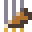

# 조선퇴마록 (朝鮮退魔錄)

> 요괴가 들끓는 조선 팔도를 다섯 퇴마사가 걷는다.
> 《뱀파이어 서바이버즈》식 자동 전투 위에 조선의 직업·신령·요괴를 얹은 **도트 그래픽 로그라이크 웹게임**입니다.

## ▶ 바로 플레이

<a href="https://fullcharge13.github.io/Joseon-Exorcism-Game/"><b>🎮 fullcharge13.github.io/Joseon-Exorcism-Game</b></a>

 휴대폰 카메라로 찍으면 바로 열립니다

- 위 링크 하나로 **PC·휴대폰 브라우저에서 바로** 시작됩니다. 설치도 로그인도 필요 없습니다.
- 휴대폰에서는 브라우저 메뉴의 「홈 화면에 추가」를 누르면 앱처럼 열 수 있습니다.
- 오프라인으로 하려면 이 저장소의 `index.html` 파일 하나를 내려받아 브라우저로 열면 됩니다.

## 기본 조작

- **조작:** PC는 `WASD`·방향키로 이동, 휴대폰은 화면을 누른 채 끌어 이동합니다. 공격은 모두 자동입니다.
- **레벨업 단축키:** 숫자 `1~4` 고르기, `R` 산통 흔들기, `X` 물리기, `B` 봉인, `Space` 신내림, `ESC`·`P` 일시정지.
- **저장:** 진행(엽전·과업·해금·설정)은 브라우저 저장소(localStorage)에 남습니다.

## 목차

0. [바로 플레이](#-바로-플레이)
1. [세계관](#1-세계관)
2. [게임의 흐름](#2-게임의-흐름)
3. [퇴마사 다섯과 전직](#3-퇴마사-다섯과-전직)
4. [5차 전직 이후의 성장](#4-5차-전직-이후의-성장)
5. [펫](#5-펫)
6. [무기와 진화](#6-무기와-진화)
7. [보패](#7-보패)
8. [신령의 힘](#8-신령의-힘)
9. [요괴와 보스](#9-요괴와-보스)
10. [출정 중의 장치들](#10-출정-중의-장치들)
11. [출정 밖의 성장과 규칙](#11-출정-밖의-성장과-규칙)
12. [개발 과정](#12-개발-과정)
13. [기술 구조](#13-기술-구조)
14. [출처와 라이선스](#14-출처와-라이선스)

---

## 1. 세계관

조선 땅에 밤이 길어졌다. 저잣거리에는 도깨비불이 떠다니고, 고갯길에는 사람을 홀리는 장산범이 울고, 동해 바닷가 하늘에는 사람 얼굴을 한 인면조가 맴돈다. 관아는 손을 놓았고, 무당의 굿도 더는 닿지 않는다.

그래서 저마다 다른 재주를 지닌 다섯이 길을 나선다. **붓으로 기를 싣는 선비**, **침과 약으로 살리고 독으로 베는 의원**, **신을 몸에 받는 무당**, **활과 칼과 총통을 쥔 장수**, **노래와 춤으로 칼을 휘두르는 기생**. 이들은 한양 저잣거리에서 출발해 범 나오는 고개와 백두산 골짜기, 동해 바닷가와 저승길을 지나, 마침내 요괴가 똬리를 튼 경복궁 근정전 앞뜰까지 열 개의 막을 차례로 평정해야 한다.

혼자 걷는 길은 아니다.

- **신령의 축복:** 성황당에서 빌면 산신·성황신·조왕신·사신(청룡·백호·주작·현무) 같은 열두 신령이 축복을 내린다. 짝이 맞는 두 신령은 함께 **쌍신 축복**을 내리고, 쌓인 믿음은 **신내림**이 되어 한 번에 터진다.
- **하늘 신령의 강림:** 단군신화에서 환웅을 따라 내려온 **풍백·우사·운사**가 막마다 한 번 구름을 타고 내려와 30초 동안 가호를 준다.
- **도사 전우치:** 체력이 위태로우면 분신술로 나타나 요괴를 쓸고, 금강불괴의 도술로 퇴마사를 지킨다.
- **산짐승 동무:** 첫 전직을 마치면 **범·반달곰·해동청** 가운데 하나가 동무가 되어 함께 싸운다.

길 위에 나오는 요괴 쉰여덟 종의 이름은 고성배 작가의 『한국 요괴 도감』(위즈덤하우스, 2019)에 실린 요괴에서 따왔습니다. 게임 속 행동과 기술은 놀이에 맞게 새로 지어냈습니다.

---

## 2. 게임의 흐름

| 단계 | 내용 |
|---|---|
| 출정 준비 | 퇴마사·**출정 방식(출정/퇴마 원정)**·난이도·**정표**·점괘 패·액운 단계를 고른다. |
| 한 막 (120초) | 요괴가 점점 몰려온다. 구슬을 모아 레벨업하고 무기·보패를 고른다. **막 의뢰**를 풀고, **연격**을 잇고, **도깨비 샛길**에 들지 말지 정한다. |
| 60초 | **중간 보스** 등장. 어려움 난이도에서는 엘리트와 함께 나온다. |
| 120초 이후 | 중간 보스를 쓰러뜨렸다면 **막 보스** 등장. 쓰러뜨리지 못했다면 막 보스는 나오지 않는다. |
| 막 평정 | 도깨비 보물(샛길에 들었다면) → 갈림길 보상(대장간이면 **담금질**) → 보물 상자 → **주막**에서 엽전으로 정비 → **갈림길**에서 다음 길 선택 |
| 제10막 평정 | 출정 성공. 여기서 마치거나 **끝없는 밤**으로 이어 간다. 남은 엽전은 상점 엽전이 된다. |
| 출정이 끝나면 | 이기든 쓰러지든 **퇴마사 본부**로 돌아온다. 식구와 이야기하고 막걸리를 건네 **정표**를 받는다. 이번 출정은 날짜와 함께 **기록관**에 남는다. |

- **레벨업:** 세 장(운이 좋으면 네 장) 가운데 하나를 고른다. **산통 흔들기**(새로 뽑기), **물리기**(건너뛰고 엽전 5닢), **봉인**(이번 출정에서 다시 안 나오게)을 쓸 수 있다.
- **전직:** Lv 10·20·30·40·50마다 전직한다. 1차 전직에서 두 갈래 길 중 하나를 고르고, 전직마다 새 기술·새 외형·직함 보너스를 받고, 추가 보너스 셋 가운데 하나를 고른다.
- **설정:** 효과음, 화면 흔들림, 피해 숫자, 화면 번쩍임, 도트 크기, 터치 조이스틱, **성능 모드(자동/고화질/절약)**, 초당 프레임 표시.

---

## 3. 퇴마사 다섯과 전직

처음에는 **선비**만 출정할 수 있습니다. 나머지 넷은 퇴마록 과업을 이룰 때마다 하나씩 열립니다.

| 퇴마사 | 여는 법 |
|---|---|
|  선비 | 처음부터 |
|  의원 | 과업 「손에 익은 퇴마」: 요괴 1,000마리 퇴치 |
|  무당 | 과업 「길이 열리다」: 제3막 도달 |
|  장수 | 과업 「장수의 부름」: 중간 보스 3마리 퇴치 |
|  기생 | 과업 「풍류의 밤」: 성황당에서 3번 기도 |

|  |  |  |  |  |
|:---:|:---:|:---:|:---:|:---:|
| **선비** | **의원** | **무당** | **장수** | **기생** |

###  선비

글 한 줄에 기를 싣는 유생. 가장 가까운 요괴에게 먹탄을 날린다.

- **특성:** 재사용 대기시간 −10%
- **시작 무기:** 먹탄
- **전용 무기:** 먹탄, 벼루, 합죽선, 서찰
- **전용 보패:** 청자 연적, 홍패, 낙관

**학문의 길**

| 전직 | 모습 | 직함 | 새 기술 | 기술 설명 | 직함 보너스 |
|---|:---:|---|---|---|---|
| 1차 (Lv 10) |  | 진사 |  천자문 | 하늘에서 천자문의 글자가 떨어져 요괴를 내리친다. | 투사체 +1 |
| 2차 (Lv 20) |  | 홍문관 교리 |  묵향 결계 | 먹 향이 몸 주위에 결계를 쳐서 안에 든 요괴를 느리게 하고 계속 깎는다. | 재사용 대기 −6% |
| 3차 (Lv 30) |  | 대제학 |  훈민정음 | 스물여덟 글자가 화면 가득 쏟아져 모든 요괴를 내리친다. | 공격력 +15% |
| 4차 (Lv 40) |  | 영의정 |  경국대전 | 법전의 조문이 몸 둘레를 넓게 돌며 닿는 요괴를 다스린다. | 범위 +15% |
| 5차 (Lv 50) |  | 성현 |  대일필 | 커다란 붓이 화면을 가로질러 한 획을 긋는다. 먹이 지나간 자리는 요괴를 늦춘다. | 공격력 +20% · 재사용 −8% |

**감찰의 길**

| 전직 | 모습 | 직함 | 새 기술 | 기술 설명 | 직함 보너스 |
|---|:---:|---|---|---|---|
| 1차 (Lv 10) |  | 암행어사 |  마패 출두 | 마패를 들어 화면 안 모든 요괴를 내리치고 얼어붙게 한다. | 이동 속도 +15% |
| 2차 (Lv 20) |  | 감찰 어사 |  역졸 소환 | 어사를 따르는 역졸들이 달려 나와 요괴를 몽둥이로 친다. | 최대 체력 +30 |
| 3차 (Lv 30) |  | 판의금부사 |  오랏줄 | 붉은 오랏줄이 요괴에서 요괴로 옮겨 가며 묶고 친다. | 치명타 +8% |
| 4차 (Lv 40) |  | 대사헌 |  탄핵 상소 | 화면에서 가장 강한 요괴를 탄핵한다. 큰 피해를 주고, 5초 동안 그 요괴가 받는 피해가 50% 늘어난다. | 공격력 +15% |
| 5차 (Lv 50) |  | 도체찰사 |  어명 | 어명이 떨어지면 화면 안 요괴가 최대 체력의 40%를 잃는다. 보스는 3%. | 치명 피해 +30% |

###  의원

침과 약으로 사람을 살리는 의원. 가는 방향으로 은침을 부채꼴로 던진다.

- **특성:** 초당 회복 0.4 · 최대 체력 +10
- **시작 무기:** 은침
- **전용 무기:** 은침, 부항, 약작두, 환약
- **전용 보패:** 감초, 녹용, 사향

**내의원의 길**

| 전직 | 모습 | 직함 | 새 기술 | 기술 설명 | 직함 보너스 |
|---|:---:|---|---|---|---|
| 1차 (Lv 10) |  | 의관 |  구급방 | 꾸준히 체력을 회복하고, 주기적으로 약기운이 퍼져 주위를 정화한다. | 최대 체력 +30 |
| 2차 (Lv 20) |  | 내의 |  쑥뜸 | 몸 둘레에 쑥뜸 불씨를 놓는다. 불씨 위의 요괴는 타들어 간다. | 회복량 +25% |
| 3차 (Lv 30) |  | 어의 |  동의보감 | 의서의 지혜로 체력의 25%를 되찾고 잠시 무적이 되며, 큰 약기운이 퍼진다. | 최대 체력 +50 · 방어 +1 |
| 4차 (Lv 40) |  | 혜민서 제조 |  약초밭 | 둘레에 약초밭 세 곳을 일군다. 밭 위에 서면 체력이 차오르고, 밭에 든 요괴는 시든다. | 초당 회복 +1 |
| 5차 (Lv 50) |  | 의성 |  회생 | 쓰러질 때 한 번 체력의 60%로 되살아난다. 다시 쓰려면 120초를 기다려야 한다. 평소에도 초당 1.5씩 회복한다. | 최대 체력 +80 |

**독술의 길**

| 전직 | 모습 | 직함 | 새 기술 | 기술 설명 | 직함 보너스 |
|---|:---:|---|---|---|---|
| 1차 (Lv 10) |  | 독의 |  비상 연기 | 발밑에 비상을 태워 넓은 독연기를 피운다. | 공격력 +15% |
| 2차 (Lv 20) |  | 비방 의원 |  칠독침 | 사방으로 독침을 흩뿌린다. 맞은 요괴는 독이 퍼져 계속 피해를 입는다. | 범위 +10% |
| 3차 (Lv 30) |  | 독선 |  만독불침 | 온갖 독을 한꺼번에 퍼뜨려 화면 안 모든 요괴를 중독시킨다. | 공격력 +20% |
| 4차 (Lv 40) |  | 고독술사 |  고독 | 독벌레 떼를 풀어 요괴를 물게 한다. 물린 요괴는 중독된다. | 투사체 +1 |
| 5차 (Lv 50) |  | 독왕 |  천독지 | 발밑에 독의 못을 연다. 못 안의 요괴는 보스까지 느려지고 녹아내린다. | 공격력 +25% |

###  무당

신을 모시는 무당. 몸 주위로 부적이 돌며 요괴를 쫓는다.

- **특성:** 레벨업 선택지 4개 · 범위 +10%
- **시작 무기:** 부적
- **전용 무기:** 부적, 신칼, 바라, 명두
- **전용 보패:** 명태, 오색천, 정화수

**굿의 길**

| 전직 | 모습 | 직함 | 새 기술 | 기술 설명 | 직함 보너스 |
|---|:---:|---|---|---|---|
| 1차 (Lv 10) |  | 큰무당 |  굿판 | 굿으로 장군신을 불러 요괴를 물어뜯게 한다. | 투사체 +1 |
| 2차 (Lv 20) |  | 당골 |  작두춤 | 작두에 오른 신이 큰 작두날을 넓게 돌린다. | 범위 +10% |
| 3차 (Lv 30) |  | 나라무당 |  대동굿 | 마을 전체의 굿판이 열린다. 수많은 신이 잠시 내려와 날뛰고 화면이 정화된다. | 재사용 대기 −8% |
| 4차 (Lv 40) |  | 신어머니 |  진오귀굿 | 넋을 달래는 굿. 요괴가 쓰러질 때 일정 확률로 그 넋이 내 편이 되어 잠시 싸운다. | 지속시간 +15% |
| 5차 (Lv 50) |  | 무조 |  길닦음 | 저승 가는 길을 닦는 흰 무명천이 길게 펼쳐져 돌며 요괴를 쓸어 낸다. | 공격력 +20% · 범위 +10% |

**신내림의 길**

| 전직 | 모습 | 직함 | 새 기술 | 기술 설명 | 직함 보너스 |
|---|:---:|---|---|---|---|
| 1차 (Lv 10) |  | 만신 |  벼락 | 신이 내린 벼락이 요괴 머리 위로 떨어진다. | 범위 +15% |
| 2차 (Lv 20) |  | 신장 만신 |  오방신장기 | 동서남북과 가운데에 신장 깃발 다섯 개를 꽂는다. 깃발 둘레의 요괴는 계속 피해를 입는다. | 지속시간 +15% |
| 3차 (Lv 30) |  | 천왕 만신 |  칠성 낙성 | 북두칠성의 일곱 별이 떨어져 크게 터진다. | 공격력 +15% |
| 4차 (Lv 40) |  | 일월성신 만신 |  일월성신 | 해와 달이 몸 둘레를 크게 돌며 닿는 요괴를 태우고 얼린다. | 치명타 +8% |
| 5차 (Lv 50) |  | 하늘 만신 |  뇌공강림 | 우레의 신이 내려와 몇 초 동안 쉬지 않고 벼락을 내리꽂는다. | 공격력 +20% · 범위 +10% |

###  장수

변방을 지킨 무관. 바라보는 쪽을 환도로 크게 벤다.

- **특성:** 최대 체력 +30 · 방어 +1
- **시작 무기:** 환도
- **전용 무기:** 환도, 편곤, 등패, 비격진천뢰
- **전용 보패:** 투구, 군령기, 전마

**지휘의 길**

| 전직 | 모습 | 직함 | 새 기술 | 기술 설명 | 직함 보너스 |
|---|:---:|---|---|---|---|
| 1차 (Lv 10) |  | 만호 |  학익진 | 학이 날개를 펴듯 진이 퍼져 나가며 요괴를 밀쳐 낸다. | 방어 +2 · 최대 체력 +30 |
| 2차 (Lv 20) |  | 병마절도사 |  천자총통 | 총통이 무거운 쇠포탄을 쏘아 떨어진 자리를 크게 부순다. | 공격력 +10% |
| 3차 (Lv 30) |  | 도원수 |  거북선 돌격 | 거북선이 화면을 가로질러 돌격하며 앞을 막는 요괴를 모두 들이받는다. | 최대 체력 +50 |
| 4차 (Lv 40) |  | 삼도수군통제사 |  수군 소환 | 창을 든 수군을 불러 함께 싸운다. | 방어 +2 |
| 5차 (Lv 50) |  | 대원수 |  천지진동 | 땅을 세 번 내리쳐 큰 진동을 일으킨다. 진동에 맞은 요괴는 잠시 굳는다. | 공격력 +20% · 최대 체력 +60 |

**궁술의 길**

| 전직 | 모습 | 직함 | 새 기술 | 기술 설명 | 직함 보너스 |
|---|:---:|---|---|---|---|
| 1차 (Lv 10) |  | 사수 |  만궁 | 사방으로 화살비를 쏟아 낸다. | 재사용 대기 −10% |
| 2차 (Lv 20) |  | 신궁 |  화살비 | 하늘을 향해 쏜 화살이 요괴 무리 위로 비처럼 쏟아진다. | 투사체 +1 |
| 3차 (Lv 30) |  | 천궁 |  천궁 일시 | 온 힘을 실은 한 발이 화면 끝까지 일직선으로 꿰뚫는다. | 치명타 +10% |
| 4차 (Lv 40) |  | 어영대장 |  편전 일제사격 | 통아에 넣은 애기살을 세 번 연달아 부채꼴로 쏟아붓는다. | 재사용 대기 −8% |
| 5차 (Lv 50) |  | 궁성 |  유성시 | 하늘 높이 쏘아 올린 화살이 유성처럼 떨어져 요괴 무리를 터뜨린다. | 치명 피해 +40% |

###  기생

가무와 시로 이름난 예인. 가야금 가락이 물결치며 요괴를 꿰뚫는다.

- **특성:** 이동 속도 +10% · 경험치 +10%
- **시작 무기:** 가야금
- **전용 무기:** 가야금, 검무, 부채춤, 장구
- **전용 보패:** 노리개, 비녀, 화관

**풍류의 길**

| 전직 | 모습 | 직함 | 새 기술 | 기술 설명 | 직함 보너스 |
|---|:---:|---|---|---|---|
| 1차 (Lv 10) |  | 관기 |  소리 한 자락 | 한 자락 소리가 둥글게 퍼져 둘레를 치고, 가락이 사방으로 흩어진다. | 투사체 +1 |
| 2차 (Lv 20) |  | 행수기생 |  사랑가 | 사랑가 한 대목에 화면 안 요괴가 넋을 잃고 멈춰 서서 서서히 깎인다. 보스는 멈추지 않는다. | 범위 +10% |
| 3차 (Lv 30) |  | 명기 |  진양조 장단 | 가장 느린 장단이 흐르는 동안 화면의 요괴가 모두 느려지고 계속 피해를 입는다. | 재사용 대기 −8% |
| 4차 (Lv 40) |  | 대명창 |  판소리 완창 | 소리꾼의 소리가 두 줄기 물결이 되어 주위를 길게 훑는다. | 공격력 +15% |
| 5차 (Lv 50) |  | 국창 |  득음 | 소리가 경지에 이르러 화면 안 모든 요괴를 크게 치고, 내 체력을 20% 되찾는다. | 공격력 +20% · 최대 체력 +50 |

**검무의 길**

| 전직 | 모습 | 직함 | 새 기술 | 기술 설명 | 직함 보너스 |
|---|:---:|---|---|---|---|
| 1차 (Lv 10) |  | 검무기 |  쌍검무 | 칼을 든 춤사위에 칼날 넷이 몸 둘레를 넓게 돈다. | 치명타 +6% |
| 2차 (Lv 20) |  | 협기 |  꽃비 | 요괴 무리 위로 꽃잎 비를 뿌린다. 꽃비 속 요괴는 느려지고 붙잡힌다. | 이동 속도 +10% |
| 3차 (Lv 30) |  | 의기 |  칼바람 | 몸을 세 번 돌려 둘레를 칼바람으로 벤다. | 공격력 +15% |
| 4차 (Lv 40) |  | 검무 대가 |  검기 | 칼끝에서 뻗은 검기가 사방으로 날아가 길게 꿰뚫는다. | 치명 피해 +30% |
| 5차 (Lv 50) |  | 검선 |  검선 강림 | 떠도는 신검들이 내려와 요괴를 쫓아다니며 벤다. | 공격력 +20% · 치명타 +8% |

---

## 4. 5차 전직 이후의 성장

5차 전직(Lv 50)을 마친 뒤에도 레벨업마다 성장이 이어집니다. 하데스의 전설 축복과 하데스 2의 오메가 기술에서 착안했습니다.

### 오의 각성 (Lv 54·58·62·66·70)

직업 기술 하나를 골라 셋 중 한 방식으로 각성합니다. 한 기술은 한 번만 각성할 수 있습니다.

| 각성 | 효과 |
|---|---|
|  연환 | 시전하고 0.4초 뒤 한 번 더 시전한다 (두 번째는 위력 60%). |
|  극의 | 피해 +50% · 범위 +25%. |
|  신속 | 재사용 대기 −35%. |

늘 켜져 있는 기술(결계·소환·궤도형)은 극의만 고를 수 있고, 의원의 「회생」은 각성 대상이 아닙니다.

### 궁극 오의 (Lv 74, 각성 4번 이상)

| 퇴마사 | 궁극 오의 | 효과 |
|---|---|---|
|  선비 |  천지개벽 필법 | 24초마다 하늘에서 글자 아홉이 요괴 위로 떨어진다. |
|  의원 |  만병회춘 | 24초마다 체력 35%를 회복하고, 화면 안 요괴 모두에게 독을 퍼뜨려 느리게 한다. |
|  무당 |  천신강림 | 24초마다 하늘 신이 내려와 벼락 열넷을 내리꽂는다. |
|  장수 |  만군돌격 | 24초마다 거북선 세 척이 화면을 가로지르며 들이받는다. |
|  기생 |  경국지색 | 24초마다 화면 안 요괴를 3초 동안 홀려 멈추고, 꽃바람이 휩쓴다. |

###  한계 돌파

Lv 50부터, 또는 더 올릴 무기·보패가 없을 때 만렙 무기·기술 카드가 「한계 돌파」로 나옵니다. 돌파마다 **피해 +10%**, 5번마다 **범위 +10%**이며 끝없이 쌓입니다. 보물 상자도 올릴 것이 없으면 돌파를 줍니다.

---

## 5. 펫

1차 전직을 마치면 펫 하나를 고릅니다. 펫은 죽지 않으며, 퇴마사 레벨에 따라 자랍니다(펫 레벨 = 1 + ⌊(퇴마사 레벨 − 10) ÷ 4⌋, 최대 10). 일반 공격은 3초, 홀딩 기술은 10초, 궁극기는 20초마다 씁니다.

###  범

앞장서 달려들어 할퀴는 산군. 몇 마리에 큰 피해를 몰아준다.

| 구분 | 펫 Lv | 기술 | 설명 |
|---|---|---|---|
| 일반 공격 (3초) | 1 | 할퀴기 | 가까운 요괴에게 달려들어 할퀸다. |
| 일반 공격 (3초) | 5 | 범 발톱 연격 | 요괴 셋을 차례로 덮쳐 할퀸다. |
| 홀딩 기술 (10초) | 2 | 포효 | 포효로 둘레의 요괴를 1.5초 얼어붙게 한다. |
| 홀딩 기술 (10초) | 6 | 산을 울리는 포효 | 더 넓게, 2.5초 동안 얼어붙게 한다. |
| 궁극기 (20초) | 4 | 산군 강림 | 화면의 요괴 다섯을 차례로 덮친다. |
| 궁극기 (20초) | 8 | 백호 현신 | 흰 범으로 변해 요괴 여덟을 덮친다. |

###  반달곰

곁을 지키는 우직한 짐승. 요괴를 끌어모아 붙잡고 땅을 울린다.

| 구분 | 펫 Lv | 기술 | 설명 |
|---|---|---|---|
| 일반 공격 (3초) | 1 | 앞발치기 | 곁에 다가온 요괴를 앞발로 쳐서 날려 버린다. |
| 일반 공격 (3초) | 5 | 곰발 내려치기 | 더 넓게, 더 세게 내려친다. |
| 홀딩 기술 (10초) | 2 | 움켜쥐기 | 둘레의 요괴를 끌어당겨 2초 붙잡는다. |
| 홀딩 기술 (10초) | 6 | 곰의 품 | 더 넓게 끌어당겨 3초 붙잡는다. |
| 궁극기 (20초) | 4 | 산 무너뜨리기 | 땅을 세 번 내리쳐 큰 진동을 일으킨다. |
| 궁극기 (20초) | 8 | 반달곰 대지진 | 네 번 내리치고, 5초 동안 내가 받는 피해를 30% 줄인다. |

###  해동청

하늘을 도는 사냥매. 멀리 있는 요괴를 내리꽂아 잡고 바람으로 묶는다.

| 구분 | 펫 Lv | 기술 | 설명 |
|---|---|---|---|
| 일반 공격 (3초) | 1 | 급강하 | 요괴 하나에게 내리꽂힌다. |
| 일반 공격 (3초) | 5 | 세 번 급강하 | 요괴 셋에게 차례로 내리꽂힌다. |
| 홀딩 기술 (10초) | 2 | 날개 회오리 | 요괴 무리 위에 회오리를 일으켜 3초 붙잡는다. |
| 홀딩 기술 (10초) | 6 | 해동청 회오리 | 더 큰 회오리로 4초 붙잡는다. |
| 궁극기 (20초) | 4 | 해동청 폭풍 | 화면 곳곳에 여덟 번 내리꽂힌다. |
| 궁극기 (20초) | 8 | 천리 해동청 | 열네 번 내리꽂힌다. |

---

## 6. 무기와 진화

무기는 최대 여섯 자루까지 듭니다. 무기를 5레벨까지 올리고 짝이 되는 보패를 가진 채 보물 상자를 열면 **진화**합니다.

### 공용 무기

| | 무기 | 설명 | 진화 짝 | 진화 후 |
|:---:|---|---|---|---|
|  | 방울 | 방울 소리가 주위 요괴에게 계속 피해를 준다. |  짚신 | **대신방울** — 방울 소리가 넓게 퍼지고, 소리 안의 요괴는 걸음이 느려진다. |
|  | 각궁 | 화면 안 요괴를 골라 관통하는 화살을 쏜다. |  윤도 | **편전** — 짧고 매서운 애기살이 쉴 새 없이 날아간다. |
|  | 신기전 🔒 | 요괴를 쫓아가 터지는 불화살을 쏜다. |  화약 | **화차** — 수레에 꽂힌 신기전이 한꺼번에 불을 뿜는다. |
|  | 약탕 🔒 | 쓴 약탕을 뿌려 그 자리의 요괴를 녹인다. |  호리병 | **십전대보탕** — 끓는 약탕이 요괴를 녹이고, 그 위에 선 나는 기운을 되찾는다. |

### 선비 전용 무기

| | 무기 | 설명 | 진화 짝 | 진화 후 |
|:---:|---|---|---|---|
|  | 먹탄 | 가장 가까운 요괴에게 먹탄을 쏜다. |  서책 | **일필휘지** — 붓끝에서 사방으로 먹탄이 쏟아진다. 끝없이 관통한다. |
|  | 벼루 | 무거운 벼루를 던진다. 멀리 갔다가 되돌아오며 두 번 벤다. |  청자 연적 | **용연** — 용이 새겨진 벼루 네 개가 크게 날아갔다가 돌아온다. |
|  | 합죽선 | 부채를 부쳐 앞쪽 요괴를 밀쳐 내는 바람을 일으킨다. |  낙관 | **태극선** — 태극 부채를 휘두르면 사방으로 회오리가 일어 요괴를 날려 버린다. |
|  | 서찰 🔒 | 봉한 서찰이 요괴를 끝까지 쫓아가 맞힌다. |  홍패 | **교지** — 왕의 교지가 날아가 요괴를 끝까지 쫓아 꿰뚫는다. |

### 의원 전용 무기

| | 무기 | 설명 | 진화 짝 | 진화 후 |
|:---:|---|---|---|---|
|  | 은침 | 가는 방향으로 은침 세 개를 부채꼴로 던진다. |  인삼 | **회춘침** — 열 개의 침이 넓게 퍼지고, 맞힐 때마다 조금씩 기운이 돌아온다. |
|  | 부항 | 부항 단지를 붙여 요괴의 기운을 서서히 빨아들이고 체력을 조금 회복한다. |  녹용 | **사혈 부항** — 붙은 부항이 나쁜 피를 크게 뽑아 내고, 그 기운으로 내 몸을 채운다. |
|  | 약작두 | 약재를 써는 작두날을 던진다. 화면 끝에 부딪히면 튕겨 나온다. |  사향 | **천금 작두** — 네 자루의 작두날이 화면을 휘저으며 튕겨 다닌다. |
|  | 환약 🔒 | 동그란 환약이 요괴 사이를 튕기며 여러 번 맞힌다. |  감초 | **청심환** — 금박 청심환이 요괴 사이를 열두 번 튕기며 맞을 때마다 터진다. |

### 무당 전용 무기

| | 무기 | 설명 | 진화 짝 | 진화 후 |
|:---:|---|---|---|---|
|  | 부적 | 부적 두 장이 몸 주위를 돌며 닿는 요괴를 벤다. |  넓은 갓 | **천지신명** — 여섯 장의 부적이 쉬지 않고 넓게 돈다. |
|  | 신칼 | 신칼을 돌려 가며 던진다. 던지는 방향이 계속 바뀌어 사방을 훑는다. |  오색천 | **칠성검** — 일곱 자루 칠성검이 회오리처럼 돌며 꿰뚫고 나간다. |
|  | 바라 | 바라를 쳐서 둥글게 퍼지는 울림으로 요괴를 밀어낸다. |  명태 | **천둥바라** — 바라를 칠 때마다 천둥 같은 울림이 화면 절반까지 퍼진다. |
|  | 명두 🔒 | 청동 거울이 빛줄기를 비추며 천천히 주위를 훑는다. |  정화수 | **일월명두** — 해와 달을 새긴 거울이 두 줄기 빛을 쉬지 않고 돌린다. |

### 장수 전용 무기

| | 무기 | 설명 | 진화 짝 | 진화 후 |
|:---:|---|---|---|---|
|  | 환도 | 바라보는 쪽을 환도로 크게 벤다. |  두석린갑 | **사인검** — 인년 인월 인일 인시에 벼린 칼. 사방을 한꺼번에 벤다. |
|  | 편곤 | 쇠도리깨를 한 바퀴 크게 휘둘러 둘레의 요괴를 모두 친다. |  전마 | **철편 기병** — 말 위에서 휘두르듯 편곤이 두 바퀴를 크게 돈다. |
|  | 등패 | 가는 방향 앞에 방패를 세운다. 요괴 탄을 막고 닿는 요괴를 밀쳐 낸다. |  투구 | **철갑 등패** — 앞뒤로 철갑 방패가 서서 요괴 탄을 되받아치고 몸으로 밀어붙인다. |
|  | 비격진천뢰 🔒 | 쇠 폭탄을 던진다. 떨어진 뒤 잠시 후 크게 터진다. |  군령기 | **진천뢰 일제** — 군령에 맞춰 네 발의 진천뢰가 한꺼번에 떨어져 크게 터진다. |

### 기생 전용 무기

| | 무기 | 설명 | 진화 짝 | 진화 후 |
|:---:|---|---|---|---|
|  | 가야금 | 가야금을 뜯어 물결치는 가락을 가까운 요괴에게 보낸다. 가락은 요괴를 꿰뚫는다. |  호리병 | **취흥 산조** — 흥에 겨운 산조 가락이 사방으로 물결치며 끝없이 꿰뚫는다. |
|  | 검무 | 두 자루 칼이 몸 가까이 빠르게 돌고, 이따금 한 바퀴 크게 벤다. |  노리개 | **진주 검무** — 여섯 자루 칼이 몸 가까이 돌고, 쉬지 않고 한 바퀴씩 크게 벤다. |
|  | 부채춤 | 부채를 펼쳐 꽃잎 물결을 둥글게 퍼뜨린다. 물결에 맞은 요괴는 느려진다. |  화관 | **화관무** — 화관을 쓴 춤사위에 꽃잎 물결이 두 겹으로 퍼지고, 꽃비가 내린 자리는 요괴를 묶어 둔다. |
|  | 장구 🔒 | 장구를 쳐서 둘레의 요괴를 치고 잠깐 멈춰 세운다. |  비녀 | **신명 장단** — 신명 난 장단이 쉼 없이 울려 둘레의 요괴를 붙잡아 둔다. |

🔒 표시는 퇴마록 과업으로 해금하는 무기입니다. 진화는 모두 24가지입니다.

### 합공 (무기 합체)

짝이 맞는 두 무기를 **모두 진화**시킨 채 보물 상자를 열면 두 무기가 하나로 합쳐집니다. 무기 칸이 하나 비고, 두 무기의 공격은 피해 +20%로 그대로 나가며, 합공 무기만의 기술이 더해집니다. (HoloCure의 콜라보, 뱀파이어 서바이버즈의 결합 무기에서 착안)

| | 합공 무기 | 재료 | 직업 | 합공 기술 |
|:---:|---|---|---|---|
|  | **필력 교지** |  일필휘지 +  교지 | 선비 | 6초마다 왕명을 담은 교지 여덟 장이 요괴를 끝까지 쫓아 꿰뚫는다. |
|  | **용연 태극** |  용연 +  태극선 | 선비 | 5초마다 용연에서 먹 회오리가 크게 일어 요괴를 밀어내고 벤다. |
|  | **회춘 청심침** |  회춘침 +  청심환 | 의원 | 5초마다 사방으로 침 열여섯 개를 흩뿌리고 체력 2%를 되찾는다. |
|  | **사혈 작두** |  사혈 부항 +  천금 작두 | 의원 | 6초마다 작두날이 몸 둘레를 크게 한 바퀴 베고, 벤 기운으로 체력 3%를 채운다. |
|  | **오방부적검** |  천지신명 +  칠성검 | 무당 | 5초마다 부적을 감은 신칼 열 자루가 사방으로 날아가 꿰뚫는다. |
|  | **일월바라** |  천둥바라 +  일월명두 | 무당 | 6초마다 해와 달의 울림이 퍼져 둘레 요괴를 치고 1초 동안 얼린다. |
|  | **쌍룡 편곤도** |  사인검 +  철편 기병 | 장수 | 4초마다 칼과 편곤으로 몸 둘레를 두 번 크게 휘두른다. |
|  | **진천 철벽** |  철갑 등패 +  진천뢰 일제 | 장수 | 6초마다 방패 둘레 네 곳에서 비격진천뢰가 터진다. |
|  | **산조 장단** |  취흥 산조 +  신명 장단 | 기생 | 5초마다 장단이 둘레를 울리고 가락 열두 줄기가 사방으로 퍼진다. |
|  | **검무 화관** |  진주 검무 +  화관무 | 기생 | 5초마다 꽃비 세 곳을 뿌리고 칼춤으로 한 바퀴 크게 벤다. |
|  | **신기 화살비** |  편전 +  화차 | 공용 | 5초마다 불화살 여섯 발이 하늘에서 요괴 위로 떨어진다. |
|  | **약방울** |  대신방울 +  십전대보탕 | 공용 | 6초마다 약 기운 실린 방울 소리가 퍼져 요괴를 늦추고 체력 3%를 되찾는다. |

### 인장 각인

보물 상자를 열면 40% 확률로, 또는 주막의 「인장 장인」에게서 인장을 얻습니다. 인장 셋 가운데 하나를 골라 정해진 무기에 새기면 **그 무기만** 강해집니다. 칸은 일반 무기 1개, 진화 무기 2개, 합공 무기 3개이고 같은 인장을 겹쳐 새길 수 있습니다. (HoloCure 스탬프, Crab Champions 무기 개조에서 착안)

| 인장 | 효과 |
|---|---|
|  힘의 인장 | 이 무기 피해 +20% |
|  넓힘의 인장 | 이 무기 범위 +20% |
|  재촉의 인장 | 이 무기 재사용 대기 −15% |
|  이음의 인장 | 이 무기 투사체 +1 |
|  오래의 인장 | 이 무기 지속시간 +25% |
|  빠름의 인장 | 이 무기 투사체 속도 +25% |

---

## 7. 보패

보패(패시브)는 최대 여섯 개까지 지닙니다.

| | 보패 | 효과 | 최대 | 전용 |
|:---:|---|---|---|---|
|  | 인삼 | 최대 체력 +20 | 5 | 공용 |
|  | 짚신 | 이동 속도 +8% | 5 | 공용 |
|  | 넓은 갓 | 공격 범위 +10% | 5 | 공용 |
|  | 윤도 | 아이템 끌어오는 거리 +30% | 5 | 공용 |
|  | 서책 | 재사용 대기시간 −8% | 5 | 공용 |
|  | 두석린갑 | 방어 +1 | 5 | 공용 |
|  | 화약 | 공격력 +10% | 5 | 공용 |
|  | 호리병 | 지속시간 +12% · 초당 회복 +0.1 | 5 | 공용 |
|  | 청자 연적 | 투사체 속도 +10% · 지속시간 +6% | 5 | 선비 |
|  | 홍패 | 경험치 +8% | 5 | 선비 |
|  | 낙관 | 치명타 확률 +5% | 5 | 선비 |
|  | 감초 | 모든 회복량 +20% · 초당 회복 +0.15 | 5 | 의원 |
|  | 녹용 | 최대 체력 +12 · 피격 후 무적 +0.06초 | 5 | 의원 |
|  | 사향 | 치명타 피해 +15% | 5 | 의원 |
|  | 명태 | 엽전·떡·복주머니가 더 자주 나온다 (+25%) | 5 | 무당 |
|  | 오색천 | 범위 +6% · 지속시간 +6% | 5 | 무당 |
|  | 정화수 | 초당 회복 +0.25 · 경험치 +4% | 5 | 무당 |
|  | 투구 | 방어 +1 · 최대 체력 +5 | 5 | 장수 |
|  | 군령기 | 공격력 +6% · 재사용 대기 −3% | 5 | 장수 |
|  | 전마 | 이동 속도 +7% · 끌어오는 거리 +10% | 5 | 장수 |
|  | 노리개 | 치명타 +4% · 이동 속도 +4% | 5 | 기생 |
|  | 비녀 | 투사체 속도 +8% · 재사용 대기 −4% | 5 | 기생 |
|  | 화관 | 범위 +8% · 경험치 +5% | 5 | 기생 |

---

## 8. 신령의 힘

### 신령 축복 (12신)

성황당에서 기도하거나, 주막에서 정화수를 올리거나, 갈림길 「신령의 사당」을 고르면 신령 셋 가운데 하나의 축복을 받습니다. 같은 신령은 3단계까지 깊어집니다.

| 신령 | 축복 (단계마다) |
|---|---|
|  산신 | 최대 체력 +25 · 초당 회복 +0.3 |
|  성황신 | 범위 +10% · 지속시간 +10% |
|  업신 | 엽전을 주울 때마다 1닢 더 |
|  삼신 | 경험치 +12% · 떡 회복 +50% |
|  용 | 공격이 요괴를 얼릴 확률 +6% |
|  백호 | 공격력 +12% |
|  청룡 | 재사용 대기 −7% |
|  주작 | 공격이 화상을 입힐 확률 +8% |
|  현무 | 일정 시간마다 피해 한 번을 막는 등껍질 (12초, 단계마다 3초 단축) |
|  조왕신 | 떡·엽전·복주머니 드롭 +30% |
|  칠성신 | 치명타 +6% · 치명 피해 +15% |
|  성주신 | 방어 +1 · 받는 피해 −8% |

### 쌍신 축복 (8종)

짝이 맞는 두 신령의 축복을 모두 받으면 다음 축복 고르기에 쌍신 축복이 섞여 나옵니다. (하데스의 듀오 축복에서 착안)

| 쌍신 축복 | 두 신령 | 효과 |
|---|---|---|
|  용호상박 | 청룡 + 백호 | 공격이 8% 확률로 벼락 발톱을 내리친다. |
|  수화상제 | 주작 + 현무 | 등껍질이 피해를 막으면 둘레에 불길이 터진다. 등껍질 대기 −3초. |
|  산천정기 | 산신 + 성황신 | 체력이 80% 이상이면 공격력 +25%. |
|  복록 | 업신 + 조왕신 | 엽전을 주울 때 4% 확률로 떡, 2% 확률로 복주머니가 나온다. |
|  칠성용궁 | 칠성신 + 용 | 얼어 있는 요괴에게는 반드시 치명타. |
|  가택평안 | 삼신 + 성주신 | 레벨이 오를 때마다 체력 15 회복 · 최대 체력 +2. |
|  맹화호 | 백호 + 주작 | 화상 입은 요괴가 쓰러지면 불꽃이 터져 둘레를 태운다. |
|  북해빙벽 | 용 + 현무 | 얼어 있는 요괴가 쓰러지면 얼음이 터져 둘레 요괴를 얼린다. |

### 신내림 (게이지 필살기)

요괴를 잡을수록 오른쪽 아래 **神 버튼**의 게이지가 찹니다(보통 요괴 0.25, 엘리트 6, 중간 보스 25, 막 보스 40, 피격 2). 가득 차면 **Space** 키나 버튼으로 씁니다. 축복을 가장 많이 받은 신령(같으면 먼저 받은 신령)의 기술이 나갑니다. (하데스의 신의 부름에서 착안)

| 신내림 | 신령 | 효과 |
|---|---|---|
|  퇴마 일갈 | (축복 없음) | 둘레 요괴를 크게 밀어내며 벤다. |
|  산군 포효 | 산신 | 체력 30% 회복, 큰 포효로 요괴를 날려 보낸다. |
|  성황 결계 | 성황신 | 6초 동안 몸 둘레에 강한 결계가 따라다닌다. |
|  업신 재물비 | 업신 | 떨어진 구슬을 모두 끌어오고 엽전 15닢을 뿌린다. |
|  삼신 점지 | 삼신 | 체력 50% 회복, 레벨업까지 필요한 경험치의 절반을 얻는다. |
|  용왕 한파 | 용 | 화면 안 요괴를 3.5초 동안 얼리고 피해를 준다. |
|  백호 질주 | 백호 | 백호가 화면을 휩쓸어 모든 요괴에게 큰 피해. |
|  청룡 승천 | 청룡 | 8초 동안 재사용 대기 −50%, 벼락 여섯. |
|  주작 화우 | 주작 | 불비 열둘이 떨어져 요괴를 태운다. |
|  현무 철갑 | 현무 | 5초 동안 어떤 피해도 받지 않는다. |
|  조왕 잔칫상 | 조왕신 | 떡 다섯을 차리고 체력 20%를 회복한다. |
|  칠성 낙성 | 칠성신 | 가장 튼튼한 요괴 일곱에게 별이 떨어진다. |
|  성주 수호 | 성주신 | 8초 동안 받는 피해 −70%, 둘레를 밀어낸다. |

### 하늘 신령의 강림 — 풍백·우사·운사

막마다 한 번, 30~95초 사이에 세 신 가운데 한 분이 구름을 타고 내려와 아래 가호 가운데 하나를 30초 동안 내립니다.

| 신 | 가호 |
|---|---|
|  풍백 (바람을 다스리는 신) | **순풍** 이동 속도 +35% / **질풍** 투사체 속도 +40% · 범위 +15% / **회오리** 2초마다 돌풍이 주변 요괴를 밀어내고 벤다 |
|  우사 (비를 다스리는 신) | **단비** 초당 체력 회복 +3 / **진창** 요괴 이동 속도 −30% / **뇌우** 2.5초마다 요괴 다섯에게 벼락 |
|  운사 (구름을 다스리는 신) | **운무** 받는 피해 −25% / **구름 장막** 재사용 대기 −20% / **풍년 구름** 획득 범위 ×3 · 경험치 +25% |

###  도사 전우치

| 조건 | 도움 |
|---|---|
| 체력 50% 이하 | 분신술로 나타나 5초 동안 요괴를 토벌한다. |
| 체력 20% 이하 | 체력 40% 회복, 10초 동안 방어 +5·받는 피해 −30%(금강불괴), 5초 동안 함께 싸운다. |

다시 나타나기까지 대기 시간이 있으며, 난이도에 따라 달라집니다.

---

## 9. 요괴와 보스

요괴 이름은 『한국 요괴 도감』을 따랐고 행동은 새로 지었습니다. 보스는 자기 기술 가운데 무작위로 골라 쓰고, 체력이 일정 비율 아래로 떨어질 때마다 **필살기**를 씁니다. 쉬움은 정해진 순서로, 어려움은 다른 보스의 기술 둘을 더 빌려 씁니다.

### 제1막 · 한양 저잣거리

| 구분 | | 요괴 | 설명 |
|---|:---:|---|---|
| 일반 |  | 귀화 | 떠도는 도깨비불. 흔들리며 다가온다. |
| 일반 |  | 꺼먹살이 | 검은 그림자 덩어리. 무리 지어 몰려온다. |
| 일반 |  | 도깨비 | 방망이를 든 도깨비. 곧장 다가온다. |
| 엘리트 |  | 걸귀 | 늘 굶주린 귀신. 원한 탄을 사방으로 뿌린다. |
| 중간 보스 |  | 야광귀 | 설날 밤 신발을 훔쳐 가는 귀신.  기술: 신발 훔치기, 원한 산탄, 그림자 걸음 · 필살기: 혼불 고리 |
| 막 보스 |  | 대장 도깨비 | 도깨비들의 우두머리. 방망이로 금을 쏟아 낸다.  기술: 내려찍기, 원한 산탄, 졸개 부르기, 돌진 · 필살기: 금 나와라 뚝딱! |

### 제2막 · 대숲 오솔길

| 구분 | | 요괴 | 설명 |
|---|:---:|---|---|
| 일반 |  | 둔갑쥐 | 둔갑하는 쥐. 떼로 빠르게 달려든다. |
| 일반 |  | 백여우 | 흰 여우. 잠시 멈췄다가 덮친다. |
| 엘리트 |  | 삼족구 | 다리가 셋인 개. 여우를 쫓는다고 한다. |
| 중간 보스 |  | 장산범 | 사람 목소리를 흉내 내어 홀리는 흰 짐승.  기술: 홀림, 삼연 질주 · 필살기: 삼연 질주 |
| 막 보스 |  | 구미호 | 천 년 묵은 아홉 꼬리 여우.  기술: 원혼 구슬, 삼연 질주, 부채꼴 탄, 홀림 · 필살기: 천년 환영 |

### 제3막 · 범 나오는 고개

| 구분 | | 요괴 | 설명 |
|---|:---:|---|---|
| 일반 |  | 식인견 | 사람을 무는 들개. |
| 일반 |  | 창귀 | 범에게 먹힌 넋. 멀리서 홀리는 기운을 던진다. |
| 일반 |  | 삼목구 | 눈이 셋 달린 개. 멈칫한 뒤 돌진한다. |
| 엘리트 |  | 흑호 | 검은 범. |
| 중간 보스 |  | 금돼지 | 금빛 털의 큰 돼지.  기술: 돌진, 졸개 부르기 · 필살기: 돌진 |
| 막 보스 |  | 강철이 | 바람과 비, 우박을 몰고 다니는 짐승.  기술: 돌진, 우박, 원한 산탄, 번개 질주 · 필살기: 우박 폭풍 |

### 제4막 · 안개 낀 나루

| 구분 | | 요괴 | 설명 |
|---|:---:|---|---|
| 일반 |  | 이어인 | 물고기 얼굴의 사람. 뛰어오르며 다가온다. |
| 일반 |  | 금혈어 | 허공을 헤엄치는 금빛 물고기. |
| 일반 |  | 인어 | 물빛 꼬리의 인어. 물방울을 쏜다. |
| 엘리트 |  | 탄주어 | 배를 삼킬 만큼 큰 물고기. |
| 중간 보스 |  | 거대하 | 거대한 새우.  기술: 부채꼴 탄, 물기둥 · 필살기: 물기둥 |
| 막 보스 |  | 이무기 | 용이 되지 못한 큰 뱀.  기술: 물줄기 소용돌이, 휘감기, 물기둥, 독안개 · 필살기: 승천 |

### 제5막 · 폐허가 된 산사

| 구분 | | 요괴 | 설명 |
|---|:---:|---|---|
| 일반 |  | 손각시 | 처녀의 넋. 벽을 지나 떠다닌다. |
| 일반 |  | 달걀귀 | 얼굴이 달걀처럼 밋밋한 귀신. |
| 일반 |  | 몽달귀 | 총각의 넋. 갓을 쓰고 떠돈다. |
| 엘리트 |  | 팔척귀 | 키가 여덟 자인 귀신. |
| 중간 보스 |  | 염매 | 저주로 만들어진 원귀.  기술: 원혼 구슬, 독안개 · 필살기: 원혼 구슬 |
| 막 보스 |  | 어둑시니 | 쳐다볼수록 커지는 어둠.  기술: 그림자 걸음, 원혼 구슬, 혼불 고리, 졸개 부르기 · 필살기: 칠흑 |

### 제6막 · 역병 도는 마을

| 구분 | | 요괴 | 설명 |
|---|:---:|---|---|
| 일반 |  | 황충 | 메뚜기 떼. 작고 빠르다. |
| 일반 |  | 식인충 | 쓰러지면 황충 두 마리로 갈라진다. |
| 일반 |  | 골생충 | 뼈빛 벌레. 독침을 뱉는다. |
| 엘리트 |  | 사두충 | 머리가 넷인 벌레. |
| 중간 보스 |  | 역신 | 돌림병을 퍼뜨리는 귀신.  기술: 돌림병, 원한 산탄 · 필살기: 돌림병 |
| 막 보스 |  | 불가사리 | 쇠를 먹고 커지는 괴물. 불에 타지 않는다.  기술: 쇠가시, 돌진, 내려찍기, 쇠 먹기 · 필살기: 쇠 삼키기 |

### 제7막 · 백두산 골짜기

| 구분 | | 요괴 | 설명 |
|---|:---:|---|---|
| 일반 |  | 조마구 | 작고 날랜 산속 요괴. |
| 일반 |  | 백두야차 | 눈 덮인 산의 야차. |
| 일반 |  | 금강야차 | 금빛 야차. 힘을 모았다가 들이받는다. |
| 엘리트 |  | 대인 | 산만 한 거인. |
| 중간 보스 |  | 백두산괴 | 백두산에 산다는 흰 괴물.  기술: 내려찍기, 우박 · 필살기: 우박 |
| 막 보스 |  | 지하국대적 | 땅속 나라의 도적 우두머리.  기술: 세 머리 숨결, 졸개 부르기, 내려찍기, 원한 산탄 · 필살기: 아홉 머리 |

### 제8막 · 동해 바닷가

| 구분 | | 요괴 | 설명 |
|---|:---:|---|---|
| 일반 |  | 인면조 | 사람 얼굴을 한 새. |
| 일반 |  | 해중조 | 바다 위를 나는 새. 깃털을 날린다. |
| 일반 |  | 마명조 | 말 울음소리를 내는 새. 내리꽂힌다. |
| 엘리트 |  | 천구 | 하늘을 달리는 개. |
| 중간 보스 |  | 불개 | 해와 달을 물어뜯는다는 불의 개.  기술: 돌진, 불길 질주 · 필살기: 불길 질주 |
| 막 보스 |  | 삼두일족응 | 머리 셋에 다리 하나인 매.  기술: 급강하, 깃털 화살, 부채꼴 탄, 원혼 구슬 · 필살기: 세 머리 급강하 |

### 제9막 · 저승길

| 구분 | | 요괴 | 설명 |
|---|:---:|---|---|
| 일반 |  | 혼쥐 | 혼이 깃든 쥐. 떼로 몰려온다. |
| 일반 |  | 귀곡성 | 귀신 울음. 사라질 때 원한을 흩뿌린다. |
| 일반 |  | 지박령 | 한 자리에 묶인 넋. 느리지만 질기다. |
| 엘리트 |  | 태자귀 | 어린아이의 넋. |
| 중간 보스 |  | 지귀 | 몸이 불이 되어 버린 넋.  기술: 불길 질주, 혼불 고리 · 필살기: 불길 질주 |
| 막 보스 |  | 저승사자 | 명부를 들고 넋을 거두러 온다.  기술: 명부 낙인, 저승 문, 그림자 걸음, 혼불 고리 · 필살기: 명부 집행 |

### 제10막 · 근정전 앞뜰

| 구분 | | 요괴 | 설명 |
|---|:---:|---|---|
| 일반 |  | 그슨새 | 검은 새. 어둠 속에서 내리꽂힌다. |
| 일반 |  | 두두리 | 쇠를 다루는 도깨비. |
| 엘리트 |  | 영노 | 탈판에 나와 양반을 잡아먹겠다는 괴물. |
| 중간 보스 |  | 장자마리 | 탈놀이에서 춤추며 판을 여는 자.  기술: 탈춤, 저승 문 · 필살기: 탈춤 |
| 막 보스 |  | 그슨대 | 밤길을 막아서는 거대한 검은 그림자.  기술: 그림자 고리, 명부 낙인, 저승 문, 커지기 · 필살기: 그림자 장막, 칠흑 |

---

## 10. 출정 중의 장치들

| 장치 | 내용 |
|---|---|
| 성황당 | 막마다 두 번 나타난다. 곁에 머물러 기도하면 신령 축복 하나를 고른다. |
| 옹기 | 깨면 떡·엽전·복주머니·경험치 구슬이 나온다. |
| 지형 | 나무·바위·장승 같은 장애물이 길을 막는다. |
| 요괴 떼 | 90초에 사방에서 요괴 떼가 몰려온다. |
| 보물 상자 | 엘리트·중간 보스·막 평정 때 나온다. 진화 조건이 맞으면 진화가 먼저 일어난다. |
| 장판·경고 표식 | 내 장판은 점무늬 원 위에 만든 기술의 아이콘이 붙는다. 보스 공격 예고는 붉은 점선 원과 ! 표식으로, 차오르면 터진다. |
|  막 의뢰 | 막마다 의뢰 하나. 끝내면 엽전과 막걸리 한 병. |
|  연격 | 요괴를 2.2초 안에 이어 잡으면 쌓인다. 100·300·700·1500에서 이동·경험치가 오른다. |
|  도깨비 샛길 | 막마다 절반 확률로 청록 도깨비불 문이 열린다. 대가를 치르고 들어가면 막이 끝날 때 보물을 준다. |

### 주막 (막 사이)

| 품목 | 효과 |
|---|---|
| 국밥 한 그릇 | 체력을 60% 회복한다. |
| 막걸리 한 사발 | 다음 막 동안 공격력 +20%. |
| 새 산통 | 산통 흔들기 +2. |
| 봉인 부적 | 봉인 +1. |
| 물리기 패 | 물리기 +2. |
| 보부상 보따리 | 가진 무기나 보패 하나를 무작위로 강화한다. |
| 정화수 한 그릇 | 신령께 올려 축복 하나를 고른다. |
| 인장 장인 | 무기 하나에 인장을 새긴다. |

같은 품목은 살 때마다 값이 오릅니다. 주막을 나서면 체력 30%를 회복합니다.

### 갈림길 (주막 다음)

길 셋 가운데 하나를 고릅니다. 길 끝의 보상이 미리 보이고, 보상은 **다음 막을 평정한 뒤** 받습니다. **험로**는 요괴 체력 +30%·수 +15% 대신 보상이 두 배입니다. 제10막으로 가는 길에는 갈림길이 없습니다. (하데스의 방 보상 미리보기에서 착안)

| 길 | 보상 |
|---|---|
|  보물 창고 | 다음 막을 평정하면 보물 상자를 하나 더 연다. |
|  장터 길 | 다음 막을 평정하면 엽전을 받는다. |
|  신령의 사당 | 다음 막을 평정하면 신령 축복을 하나 고른다. |
|  약수터 | 다음 막을 평정하면 최대 체력 +15, 체력을 모두 채운다. |
|  수련터 | 다음 막을 평정하면 곧바로 두 번 레벨업한다. |
|  대장간 | 다음 막을 평정하면 명장의 담금질로 무기 하나의 움직임을 바꾼다. |

###  명장의 담금질

갈림길의 **대장간** 길을 고르고 막을 평정하면, 무기 하나를 골라 **움직임 자체를** 바꿉니다. 무기마다 한 번만 담글 수 있고, 슬롯 오른쪽 위에 글자가 붙습니다. 투사체를 쏘는 무기와 장판을 까는 무기는 그에 맞는 담금질이 더 자주 나오며, 합공하면 담금질이 이어집니다. (하데스의 다이달로스의 망치에서 착안)

| 담금질 | 대상 | 효과 |
|---|---|---|
|  세 갈래 | 투사체 무기 | 투사체가 세 갈래로 갈라져 나간다. 곁가지는 피해 45%. |
|  튕김 | 투사체 무기 | 투사체가 요괴를 맞히고 사라질 때 가까운 요괴에게 두 번까지 튕겨 간다. |
|  터짐 | 투사체 무기 | 투사체가 맞힌 자리에서 작게 터져 둘레에 피해 50%를 준다. |
|  쫓음 | 투사체 무기 | 투사체가 가까운 요괴 쪽으로 휘어 날아간다. |
|  잔불 | 장판 무기 | 이 무기가 까는 장판이 60% 더 오래 남고 안의 요괴를 늦춘다. |
|  소용돌이 | 장판 무기 | 이 무기가 까는 장판이 둘레 요괴를 가운데로 끌어당긴다. |
|  뇌전 | 모든 무기 | 이 무기로 피해를 줄 때 10% 확률로 그 자리에 벼락이 떨어진다. |
|  서리 | 모든 무기 | 이 무기로 피해를 줄 때 15% 확률로 요괴를 0.8초 얼린다(보스 제외). |
|  메아리 | 모든 무기 | 4초마다 몸 둘레로 이 무기의 울림이 퍼져 요괴를 친다. |

###  도깨비 샛길

막마다 절반 확률로, 40~110초 사이 청록색 도깨비불 문이 열립니다. 1.2초 서 있으면 외뿔 도깨비가 거래를 겁니다. 들어가면 **체력 15%**를 내고 그 막이 끝날 때까지 **짐** 하나를 집니다. 막을 평정하면 갈림길 보상보다 먼저 **도깨비 보물** 셋 가운데 하나를 고릅니다. 문은 45초 뒤 꺼집니다. (하데스의 혼돈의 문에서 착안)

짐(무작위 하나): **무거운 발**(이동 속도 −15%) · **얇은 살갗**(받는 피해 +25%) · **굳은 손**(재사용 대기 +15%) · **흐린 눈**(줍는 범위 −50%) · **마른 목**(회복량 −50%)

| 도깨비 보물 | 효과 |
|---|---|
|  도깨비 감투 | 투사체 +1. |
|  도깨비 방망이 | 공격력 +15%. |
|  도깨비불 | 치명타 +8% · 치명 피해 +25%. |
|  금 나와라 뚝딱 | 엽전을 크게 얻는다. |
|  은 나와라 뚝딱 | 최대 체력 +30, 체력을 모두 채운다. |
|  뚝딱 수련 | 곧바로 세 번 레벨업한다. |
|  둔갑술 | 재사용 대기 −10%. |

###  막 의뢰

막마다 마을에서 의뢰 하나가 들어옵니다. 오른쪽 위 정보창에 진행이 보이고, 끝내면 곧바로 엽전과 **막걸리 한 병**을 받습니다. 막걸리는 본부 식구에게 건네는 선물입니다. 제5막·제10막 보스를 쓰러뜨려도 한 병씩 보내옵니다. (Deep Rock Galactic의 부가 임무에서 착안)

의뢰 종류: 옹기 깨기 · 엘리트 사냥 · 요괴 퇴치 · 성황당 기도 · 떡 먹기 · 연격 잇기 · 탄 스치기 · 변종 퇴치 · 괴이 조사

###  연격

요괴를 2.2초 안에 이어서 잡으면 연격이 쌓이고, 끊기면 0부터 다시 셉니다. 정보창에는 10연격부터 보입니다. (Post Void의 멈추면 지는 속도감에서 착안)

| 연격 | 이동 속도 | 경험치 |
|---|---|---|
| 100 | +5% | +10% |
| 300 | +10% | +20% |
| 700 | +15% | +30% |
| 1500 | +20% | +40% |

---

## 11. 출정 밖의 성장과 규칙

###  끝없는 밤

제10막을 평정하면 출정을 마치거나 **끝없는 밤**으로 이어 갈 수 있습니다. 이어 가면 제1막부터 다시 돌며, 바퀴마다 요괴 체력 ×1.9 · 받는 피해 ×1.3 · 엽전 +25%가 겹쳐 쌓입니다. 쓰러져도 평정은 이미 인정되고 바퀴마다 엽전 150닢이 더해집니다. 가장 멀리 간 바퀴는 퇴마록에 남습니다. (뱀파이어 서바이버즈·Crab Champions의 무한 진행에서 착안)

###  스치기

요괴 탄을 맞지 않고 아슬아슬하게 스쳐 지나가면 「스침」이 뜹니다. 스칠 때마다 신내림 게이지가 1.2 차고, 2초 동안 모든 무기의 재사용 대기가 15% 짧아집니다. 회피 기술 없이도 탄막 사이를 누빌수록 강해집니다. (Picayune Dreams의 탄막 회피에서 착안)

###  퇴마 원정 (보스 연전 모드)

출정 준비에서 「퇴마 원정」을 고르면 **보스만 열 번** 연달아 상대합니다. 막마다 보스 셋이 하·중·상 등급으로 제시되고, 하나를 골라 싸웁니다. 요괴는 평소보다 적게 나오고, 시작할 때 레벨업 세 번을 받습니다. 보스를 쓰러뜨리면 **넋의 선물**을 고릅니다. (The Void Rains Upon Her Heart의 보스 선택·보스 레벨에서 착안)

| 등급 | 체력 | 빌린 기술 | 그 밖 | 넋의 선물 |
|---|---|---|---|---|
|  하급 | ×0.8 | 0개 | - | 1개 |
|  중급 | ×1.25 | 1개 | - | 1개 |
|  상급 | ×1.8 | 2개 | 필살기 한 번 더 | 2개 |

넋의 선물(셋 가운데 하나):  **신령의 축복**(신령 셋 가운데 하나의 축복을 받는다) ·  **보물 상자**(보물 상자 하나를 연다) ·  **깨달음**(곧바로 두 번 레벨업한다) ·  **인장**(무기 하나에 인장을 새긴다) ·  **기혈**(최대 체력 +20, 체력을 모두 채운다) ·  **신기**(신내림 게이지를 가득 채운다) ·  **노잣돈**(엽전을 받는다)

###  괴이 조사

막마다 한 번, 무대의 물건 하나가 이상하게 굽니다. 거꾸로 서거나, 피눈물을 흘리거나, 혼자 돕니다. 화면 가장자리 보라색 화살표를 따라가 곁에 2.5초 머물면 조사해 엽전·신내림·깨달음·인장 가운데 하나를 받습니다. 처음 조사한 괴이는 퇴마록의 「괴이록」에 남고, 괴이를 2·5·8·12종 모으면 퇴마사마다 이야기 조각이 하나씩 열립니다(5명 × 4조각). (CAPTURED 2의 이상 현상 찾기에서 착안)

| | 괴이 | 모습 |
|:---:|---|---|
|  | 거꾸로 선 것 | 땅에 박힌 채 거꾸로 서 있다. 아무도 뒤집은 적이 없다. |
|  | 피눈물 흘리는 것 | 돌과 나무가 붉은 물을 흘린다. |
|  | 떨고 있는 것 | 바람 한 점 없는데 혼자 떨고 있다. |
|  | 비쳐 보이는 것 | 건너편이 비쳐 보인다. 손을 대면 서늘하다. |
|  | 혼자 도는 것 | 제자리에서 천천히 돌고 있다. |
|  | 둘로 보이는 것 | 분명 하나인데 둘로 보인다. |
|  | 숨 쉬는 것 | 부풀었다 줄었다 하며 숨을 쉰다. |
|  | 쪼그라든 것 | 제 크기의 절반으로 오그라들었다. |
|  | 떠오른 것 | 땅에서 한 뼘쯤 떠 있다. |
|  | 눈 뜬 것 | 붉은 눈 두 개가 지나가는 사람을 따라 움직인다. |
|  | 빛을 삼키는 것 | 둘레의 빛이 빨려 들어간다. |
|  | 좌우가 바뀐 것 | 거울에 비친 듯 좌우가 뒤집혀 있다. |

### 난이도

| 난이도 | 내용 |
|---|---|
| 쉬움 | 요괴 체력 −30%, 받는 피해 −30%. 보스는 정해진 순서대로 기술을 쓰고 기술 사이 쉬는 틈이 길다. 중간 보스가 있는 동안 엘리트가 나오지 않는다. 전우치가 더 자주 온다. 상점 엽전 −30%. |
| 보통 | 보스는 자기 기술 가운데 무작위로 골라 쓴다. 중간 보스가 있는 동안 엘리트가 나오지 않는다. |
| 어려움 | 요괴 체력 +35%, 받는 피해 +25%. 보스마다 다른 보스의 기술 두 가지를 무작위로 빌려 와 섞어 쓰고, 기술 사이 틈이 짧다. 중간 보스도 필살기를 쓰며 엘리트를 거느리고 나온다. 전우치가 드물게 온다. 상점 엽전 +30%. |

### 점괘 패 (출정마다 한 장)

| 점괘 패 | 효과 |
|---|---|
| 길일 | 경험치 +20%. 요괴가 15% 더 많이 나온다. |
| 흉년 | 떡이 나오지 않는다. 엽전을 두 배로 얻는다. |
| 역마살 | 이동 속도 +25%. 최대 체력 −20%. |
| 도화살 | 끌어오는 거리 두 배. 요괴 이동 속도 +10%. |
| 홍수 | 범위 +25%. 투사체 속도 −20%. |
| 백호살 | 치명타 +15%. 받는 피해 +20%. |
| 삼재 | 엘리트가 두 배로 나온다. 보물상자에서 강화를 하나 더 얻는다. |
| 천을귀인 | 쓰러져도 한 번 되살아난다. 공격력 −10%. |
| 장원급제 | 레벨업 선택지 +1. 요괴 체력 +15%. |
| 문창성 | 전직 기술이 25% 더 자주 발동한다. 최대 체력 −10%. |
| 천살 | 요괴 체력 +30%. 경험치 +40%. |

### 액운 단계

제10막을 완주하면 다음 단계가 열립니다. 단계는 앞 단계의 효과를 모두 안고 가며, 단계마다 상점 엽전이 15% 더 붙습니다.

| 단계 | 추가 효과 |
|---|---|
| 1 | 요괴 체력 +25% |
| 2 | 요괴 이동 속도 +10% |
| 3 | 엘리트가 두 배로 나온다 |
| 4 | 보스 체력 +35% |
| 5 | 떡 회복량이 절반 |
| 6 | 요괴가 25% 더 많이 나온다 |
| 7 | 요괴 탄 속도·피해 +20% |
| 8 | 중간 보스도 필살기를 쓴다 |
| 9 | 시작 최대 체력 −20% |
| 10 | 막 보스가 필살기를 한 번 더 쓴다 |

**액운 변종:** 액운 단계마다 변종 요괴가 나올 확률이 3%씩 오릅니다(어려움 +5%, 끝없는 밤 바퀴마다 +5%, 최대 45%). 변종은 발밑에 색 고리가 돕니다. (Dead Cells의 보스 세포 난이도에서 착안)

| 변종 | 특징 |
|---|---|
|  분열 | 쓰러지면 작은 둘로 갈라진다. |
|  독 | 쓰러진 자리에 독 웅덩이를 남긴다. |
|  질주 | 60% 더 빠르다. |
|  철갑 | 체력 2.2배, 밀려나지 않는다. |
|  저주 | 닿으면 1.5초 동안 느려진다. |

###  퇴마사 본부와 정표

출정이 끝나면 이기든 쓰러지든 **퇴마사 본부**로 돌아옵니다. 식구들은 출정을 거듭할수록, 정이 깊어질수록 새 이야기를 들려줍니다(이야기 버튼에 ! 표시). 주모와 전우치는 지난 출정의 결과를 두고 한마디씩 합니다. 막 의뢰로 얻은 **막걸리**를 건네면 정이 한 칸(최대 다섯 칸) 깊어지고, 처음 건넬 때 **정표**를 줍니다. 정표는 출정 준비나 본부에서 하나를 차고 나가며, 주막에서 바꿀 수 있습니다. (하데스의 저택과 넥타르·기념품에서 착안)

| | 식구 | 정표 | 효과 |
|:---:|---|---|---|
|  | **주모 순덕** 주막 주인 |  놋 국자 | 떡 회복량 +50%. |
|  | **도사 전우치** 떠돌이 도사 |  도술 부채 | 전우치가 25% 더 자주 돕는다. |
|  | **대장장이 무쇠** 명장 |  작은 망치 | 갈림길에 대장간이 꼭 나오고, 출정 10초 뒤 담금질 하나를 받는다. |
|  | **무녀 할멈** 산통 점쟁이 |  방울 한 쌍 | 출정마다 산통 흔들기 +2 · 물리기 +1. |
|  | **성황신** 마을 지킴이 |  오색 천 | 성황당 기도 시간 −40% · 신내림 게이지 30으로 시작. |
|  | **외뿔 도깨비** 샛길 주인 · 샛길에 한 번 든 뒤 나타남 |  헌 감투 | 도깨비 샛길이 막마다 열리고, 샛길에 내는 체력이 절반이 된다. |

###  수련 도장 (엽전으로 영구 강화)

수련마다 **갑**·**을** 두 길이 있습니다. 쌓은 단계는 그대로 둔 채 언제든 공짜로 길을 바꿀 수 있어, 판마다 다르게 맞춰 나갈 수 있습니다. (하데스의 밤의 거울에서 착안)

| 수련 | 갑 | 을 | 최대 |
|---|---|---|---|
| 단단한 몸 | 시작 최대 체력 +10 | **맑은 기혈** · 초당 체력 회복 +0.1 | 5 |
| 기합 | 공격력 +5% | **급소 찌르기** · 치명타 확률 +3% | 5 |
| 경공 | 이동 속도 +4% | **끌어당김** · 줍는 범위 +12% | 4 |
| 총명 | 경험치 획득 +10% | **재물운** · 출정 뒤 받는 엽전 +8% | 5 |
| 산통 손질 | 출정마다 산통 흔들기 +1 | **물리기 손질** · 출정마다 물리기 +1 | 2 |
| 혼백 부적 | 쓰러지면 한 번 되살아난다 | **금강 부적** · 받는 피해 −10% | 1 |

###  기록관

출정이 끝날 때마다 퇴마사·직업·결과·버틴 시간·처치 수·레벨·연격·무기와 보패 조합·주력 무기의 피해 비중을 **날짜와 함께** 남깁니다. 날짜는 세계관에 맞게 간지 해와 열두 시각으로 적습니다(예: 「병오년 시월 열이레 신시」, 괄호 안에 실제 날짜와 시각).

| 탭 | 내용 |
|---|---|
| 명예록 | 가장 빠른 새벽 · 한 출정 최다 처치 · 가장 높은 레벨 · 가장 오래 버틴 밤 · 가장 긴 연격 · 가장 큰 피해 · 가장 높은 액운 평정 · 가장 먼 끝없는 밤 · 가장 빠른 퇴마 원정 |
| 퇴마사별 | 출정·새벽 횟수, **가장 좋았던 판의 조합**(무기·보패·담금질·정표·점괘 패와 그 판의 주력), **분당 피해가 가장 큰 무기·기술 셋** |
| 출정 일지 | 최근 50번의 출정 |

### 퇴마록

- **과업 60개:** 요괴 처치 수, 막 도달, 전직, 진화, 각성 같은 목표를 이루면 엽전·캐릭터·무기·점괘 패·산통 같은 보상이 열립니다. 처음에는 선비만 고를 수 있고, 나머지 퇴마사는 과업으로 해금합니다.
- **요괴 도감:** 만난 요괴 58종의 이름·설명·퇴치 수가 기록됩니다.

---

## 12. 개발 과정

이 게임은 대화형 AI(Claude)와 함께, 요청 → 구현 → 브라우저 검증 → 피드백을 반복하며 만들었습니다. 아래는 버전별 변화입니다. 버전마다 찾아낸 문제와 원인, 고친 방법은 [LOG.md](LOG.md)에 자세히 적었습니다.

| 버전 | 주요 내용 |
|---|---|
| v1 | 첫 플레이 가능 버전. 《뱀파이어 서바이버즈》를 참고한 자동 전투 도트 로그라이크. 선비·의원·무당·장수 네 직업, 레벨업 선택, 스테이지 진행. |
| v2 | 직업마다 10레벨 단위 3차 전직과 전직 기술. 직업별 무기 3종·보패 3종, 무기 진화 확대. 보스 공격 패턴을 무작위로 바꾸고 보스별 기술·필살기 추가. |
| v3 | 시장에 나온 유사 게임(뱀파이어 서바이버즈, 하데스 등)을 조사해 보완점 제안. |
| v4 | 대규모 확장. 레벨업 조작(산통 흔들기·물리기·봉인), 설정 메뉴, 퇴마록 과업과 해금, 액운 단계, 점괘 패, 막 사이 주막, 지형과 옹기, 성황당 신령 축복. 『한국 요괴 도감』을 참고한 요괴 58종(일반·엘리트·중간 보스·막 보스), 10막, 5차 전직과 전직마다 바뀌는 외형. |
| v5 | 첫 화면 「도움말·팁」 메뉴(7개 탭). 난이도 3단계(보스 패턴이 순서형/무작위/기술 차용으로 바뀜, 어려움에서 엘리트와 중간 보스 동시 등장). 체력 50%·20%에서 나타나는 도사 전우치 지원. |
| v6 | 첫 화면 난이도 선택 오류 수정. 펫 시스템(범·반달곰·해동청, 펫 레벨에 따라 기술 습득). 신규 퇴마사 **기생**. 내려받은 파일을 직접 열 때 모든 화면이 한꺼번에 보이던 오류 수정(실제 브라우저에서 3차례 디버깅). |
| v7 | 화면 크기가 0일 때 나던 `drawImage` 오류와 그 뒤 게임이 멈추던 문제 수정. **풍백·우사·운사** 강림 가호. 성능 모드(자동/고화질/절약)와 FPS 표시, 화면 밖 요괴 그리기 생략 등 최적화. |
| v8 | 장판 기술과 보스 공격 범위를 **도트풍 점무늬 원**으로 바꾸고, 장판마다 만든 기술의 아이콘을 붙임. 보스 경고에 ! 표식과 조여 드는 화살표. |
| v9 | 하데스·하데스 2를 참고한 1차 묶음. **오의 각성·궁극 오의·한계 돌파**(Lv 50 이후 성장), **신내림 게이지**, **갈림길**, **쌍신 축복**. 과업 4개 추가. |
| v9.1 | 이동 중 레벨업 창이 뜰 때 선택이 저절로 되던 문제 수정(물리기 단축키 `S`→`X`, 창이 뜬 뒤 0.5초 동안 입력 무시, 누르고 있는 키의 반복 입력 무시). README에 게임 도트 그래픽 아이콘 추가. 링크 하나로 바로 플레이할 수 있게 GitHub Pages 배포. |
| v9.2 | 전체 디버깅(화면 크기 6종, 어려움·액운 10 완주, 15분 장시간 실행, 회전·터치)과 웹·모바일 성능 재측정. 떨어진 아이템 상한 300, 선택 창이 열리면 게임 버튼 숨김, 화면 밖 구슬·아이템 그리기 생략(프레임 약 12% 단축). |
| v9.3 | 등패 등 무기가 커지면서 캐릭터와 체력 막대를 가리던 문제 수정. 캐릭터에 붙은 무기와 내 투사체는 캐릭터 뒤에, 체력 막대는 맨 위에 그림. 등패는 커질수록 바깥으로 물러나고, 빛줄기는 캐릭터 바깥에서 시작. 전 직업 전부 착용 측정에서 가려짐 11~93% → 2~6%. |
| v10 | 스팀 액션 로그라이크 상위 10개 분석을 바탕으로 한 1차 묶음. **합공**(무기 합체 12종), **인장 각인**(무기별 강화 6종), **끝없는 밤**(제10막 이후 무한 진행), **스치기**(탄 회피 보상). 과업 4개 추가. |
| v11 | 2차 묶음. **퇴마 원정**(보스 10연전 모드, 하·중·상 등급과 넋의 선물), **액운 변종**(변종 요괴 5종), **괴이 조사**(괴이 12종과 괴이록, 퇴마사별 이야기 조각 20개). 과업 5개 추가. |
| v12 | 처음엔 **선비만**, 나머지 퇴마사는 과업으로 해금. **기록관**(날짜 기록, 명예록·퇴마사별 최고 조합·출정 일지). 하데스 2·3차 묶음 **담금질·도깨비 샛길·퇴마사 본부·정표·수련 도장(갑·을)**, 스팀 3차 묶음 **막 의뢰·연격**. 과업 8개 추가. |

### 검증 방식

- 매 버전마다 실제 크로미움 브라우저(헤드리스)로 PC(1600×900)와 휴대폰(412×900) 크기에서 38개 화면을 모두 눌러 보고, 콘솔 오류와 가로 넘침을 확인했습니다.
- 다섯 퇴마사 × 두 갈래 전직을 자동으로 제10막까지 플레이하는 시뮬레이션으로 전직·펫·각성·신내림 등이 실제로 발동하는지 확인했습니다.
- 요괴 280마리가 몰린 장면에서 한 프레임 처리 시간을 재어 최적화 전후를 비교했습니다(휴대폰 화면 기준 약 5~6ms).

---

## 13. 기술 구조

- **파일 하나:** HTML·CSS·자바스크립트가 `index.html` 한 파일에 모두 들어 있습니다. 외부 라이브러리는 쓰지 않고, 글꼴만 Google Fonts에서 불러옵니다(오프라인이면 기본 글꼴로 대체).
- **그리기:** 낮은 해상도의 버퍼 캔버스에 도트를 그린 뒤 정수 배율로 확대해 화면에 옮깁니다(이미지 보간 끔). 모든 캐릭터·요괴·아이콘은 코드 안의 픽셀 문자열로 그려 이미지 파일이 없습니다.
- **데이터 중심 설계:** 무기(`WD`), 보패(`PD`), 요괴(`EN`), 막(`STAGES`), 보스 기술(`BSK`), 신령(`BLESS`), 쌍신(`DUO`), 신내림(`CALL`), 펫(`PETS`), 과업(`TASKS`), 담금질(`TEMPER`), 본부 식구(`NPCS`) 같은 표를 바꾸면 게임 내용이 바뀝니다.
- **충돌 처리:** 공간 격자로 가까운 요괴만 검사합니다.
- **저장:** 브라우저 `localStorage`의 `joseon-toema-v1` 키에 엽전·과업·해금·설정·본부(정과 정표)·기록관을 저장합니다.
- **배포:** `gh-pages` 브랜치의 `index.html`이 GitHub Pages로 서비스됩니다. 게임을 고치면 `main`과 함께 `gh-pages` 브랜치에도 푸시해야 플레이 링크에 반영됩니다.

---

## 14. 출처와 라이선스

- 요괴 이름: 고성배, 『한국 요괴 도감』, 위즈덤하우스, 2019. 게임 속 요괴의 행동·기술·설명은 놀이를 위해 새로 지은 것입니다.
- 풍백·우사·운사, 환웅: 단군신화. 전우치: 고전소설 『전우치전』.
- 코드: [MIT License](LICENSE)
