# 요괴와 보스

[← README](../../README.md) · 다른 안내서는 README의 「목차」에서 봅니다.

## 9. 요괴와 보스

요괴 이름은 『한국 요괴 도감』을 따랐고 행동은 새로 지었습니다. 보스는 자기 기술 가운데 무작위로 골라 쓰고, 체력이 일정 비율 아래로 떨어질 때마다 **필살기**를 씁니다. 쉬움은 정해진 순서로, 어려움은 다른 보스의 기술 둘을 더 빌려 씁니다.

### 제1막 · 한양 저잣거리

| 구분 | | 요괴 | 설명 |
|---|:---:|---|---|
| 일반 |  | 귀화 | 떠도는 도깨비불. 흔들리며 다가온다. |
| 일반 |  | 꺼먹살이 | 검은 그림자 덩어리. 무리 지어 몰려온다. |
| 일반 |  | 도깨비 | 방망이를 든 도깨비. 곧장 다가온다. |
| 엘리트 |  | 걸귀 | 늘 굶주린 귀신. 원한 탄을 사방으로 뿌린다. |
| 엘리트(중간 보스 뒤, v19.4) | 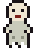 | 객귀 | 집 밖이나 객지에서 죽은 사람의 혼령. 다가와 들러붙어 3초 동안 걸음을 무겁게 한다(이동 −35%). |
| 중간 보스 | 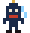 | 야광귀 | 설날 밤 신발을 훔쳐 가는 귀신.  기술: 신발 훔치기, 원한 산탄, 그림자 걸음 · 필살기: 혼불 고리 |
| 막 보스 |  | 대장 도깨비 | 도깨비들의 우두머리. 방망이로 금을 쏟아 낸다.  기술: 내려찍기, 원한 산탄, 졸개 부르기, 돌진 · 필살기: 금 나와라 뚝딱! |

### 제2막 · 대숲 오솔길

| 구분 | | 요괴 | 설명 |
|---|:---:|---|---|
| 일반 | 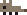 | 둔갑쥐 | 둔갑하는 쥐. 떼로 빠르게 달려든다. |
| 일반 | 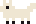 | 백여우 | 흰 여우. 잠시 멈췄다가 덮친다. |
| 엘리트 | 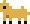 | 삼족구 | 다리가 셋인 개. 여우를 쫓는다고 한다. |
| 엘리트(중간 보스 뒤, v19.4) |  | 죽통 나그네 | 대나무 통에 여인 둘을 넣고 다니는 나그네. 8초마다 통을 열어 대통 여인을 불러낸다(동시 최대 4). |
| 중간 보스 | 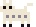 | 장산범 | 사람 목소리를 흉내 내어 홀리는 흰 짐승.  기술: 홀림, 삼연 질주 · 필살기: 삼연 질주 |
| 막 보스 |  | 구미호 | 천 년 묵은 아홉 꼬리 여우.  기술: 원혼 구슬, 삼연 질주, 부채꼴 탄, 홀림 · 필살기: 천년 환영 |

### 제3막 · 범 나오는 고개

| 구분 | | 요괴 | 설명 |
|---|:---:|---|---|
| 일반 | 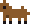 | 식인견 | 사람을 무는 들개. |
| 일반 |  | 창귀 | 범에게 먹힌 넋. 멀리서 홀리는 기운을 던진다. |
| 일반 |  | 삼목구 | 눈이 셋 달린 개. 멈칫한 뒤 돌진한다. |
| 엘리트 | 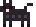 | 흑호 | 검은 범. |
| 엘리트(중간 보스 뒤, v19.4) |  | 범이 된 남편 | 부적으로 범이 되었다가 사람으로 돌아오지 못한 남자. 7초마다 웅크렸다가(떨어질 자리 경고) 덮친다. |
| 중간 보스 |  | 금돼지 | 금빛 털의 큰 돼지.  기술: 돌진, 졸개 부르기 · 필살기: 돌진 |
| 막 보스 | 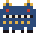 | 강철이 | 바람과 비, 우박을 몰고 다니는 짐승.  기술: 돌진, 우박, 원한 산탄, 번개 질주 · 필살기: 우박 폭풍 |

### 제4막 · 안개 낀 나루

| 구분 | | 요괴 | 설명 |
|---|:---:|---|---|
| 일반 |  | 이어인 | 물고기 얼굴의 사람. 뛰어오르며 다가온다. |
| 일반 |  | 금혈어 | 허공을 헤엄치는 금빛 물고기. |
| 일반 |  | 인어 | 물빛 꼬리의 인어. 물방울을 쏜다. |
| 엘리트 |  | 탄주어 | 배를 삼킬 만큼 큰 물고기. |
| 엘리트(중간 보스 뒤, v19.4) |  | 곰나루 암곰 | 곰나루 전설의 암곰. 새끼 곰 둘과 나오고, 새끼가 쓰러질 때마다 이동·피해 +25%. |
| 중간 보스 |  | 거대하 | 거대한 새우.  기술: 부채꼴 탄, 물기둥 · 필살기: 물기둥 |
| 막 보스 |  | 이무기 | 용이 되지 못한 큰 뱀.  기술: 물줄기 소용돌이, 휘감기, 물기둥, 독안개 · 필살기: 승천 |

### 제5막 · 폐허가 된 산사

| 구분 | | 요괴 | 설명 |
|---|:---:|---|---|
| 일반 |  | 손각시 | 시집을 가지 못하고 죽은 처녀의 넋. 떠다니며 한 맺힌 기운을 던진다. 출처: 한국민족문화대백과사전 「손각시」 · 던지는 행동은 게임 속 각색 |
| 일반 |  | 달걀귀 | 얼굴이 달걀처럼 밋밋한 귀신. |
| 일반 |  | 몽달귀 | 총각의 넋. 갓을 쓰고 떠돈다. |
| 엘리트 |  | 팔척귀 | 키가 여덟 자인 귀신. |
| 엘리트(중간 보스 뒤, v19.4) |  | 길달 | 사람으로 나타나 벼슬을 하던 도깨비(『삼국유사』). 6초마다 여우로 변해 사라졌다가 가까운 다른 곳에 나타나며 탄을 뿌린다. |
| 중간 보스 |  | 염매 | 저주로 만들어진 원귀.  기술: 원혼 구슬, 독안개 · 필살기: 원혼 구슬 |
| 막 보스 |  | 어둑시니 | 쳐다볼수록 커지는 어둠.  기술: 그림자 걸음, 원혼 구슬, 혼불 고리, 졸개 부르기 · 필살기: 칠흑 |

### 제6막 · 역병 도는 마을

| 구분 | | 요괴 | 설명 |
|---|:---:|---|---|
| 일반 |  | 황충 | 메뚜기 떼. 작고 빠르다. |
| 일반 |  | 식인충 | 쓰러지면 황충 두 마리로 갈라진다. |
| 일반 |  | 골생충 | 뼈빛 벌레. 독침을 뱉는다. |
| 엘리트 |  | 사두충 | 머리가 넷인 벌레. |
| 엘리트(중간 보스 뒤, v19.5) |  | 여귀 | 비명횡사해 기댈 데 없는 외로운 혼. 1초마다 독 안개 장판을 남긴다(5초, 동시 최대 8). |
| 중간 보스 |  | 역신 | 돌림병을 퍼뜨리는 귀신.  기술: 돌림병, 원한 산탄 · 필살기: 돌림병 |
| 막 보스 | 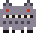 | 불가사리 | 쇠를 먹고 커지는 괴물. 불에 타지 않는다.  기술: 쇠가시, 돌진, 내려찍기, 쇠 먹기 · 필살기: 쇠 삼키기 |

### 제7막 · 백두산 골짜기

| 구분 | | 요괴 | 설명 |
|---|:---:|---|---|
| 일반 | 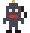 | 조마구 | 작고 날랜 산속 요괴. |
| 일반 |  | 백두야차 | 눈 덮인 산의 야차. |
| 일반 |  | 금강야차 | 금빛 야차. 힘을 모았다가 들이받는다. |
| 엘리트 |  | 대인 | 산만 한 거인. |
| 엘리트(중간 보스 뒤, v19.5) |  | 흑룡 | 백두산 전설에서 물줄기를 말리고 태양을 훔치려 한 악룡. 10초마다 4초 동안 화면 가장자리가 어두워진다(가운데는 보임). |
| 중간 보스 | 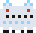 | 백두산괴 | 백두산에 산다는 흰 괴물.  기술: 내려찍기, 우박 · 필살기: 우박 |
| 막 보스 | 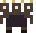 | 지하국대적 | 땅속 나라의 도적 우두머리.  기술: 세 머리 숨결, 졸개 부르기, 내려찍기, 원한 산탄 · 필살기: 아홉 머리 |

### 제8막 · 동해 바닷가

| 구분 | | 요괴 | 설명 |
|---|:---:|---|---|
| 일반 |  | 인면조 | 사람 얼굴을 한 새. |
| 일반 |  | 해중조 | 바다 위를 나는 새. 깃털을 날린다. |
| 일반 | 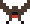 | 마명조 | 말 울음소리를 내는 새. 내리꽂힌다. |
| 엘리트 |  | 천구 | 하늘을 달리는 개. |
| 엘리트(중간 보스 뒤, v19.5) |  | 바닷속 큰 메기 | 밀물·썰물을 일으킨다는 큰 메기. 3초 끌어당김 ↔ 3초 밀쳐 냄(보스가 끌어당기는 동안은 쉼). |
| 중간 보스 |  | 불개 | 해와 달을 물어뜯는다는 불의 개.  기술: 돌진, 불길 질주 · 필살기: 불길 질주 |
| 막 보스 | 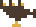 | 삼두일족응 | 머리 셋에 다리 하나인 매.  기술: 급강하, 깃털 화살, 부채꼴 탄, 원혼 구슬 · 필살기: 세 머리 급강하 |

### 제9막 · 저승길

| 구분 | | 요괴 | 설명 |
|---|:---:|---|---|
| 일반 |  | 혼쥐 | 혼이 깃든 쥐. 떼로 몰려온다. |
| 일반 |  | 귀곡성 | 귀신 울음. 사라질 때 원한을 흩뿌린다. |
| 일반 |  | 지박령 | 한 자리에 묶인 넋. 느리지만 질기다. |
| 엘리트 |  | 태자귀 | 어린아이의 넋. |
| 엘리트(중간 보스 뒤, v19.5) | 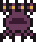 | 삼두구미 | 제주 무가 〈삼두구미본〉의 괴물. 쓰러지면 머리 하나를 잃고 체력 20%로 한 번 다시 일어난다. |
| 중간 보스 |  | 지귀 | 몸이 불이 되어 버린 넋.  기술: 불길 질주, 혼불 고리 · 필살기: 불길 질주 |
| 막 보스 |  | 저승사자 | 명부를 들고 넋을 거두러 온다.  기술: 명부 낙인, 저승 문, 그림자 걸음, 혼불 고리 · 필살기: 명부 집행 |

### 제10막 · 근정전 앞뜰

| 구분 | | 요괴 | 설명 |
|---|:---:|---|---|
| 일반 |  | 그슨새 | 검은 새. 어둠 속에서 내리꽂힌다. |
| 일반 |  | 두두리 | 쇠를 다루는 도깨비. |
| 엘리트 |  | 영노 | 탈판에 나와 양반을 잡아먹겠다는 괴물. |
| 엘리트(중간 보스 뒤, v19.5) |  | 화마 | 궁궐의 불기운. 2초마다 불 장판 셋. 뜰에 놓인 물독 드므 곁에 오면 불이 꺼지고 받는 피해 ×1.5. |
| 중간 보스 |  | 장자마리 | 탈놀이에서 춤추며 판을 여는 자.  기술: 탈춤, 저승 문 · 필살기: 탈춤 |
| 막 보스 |  | 그슨대 | 밤길을 막아서는 거대한 검은 그림자.  기술: 그림자 고리, 명부 낙인, 저승 문, 커지기 · 필살기: 그림자 장막, 칠흑 |

## 2부 「압록강까지」 (v22.0)

제10막을 평정하면 의금부의 **판의금부사**(이름 없는 가상 인물)가 전갈을 가져온다. 「북으로 간다」를 고르면 같은 판에서 제11~15막을 더 치른다. 요괴는 모두 『산해경』(Project Gutenberg #25288, 공개 저작물) 원문 묘사를 바탕으로 새로 그린 각색이며, 괄호 안이 원문이다. 제강·촉음은 원문에서 신(神)이라 쓰러뜨리면 「잠재운다」.

### 제11막 · 홍제원 고개

| 구분 | | 요괴 | 설명 |
|---|:---:|---|---|
| 일반 |  | 필방 | 사람 얼굴에 다리가 하나인 새(『산해경』 해외남경 「為鳥人面一腳」). 불씨를 던지는 것은 게임 속 각색. |
| 일반 |  | 쟁 | 붉은 표범 같고 꼬리 다섯에 뿔 하나, 돌을 치는 소리를 낸다(『산해경』 서산경 「如赤豹，五尾一角，其音如擊石」). |
| 일반 |  | 고조 | 수리 같은데 뿔이 있고 아기 울음소리를 내며 사람을 먹는다(『산해경』 남산경 「如雕而有角，其音如嬰兒」). |
| 엘리트 | 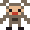 | 장우 | 원숭이 같은데 귀가 넷이다(『산해경』 남산경 「其狀如禺而四耳，其名長右」). |
| 엘리트(중간 보스 뒤) |  | 효 | 원숭이 같은데 팔이 길고 잘 던진다(『산해경』 서산경 「其狀如禺而長臂，善投，其名曰嚻」). 바위를 던지는 것은 게임 속 각색. 성난 행동: 바위 셋을 한꺼번에 던진다. |
| 중간 보스 |  | 마복 | 사람 얼굴에 범의 몸, 아기 울음소리를 내며 사람을 먹는다(『산해경』 중산경 「人面虎身，其音如嬰兒」).  기술: 돌진, 삼연 질주 · 필살기: 돌진 |
| 막 보스 | 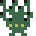 | 상류 | 공공의 신하로 머리가 아홉이다(『산해경』 해외북경 「共工之臣曰相柳氏，九首」). 독을 뿜는 것은 게임 속 각색.  기술: 세 머리 숨결, 물줄기 소용돌이, 내려찍기, 아홉 머리의 독 · 필살기: 아홉 머리 |

### 제12막 · 임진나루

| 구분 | | 요괴 | 설명 |
|---|:---:|---|---|
| 일반 |  | 문요어 | 물고기 몸에 새 날개, 푸른 무늬에 흰 머리·붉은 부리, 밤에 난다(『산해경』 서산경 「魚身而鳥翼…以夜飛」). |
| 일반 |  | 고조 | 수리 같은데 뿔이 있고 아기 울음소리를 내며 사람을 먹는다(『산해경』 남산경 「如雕而有角，其音如嬰兒」). |
| 일반 |  | 하라어 | 머리 하나에 몸이 열인 물고기, 개 짖는 소리를 낸다(『산해경』 북산경 「一首而十身，其音如吠犬」). 쪼개지는 것은 각색. |
| 엘리트 | 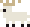 | 부제 | 흰 사슴 같고 뿔이 넷이며, 나타나면 그 고을에 큰물이 진다(『산해경』 중산경 「如白鹿而四角…見則其邑大水」). |
| 엘리트(중간 보스 뒤) | 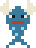 | 영어 | 물고기 몸에 새 날개, 원앙 소리를 내며 나타나면 고을에 큰물이 진다(『산해경』 서산경 「嬴魚，魚身而鳥翼，音如鴛鴦，見則其邑大水」). 지나간 자리에 물웅덩이를 남기는 것은 각색. 성난 행동: 물살 여덟 줄기를 사방으로 뿜는다. |
| 중간 보스 | 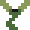 | 명사 | 뱀 같은데 날개가 넷, 경쇠 소리를 내며 나타나면 고을에 큰 가뭄이 든다(『산해경』 중산경 「如蛇而四翼，其音如磬」).  기술: 부채꼴 탄, 물기둥 · 필살기: 부채꼴 탄 |
| 막 보스 |  | 화사 | 사람 얼굴에 승냥이 몸, 새 날개로 뱀처럼 기며, 나타나면 고을에 큰물이 진다(『산해경』 중산경 「人面而豺身，鳥翼而蛇行」).  기술: 휘감기, 부채꼴 탄, 물줄기 소용돌이, 큰물 · 필살기: 큰물이 진다 |

### 제13막 · 송악 아래 개성

| 구분 | | 요괴 | 설명 |
|---|:---:|---|---|
| 일반 |  | 저여 | 쥐 같고 귀와 주둥이가 희며, 나타나면 나라에 큰 싸움이 난다(『산해경』 중산경 「白耳白喙…見則其國有大兵」). |
| 일반 |  | 쟁 | 붉은 표범 같고 꼬리 다섯에 뿔 하나, 돌을 치는 소리를 낸다(『산해경』 서산경 「如赤豹，五尾一角，其音如擊石」). |
| 일반 | 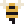 | 흠원 | 벌 같은 새로 원앙만큼 크며, 쏘인 새와 짐승은 죽고 나무는 마른다(『산해경』 서산경 「其狀如蜂，大如鴛鴦」). |
| 엘리트 | 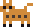 | 체 | 범 같은데 소 꼬리가 있고, 개 짖는 소리를 내며 사람을 먹는다(『산해경』 남산경 「如虎而牛尾，其音如吠犬」). |
| 엘리트(중간 보스 뒤) | 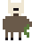 | 비 | 소 같고 머리가 희며 눈이 하나에 뱀 꼬리. 물로 가면 물이 마르고 풀로 가면 풀이 죽으며, 나타나면 천하에 큰 역병이 돈다(『산해경』 동산경 「行水則竭，行草則死，見則天下大疫」). 마른 독 땅은 각색. 성난 행동: 자기 둘레를 크게 말려 독 땅을 만든다. |
| 중간 보스 |  | 제건 | 표범 같은데 꼬리가 길고 사람 머리에 소 귀, 눈이 하나이며 꼬리를 물고 다닌다(『산해경』 북산경 「如豹而長尾，人首而牛耳，一目」).  기술: 돌진, 원한 산탄 · 필살기: 혼불 고리 |
| 막 보스 |  | 제강 | 누런 자루 같고 붉은 불빛, 다리 여섯·날개 넷에 얼굴이 없으며 노래와 춤을 안다(『산해경』 서산경 「渾敦無面目，是識歌舞」). 원문의 신(神)이라 「잠재운다」.  기술: 혼돈의 춤, 탈춤, 그림자 걸음, 혼불 고리 · 필살기: 혼돈의 춤 |

### 제14막 · 대동강 평양성

| 구분 | | 요괴 | 설명 |
|---|:---:|---|---|
| 일반 |  | 서거 | 소 같고 몸이 푸르며 아기 울음소리를 내고 사람을 먹는다(『산해경』 중산경 「其狀如牛。蒼身，其音如嬰兒」). |
| 일반 |  | 문요어 | 물고기 몸에 새 날개, 푸른 무늬에 흰 머리·붉은 부리, 밤에 난다(『산해경』 서산경 「魚身而鳥翼…以夜飛」). |
| 일반 |  | 흠원 | 벌 같은 새로 원앙만큼 크며, 쏘인 새와 짐승은 죽고 나무는 마른다(『산해경』 서산경 「其狀如蜂，大如鴛鴦」). |
| 엘리트 |  | 옹화 | 원숭이 같고 눈과 부리가 붉고 몸은 누러며, 나타나면 나라에 큰 두려움이 인다(『산해경』 중산경 「赤目，赤喙，黃身」). |
| 엘리트(중간 보스 뒤) |  | 주염 | 원숭이 같고 머리가 희고 발이 붉으며, 나타나면 큰 싸움이 난다(『산해경』 서산경 「其狀如猿，而白首赤足，名曰朱厭，見則大兵」). 둘레 요괴를 북돋우는 것은 각색. 성난 행동: 외침과 함께 탄 여섯 발을 부채꼴로 쏜다. |
| 중간 보스 | 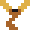 | 비유 | 다리 여섯에 날개 넷인 뱀, 나타나면 온 세상이 크게 가문다(『산해경』 서산경 태화산 「六足四翼，見則天下大旱」).  기술: 불길 질주, 부채꼴 탄 · 필살기: 불길 질주 |
| 막 보스 | 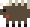 | 궁기 | 소 같고 고슴도치 털에 개 짖는 소리를 내며 사람을 먹는다(『산해경』 서산경 「其狀如牛，蝟毛…名曰窮奇」).  기술: 고슴도치 털, 돌진, 삼연 질주, 내려찍기 · 필살기: 고슴도치 털 |

### 제15막 · 의주 압록강

| 구분 | | 요괴 | 설명 |
|---|:---:|---|---|
| 일반 |  | 저여 | 쥐 같고 귀와 주둥이가 희며, 나타나면 나라에 큰 싸움이 난다(『산해경』 중산경 「白耳白喙…見則其國有大兵」). |
| 일반 |  | 필방 | 사람 얼굴에 다리가 하나인 새(『산해경』 해외남경 「為鳥人面一腳」). 불씨를 던지는 것은 게임 속 각색. |
| 일반 |  | 서거 | 소 같고 몸이 푸르며 아기 울음소리를 내고 사람을 먹는다(『산해경』 중산경 「其狀如牛。蒼身，其音如嬰兒」). |
| 엘리트 |  | 장우 | 원숭이 같은데 귀가 넷이다(『산해경』 남산경 「其狀如禺而四耳，其名長右」). |
| 엘리트(중간 보스 뒤) | 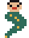 | 고 | 종산 신의 아들. 사람 얼굴에 용의 몸이다(『산해경』 서산경 「其子曰鼓，其狀如人面而龍身」). 퇴마사 둘레를 감아 도는 것은 각색. 성난 행동: 용의 몸을 뒤틀어 퇴마사 자리에 큰 경고를 남긴다. |
| 중간 보스 | 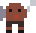 | 형천 | 천제와 신의 자리를 다투다 머리가 잘렸다(『산해경』 해외서경 「形天與帝至此爭神，帝斷其首」). 방패·도끼는 전해지는 이야기를 따른 각색.  기술: 돌진, 내려찍기 · 필살기: 내려찍기 |
| 막 보스 | 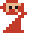 | 촉음 | 종산의 신. 눈을 뜨면 낮이 되고 감으면 밤이 된다(『산해경』 해외북경 「鐘山之神，名曰燭陰，視為晝，瞑為夜」). 원문의 신(神)이라 「잠재운다」.  기술: 물줄기 소용돌이, 혼불 고리, 독안개, 눈을 뜨다 · 필살기: 눈을 감다 · 밤, 눈을 뜨다 · 낮 |

