# 요괴와 보스

[← README](../../README.md) · 다른 안내서는 README의 「목차」에서 봅니다.

## 9. 요괴와 보스

요괴 이름은 『한국 요괴 도감』을 따랐고 행동은 새로 지었습니다. 보스는 자기 기술 가운데 무작위로 골라 쓰고, 체력이 일정 비율 아래로 떨어질 때마다 **필살기**를 씁니다. 쉬움은 정해진 순서로, 어려움은 다른 보스의 기술 둘을 더 빌려 씁니다.

### 제1막 · 한양 저잣거리

| 구분 | | 요괴 | 설명 |
|---|:---:|---|---|
| 일반 |  | 귀화 | 떠도는 도깨비불. 흔들리며 다가온다. |
| 일반 |  | 꺼먹살이 | 검은 그림자 덩어리. 무리 지어 몰려온다. |
| 일반 |  | 도깨비 | 방망이를 든 도깨비. 곧장 다가온다. |
| 엘리트 |  | 걸귀 | 늘 굶주린 귀신. 원한 탄을 사방으로 뿌린다. |
| 엘리트(중간 보스 뒤, v19.4) | 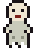 | 객귀 | 집 밖이나 객지에서 죽은 사람의 혼령. 다가와 들러붙어 3초 동안 걸음을 무겁게 한다(이동 −35%). |
| 중간 보스 |  | 야광귀 | 설날 밤 신발을 훔쳐 가는 귀신.  기술: 신발 훔치기, 원한 산탄, 그림자 걸음 · 필살기: 혼불 고리 |
| 막 보스 |  | 대장 도깨비 | 도깨비들의 우두머리. 방망이로 금을 쏟아 낸다.  기술: 내려찍기, 원한 산탄, 졸개 부르기, 돌진 · 필살기: 금 나와라 뚝딱! |

### 제2막 · 대숲 오솔길

| 구분 | | 요괴 | 설명 |
|---|:---:|---|---|
| 일반 | 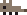 | 둔갑쥐 | 둔갑하는 쥐. 떼로 빠르게 달려든다. |
| 일반 | 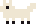 | 백여우 | 흰 여우. 잠시 멈췄다가 덮친다. |
| 엘리트 |  | 삼족구 | 다리가 셋인 개. 여우를 쫓는다고 한다. |
| 엘리트(중간 보스 뒤, v19.4) |  | 죽통 나그네 | 대나무 통에 여인 둘을 넣고 다니는 나그네. 8초마다 통을 열어 대통 여인을 불러낸다(동시 최대 4). |
| 중간 보스 | 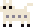 | 장산범 | 사람 목소리를 흉내 내어 홀리는 흰 짐승.  기술: 홀림, 삼연 질주 · 필살기: 삼연 질주 |
| 막 보스 |  | 구미호 | 천 년 묵은 아홉 꼬리 여우.  기술: 원혼 구슬, 삼연 질주, 부채꼴 탄, 홀림 · 필살기: 천년 환영 |

### 제3막 · 범 나오는 고개

| 구분 | | 요괴 | 설명 |
|---|:---:|---|---|
| 일반 | 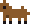 | 식인견 | 사람을 무는 들개. |
| 일반 |  | 창귀 | 범에게 먹힌 넋. 멀리서 홀리는 기운을 던진다. |
| 일반 |  | 삼목구 | 눈이 셋 달린 개. 멈칫한 뒤 돌진한다. |
| 엘리트 | 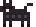 | 흑호 | 검은 범. |
| 엘리트(중간 보스 뒤, v19.4) | 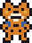 | 범이 된 남편 | 부적으로 범이 되었다가 사람으로 돌아오지 못한 남자. 7초마다 웅크렸다가(떨어질 자리 경고) 덮친다. |
| 중간 보스 |  | 금돼지 | 금빛 털의 큰 돼지.  기술: 돌진, 졸개 부르기 · 필살기: 돌진 |
| 막 보스 | 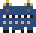 | 강철이 | 바람과 비, 우박을 몰고 다니는 짐승.  기술: 돌진, 우박, 원한 산탄, 번개 질주 · 필살기: 우박 폭풍 |

### 제4막 · 안개 낀 나루

| 구분 | | 요괴 | 설명 |
|---|:---:|---|---|
| 일반 |  | 이어인 | 물고기 얼굴의 사람. 뛰어오르며 다가온다. |
| 일반 |  | 금혈어 | 허공을 헤엄치는 금빛 물고기. |
| 일반 |  | 인어 | 물빛 꼬리의 인어. 물방울을 쏜다. |
| 엘리트 |  | 탄주어 | 배를 삼킬 만큼 큰 물고기. |
| 엘리트(중간 보스 뒤, v19.4) | 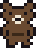 | 곰나루 암곰 | 곰나루 전설의 암곰. 새끼 곰 둘과 나오고, 새끼가 쓰러질 때마다 이동·피해 +25%. |
| 중간 보스 |  | 거대하 | 거대한 새우.  기술: 부채꼴 탄, 물기둥 · 필살기: 물기둥 |
| 막 보스 |  | 이무기 | 용이 되지 못한 큰 뱀.  기술: 물줄기 소용돌이, 휘감기, 물기둥, 독안개 · 필살기: 승천 |

### 제5막 · 폐허가 된 산사

| 구분 | | 요괴 | 설명 |
|---|:---:|---|---|
| 일반 |  | 손각시 | 시집을 가지 못하고 죽은 처녀의 넋. 떠다니며 한 맺힌 기운을 던진다. 출처: 한국민족문화대백과사전 「손각시」 · 던지는 행동은 게임 속 각색 |
| 일반 |  | 달걀귀 | 얼굴이 달걀처럼 밋밋한 귀신. |
| 일반 |  | 몽달귀 | 총각의 넋. 갓을 쓰고 떠돈다. |
| 엘리트 |  | 팔척귀 | 키가 여덟 자인 귀신. |
| 엘리트(중간 보스 뒤, v19.4) |  | 길달 | 사람으로 나타나 벼슬을 하던 도깨비(『삼국유사』). 6초마다 여우로 변해 사라졌다가 가까운 다른 곳에 나타나며 탄을 뿌린다. |
| 중간 보스 |  | 염매 | 저주로 만들어진 원귀.  기술: 원혼 구슬, 독안개 · 필살기: 원혼 구슬 |
| 막 보스 |  | 어둑시니 | 쳐다볼수록 커지는 어둠.  기술: 그림자 걸음, 원혼 구슬, 혼불 고리, 졸개 부르기 · 필살기: 칠흑 |

### 제6막 · 역병 도는 마을

| 구분 | | 요괴 | 설명 |
|---|:---:|---|---|
| 일반 |  | 황충 | 메뚜기 떼. 작고 빠르다. |
| 일반 |  | 식인충 | 쓰러지면 황충 두 마리로 갈라진다. |
| 일반 |  | 골생충 | 뼈빛 벌레. 독침을 뱉는다. |
| 엘리트 |  | 사두충 | 머리가 넷인 벌레. |
| 엘리트(중간 보스 뒤, v19.5) |  | 여귀 | 비명횡사해 기댈 데 없는 외로운 혼. 1초마다 독 안개 장판을 남긴다(5초, 동시 최대 8). |
| 중간 보스 |  | 역신 | 돌림병을 퍼뜨리는 귀신.  기술: 돌림병, 원한 산탄 · 필살기: 돌림병 |
| 막 보스 | 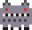 | 불가사리 | 쇠를 먹고 커지는 괴물. 불에 타지 않는다.  기술: 쇠가시, 돌진, 내려찍기, 쇠 먹기 · 필살기: 쇠 삼키기 |

### 제7막 · 백두산 골짜기

| 구분 | | 요괴 | 설명 |
|---|:---:|---|---|
| 일반 |  | 조마구 | 작고 날랜 산속 요괴. |
| 일반 |  | 백두야차 | 눈 덮인 산의 야차. |
| 일반 |  | 금강야차 | 금빛 야차. 힘을 모았다가 들이받는다. |
| 엘리트 |  | 대인 | 산만 한 거인. |
| 엘리트(중간 보스 뒤, v19.5) |  | 흑룡 | 백두산 전설에서 물줄기를 말리고 태양을 훔치려 한 악룡. 10초마다 4초 동안 화면 가장자리가 어두워진다(가운데는 보임). |
| 중간 보스 | 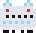 | 백두산괴 | 백두산에 산다는 흰 괴물.  기술: 내려찍기, 우박 · 필살기: 우박 |
| 막 보스 | 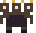 | 지하국대적 | 땅속 나라의 도적 우두머리.  기술: 세 머리 숨결, 졸개 부르기, 내려찍기, 원한 산탄 · 필살기: 아홉 머리 |

### 제8막 · 동해 바닷가

| 구분 | | 요괴 | 설명 |
|---|:---:|---|---|
| 일반 |  | 인면조 | 사람 얼굴을 한 새. |
| 일반 |  | 해중조 | 바다 위를 나는 새. 깃털을 날린다. |
| 일반 |  | 마명조 | 말 울음소리를 내는 새. 내리꽂힌다. |
| 엘리트 |  | 천구 | 하늘을 달리는 개. |
| 엘리트(중간 보스 뒤, v19.5) |  | 바닷속 큰 메기 | 밀물·썰물을 일으킨다는 큰 메기. 3초 끌어당김 ↔ 3초 밀쳐 냄(보스가 끌어당기는 동안은 쉼). |
| 중간 보스 |  | 불개 | 해와 달을 물어뜯는다는 불의 개.  기술: 돌진, 불길 질주 · 필살기: 불길 질주 |
| 막 보스 | 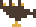 | 삼두일족응 | 머리 셋에 다리 하나인 매.  기술: 급강하, 깃털 화살, 부채꼴 탄, 원혼 구슬 · 필살기: 세 머리 급강하 |

### 제9막 · 저승길

| 구분 | | 요괴 | 설명 |
|---|:---:|---|---|
| 일반 |  | 혼쥐 | 혼이 깃든 쥐. 떼로 몰려온다. |
| 일반 |  | 귀곡성 | 귀신 울음. 사라질 때 원한을 흩뿌린다. |
| 일반 |  | 지박령 | 한 자리에 묶인 넋. 느리지만 질기다. |
| 엘리트 |  | 태자귀 | 어린아이의 넋. |
| 엘리트(중간 보스 뒤, v19.5) | 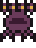 | 삼두구미 | 제주 무가 〈삼두구미본〉의 괴물. 쓰러지면 머리 하나를 잃고 체력 20%로 한 번 다시 일어난다. |
| 중간 보스 |  | 지귀 | 몸이 불이 되어 버린 넋.  기술: 불길 질주, 혼불 고리 · 필살기: 불길 질주 |
| 막 보스 |  | 저승사자 | 명부를 들고 넋을 거두러 온다.  기술: 명부 낙인, 저승 문, 그림자 걸음, 혼불 고리 · 필살기: 명부 집행 |

### 제10막 · 근정전 앞뜰

| 구분 | | 요괴 | 설명 |
|---|:---:|---|---|
| 일반 |  | 그슨새 | 검은 새. 어둠 속에서 내리꽂힌다. |
| 일반 |  | 두두리 | 쇠를 다루는 도깨비. |
| 엘리트 |  | 영노 | 탈판에 나와 양반을 잡아먹겠다는 괴물. |
| 엘리트(중간 보스 뒤, v19.5) |  | 화마 | 궁궐의 불기운. 2초마다 불 장판 셋. 뜰에 놓인 물독 드므 곁에 오면 불이 꺼지고 받는 피해 ×1.5. |
| 중간 보스 |  | 장자마리 | 탈놀이에서 춤추며 판을 여는 자.  기술: 탈춤, 저승 문 · 필살기: 탈춤 |
| 막 보스 |  | 그슨대 | 밤길을 막아서는 거대한 검은 그림자.  기술: 그림자 고리, 명부 낙인, 저승 문, 커지기 · 필살기: 그림자 장막, 칠흑 |
