# 출정 밖의 성장과 규칙

[← README](../../README.md) · 다른 안내서는 README의 「목차」에서 봅니다.

## 11. 출정 밖의 성장과 규칙

###  끝없는 밤

제10막을 평정하면 출정을 마치거나 **끝없는 밤**으로 이어 갈 수 있습니다. 이어 가면 제1막부터 다시 돌며, 바퀴마다 요괴 체력 ×1.9 · 받는 피해 ×1.3 · 엽전 +25%가 겹쳐 쌓입니다. 쓰러져도 평정은 이미 인정되고 바퀴마다 엽전 150닢이 더해집니다. 가장 멀리 간 바퀴는 퇴마록에 남습니다. (뱀파이어 서바이버즈·Crab Champions의 무한 진행에서 착안)

###  스치기

요괴 탄을 맞지 않고 아슬아슬하게 스쳐 지나가면 「스침」이 뜹니다. 스칠 때마다 신내림 게이지가 1.2 차고, 2초 동안 모든 무기의 재사용 대기가 15% 짧아집니다. 회피 기술 없이도 탄막 사이를 누빌수록 강해집니다. (Picayune Dreams의 탄막 회피에서 착안)

###  퇴마 원정 (보스 연전 모드)

출정 준비에서 「퇴마 원정」을 고르면 **보스만 열 번** 연달아 상대합니다. 막마다 보스 셋이 하·중·상 등급으로 제시되고, 하나를 골라 싸웁니다. 요괴는 평소보다 적게 나오고, 시작할 때 레벨업 세 번을 받습니다. 보스를 쓰러뜨리면 **넋의 선물**을 고릅니다. (The Void Rains Upon Her Heart의 보스 선택·보스 레벨에서 착안)

| 등급 | 체력 | 빌린 기술 | 그 밖 | 넋의 선물 |
|---|---|---|---|---|
|  하급 | ×0.8 | 0개 | - | 1개 |
|  중급 | ×1.25 | 1개 | - | 1개 |
|  상급 | ×1.8 | 2개 | 필살기 한 번 더 | 2개 |

넋의 선물(셋 가운데 하나):  **신령의 축복**(신령 셋 가운데 하나의 축복을 받는다) ·  **보물 상자**(보물 상자 하나를 연다) ·  **깨달음**(곧바로 두 번 레벨업한다) ·  **인장**(무기 하나에 인장을 새긴다) ·  **기혈**(최대 체력 +20, 체력을 모두 채운다) ·  **신기**(신내림 게이지를 가득 채운다) ·  **노잣돈**(엽전을 받는다)

###  괴이 조사

막마다 한 번, 무대의 물건 하나가 이상하게 굽니다. 포도청 포졸이 그 둘레에 **금줄**(고추·숯·흰 종이를 끼운 새끼줄)을 치고 지키고 있어 평범한 장애물과 구별됩니다. 거꾸로 서거나, 피눈물을 흘리거나, 혼자 돕니다. 화면 가장자리 보라색 화살표를 따라가 곁에 2.5초 머물면 조사해 엽전·신내림·깨달음·인장 가운데 하나를 받습니다. 처음 조사한 괴이는 퇴마록의 「괴이록」에 남고, 괴이를 2·5·8·12종 모으면 퇴마사마다 이야기 조각이 하나씩 열립니다(6명 × 4조각). (CAPTURED 2의 이상 현상 찾기에서 착안)

| | 괴이 | 모습 |
|:---:|---|---|
|  | 거꾸로 선 것 | 땅에 박힌 채 거꾸로 서 있다. 아무도 뒤집은 적이 없다. |
|  | 피눈물 흘리는 것 | 돌과 나무가 붉은 물을 흘린다. |
|  | 떨고 있는 것 | 바람 한 점 없는데 혼자 떨고 있다. |
|  | 비쳐 보이는 것 | 건너편이 비쳐 보인다. 손을 대면 서늘하다. |
|  | 혼자 도는 것 | 제자리에서 천천히 돌고 있다. |
|  | 둘로 보이는 것 | 분명 하나인데 둘로 보인다. |
|  | 숨 쉬는 것 | 부풀었다 줄었다 하며 숨을 쉰다. |
|  | 쪼그라든 것 | 제 크기의 절반으로 오그라들었다. |
|  | 떠오른 것 | 땅에서 한 뼘쯤 떠 있다. |
|  | 눈 뜬 것 | 붉은 눈 두 개가 지나가는 사람을 따라 움직인다. |
|  | 빛을 삼키는 것 | 둘레의 빛이 빨려 들어간다. |
|  | 좌우가 바뀐 것 | 거울에 비친 듯 좌우가 뒤집혀 있다. |

###  설화 흔적과 설화 출정 (이야기 모드)

게임 속 요괴와 인물이 나오는 옛이야기 세 편을 짧은 출정으로 따라갑니다.

**설화 흔적 모으기.** 본편(「출정」)에서 설화와 관계있는 막에 들어서면 금빛 흔적이 한 번 나타납니다. 화면 가장자리 금색 화살표를 따라가 곁에 2.5초 머물면 **설화 조각**을 얻고, 이야기 한 대목이 장면 창에 나옵니다. 조각 셋을 모으면 그 설화의 출정이 열립니다(장면 창 끝과 과업 알림 자리에 「열렸다」가 뜹니다). 퇴마 원정·설화 출정·끝없는 밤 두 바퀴째부터는 흔적이 나오지 않습니다.

| 흔적 | 설화 | 흔적이 나오는 막 | 퇴마사 |
|:---:|---|---|---|
|  낡은 족자 | 『전우치전』 | 제1막 한양 저잣거리 | 선비 |
|  굴 입구 | 『지하국대적』 | 제7막 백두산 골짜기 | 장수 |
|  서천꽃밭의 꽃 | 『바리공주』 | 제9막 저승길 | 무당 |

**설화 출정.** 출정 준비 → 출정 방식 「설화 출정」에서 설화를 고릅니다. 퇴마사·갈래·전직·레벨·무기가 설화마다 정해져 있고, 난이도는 보통으로 고정되며 점괘 패·액운·정표는 쓰지 않습니다. 세 막을 차례로 지나며, 막마다 90초 뒤(또는 막의 조건을 채우면) 이야기 보스가 나옵니다. 중간 보스·주막·갈림길·도깨비 보물은 없고, 막 사이에는 이야기 장면이 나온 뒤 체력을 50% 회복합니다. 레벨업·전직·축복은 본편처럼 받습니다.

| 설화 | 시작 힘 | 1막 | 2막 | 3막 |
|---|---|---|---|---|
| 『전우치전』 | 선비 · 감찰의 길 1차(암행어사) · Lv 12 · 먹탄 3, 합죽선 2 | **송도 장터** — 도사 전우치가 막 내내 곁에서 싸운다. 보스 「천서를 찾는 여우」(구미호) |  **곡식 나누기** — 떡 대신 곡식 섬이 떨어지고, 20섬을 모아야 보스 「곡식을 노리는 도깨비」(대장 도깨비) | **도술의 끝** — 전우치의 그림자들이 섞여 나온다. 보스 「전우치의 분신」 |
| 『지하국대적』 | 장수 · 지휘의 길 1차(만호) · Lv 14 · 환도 3, 편곤 2, 등패 1 | **어두운 굴** — 시야가 좁다. 보스 「굴을 지키는 산괴」(백두산괴) |  **우물가** — 우물 곁에 있으면 공격력이 초당 +6%씩 최대 +60%까지 오르고, 떨어지면 초당 10%씩 줄어든다. 보스 「대적의 불개」 | **대적의 집** — 떡 같은 회복 아이템이 나오지 않는다. 보스 「지하국 대적」 |
| 『바리공주』 | 무당 · 굿의 길 1차(큰무당) · Lv 14 · 부적 3, 바라 2, 방울 1 | **병든 나라** — 역병으로 초당 최대 체력의 0.4%를 잃는다(체력 1에서 멈춤). 보스 「역병의 신」(역신) |  **약수 긷기** — 우물 셋을 차례로 6초씩 지켜야 보스 「약수를 노리는 지귀」 |  **서천꽃밭** — 숨살이꽃·뼈살이꽃·살살이꽃을 모아야 보스 「저승사자」 |

**보상.** 처음 끝맺으면 그 퇴마사의 **옷 빛깔**(선비 쪽빛 도포 · 장수 청록 철릭 · 무당 흰 무명옷)이 열리고 바로 입혀집니다. 옷 빛깔은 출정 준비의 「차림」에서 고르며, 기본과 1~5차 모든 차림의 옷 색이 바뀝니다(능력치는 그대로). 다시 하면 **가장 빠른 완주 시간**에 도전합니다. 엽전은 본편과 같은 셈법으로 받습니다(막이 셋뿐이라 본편보다 적음). 수련 도장의 영구 강화는 설화 출정에도 적용됩니다. 설화 출정은 처치 수·요괴 도감·보스 퇴치 과업에는 쌓이지만, 최고 막·평정 수·액운 기록과 「제n막 도달」 과업에는 들어가지 않습니다. 도중에 쓰러지거나 그만두면 기록은 남지 않고, 모은 조각과 연 빛깔은 그대로입니다.

**본편 결말.** 제10막의 그슨대를 처음 쓰러뜨리면, 끝없는 밤으로 넘어가기 전에 결말 장면 네 쪽이 나옵니다. 퇴마사마다 처음 평정했을 때 그 퇴마사의 맺음말 한 쪽이 더 나옵니다. 결말과 맺음말, 설화 조각과 설화 결말은 퇴마록의 「설화록」에서 다시 읽을 수 있습니다.

### 난이도

| 난이도 | 내용 |
|---|---|
| 쉬움 | 요괴 체력 −30%, 받는 피해 −30%. 보스는 정해진 순서대로 기술을 쓰고 기술 사이 쉬는 틈이 길다. 중간 보스가 있는 동안 엘리트가 나오지 않는다. 엘리트 −30%. 전우치가 더 자주 온다. 출정 뒤 엽전 −30%. |
| 보통 | 보스는 자기 기술 가운데 무작위로 골라 쓴다. 중간 보스가 있는 동안 엘리트가 나오지 않는다. |
| 어려움 | 요괴 체력 +35%, 받는 피해 +25%. 보스마다 다른 보스의 기술 두 가지를 무작위로 빌려 와 섞어 쓰고, 기술 사이 틈이 짧다. 중간 보스도 필살기를 쓰며 엘리트를 거느리고 나온다. 엘리트 +20%. 전우치가 드물게 온다. 출정 뒤 엽전 +30%. |

### 점괘 패 (출정마다 세 장까지, v19.3)

| 점괘 패 | 효과 |
|---|---|
| 길일 | 경험치 +20%. 요괴가 15% 더 많이 나온다. |
| 흉년 | 떡이 나오지 않는다. 엽전을 두 배로 얻는다. |
| 역마살 | 이동 속도 +25%. 최대 체력 −20%. |
| 도화살 | 끌어오는 거리 두 배. 요괴 이동 속도 +10%. |
| 홍수 | 범위 +25%. 투사체 속도 −20%. |
| 백호살 | 치명타 +15%. 받는 피해 +20%. |
| 삼재 | 엘리트가 두 배로 나온다. 막을 끝낼 때 받는 보물상자에서 강화를 하나 더 얻는다. |
| 천을귀인 | 쓰러져도 한 번 되살아난다. 공격력 −10%. |
| 장원급제 | 레벨업 선택지 +1. 요괴 체력 +15%. |
| 문창성 | 전직 기술이 25% 더 자주 발동한다. 최대 체력 −10%. |
| 천살 | 요괴 체력 +30%. 경험치 +40%. |

### 액운 단계

제10막을 완주하면 다음 단계가 열립니다. 단계는 앞 단계의 효과를 모두 안고 가며, 단계마다 출정 뒤 받는 엽전이 15% 더 붙습니다.

| 단계 | 추가 효과 |
|---|---|
| 1 | 요괴 체력 +25% |
| 2 | 요괴 이동 속도 +10% |
| 3 | 엘리트가 두 배로 나온다 |
| 4 | 보스 체력 +35% |
| 5 | 떡 회복량이 절반 |
| 6 | 요괴가 25% 더 많이 나온다 |
| 7 | 요괴 탄 속도·피해 +20% |
| 8 | 중간 보스도 필살기를 쓴다 |
| 9 | 시작 최대 체력 −20% |
| 10 | 막 보스가 필살기를 한 번 더 쓴다 |

**액운 변종:** 액운 단계마다 변종 요괴가 나올 확률이 3%씩 오릅니다(어려움 +5%, 끝없는 밤 바퀴마다 +5%, 최대 45%). 변종은 발밑에 색 고리가 돕니다. (Dead Cells의 보스 세포 난이도에서 착안)

| 변종 | 특징 |
|---|---|
|  분열 | 쓰러지면 작은 둘로 갈라진다. |
|  독 | 쓰러진 자리에 독 웅덩이를 남긴다. |
|  질주 | 60% 더 빠르다. |
|  철갑 | 체력 2.2배, 밀려나지 않는다. |
|  저주 | 닿으면 1.5초 동안 느려진다. |

###  퇴마사 본부와 정표

출정이 끝나면 이기든 쓰러지든 **퇴마사 본부**로 돌아옵니다. 식구들은 출정을 거듭할수록, 정이 깊어질수록 새 이야기를 들려줍니다(이야기 버튼에 ! 표시). 주모와 전우치는 지난 출정의 결과를 두고 한마디씩 합니다. 막 의뢰로 얻은 **막걸리**를 건네면 정이 한 칸(최대 다섯 칸) 깊어지고, 처음 건넬 때 **정표**를 줍니다. 정표는 출정 준비나 본부에서 하나를 차고 나가며, 주막에서 바꿀 수 있습니다. (하데스의 저택과 넥타르·기념품에서 착안)

| | 식구 | 정표 | 효과 |
|:---:|---|---|---|
|  | **주모 순덕** 주막 주인 |  놋 국자 | 떡 회복량 +50%. |
|  | **도사 전우치** 떠돌이 도사 |  도술 부채 | 전우치가 25% 더 자주 돕는다. |
|  | **대장장이 무쇠** 명장 |  작은 망치 | 갈림길에 대장간이 꼭 나오고, 출정 10초 뒤 담금질 하나를 받는다. |
|  | **무녀 할멈** 산통 점쟁이 |  방울 한 쌍 | 출정마다 산통 흔들기 +2 · 물리기 +1. |
|  | **성황신** 마을 지킴이 |  오색 천 | 성황당 기도 시간 −40% · 신내림 게이지 30으로 시작. |
|  | **패랭이 도깨비** 샛길 주인 · 샛길에 한 번 든 뒤 나타남 |  헌 감투 | 도깨비 샛길이 막마다 열리고, 샛길에 내는 체력이 절반이 된다. |

###  수련 도장 (엽전으로 영구 강화)

수련마다 **갑**·**을** 두 길이 있습니다. 쌓은 단계는 그대로 둔 채 언제든 공짜로 길을 바꿀 수 있어, 판마다 다르게 맞춰 나갈 수 있습니다. (하데스의 밤의 거울에서 착안)

| 수련 | 갑 | 을 | 최대 |
|---|---|---|---|
| 단단한 몸 | 시작 최대 체력 +10 | **맑은 기혈** · 초당 체력 회복 +0.1 | 5 |
| 기합 | 공격력 +5% | **급소 찌르기** · 치명타 확률 +3% | 5 |
| 경공 | 이동 속도 +4% | **끌어당김** · 줍는 범위 +12% | 4 |
| 총명 | 경험치 획득 +10% | **재물운** · 출정 뒤 받는 엽전 +8% | 5 |
| 산통 손질 | 출정마다 산통 흔들기 +1 | **물리기 손질** · 출정마다 물리기 +1 | 2 |
| 혼백 부적 | 쓰러지면 한 번 되살아난다 | **금강 부적** · 받는 피해 −10% | 1 |

###  기록관

출정이 끝날 때마다 퇴마사·직업·결과·버틴 시간·처치 수·레벨·연격·무기와 보패 조합·주력 무기의 피해 비중을 **날짜와 함께** 남깁니다. 날짜는 세계관에 맞게 간지 해와 열두 시각으로 적습니다(예: 「병오년 시월 열이레 신시」, 괄호 안에 실제 날짜와 시각).

| 탭 | 내용 |
|---|---|
| 명예록 | 가장 빠른 새벽 · 한 출정 최다 처치 · 가장 높은 레벨 · 가장 오래 버틴 밤 · 가장 긴 연격 · 가장 큰 피해 · 가장 높은 액운 평정 · 가장 먼 끝없는 밤 · 가장 빠른 퇴마 원정 |
| 퇴마사별 | 출정·새벽 횟수, **가장 좋았던 판의 조합**(무기·보패·담금질·정표·점괘 패와 그 판의 주력), **분당 피해가 가장 큰 무기·기술 셋** |
| 출정 일지 | 최근 50번의 출정 |

### 퇴마록

- **과업 106개:** 요괴 처치 수, 막 도달, 전직, 진화, 각성 같은 목표를 이루면 엽전·캐릭터·무기·점괘 패·산통 같은 보상이 열립니다. 처음에는 선비만 고를 수 있고, 나머지 퇴마사는 과업으로 해금합니다.
- **다음 목표:** 출정 결과 화면에 「이번 출정으로 가까워진 과업」 셋이 「1/3 → 2/3」처럼 전후와 보상과 함께 나오고, 본부에는 「가까운 과업」 한 줄이 보입니다. 진행률이 높은 순이며, 셋 가운데 한 칸은 퇴마사·무기 해금 과업입니다. 아직 열지 않은 퇴마사의 전용 과업은 나오지 않습니다.
- **요괴 도감:** 만난 요괴 68종(v19.5)의 이름·설명·퇴치 수가 기록됩니다.
- **괴이록:** 조사한 괴이와 퇴마사별 이야기 조각이 기록됩니다.
- **설화록:** 본편 결말(공통 네 쪽과 퇴마사별 맺음말), 설화 세 편의 조각·결말·출처가 기록됩니다. 아직 보지 못한 쪽은 「???」로 열 조건만 보입니다.

### 과업 목록과 휘장

과업마다 도트 휘장이 있습니다. 이루지 못한 과업은 퇴마록에서 휘장이 어둡게 보이고, 이루는 순간 게임 화면 오른쪽 위에 휘장과 함께 「과업 달성」 알림이 5초 동안 떴다가 사라집니다. (Steam 도전 과제에서 착안)

#### 공통 과업 (61)

| 휘장 | 과업 | 조건 | 보상 |
|:---:|---|---|---|
|  | 첫 퇴마 | 요괴 100마리 퇴치 | 엽전 20 |
|  | 손에 익은 퇴마 | 요괴 1,000마리 퇴치 | 의원 해금 |
|  | 이름난 퇴마사 | 요괴 5,000마리 퇴치 | 산통 흔들기 +1 |
|  | 요괴의 천적 | 요괴 20,000마리 퇴치 | 점괘 패 · 천살 |
|  | 첫 고개를 넘다 | 제2막 도달 | 점괘 패 · 역마살 |
|  | 길이 열리다 | 제3막 도달 | 무당 해금 |
|  | 절반의 밤 | 제5막 도달 | 점괘 패 · 백호살 |
| 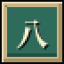 | 먼 바닷가 | 제8막 도달 | 엽전 200 |
|  | 새벽을 맞다 | 제10막 그슨대 퇴치 | 점괘 패 · 천을귀인, 액운 1 |
|  | 도깨비 방망이 | 대장 도깨비 퇴치 | 엽전 30 |
|  | 여우 사냥 | 구미호 퇴치 | 점괘 패 · 도화살 |
|  | 승천을 막다 | 이무기 퇴치 | 물리기 +1 |
|  | 명부를 찢다 | 저승사자 퇴치 | 봉인 +1 |
| 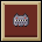 | 쇠를 먹는 괴물 | 불가사리 퇴치 | 점괘 패 · 홍수 |
|  | 엘리트 사냥꾼 | 엘리트 10마리 퇴치 | 신기전 해금 |
|  | 중간 보스 사냥 | 중간 보스 10마리 퇴치 | 엽전 120 |
|  | 떡 좋아하는 퇴마사 | 떡 20개 먹기 | 약탕 해금 |
|  | 옹기 깨기 | 옹기 30개 깨기 | 엽전 40 |
|  | 기도하는 손 | 성황당에서 5번 기도 | 점괘 패 · 삼재 |
|  | 신령의 벗 | 성황당에서 20번 기도 | 산통 흔들기 +1 |
|  | 주막 단골 | 주막에서 엽전 100닢 쓰기 | 점괘 패 · 장원급제 |
|  | 첫 진화 | 무기 하나를 진화 | 엽전 50 |
| 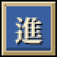 | 진화의 대가 | 서로 다른 무기 6종 진화 | 봉인 +1 |
|  | 깊어진 수련 | 한 출정에서 레벨 30 도달 | 물리기 +1 |
| 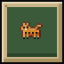 | 짐승과 한 몸 | 펫 레벨 10 달성 | 엽전 120 |
| 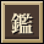 | 요괴 도감 절반 | 요괴 30종 만나기 | 엽전 100 |
| 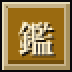 | 요괴 도감 완성 | 요괴 68종 모두 만나기(v19.5부터, 이미 이룬 저장은 그대로) | 엽전 300 |
|  | 요괴 사냥꾼 | 막별 새 엘리트 10종 모두 퇴치 | 엽전 300 |
|  | 액운을 이기다 | 액운 5에서 제10막 완주 | 엽전 500 |
|  | 첫 깨달음 | 오의 각성 1번 | 엽전 60 |
|  | 궁극에 이르다 | 궁극 오의 깨치기 | 엽전 150 |
|  | 두 신의 가호 | 쌍신 축복 받기 | 엽전 80 |
|  | 신이 내리다 | 신내림 30번 쓰기 | 산통 흔들기 +1 |
|  | 두 무기가 하나로 | 합공 1번 | 엽전 100 |
|  | 인장 장인 | 인장 10개 새기기 | 엽전 60 |
|  | 스치는 바람 | 요괴 탄 100번 스치기 | 물리기 +1 |
|  | 끝없는 밤 | 끝없는 밤으로 들어서기 | 엽전 200 |
|  | 원정길에 오르다 | 퇴마 원정 보스 3마리 쓰러뜨리기 | 엽전 80 |
|  | 열 번의 원정 | 퇴마 원정 완주 | 엽전 300 |
| 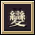 | 변종 사냥꾼 | 변종 요괴 100마리 퇴치 | 산통 흔들기 +1 |
|  | 괴이 탐문 | 괴이 6종 조사 | 엽전 120 |
|  | 괴이록 완성 | 괴이 12종 모두 조사 | 봉인 +1 |
|  | 명장의 손 | 담금질 1번 | 엽전 60 |
|  | 버릇을 바꾸다 | 담금질 10번 | 봉인 +1 |
| 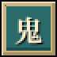 | 도깨비와 거래 | 도깨비 샛길에 들기 | 엽전 60 |
|  | 의뢰 해결사 | 막 의뢰 10번 완료 | 산통 흔들기 +1 |
|  | 끊이지 않는 칼 | 연격 300 잇기 | 물리기 +1 |
|  | 정 많은 퇴마사 | 정표 3개 받기 | 엽전 150 |
|  | 백귀야행을 끊다 | 요괴 50,000마리 퇴치 | 엽전 500 |
|  | 여섯 퇴마사 | 퇴마사 여섯 모두 해금 | 엽전 300 |
|  | 서른 번의 밤 | 출정 30번 | 산통 흔들기 +1 |
|  | 천 번의 칼끝 | 연격 1,000 잇기 | 엽전 200 |
|  | 세 바퀴의 밤 | 끝없는 밤 3바퀴 들어서기 | 엽전 400 |
|  | 마을의 해결사 | 막 의뢰 30번 완료 | 엽전 250 |
|  | 바람을 걷는 자 | 요괴 탄 1,000번 스치기 | 엽전 200 |
| 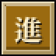 | 열두 가지 진화 | 서로 다른 무기 12종 진화 | 봉인 +1 |
| 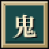 | 도깨비의 단골 | 도깨비 샛길에 10번 들기 | 엽전 200 |
|  | 백 번의 깨달음 | 한 출정에서 레벨 100 도달 | 엽전 300 |
|  | 액막이의 끝 | 액운 10에서 제10막 완주 | 엽전 1000 |
|  | 이야기의 실마리 | 설화 흔적을 조사해 설화 조각 얻기 | 엽전 30 |
|  | 옛이야기 한 편 | 설화 출정 한 편 끝맺기 | 엽전 100 |
|  | 새벽의 이야기 | 제10막을 평정하고 본편 결말 보기 | 엽전 100 |

####  선비 과업 (7)

| 휘장 | 과업 | 조건 | 보상 |
|:---:|---|---|---|
|  | 선비 1차 전직 | 선비로 1차 전직 | 서찰 해금 |
|  | 성현이 되다 | 선비로 5차 전직 | 엽전 150 |
|  | 문방사우의 힘 | 선비로 요괴 3,000마리 퇴치 | 엽전 120 |
|  | 성현의 반열 | 학문의 길에서 5차 전직(성현) | 엽전 200 |
| 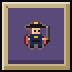 | 도체찰사의 마패 | 감찰의 길에서 5차 전직(도체찰사) | 엽전 200 |
|  | 먹이 마르기 전에 | 먹탄을 일필휘지로 진화 | 엽전 100 |
|  | 선비의 새벽 | 선비로 제10막 평정 | 엽전 300 |

####  의원 과업 (7)

| 휘장 | 과업 | 조건 | 보상 |
|:---:|---|---|---|
|  | 의원 1차 전직 | 의원으로 1차 전직 | 환약 해금 |
|  | 의성이 되다 | 의원으로 5차 전직 | 엽전 150 |
|  | 백 사람을 살린 손 | 의원으로 요괴 3,000마리 퇴치 | 엽전 120 |
|  | 의성의 경지 | 내의원의 길에서 5차 전직(의성) | 엽전 200 |
|  | 독왕의 경지 | 독술의 길에서 5차 전직(독왕) | 엽전 200 |
|  | 약과 독은 한 뿌리 | 은침을 회춘침으로 진화 | 엽전 100 |
|  | 의원의 새벽 | 의원으로 제10막 평정 | 엽전 300 |

####  무당 과업 (7)

| 휘장 | 과업 | 조건 | 보상 |
|:---:|---|---|---|
|  | 무당 1차 전직 | 무당으로 1차 전직 | 명두 해금 |
|  | 무조가 되다 | 무당으로 5차 전직 | 점괘 패 · 문창성 |
|  | 넋을 달래는 방울 | 무당으로 요괴 3,000마리 퇴치 | 엽전 120 |
|  | 무조의 경지 | 굿의 길에서 5차 전직(무조) | 엽전 200 |
|  | 하늘 만신의 경지 | 신내림의 길에서 5차 전직(하늘 만신) | 엽전 200 |
|  | 굿판의 첫 신명 | 부적을 천지신명으로 진화 | 엽전 100 |
|  | 무당의 새벽 | 무당으로 제10막 평정 | 엽전 300 |

####  장수 과업 (8)

| 휘장 | 과업 | 조건 | 보상 |
|:---:|---|---|---|
|  | 장수의 부름 | 중간 보스 3마리 퇴치 | 장수 해금 |
|  | 장수 1차 전직 | 장수로 1차 전직 | 비격진천뢰 해금 |
|  | 대원수가 되다 | 장수로 5차 전직 | 엽전 150 |
|  | 변방을 지킨 칼 | 장수로 요괴 3,000마리 퇴치 | 엽전 120 |
| 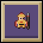 | 대원수의 군령 | 지휘의 길에서 5차 전직(대원수) | 엽전 200 |
|  | 궁성의 시위 | 궁술의 길에서 5차 전직(궁성) | 엽전 200 |
|  | 첫 칼을 벼리다 | 환도를 사인검으로 진화 | 엽전 100 |
|  | 장수의 새벽 | 장수로 제10막 평정 | 엽전 300 |

####  기생 과업 (8)

| 휘장 | 과업 | 조건 | 보상 |
|:---:|---|---|---|
|  | 풍류의 밤 | 성황당에서 3번 기도 | 기생 해금 |
|  | 기생 1차 전직 | 기생으로 1차 전직 | 장구 해금 |
|  | 국창·검선이 되다 | 기생으로 5차 전직 | 엽전 150 |
|  | 가락으로 벤 요괴 | 기생으로 요괴 3,000마리 퇴치 | 엽전 120 |
|  | 국창의 소리 | 풍류의 길에서 5차 전직(국창) | 엽전 200 |
| 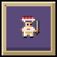 | 검선의 칼춤 | 검무의 길에서 5차 전직(검선) | 엽전 200 |
|  | 흥에 겨운 가락 | 가야금을 취흥 산조로 진화 | 엽전 100 |
|  | 기생의 새벽 | 기생으로 제10막 평정 | 엽전 300 |

####  상인 과업 (8)

| 휘장 | 과업 | 조건 | 보상 |
|:---:|---|---|---|
|  | 셈이 빠른 퇴마사 | 주막에서 엽전 200닢 쓰기 | 상인 해금 |
|  | 상인 1차 전직 | 상인으로 1차 전직 | 등짐 지게 해금 |
|  | 대방·도반수가 되다 | 상인으로 5차 전직 | 엽전 150 |
|  | 셈이 맞는 장사 | 상인으로 요괴 3,000마리 퇴치 | 엽전 120 |
|  | 대방의 장부 | 시전의 길에서 5차 전직(대방) | 엽전 200 |
|  | 도반수의 통문 | 보부상의 길에서 5차 전직(도반수) | 엽전 200 |
|  | 천금의 셈 | 주판을 천금 주판으로 진화 | 엽전 100 |
|  | 상인의 새벽 | 상인으로 제10막 평정 | 엽전 300 |
