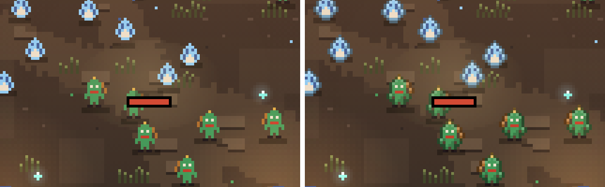
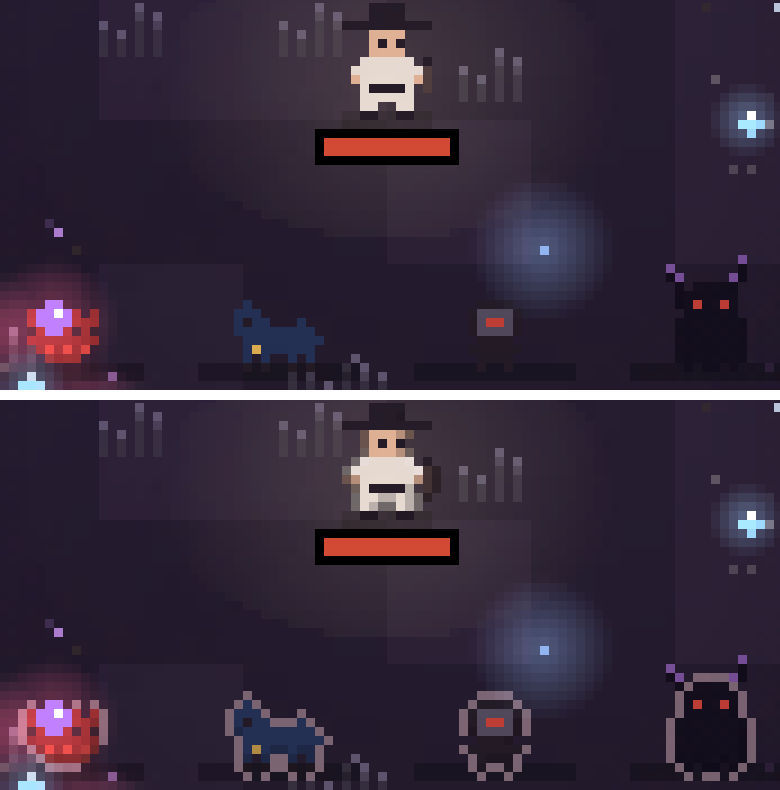
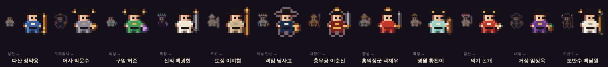
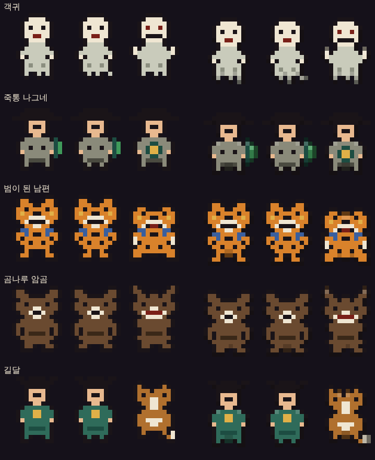
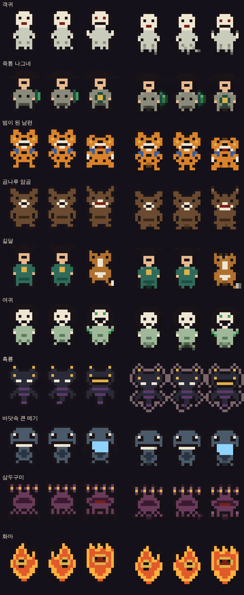

# 개발 과정

[← README](../README.md) · 다른 안내서는 README의 「목차」에서 봅니다.

## 12. 개발 과정

이 게임은 대화형 AI(Claude)와 함께, 요청 → 구현 → 브라우저 검증 → 피드백을 반복하며 만들었습니다. 아래는 버전별 변화입니다. 버전마다 찾아낸 문제와 원인, 고친 방법은 [LOG.md](../LOG.md)에 자세히 적었습니다.

| 버전 | 주요 내용 |
|---|---|
| v1 | 첫 플레이 가능 버전. 《뱀파이어 서바이버즈》를 참고한 자동 전투 도트 로그라이크. 선비·의원·무당·장수 네 직업, 레벨업 선택, 스테이지 진행. |
| v2 | 직업마다 10레벨 단위 3차 전직과 전직 기술. 직업별 무기 3종·보패 3종, 무기 진화 확대. 보스 공격 패턴을 무작위로 바꾸고 보스별 기술·필살기 추가. |
| v3 | 시장에 나온 유사 게임(뱀파이어 서바이버즈, 하데스 등)을 조사해 보완점 제안. |
| v4 | 대규모 확장. 레벨업 조작(산통 흔들기·물리기·봉인), 설정 메뉴, 퇴마록 과업과 해금, 액운 단계, 점괘 패, 막 사이 주막, 지형과 옹기, 성황당 신령 축복. 『한국 요괴 도감』을 참고한 요괴 58종(일반·엘리트·중간 보스·막 보스), 10막, 5차 전직과 전직마다 바뀌는 외형. |
| v5 | 첫 화면 「도움말·팁」 메뉴(7개 탭). 난이도 3단계(보스 패턴이 순서형/무작위/기술 차용으로 바뀜, 어려움에서 엘리트와 중간 보스 동시 등장). 체력 50%·20%에서 나타나는 도사 전우치 지원. |
| v6 | 첫 화면 난이도 선택 오류 수정. 펫 시스템(범·반달곰·해동청, 펫 레벨에 따라 기술 습득). 신규 퇴마사 **기생**. 내려받은 파일을 직접 열 때 모든 화면이 한꺼번에 보이던 오류 수정(실제 브라우저에서 3차례 디버깅). |
| v7 | 화면 크기가 0일 때 나던 `drawImage` 오류와 그 뒤 게임이 멈추던 문제 수정. **풍백·우사·운사** 강림 가호. 성능 모드(자동/고화질/절약)와 FPS 표시, 화면 밖 요괴 그리기 생략 등 최적화. |
| v8 | 장판 기술과 보스 공격 범위를 **도트풍 점무늬 원**으로 바꾸고, 장판마다 만든 기술의 아이콘을 붙임. 보스 경고에 ! 표식과 조여 드는 화살표. |
| v9 | 하데스·하데스 2를 참고한 1차 묶음. **오의 각성·궁극 오의·한계 돌파**(Lv 50 이후 성장), **신내림 게이지**, **갈림길**, **쌍신 축복**. 과업 4개 추가. |
| v9.1 | 이동 중 레벨업 창이 뜰 때 선택이 저절로 되던 문제 수정(물리기 단축키 `S`→`X`, 창이 뜬 뒤 0.5초 동안 입력 무시, 누르고 있는 키의 반복 입력 무시). README에 게임 도트 그래픽 아이콘 추가. 링크 하나로 바로 플레이할 수 있게 GitHub Pages 배포. |
| v9.2 | 전체 디버깅(화면 크기 6종, 어려움·액운 10 완주, 15분 장시간 실행, 회전·터치)과 웹·모바일 성능 재측정. 떨어진 아이템 상한 300, 선택 창이 열리면 게임 버튼 숨김, 화면 밖 구슬·아이템 그리기 생략(프레임 약 12% 단축). |
| v9.3 | 등패 등 무기가 커지면서 캐릭터와 체력 막대를 가리던 문제 수정. 캐릭터에 붙은 무기와 내 투사체는 캐릭터 뒤에, 체력 막대는 맨 위에 그림. 등패는 커질수록 바깥으로 물러나고, 빛줄기는 캐릭터 바깥에서 시작. 전 직업 전부 착용 측정에서 가려짐 11~93% → 2~6%. |
| v10 | 스팀 액션 로그라이크 상위 10개 분석을 바탕으로 한 1차 묶음. **합공**(무기 합체 12종), **인장 각인**(무기별 강화 6종), **끝없는 밤**(제10막 이후 무한 진행), **스치기**(탄 회피 보상). 과업 4개 추가. |
| v11 | 2차 묶음. **퇴마 원정**(보스 10연전 모드, 하·중·상 등급과 넋의 선물), **액운 변종**(변종 요괴 5종), **괴이 조사**(괴이 12종과 괴이록, 퇴마사별 이야기 조각 20개). 과업 5개 추가. |
| v12 | 처음엔 **선비만**, 나머지 퇴마사는 과업으로 해금. **기록관**(날짜 기록, 명예록·퇴마사별 최고 조합·출정 일지). 하데스 2·3차 묶음 **담금질·도깨비 샛길·퇴마사 본부·정표·수련 도장(갑·을)**, 스팀 3차 묶음 **막 의뢰·연격**. 과업 8개 추가. |
| v12.1 | 예전 저장으로 들어오면 모든 퇴마사가 열려 있던 문제 수정. 저장을 한 번 옮겨 적으면서 과업으로 연 퇴마사만 남기고, 설정에 「처음부터 다시」, 시작 화면에 버전 표시와 안내 추가. |
| v13 | **캐릭터 상태창**(무기·기술 / 보패·축복 / 능력치 3탭, 무기별 피해 비중). 5직업 × 2갈래 × 모든 무기·기술·보패·각성·담금질·신내림을 하나씩 돌리는 전수 디버깅으로 **천자문·훈민정음이 피해를 전혀 주지 못하던 오류** 등 수정. |
| v14 | 오른쪽 아래 버튼을 한글(신내림·소리·상태·정지)로 통일. 새 퇴마사 **상인**(시전의 길: 상인→행수→대행수→도방→대방 / 보부상의 길: 보상→접장→공원→반수→도반수). 전용 무기 4·보패 3·직업 기술 10·합공 2·궁극 오의·괴이 이야기 4. 과업 3개 추가. |
| v15 | README 배너를 여섯 퇴마사 기본 모습으로 교체, README 전체 재검수. 과업 40개 추가(퇴마사마다 5개 + 공통 10개, 모두 103개). 과업마다 도트 휘장을 그리고, 달성하면 화면 오른쪽 위에 휘장과 함께 5초 동안 알림. |
| v16 | **홈 화면 앱**(오프라인 실행, 주소창 없는 전체 화면). 레벨링·난이도 재조정: 중반 이후 경험치 곡선 가파르게, 중반 요괴 체력 증가 가파르게·제9막 완화, **보스 체력을 플레이어 힘에 맞춤 + 초당 받을 수 있는 피해 상한**, 펫 피해의 막별 성장 단계적 감소, 레벨업에서 직업 기술 비중 3배 → 1.5배, 시작 무기 전직마다 +12%, 한계 돌파 +10% → +5%. 공용 무기 4종 추가(투호·윷·방패연·제기). |
| v16.1 | **인장 각인 정리**: 무기에 효과 없는 인장은 나오지 않게 거름, 「오래(지속시간)」를 「날카로움(피해 +12%·범위 +8%)」으로 교체, 표기를 「인장 1/2 → 2/2」로, 빈 칸 있는 무기가 여럿이면 카드마다 다른 무기, 합공 칸 3 → 4개(합칠 때 인장이 사라지던 오류 수정) |
| v16.2 | 유사 게임 조사 후 첫 묶음. 설정에 **내 기술 효과 진하기**(내 장판·투사체·순간 효과·장판 아이콘을 70%/40%로 흐림, 요괴·요괴 탄·보스 경고는 그대로). 요괴 탄을 내 효과 위에 그림. 결과 화면·본부에 **다음 목표**(가까운 과업 셋과 전후 진행). 출정이 끝날 때 이번 출정 수치가 두 번 더해져 과업이 일찍 이뤄지던 오류 수정. 저장소에 시험 도구(`tests/`) 추가. |
| v16.3 | 전직·펫 선택창 오류 수정: 휴대폰에서 이동 손가락을 누른 채 탭해도 카드가 골라지게 함, 2~5차 전직은 레벨업 카드처럼 칸 전체를 누르는 수련 카드 셋으로 바꿈, 대기 중인 전직 창을 쌓인 레벨업보다 먼저 열어 오의 각성이 사라지던 문제도 해결. |
| v17.0 | **설화 출정(이야기 모드)**: 본편 관련 막의 금빛 흔적에서 설화 조각 3개를 모으면 『전우치전』·『지하국대적』·『바리공주』 3막 출정이 열림(정해진 퇴마사·힘, 막마다 이야기 규칙, 완주하면 옷 빛깔·결말 글, 다시 하면 기록 도전). **본편 결말**(제10막 첫 평정 때 공통 네 쪽 + 퇴마사별 맺음말), 퇴마록 「설화록」, 과업 3개(모두 106개). 보스 처치 직후 상자를 주우면 다음 창이 덮여 흐름이 멈추던 오류, 점괘 패 「흉년」에서도 신내림·쌍신으로 떡이 나오던 오류 수정 |
| v17.1 | 설정에 **캐릭터·요괴 크기**(기본/2배). 보이는 넓이·맞는 범위는 그대로, 플레이어·펫·전우치·요괴 그림만 2배(보스 1.5배까지, 이무기·어둑시니·그슨대 그대로). 켜면 그리기 판을 2배 정밀로 그리고, 느려지면 먼저 이 설정을 끄고 그래도 느리면 절약 모드. 『바리공주』 2막 우물이 서로 붙어 생기던 문제 수정 |
| v17.2 | 다른 AI 수정본 검토와 보완: 고르기 창 입력 보호를 0.5초로 되돌림(0.18초에서는 고른 직후 다음 카드가 저절로 골라짐), 이동 중 카드를 골라도 이동이 이어지게 되돌림, 오디오 되살리기 오류 처리, 걷기 기울이기·보스 붉은 빛 제거, 플레이어 둘레 옅은 빛 |
| v17.3 | **멈춤 기록 장치**: 진행 멈춤(창 없이 3초 넘게 시간 정지)·창 없음·오류·긴 끊김·지난 실행의 게임 중 끊김을 이 기기에만 최근 20건 적고, 설정의 「오류 기록」에서 복사·지우기. 도움말 「처음이라면」에 게임 속 도트 그림(장판·경고 표식은 실제 그리기 함수로 잘라 낸 그림) |
| v17.4 | 레벨업 카드에 **진화 짝 강조**(보패 카드에 짝 무기·보유 레벨·진화 이름, 무기 카드에 짝 보패 보유 여부, 금색 테두리, 「보물상자를 열면 진화」 안내). 개발용 **조합 시험장**(주소에 `?combo`, 32조합을 바로 진화해 보기, 저장 안 함). 상인 「됫박」의 짝 「명태」가 무당 전용이라 「만석 곳간」을 만들 수 없던 오류 수정(명태를 무당·상인이 함께 씀) |
| v17.5 | **장소 안내인과 상징물**: 성황당(서낭나무·오색 천·장승, 당 지기 할머니), 괴이(금줄 친 말뚝, 포도청 포졸), 도깨비 샛길(방망이, 패랭이 쓴 길잡이 도깨비)이 상황마다 한마디씩 말풍선으로 이끈다. 화면 밖이면 상징물 아이콘 표지와 말 한 줄 |
| v18.0 | 다국어(한국어·간체 중국어) 준비 공사: 소스를 `src/`로 나누고 `build.py`로 한 장으로 합침, 화면 문구를 번역 함수로 감쌈. 플레이 화면은 그대로 |
| v18.1 | **간체 중국어(简体中文) 지원**: 게임 전체 원문 2,370개를 간체로, 시작 화면·설정에서 언어 바꾸기(기기 언어가 중국어면 간체로 시작), 간체 글꼴, 기록관이 언어를 바꿔도 맞는 글로. 번역 방법은 LinguaGacha 번역 지침의 방법(용어집·글 보호·목소리·반복 교정)을 참고 |
| v18.2 | **분위기 층 1단계**: 막이 갈수록 깊어지는 밤(제1막 해 질 녘 → 제9막 가장 깊음 → 제10막 보스 뒤 새벽), 막마다 다른 어둠 색, 빛나는 물건(청사초롱·횃불·석등·넋불 등), 요괴 탄·보스 경고는 어둠 속에서도 또렷하게, 요괴·옹기 잔해. 설정 「분위기 효과」(켬·약하게·끔). 보기만 하는 효과라 규칙은 그대로 |
| v18.2.1 | 버그 고침: 엽전·복주머니·떡이 대나무·바위 같은 장애물 뒤나 한가운데에 떨어져 보이지 않거나 주울 수 없던 것 → 장애물 밖으로 밀어 떨어뜨리고, 떨어진 물건은 장애물 위에 그림 |
| v18.3 | **분위기 층 2단계**: 바람에 흔들리고 퇴마사가 지나가면 눕는 풀, 막마다 하나의 날씨(저녁놀·날리는 댓잎·흙바람·물안개·떨어지는 재·누런 먼지·눈발·물보라·넋 안개). 보기만 하는 효과이고 요괴 탄·경고·숫자는 날씨 위에 그림. 설정 「분위기 효과」 약하게는 날씨 절반, 절약 모드는 풀·날씨 없음 |
| v18.4 | **분위기 층 3단계**: 막마다 다른 바닥 무늬(흙길·낙엽 오솔길·자갈길·물웅덩이·금 간 돌바닥·마른 땅·눈더미·모래·갈라진 땅·박석 길). 보기만 하고 길을 막지 않음. 바닥을 미리 구운 조각으로 그려 무늬를 더하고도 무게는 v18.3과 비슷 |
| v18.5 | **장수의 방패 다섯 단계**: 레벨마다 이름과 그림이 바뀐다 — 죽패(대나무를 엮음) → 생우피방패(나무틀에 날소가죽) → 장방패(흰 판에 파란 귀면) → 원방패(쇠테 두른 둥근 판에 귀면) → 등패(등나무를 감아 엮음), 진화하면 철갑 등패. 레벨업 카드에 「지금 → 다음」 이름. 방패 크기·피해·막는 범위는 그대로. 고증: 한국민족문화대백과사전 「방패」  |
| v18.6 | **그림 다듬기**: 퇴마사·요괴·보스·펫·동료 그림 둘레에 맞닿은 색을 어둡게 한 테두리 1칸, 맨 위 칸은 조금 밝게·맨 아래는 조금 어둡게(검은 갓·눈 같은 짙은 색은 그대로). 설정 「그림 다듬기」 켬/끔(기본 켬). 맞는 범위·크기·규칙 그대로, 게임 중 무게 거의 같음  |
| v18.6.1 | 그림 다듬기 보탬: 몸 대부분이 검은 요괴(어둑시니·그슨대·흑호 등)는 붉은 기 도는 밝은 회색 테두리를 둘러 밤 바닥에서도 보이게. 퇴마사의 검은 갓처럼 일부만 검은 그림은 그대로  |
| v18.6.2 | 버그 고침: 무당 등 직업 기술 레벨업 카드 아이콘이 「?」로 나오던 것(v18.5에서 생김) · 퇴마사가 오방신장기 깃발 표지 밑에 서면 표지가 퇴마사를 가리던 것(이제 옅어짐) · 보스가 받는 피해 숫자에 소수점이 나오던 것(초당 피해 상한을 정수로) |
| v18.6.3 | 버그 고침: 휴대폰에서 손을 뗐는데도 이동이 「눌린 채」 남아 퇴마사가 저절로 움직이고, 그 뒤로는 새 터치도 먹지 않던 문제. 손을 뗀 알림을 놓쳐도 화면에 손가락이 없으면 이동을 풀고, 새로 누르면 그 손가락이 이동을 맡음. 앱 전환·제어 센터 등으로 화면이 가려져도 풀림 |
| v19.0 | **6차 전직(1부)**: 5차를 마친 퇴마사가 Lv 60에 조선의 실존 인물로 전직. 선비(다산 정약용 「거중기」 · 어사 박문수 「봉고파직」)·의원(구암 허준 「백 첩 탕약」 · 신의 백광현 「대침 발근」)·장수(충무공 이순신 「울돌목 회오리」 · 홍의장군 곽재우 「홍의 의병」). 고유 기술·전직 보너스·새 차림·발밑 금빛 고리·과업 6. 무당·기생·상인은 다음 판. 고증: 한국민족문화대백과사전  |
| v19.1 | **6차 전직(2부)**: 무당(토정 이지함 「토정비결」 · 격암 남사고 「천기누설」)·기생(명월 황진이 「청산리 벽계수」 · 의기 논개 「남강의 물결」)·상인(거상 임상옥 「인삼 교역」 · 도반수 백달원 「지게 행렬」). 이제 12갈래 모두 Lv 60에 6차 전직 |
| v19.2 | **밸런스 검수**: 약했던 6차 기술 셋(봉고파직·백 첩 탕약·남강의 물결) 피해 약 1.8배 · 「천금 주판」 구슬 피해 16→12 · 합공 「약방울」의 피해 +20% 없앰 · 남강의 물결은 엘리트·보스에게도 피해 숫자 하나 · 시작 무기 보너스는 5차까지만 커짐 |
| v19.3 | **점괘 패 세 장**: 출정 준비에서 점괘 패를 세 장까지 골라 효과를 함께 건다. 다시 누르면 빠지고, 「아무 패나 뽑기」는 한 장을 더한다 |
| v19.4 | **막별 새 엘리트(1부)**: 중간 보스를 쓰러뜨린 뒤에는 막마다 새 엘리트가 나온다 — 1막 객귀(들러붙어 느리게)·2막 죽통 나그네(대통 여인 소환)·3막 범이 된 남편(웅크렸다 덮침)·4막 곰나루 암곰(새끼 곰, 성남)·5막 길달(여우로 순간이동). 새 도트(걷기 2장 + 행동 1장), 도감 63종. 고증: 한국민족문화대백과사전  |
| v19.5 | **막별 새 엘리트(2부)**: 6막 여귀(독 안개 장판)·7막 흑룡(화면 가장자리 어둠)·8막 바닷속 큰 메기(밀물·썰물로 끌고 밂)·9막 삼두구미(한 번 다시 일어남)·10막 화마(불 장판, 물독 드므 곁에서 약해짐). 이제 10막 모두 중간 보스 뒤 새 엘리트. 도감 68종, 과업 「요괴 사냥꾼」. 열 종 세기는 12갈래 × 8판으로 맞춤  |
| v19.6 | **밸런스: 점괘 패 「삼재」**: 「보물상자에서 강화를 하나 더」가 막을 끝낼 때 받는 상자에만 붙는다(길에서 줍는 엘리트·중간 보스 상자는 하나). 어려움 + 길일·역마살·삼재 의원에서 제4막에 들어설 때 무기·기술·보패가 거의 다 최대 레벨이던 것(97~100%)이 69%로 |
| v19.7 | **제5막 손각시**: 쫓아오기만 하던 손각시가 거리를 두고 2.8초마다 한 맺힌 기운을 던진다(5막에만 쏘는 요괴가 없어 4막보다 쉬웠음). 5막에 받는 피해가 4막과 비슷해짐 |
| v19.8 | **저장 지키기**: 저장을 읽을 수 없을 때 새 저장으로 덮어써 진행이 사라지던 문제 수정 — 깨진 원본은 `-broken` 칸에 남기고 지난번 제대로 열린 백업(`-bak`)으로 이어 감. 설정에 **저장 코드**(복사·불러오기)를 더해 다른 기기로 옮기거나 지워진 저장을 되살림 |
| v19.9 | **밸런스 표**: 점괘 패·액운·난이도의 효과와 보패·축복의 능력치 계수를 코드에서 `02_data.js`의 표(`CARDS[].fx`·`CURSE_FX`·`DIFFS[].fx`·`STATS`)로 옮김. 게임 숫자는 그대로(모든 조합 15,482가지를 옮기기 전후로 비교해 같음). 시험 `balance_tables`가 설명 글의 숫자와 표가 맞는지 본다 |
| v19.9.1 | 난이도 설명에 빠져 있던 효과를 적음: 쉬움 **엘리트 −30%**, 어려움 **엘리트 +20%** (게임 숫자는 그대로, 간체 함께) |
| v20.0 | **코드 정리**: `src/js`를 Prettier로 정렬(한 줄 최대 1,223자 → 대부분 120자 안)하고 파일 이름을 하는 일로 바꿈(`07_v12.js` → `09_run_extras.js` 등, 순서 그대로). 문법 나무를 정리 전후로 비교해 같음(게임 동작 그대로) |
| v20.0.1 | **판 번호 한 곳**: `GAME_VER`만 고치면 `build.py`가 `sw.js` 캐시 이름을 맞추고, 어긋나면 `build.py --check`(시험·CI)가 실패. 윈도 콘솔에서 빌드의 한글 알림이 오류로 멈추던 문제도 고침 |
| v20.1 | **씨앗 난수**: 판의 난수를 씨앗(`G.seed`)으로 만들어, 같은 씨앗이면 그리기·기기 빠르기와 상관없이 같은 판이 흐른다(같은 절약 모드·화면 크기에서). 오류 기록에 씨앗이 남고, 주소에 `?seed=숫자`를 붙이면 그 판을 다시 볼 수 있다. 그리기·소리·잔상은 따로 된 난수(`vrand`) |
| v20.2 | **느린 기기에서도 제 속도**: 한 장면이 1/30초보다 길면 1/30초 이하 조각으로 나눠 게임을 진행(예전에는 20fps 아래에서 게임 시간이 느리게 흐름, 10fps면 절반 속도). 멈췄다 돌아온 장면은 0.25초까지만 따라잡음 |
| v20.2 (문서) | **문서 나누기**: README(143KB)를 플레이 안내·목차만 남기고(12KB), 시스템 설명은 `docs/guide/` 여섯 파일로, 버전 표·소스 구조·검증 방식은 `docs/개발-과정.md`로 옮김. 내용은 그대로(링크·그림 652개 확인) |
| v20.2.1 | **시작 화면 판 번호**: v20.0.1 뒤로 v20.2가 돌아도 시작 화면에 v19.7이 떠 「옛 판이 뜬다」로 보이던 문제 — `build.py`가 판 표시를 `GAME_VER`로 채움(어긋나면 `--check` 실패). 드물게 실패하던 `clear_overlap` 시험을 같은 난수로 고정. 바로잡음: v20.1의 「같은 씨앗이면 같은 판」은 **장면 빠르기(fps)가 같을 때만** 맞음(LOG v20.2.1) |
| v20.3 | **고정 진행**: 화면이 초당 몇 장이든 게임은 늘 1/60초씩 진행하고 남는 시간은 다음 장면으로 넘김 — 같은 씨앗·같은 조작이면 기기·fps와 상관없이 같은 판(자동 플레이·시험용, 사람 조작은 기록하지 않음). 30fps 기기는 장면마다 진행 두 번(약 2ms 더). 120·144Hz 화면에서는 움직임이 60Hz로 보임 |
| v20.3.1 | **시험 도구**: 화면을 옛 판과 한 점까지 비교하는 `refine_same`·`i18n_ko_same`이 v20.1부터 실패하던 것을 고침(시험 장면을 `update()`로 직접 데우기 · 주소 `?seed=` · 시험 난수 감싸기). 게임은 판 번호만 바뀜 |
| v20.4 | **저장 셋**: 백업은 저장할 때마다 바로 앞 저장으로(깨진 저장을 되살려도 잃는 진행이 최소) · 저장 코드 불러오기를 설정의 「불러오기 전으로」로 되돌림 · 빈 저장은 「읽을 수 없음」 안내 없이 새로 시작 |
| v20.5 | **그림 다듬기 새 규칙(은은하게)**: 테두리·가장자리 색을 색조 이동으로 — 위·왼쪽 가장자리는 노란 쪽으로 밝게, 아래·오른쪽은 푸른 쪽으로 어둡게, 테두리는 빛 쪽이 덜 짙음. 색조는 15°까지, 색이 짙어지지 않게(연한 흰 옷이 물들지 않게). 「끔」은 그대로. 생각은 codixel(MIT)에서 |
| v20.6 | **칸 줄이기 · 2단계 성장**: 무기·보패 칸 6 → 4, 진화·합공 무기는 진화 Lv 1~5, 직업 기술은 숙련 1~3(단계마다 피해 +10%), 한계 돌파는 다 키운 뒤에만, 막 끝 상자 강화 3 → 2. 생존 보패가 밀려난 만큼 진화 Lv·숙련 한 단계마다 몸 단련(최대 체력 +6 · 초당 회복 +0.075) — 보통 48판에서 끝까지 버틴 판 28(v20.5 29), 칸이 다 차는 막 7 → 9 |
| v20.7 | **설정에 「저장」·「홈 화면에 추가」**: 진행을 파일(`조선퇴마록-저장-날짜.txt`)로 내보내고 다른 기기에서 가져오기(저장 코드와 같은 확인·되돌리기), 오프라인 준비 표시, 기기별 홈 화면 추가(안드로이드·PC는 단추 한 번, 아이폰 사파리는 세 단계 안내, 다른 아이폰 브라우저는 사파리로) · 도움말·README 가이드 |
| v20.8 | **에셋 도감**: 코드로 그린 그림 554장(27종류)을 게임의 그리기 함수로 뽑는 도구(`tools/assets.py`)와 찾고 거르고 크게 보는 도감 페이지(`docs/assets/`). README·안내서 그림도 같은 도구가 새로 그려, v9 무렵 옛 도트로 남아 있던 퇴마사·사람·휘장 136장이 지금 게임 모습이 됨 |

### 소스 구조 (v18.0~)

배포물은 여전히 `index.html` 한 장입니다. 고칠 때는 `src/`(`shell.html` + `js/*.js`)를 고치고 `python3 build.py`로 `index.html`을 다시 만듭니다. 화면 문구는 `_t('한국어 원문')`으로 감싸 두어 간체 중국어 사전을 붙일 수 있습니다. 자세한 것은 `tools/README.md`. 간체 번역은 `src/i18n/zh/*.json`(「한국어 원문 → 中文」)에 있고, `build.py`가 함께 합칩니다. 원문 목록은 `python3 tools/i18n_keys.py`, 남은 번역은 `python3 tools/i18n_todo.py`로 봅니다.

`src/js/`의 파일은 `build.py`가 **이름 순서대로** 이어 붙이므로 번호가 곧 실행 순서입니다(v20.0에서 버전 이름 대신 하는 일로 이름을 바꿈).

| 파일 | 하는 일 |
|---|---|
| `00_boot_i18n.js` | 캔버스·공용 도구, 번역 함수 `_t`와 한국어 조사 |
| `01_sprites.js` | 도트 그림 도구, 캐릭터·요괴 그림 |
| `02_data.js` | 데이터 표: 요괴·막·직업·보패·신령·점괘 패·난이도·액운·밸런스(`STATS`·`CURSE_FX`) |
| `03_systems.js` | 오의 각성·신내림·쌍신 축복·갈림길 |
| `04_tier6.js` | 6차 전직 |
| `05_meta_save.js` | 저장·백업·저장 코드, 설화 출정, 오류 기록, 소리 |
| `06_run.js` | 출정 상태, 점괘 패·액운·난이도 적용, 능력치 계산, 합공 |
| `07_world_spawn.js` | 지형·요괴 등장·충돌·피해 |
| `08_elites_by_act.js` | 막별 새 엘리트 |
| `09_run_extras.js` | 담금질·도깨비 샛길·막 의뢰·연격·본부·정표·기록관 |
| `10_ui.js` | 과업·도감·레벨업·화면·설정 |
| `11_lang_switch.js` | 언어 바꾸기(표와 화면 틀 덧씌우기) |
| `12_vfx_mood.js` | 분위기 층(어둠·불빛·날씨) |
| `13_render.js` | 그리기와 게임 루프 |

코드 모양은 Prettier 3.3.3(`.prettierrc.json`, 한 줄 120자)로 맞춥니다. 방법은 `tools/README.md`.

### 검증 방식

- 매 버전마다 실제 크로미움 브라우저(헤드리스)로 PC(1600×900)와 휴대폰(412×900) 크기에서 41개 화면을 모두 눌러 보고, 콘솔 오류와 가로 넘침을 확인했습니다.
- 여섯 퇴마사 × 두 갈래 전직을 자동으로 제10막까지 플레이하는 시뮬레이션으로 전직·펫·각성·신내림 등이 실제로 발동하는지 확인했습니다.
- 요괴 280마리가 몰린 장면에서 한 프레임 처리 시간을 재어 최적화 전후를 비교했습니다(휴대폰 화면 기준 약 7~10ms, 60fps 기준 16.7ms 안쪽).
- 여섯 퇴마사 × 두 갈래를 5차 전직까지 올리고 모든 무기·기술·진화·각성·담금질·신내림·보패를 하나씩 돌려 실제로 피해와 능력치 변화가 나는지 확인하는 전수 디버깅을 합니다.
